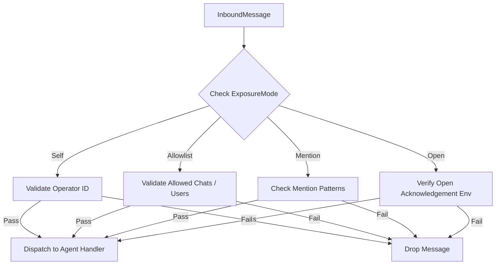
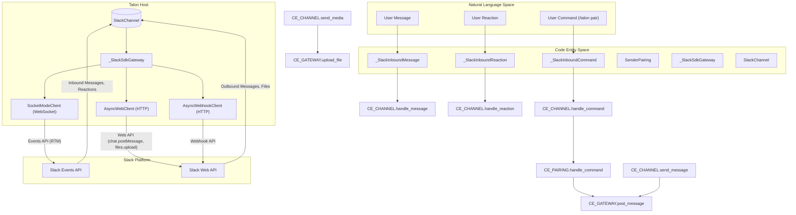
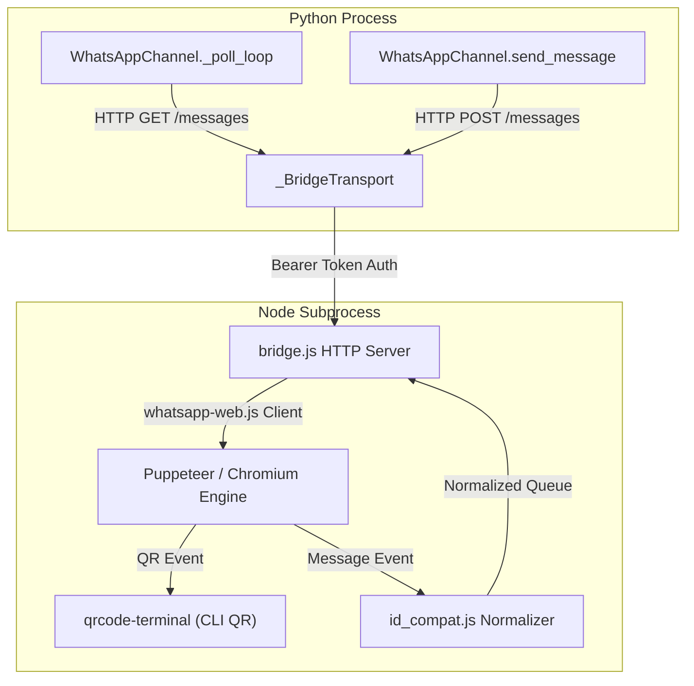
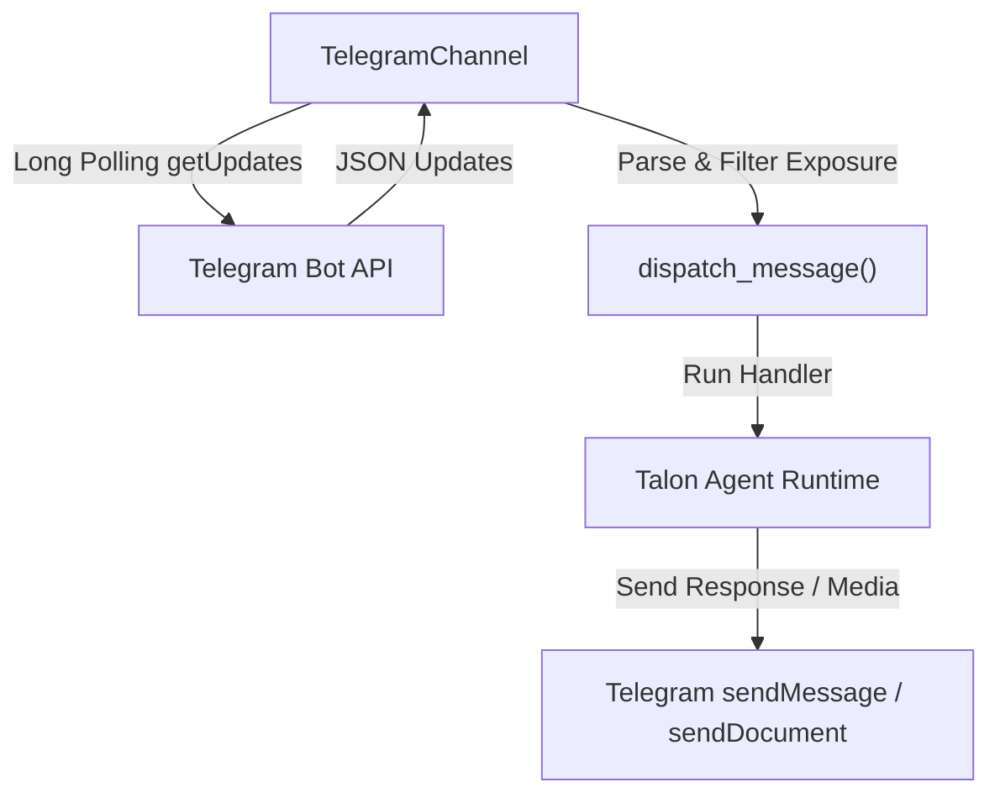
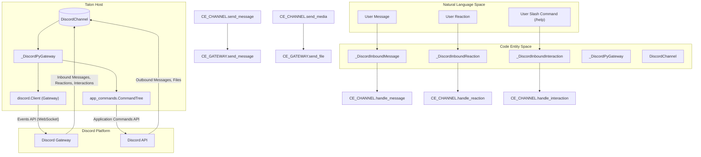
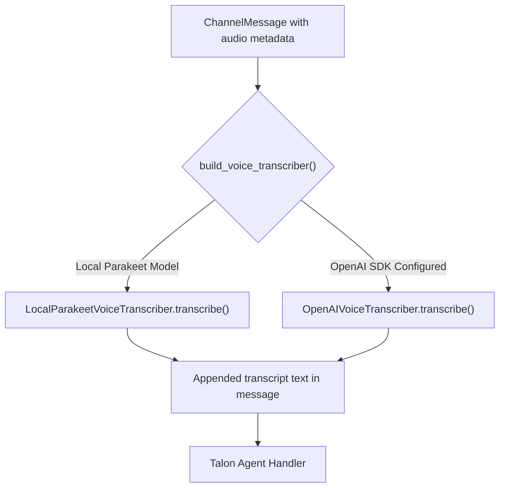

# Talon Channel Adapters

Relevant source files

The following files were used as context for generating this wiki page:

- [examples/talon/Dockerfile](examples/talon/Dockerfile)
- [examples/talon/README.md](examples/talon/README.md)
- [examples/talon/docker-compose.yml](examples/talon/docker-compose.yml)
- [libs/talon/deepagents_talon/archive_saver.py](libs/talon/deepagents_talon/archive_saver.py)
- [libs/talon/deepagents_talon/channels/__init__.py](libs/talon/deepagents_talon/channels/__init__.py)
- [libs/talon/deepagents_talon/channels/base.py](libs/talon/deepagents_talon/channels/base.py)
- [libs/talon/deepagents_talon/channels/discord.py](libs/talon/deepagents_talon/channels/discord.py)
- [libs/talon/deepagents_talon/channels/slack.py](libs/talon/deepagents_talon/channels/slack.py)
- [libs/talon/deepagents_talon/channels/telegram.py](libs/talon/deepagents_talon/channels/telegram.py)
- [libs/talon/deepagents_talon/channels/whatsapp.py](libs/talon/deepagents_talon/channels/whatsapp.py)
- [libs/talon/deepagents_talon/channels/whatsapp_bridge/bridge.js](libs/talon/deepagents_talon/channels/whatsapp_bridge/bridge.js)
- [libs/talon/deepagents_talon/channels/whatsapp_bridge/id_compat.js](libs/talon/deepagents_talon/channels/whatsapp_bridge/id_compat.js)
- [libs/talon/deepagents_talon/channels/whatsapp_bridge/media.js](libs/talon/deepagents_talon/channels/whatsapp_bridge/media.js)
- [libs/talon/deepagents_talon/commands.py](libs/talon/deepagents_talon/commands.py)
- [libs/talon/deepagents_talon/history_embeddings.py](libs/talon/deepagents_talon/history_embeddings.py)
- [libs/talon/deepagents_talon/pairing.py](libs/talon/deepagents_talon/pairing.py)
- [libs/talon/deepagents_talon/speech.py](libs/talon/deepagents_talon/speech.py)
- [libs/talon/tests/channels/test_base.py](libs/talon/tests/channels/test_base.py)
- [libs/talon/tests/channels/test_discord.py](libs/talon/tests/channels/test_discord.py)
- [libs/talon/tests/channels/test_slack.py](libs/talon/tests/channels/test_slack.py)
- [libs/talon/tests/channels/test_telegram.py](libs/talon/tests/channels/test_telegram.py)
- [libs/talon/tests/channels/test_whatsapp.py](libs/talon/tests/channels/test_whatsapp.py)
- [libs/talon/tests/channels/whatsapp_bridge/id_compat.test.js](libs/talon/tests/channels/whatsapp_bridge/id_compat.test.js)
- [libs/talon/tests/channels/whatsapp_bridge/media.test.js](libs/talon/tests/channels/whatsapp_bridge/media.test.js)
- [libs/talon/tests/conftest.py](libs/talon/tests/conftest.py)
- [libs/talon/tests/integration_tests/test_discord_host.py](libs/talon/tests/integration_tests/test_discord_host.py)
- [libs/talon/tests/integration_tests/test_slack_host.py](libs/talon/tests/integration_tests/test_slack_host.py)
- [libs/talon/tests/integration_tests/test_telegram_host.py](libs/talon/tests/integration_tests/test_telegram_host.py)
- [libs/talon/tests/test_config.py](libs/talon/tests/test_config.py)
- [libs/talon/tests/test_speech.py](libs/talon/tests/test_speech.py)
- [libs/talon/tests/unit_tests/test_commands.py](libs/talon/tests/unit_tests/test_commands.py)
- [libs/talon/tests/unit_tests/test_conversation_deletion.py](libs/talon/tests/unit_tests/test_conversation_deletion.py)
- [libs/talon/tests/unit_tests/test_history_embeddings.py](libs/talon/tests/unit_tests/test_history_embeddings.py)
- [libs/talon/tests/unit_tests/test_history_visibility.py](libs/talon/tests/unit_tests/test_history_visibility.py)
- [libs/talon/tests/unit_tests/test_pairing.py](libs/talon/tests/unit_tests/test_pairing.py)
- [libs/talon/tests/unit_tests/test_pairing_slack.py](libs/talon/tests/unit_tests/test_pairing_slack.py)
- [libs/talon/tests/unit_tests/test_scheduled_history.py](libs/talon/tests/unit_tests/test_scheduled_history.py)
- [libs/talon/tests/unit_tests/test_slack_oauth_context.py](libs/talon/tests/unit_tests/test_slack_oauth_context.py)
- [libs/talon/tests/unit_tests/test_speech.py](libs/talon/tests/unit_tests/test_speech.py)
- [libs/talon/tests/unit_tests/test_whatsapp_reactions.py](libs/talon/tests/unit_tests/test_whatsapp_reactions.py)

## Purpose and Scope

The `deepagents-talon` channel adapter subsystem provides the boundary layer between external messaging platforms (WhatsApp, Telegram, Discord, Slack) and the Talon long-running agent runtime host. It normalized inbound text, media, reactions, and commands into provider-agnostic data structures (`ChannelMessage`, `ChannelReaction`), enforces rigorous exposure and access-control policies, manages asynchronous polling or event gateways, and handles optional inbound voice transcription.

Sources: [libs/talon/deepagents_talon/channels/whatsapp.py:1-53](), [libs/talon/deepagents_talon/channels/discord.py:1-49](), [libs/talon/deepagents_talon/speech.py:1-23](), [libs/talon/deepagents_talon/channels/slack.py:1-66]()

---

## Exposure Modes and Access Control

All channel adapters share a common authorization and exposure engine defined in `deepagents_talon.channels.base`. The `ChannelExposure` dataclass and `ExposureMode` enum govern whether an inbound message or reaction is permitted to trigger the assistant.

### Exposure Modes

*   `self`: Only permits messages originating from the operator or direct messages to the bot where the operator ID matches.
*   `allowlist`: Permits messages from a explicitly configured set of allowed chat identifiers or user IDs.
*   `mention`: Requires specific mention patterns (e.g., `@agent`) in group or shared chats before processing.
*   `open`: Exposes the bot to all inbound messages. This mode requires an explicit environmental acknowledgement (e.g., `DEEPAGENTS_TALON_WHATSAPP_OPEN_ACK`) to prevent accidental public exposure.

Sources: [libs/talon/tests/channels/test_whatsapp.py:94-149](), [libs/talon/deepagents_talon/channels/whatsapp.py:110-169]()

---

## Slack Channel Adapter

The Slack channel adapter (`libs/talon/deepagents_talon/channels/slack.py`) uses the `slack_sdk` Socket Mode client for real-time event handling and the Web API for message posting and file uploads.

### Key Features

*   **Socket Mode**: Connects to Slack's Events API via WebSockets, enabling real-time message and reaction processing.
*   **Web API**: Utilizes `AsyncWebClient` for sending messages, uploading files, and retrieving thread context.
*   **Thread Context Management**: Retrieves historical messages within a thread to provide context to the agent, filtering out sensitive OAuth callback URLs.
*   **Media Handling**: Downloads inbound files from `files.slack.com` and uploads outbound files, respecting `max_media_bytes` limits.
*   **Mention Allowlist**: Optionally restricts outbound mentions to a specific set of user IDs.
*   **Sender Pairing**: Supports the `SenderPairing` mechanism for approving unknown DM senders via `/talon pair` commands.

Sources: [libs/talon/deepagents_talon/channels/slack.py:1-179](), [libs/talon/tests/channels/test_slack.py:1-194](), [libs/talon/tests/unit_tests/test_slack_oauth_context.py:1-74](), [libs/talon/tests/unit_tests/test_pairing_slack.py:1-197]()

---

## WhatsApp Bridge Architecture

WhatsApp integration is implemented via a loopback Node.js subprocess (`bridge.js`) communicating with Python via a local HTTP interface secured with a ephemeral shared bearer token (`DEEPAGENTS_TALON_WHATSAPP_BRIDGE_TOKEN`). The Node process wraps `whatsapp-web.js` and Puppeteer.

### Node Bridge and ID Compatibility

Because WhatsApp Web uses complex internal ID representations (Phone Numbers vs LIDs), `id_compat.js` injects prototype-level compatibility into `WAWebMsgKey` and normalizes serialized message identifiers.

Sources: [libs/talon/deepagents_talon/channels/whatsapp.py:61-128](), [libs/talon/deepagents_talon/channels/whatsapp_bridge/bridge.js:1-92](), [libs/talon/deepagents_talon/channels/whatsapp_bridge/id_compat.js:1-81]()

### QR Pairing and Session Persistence

When a WhatsApp session is unauthenticated, the Node bridge emits a `qr` event intercepted by `qrcode-terminal` to render an interactive QR code directly in the terminal host. Session credentials and Chromium profile data persist in `WhatsAppChannelConfig.session_dir`.

Sources: [libs/talon/deepagents_talon/channels/whatsapp.py:84-128](), [libs/talon/deepagents_talon/channels/whatsapp_bridge/bridge.js:94-98]()

---

## Telegram Channel Adapter

The Telegram channel adapter (`deepagents_talon/channels/telegram.py`) uses long polling via `DEEPAGENTS_TALON_TELEGRAM_BOT_TOKEN` to retrieve updates from the Telegram Bot API (`DEEPAGENTS_TALON_TELEGRAM_API_BASE`).

Sources: [examples/talon/.env.example:77-93]()

---

## Discord Channel Adapter

The Discord channel adapter (`libs/talon/deepagents_talon/channels/discord.py`) is backed by the `discord.py` Gateway client and `app_commands.CommandTree`.

### Key Features

*   **Gateway Event Handling**: Intercepts `on_message`, `on_raw_reaction_add`, and connection state changes.
*   **Native Slash Commands**: Automatically registers Talon chat commands as Discord application commands (`DEEPAGENTS_TALON_DISCORD_SLASH_COMMANDS`). Guild-scoped registration (`DEEPAGENTS_TALON_DISCORD_COMMAND_GUILD_ID`) allows instant iteration during development.
*   **Attachment Handling**: Automatically downloads inbound files up to `max_media_bytes` into `DiscordChannelConfig.inbound_media_dir`.

Sources: [libs/talon/deepagents_talon/channels/discord.py:75-156](), [libs/talon/tests/channels/test_discord.py:30-116]()

---

## Commands System

Talon channels support integrated chat commands (e.g., status inquiries, control directives) cataloged in `deepagents_talon.commands`. Commands are evaluated prior to agent invocation when prefixed with command markers, or via native platform constructs (such as Discord slash commands). The `COMMANDS_BY_NAME` dictionary [libs/talon/deepagents_talon/commands.py:10]() holds all registered commands, and `visible_commands()` [libs/talon/deepagents_talon/commands.py:12]() filters them for display.

Sources: [libs/talon/deepagents_talon/commands.py:1-40](), [libs/talon/deepagents_talon/channels/discord.py:38-68](), [libs/talon/tests/unit_tests/test_commands.py:1-59]()

---

## Voice Transcription and Speech

Inbound audio payloads (voice notes or audio attachments matching `ASR_ELIGIBLE_MEDIA_TYPES` [libs/talon/deepagents_talon/channels/base.py:31]()) can be automatically transcribed into text before reaching the agent runtime.

### Transcriber Implementations

*   **Local Parakeet Transcriber**: Uses local NVIDIA Parakeet models through Hugging Face `transformers` running on CPU or configured devices (`LocalParakeetVoiceTranscriber`).
*   **OpenAI Transcriber**: Delegates to the OpenAI Audio Transcriptions API (`OpenAIVoiceTranscriber`).

Sources: [libs/talon/deepagents_talon/speech.py:31-155](), [examples/talon/.env.example:44-49]()