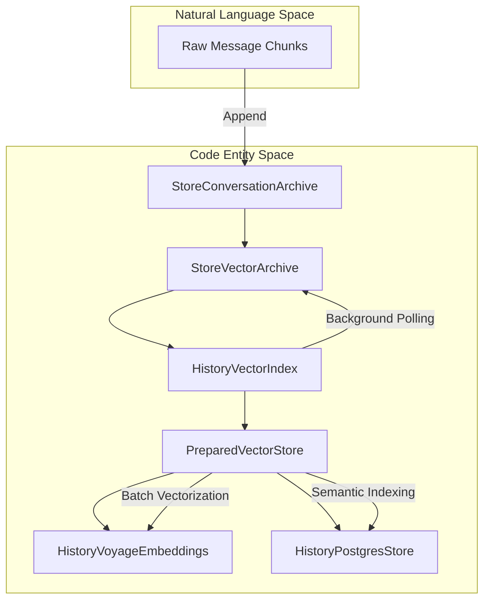
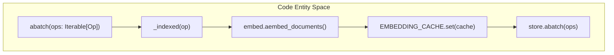
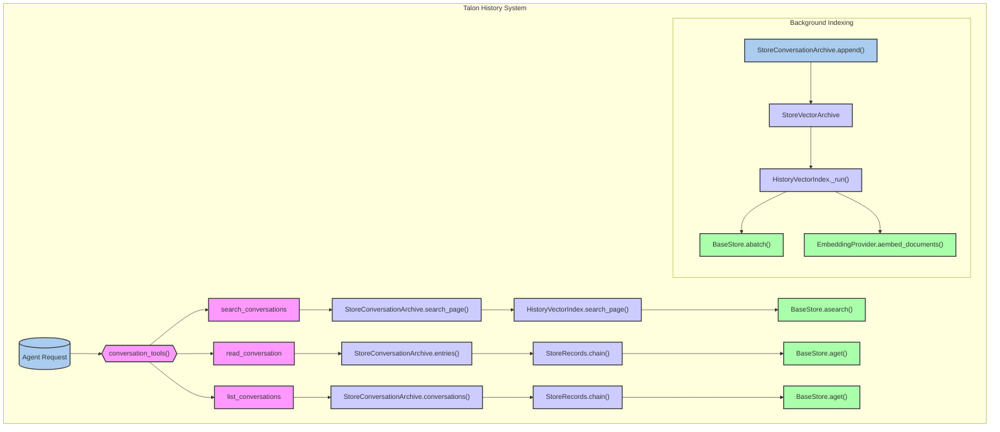

# Talon History, Embeddings and Archive Storage

<details>
<summary>Relevant source files</summary>

The following files were used as context for generating this wiki page:

- [libs/talon/deepagents_talon/archive.py](libs/talon/deepagents_talon/archive.py)
- [libs/talon/deepagents_talon/history_index.py](libs/talon/deepagents_talon/history_index.py)
- [libs/talon/deepagents_talon/history_postgres.py](libs/talon/deepagents_talon/history_postgres.py)
- [libs/talon/deepagents_talon/history_vector_backends.py](libs/talon/deepagents_talon/history_vector_backends.py)
- [libs/talon/deepagents_talon/history_vectors.py](libs/talon/deepagents_talon/history_vectors.py)
- [libs/talon/deepagents_talon/store_archive.py](libs/talon/deepagents_talon/store_archive.py)
- [libs/talon/deepagents_talon/store_archive_index.py](libs/talon/deepagents_talon/store_archive_index.py)
- [libs/talon/deepagents_talon/store_records.py](libs/talon/deepagents_talon/store_records.py)
- [libs/talon/pyproject.toml](libs/talon/pyproject.toml)
- [libs/talon/tests/archive_helpers.py](libs/talon/tests/archive_helpers.py)
- [libs/talon/tests/store_archive_contract.py](libs/talon/tests/store_archive_contract.py)
- [libs/talon/tests/test_main.py](libs/talon/tests/test_main.py)
- [libs/talon/tests/unit_tests/test_archive.py](libs/talon/tests/unit_tests/test_archive.py)
- [libs/talon/tests/unit_tests/test_archive_saver.py](libs/talon/tests/unit_tests/test_archive_saver.py)
- [libs/talon/tests/unit_tests/test_archive_search.py](libs/talon/tests/unit_tests/test_archive_search.py)
- [libs/talon/tests/unit_tests/test_history_vectors.py](libs/talon/tests/unit_tests/test_history_vectors.py)
- [libs/talon/tests/unit_tests/test_store_archive.py](libs/talon/tests/unit_tests/test_store_archive.py)

</details>


## Purpose and Scope
This document covers the technical architecture of Talon's durable conversation archiving, vector indexing, hybrid search, and checkpoint integration. It details how conversation histories are normalized, chunked, journaled, embedded across various adapters (such as local models, Voyage AI, and OpenAI-compatible endpoints), and exposed via chat-scoped agent tools without relying on database-specific SQL assumptions.

---

## 1. History Profiles and Configuration
Talon isolates embedding configuration and resource limits from the underlying storage backend through the `EmbeddingProfile` dataclass and validation routines [libs/talon/deepagents_talon/history_profiles.py:32-95]().

The configuration parses environment variables prefixed with `DEEPAGENTS_TALON_HISTORY_EMBED_` [libs/talon/deepagents_talon/history_profiles.py:24](). Supported adapters include `local`, `voyage`, `openai-compatible`, and `atlas` [libs/talon/deepagents_talon/history_profiles.py:27]().

```python
@dataclass(frozen=True)
class EmbeddingProfile:
    adapter: str = "local"
    model: str = LOCAL_MODEL
    dims: int = 1024
    max_input_tokens: int = 8192
    batch_size: int = 4
    concurrency: int = 1
    bytes_per_token: int = 1
    send_dimensions: bool = True
    query_prompt: str = LOCAL_PROMPT
    base_url: str = ""
    query_model: str = ""
    embed: Embeddings | None = field(default=None, repr=False, compare=False)
```
* `fingerprint`: Computes a SHA-256 hash over core vector space settings (adapter, model, dimensions, input bounds, base URL) while explicitly excluding credentials and query-time options, ensuring re-indexing only triggers on structural changes [libs/talon/deepagents/config.py:100-113]().
* `client_side`: Returns `True` for all adapters except `atlas`, indicating whether Talon computes embeddings prior to database writes [libs/talon/deepagents_talon/history_profiles.py:54-56]().

Sources:
- `libs/talon/deepagents_talon/history_profiles.py`
- `libs/talon/deepagents/config.py`

---

## 2. History Backends and Drivers
Talon supports pluggable storage backends for conversation archives through connection URIs and dynamic entry-point loading [libs/talon/deepagents_talon/history_backends.py](), [libs/talon/deepagents_talon/history_drivers.py]().

The `open_history` asynchronous context manager validates the `DEEPAGENTS_TALON_HISTORY_URI` setting, rejecting unauthenticated or invalid connection strings, and manages lifecycles for SQLite, PostgreSQL, and MongoDB stores via LangGraph store interfaces. Custom backends register via the `deepagents_talon.history_backends` entry point group.

Sources:
- `libs/talon/deepagents_talon/history_backends.py`
- `libs/talon/deepagents_talon/history_drivers.py`

---

## 3. Vector Stores and Embeddings (Voyage, Postgres, Local)
Semantic retrieval relies on `HistoryVectorIndex`, which synchronizes unindexed conversation transcripts with a vector-capable store [libs/talon/deepagents_talon/history_vectors.py:62-104]().



*   **Voyage Integration**: `HistoryVoyageEmbeddings` wraps Voyage AI clients with rate-limiting, batch size limits, and `output_dimension` configuration parameters [libs/talon/deepagents_talon/history_voyage.py](). The `deepagents-talon` package declares `langchain-voyageai` and `voyageai` as optional dependencies for this functionality [libs/talon/pyproject.toml:58-63]().
*   **PostgreSQL Vector Backend**: `HistoryPostgresStore` leverages database-native vector extensions and asynchronous connection drivers for efficient similarity searches [libs/talon/deepagents_talon/history_postgres.py](). The `deepagents-talon` package declares `langgraph-checkpoint-postgres` and `psycopg[binary]` as optional dependencies for PostgreSQL support [libs/talon/pyproject.toml:74-76]().
*   **Vector Backend Factory**: `vector_backend` coordinates initialization parameters across pluggable vector engines [libs/talon/deepagents_talon/history_vector_backends.py]().

Sources:
- `libs/talon/deepagents_talon/history_vectors.py`
- `libs/talon/deepagents_talon/history_voyage.py`
- `libs/talon/deepagents_talon/history_postgres.py`
- `libs/talon/deepagents_talon/history_vector_backends.py`
- `libs/talon/pyproject.toml`

---

## 4. Prepared Store
To prevent slow embedding provider network calls from blocking database connection locks, Talon introduces `PreparedVectorStore` [libs/talon/deepagents_talon/history_prepared_store.py:18-25]().



`PreparedVectorStore` intercepts asynchronous batch operations (`abatch`), inspects `PutOp` payloads to extract text fields requiring indexing, computes all document and query vectors in parallel outside transaction boundaries, stores them in context-local state via `EMBEDDING_CACHE`, and then invokes the underlying store mutation [libs/talon/deepagents_talon/history_prepared_store.py:39-72]().

Sources:
- `libs/talon/deepagents_talon/history_prepared_store.py`

---

## 5. Archive Saver
`ConversationSaver` wraps any asynchronous LangGraph checkpointer (`BaseCheckpointSaver`) to append conversation message deltas to a `StoreConversationArchive` concurrently with thread state persistence [libs/talon/deepagents_talon/archive_saver.py:37-57]().

```python
class ConversationSaver(BaseCheckpointSaver[V]):
    def __init__(
        self, checkpointer: BaseCheckpointSaver[V], *, archive: StoreConversationArchive
    ) -> None:
        super().__init__(serde=checkpointer.serde)
        self.checkpointer = checkpointer
        self.archive = archive
        self._lock = asyncio.Lock()
```

When `aput` is called, `ConversationSaver` extracts trusted channel/chat scope metadata from `RunnableConfig`, records session markers, extracts new message representations from the checkpoint, and commits them to the archive storage [libs/talon/deepagents_talon/archive_saver.py:127-177]().

Sources:
- `libs/talon/deepagents_talon/archive_saver.py`

---

## 6. Store Records and Durable Journal
`StoreRecords` provides an ordered, recoverable record journaling mechanism over any portable LangGraph key/value Store [libs/talon/deepagents_talon/store_records.py:56-61]().

*   **Redo Journal**: Writes are preceded by committing a journal node containing bounded mutations (`_MAX_WRITES = 12`) [libs/talon/deepagents_talon/store_records.py:23,94-102]().
*   **Recovery**: Upon accessing records, `recover()` replays uncommitted batch operations and clears the journal on success, ensuring interrupted operations are fully restartable [libs/talon/deepagents_talon/store_records.py:72-78,105-117]().
*   **Chaining**: `chain()` traverses explicit cursor links (`previous_session`, `next_session`) to guarantee order without relying on backend search sorting [libs/talon/deepagents_talon/store_records.py:118-134]().

Sources:
- `libs/talon/deepagents_talon/store_records.py`

---

## 7. Archive Search and Vector Index Worker
`StoreConversationArchive` coordinates metadata records, keyword searching, and background vector synchronization [libs/talon/deepagents_talon/store_archive.py:83-129](). Messages are broken into bounded chunks (`CHUNK_SIZE = 4000`) before persistence [libs/talon/deepagents_talon/archive.py:20](), [libs/talon/deepagents_talon/store_archive.py:58-81]().

`StoreVectorArchive` implements the `VectorArchive` protocol to bridge immutable archive entries with `HistoryVectorIndex` without maintaining a separate SQL queue [libs/talon/deepagents_talon/store_archive_index.py:17-26]().

`conversation_tools()` exposes three core tools to agents [libs/talon/deepagents_talon/archive.py:121-177]():
1.  `search_conversations`: Performs hybrid semantic/keyword search across past chat archives [libs/talon/deepagents_talon/archive.py:135-148]().
2.  `read_conversation`: Retrieves chronological chunks from a specific session [libs/talon/deepagents_talon/archive.py:150-162]().
3.  `list_conversations`: Summarizes available sessions in the current channel and chat scope [libs/talon/deepagents_talon/archive.py:164-175]().

The `StoreConversationArchive` also handles legacy Slack scope compatibility, allowing parent scopes to access history from child threads without moving the history [libs/talon/deepagents_talon/store_archive.py:53-60](), as demonstrated in unit tests [libs/talon/tests/unit_tests/test_store_archive.py:21-73](). It enforces a retrieval budget to bound reads and releases locks, preventing excessive resource consumption during searches [libs/talon/tests/unit_tests/test_store_archive.py:132-153]().


Title: Talon History Search and Indexing Flow

Sources:
- `libs/talon/deepagents_talon/archive.py`
- `libs/talon/deepagents_talon/store_archive.py`
- `libs/talon/deepagents_talon/store_archive_index.py`
- `libs/talon/deepagents_talon/history_vectors.py`
- `libs/talon/tests/unit_tests/test_store_archive.py`