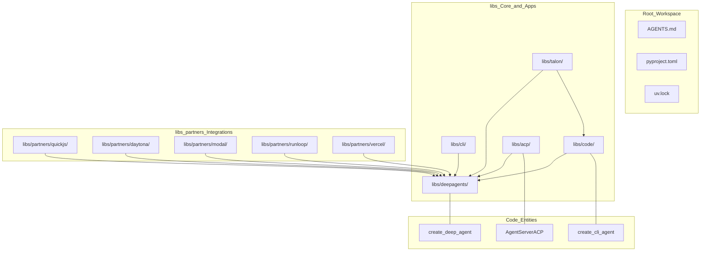
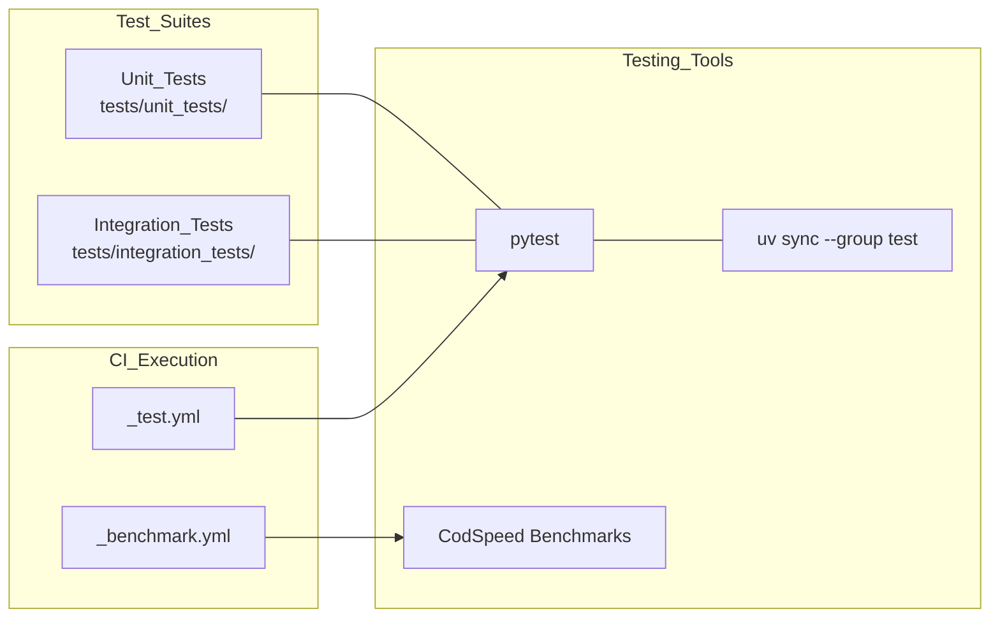

# Development and Testing

Relevant source files

The following files were used as context for generating this wiki page:

- [.github/ISSUE_TEMPLATE/bug-report.yml](.github/ISSUE_TEMPLATE/bug-report.yml)
- [.github/ISSUE_TEMPLATE/config.yml](.github/ISSUE_TEMPLATE/config.yml)
- [.github/ISSUE_TEMPLATE/feature-request.yml](.github/ISSUE_TEMPLATE/feature-request.yml)
- [.github/ISSUE_TEMPLATE/privileged.yml](.github/ISSUE_TEMPLATE/privileged.yml)
- [.github/PULL_REQUEST_TEMPLATE.md](.github/PULL_REQUEST_TEMPLATE.md)
- [.github/workflows/deepagents-example.yml.example](.github/workflows/deepagents-example.yml.example)
- [AGENTS.md](AGENTS.md)

This document covers development practices, testing strategies, dependency management, code quality tooling, and release automation for the Deep Agents monorepo. It bridges the gap between high-level architectural concepts and the actual files, packages, and commands used during daily development.

---

## Monorepo Organization and Guidelines

The Deep Agents project uses a Python monorepo structure managed by the `uv` package manager [AGENTS.md:18-22](). Each package is a distinct workspace member with its own `pyproject.toml` and `uv.lock` file, allowing for independent versioning and dependency pinning. 

For full details on repository layout, contribution standards, issue templates, and development guidelines, see [Project Structure and Guidelines](#6.1).

**Monorepo Entity Map**

Sources: [AGENTS.md:1-22](), [.github/workflows/deepagents-example.yml.example:1-157]()

---

## Dependencies and Build System

The project relies exclusively on `uv` for package resolution, lockfile generation, and virtual environment synchronization. CI workflows enforce `UV_NO_SYNC` and `UV_FROZEN` to maintain environment integrity and prevent unexpected lockfile modifications [AGENTS.md:18-22]().

For deep dives into cross-package dependencies, version pin bumps, and build configurations, see [Dependencies and Build System](#6.2).

Sources: [AGENTS.md:18-22]()

---

## Testing and Evaluation Framework

The codebase uses `pytest` as its primary testing execution engine. The test architecture enforces a strict boundary between network-free unit tests located in `tests/unit_tests/` and networked integration tests located in `tests/integration_tests/` [AGENTS.md:81-83](). All packages treat unaccepted pytest warnings as errors [AGENTS.md:85-87]().

For detailed instructions on configuring fixtures, running async tests under `asyncio_mode = "auto"`, and executing smoke tests, see [Testing and Evaluation Framework](#6.3).

**Test Flow and Code Association**

Sources: [AGENTS.md:77-88]()

---

## Code Quality Tools

Code quality is automatically validated via static analysis tooling. `ruff` is used for high-performance linting and formatting, alongside strict type annotations that prohibit unconstrained `Any` types in public interfaces [AGENTS.md:24-27, 66]().

For configuration options, pre-commit hooks, Makefile tasks, and per-file lint suppression strategies, see [Code Quality Tools](#6.4).

Sources: [AGENTS.md:24-27, 66-70, 85-87]()

---

## Release Process and CI/CD

Releases are managed via an automated pipeline driven by Conventional Commits [AGENTS.md:30-39](). Pull request titles and branches are validated against strict type and scope rules to guarantee reliable changelog generation and automated version bumping [AGENTS.md:30-39](). The project uses a pull request template to guide contributions [AGENTS.md:47-53]().

For details on PyPI trusted publishing, changelog generation scripts, and release-please workflows, see [Release Process and CI/CD](#6.5).

Sources: [AGENTS.md:30-53](), [.github/PULL_REQUEST_TEMPLATE.md:1-32]()

---

## Evals Package and Benchmark Workflows

The monorepo includes dedicated evaluation packages (`libs/evals`) for tracking model behavior, trajectory scoring, and benchmark execution across standardized datasets.

For details on model groups, evaluation tiers, `EVAL_CATALOG` generation, LLM judges, and continuous benchmarking actions, see [Evals Package and Benchmark Workflows](#6.6).

Sources: [AGENTS.md:5-7]()