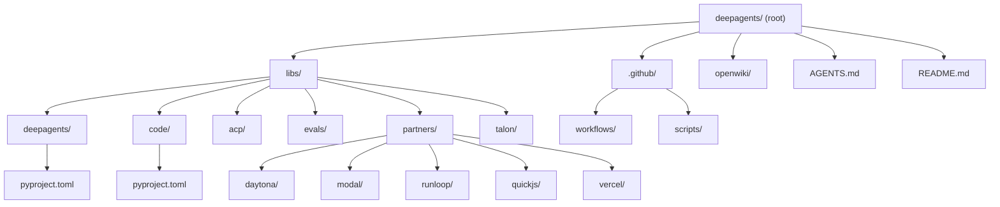
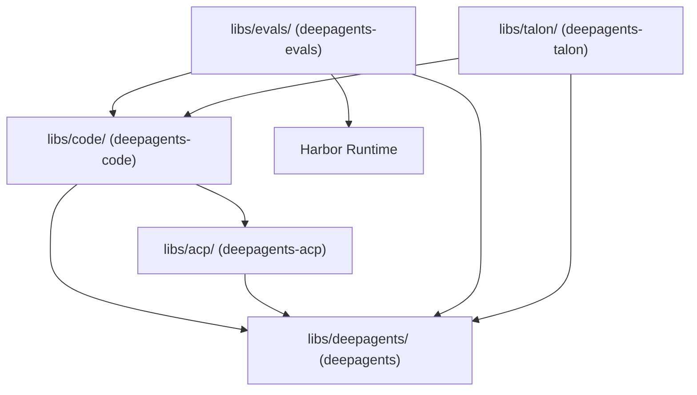
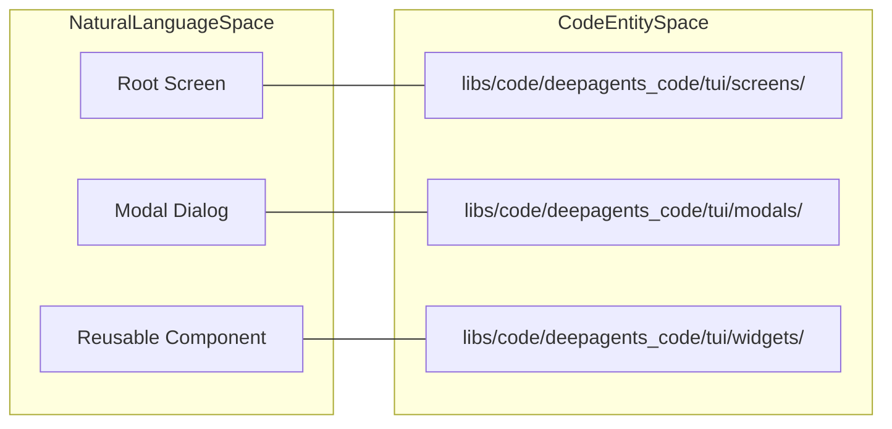

# Project Structure and Guidelines

Relevant source files

The following files were used as context for generating this wiki page:

- [.github/ISSUE_TEMPLATE/bug-report.yml](.github/ISSUE_TEMPLATE/bug-report.yml)
- [.github/ISSUE_TEMPLATE/config.yml](.github/ISSUE_TEMPLATE/config.yml)
- [.github/ISSUE_TEMPLATE/feature-request.yml](.github/ISSUE_TEMPLATE/feature-request.yml)
- [.github/ISSUE_TEMPLATE/privileged.yml](.github/ISSUE_TEMPLATE/privileged.yml)
- [.github/PULL_REQUEST_TEMPLATE.md](.github/PULL_REQUEST_TEMPLATE.md)
- [.github/workflows/deepagents-example.yml.example](.github/workflows/deepagents-example.yml.example)
- [AGENTS.md](AGENTS.md)
- [libs/code/AGENTS.md](libs/code/AGENTS.md)
- [openwiki/.claims/architecture/code-agent.json](openwiki/.claims/architecture/code-agent.json)
- [openwiki/.claims/architecture/overview.json](openwiki/.claims/architecture/overview.json)
- [openwiki/.claims/quickstart.json](openwiki/.claims/quickstart.json)
- [openwiki/.claims/testing/testing-guide.json](openwiki/.claims/testing/testing-guide.json)
- [openwiki/.last-update.json](openwiki/.last-update.json)
- [openwiki/architecture/code-agent.md](openwiki/architecture/code-agent.md)
- [openwiki/architecture/index.md](openwiki/architecture/index.md)
- [openwiki/architecture/overview.md](openwiki/architecture/overview.md)
- [openwiki/concepts/index.md](openwiki/concepts/index.md)
- [openwiki/index.md](openwiki/index.md)
- [openwiki/operations/index.md](openwiki/operations/index.md)
- [openwiki/quickstart.md](openwiki/quickstart.md)
- [openwiki/testing/index.md](openwiki/testing/index.md)
- [openwiki/testing/testing-guide.md](openwiki/testing/testing-guide.md)

This page documents the monorepo organization, development tooling, coding standards, contribution guidelines, and maintainer routing for Deep Agents. It covers the physical structure of the codebase, package topologies, issue/PR automation, and the internal maintainer wiki (`openwiki/`).

---

## Monorepo Organization

Deep Agents is a Python monorepo containing multiple independently versioned packages managed with `uv` [openwiki/quickstart.md:78-78](). The repository follows a workspace-based structure where each package maintains its own `pyproject.toml` and `Makefile` [openwiki/quickstart.md:78-78]().

### Directory Structure and Package Topology

Sources: [openwiki/quickstart.md:60-78](), [AGENTS.md:1-9]()

### Package Summary Table

| Package | Path | Declared Python | Purpose |
|---------|------|-----------------|---------|
| `deepagents` | `libs/deepagents/` | `>=3.11,<4.0` | Core SDK: `create_deep_agent`, middleware, backends, and harness behavior [openwiki/quickstart.md:67-67](). |
| `deepagents-code` | `libs/code/` | `>=3.12,<4.0` | Prebuilt `dcode` terminal agent: TUI, client/server runtime, and sessions [openwiki/quickstart.md:68-68](). |
| `deepagents-acp` | `libs/acp/` | `>=3.11` | Agent Client Protocol (ACP) adapter for editor integration [openwiki/quickstart.md:69-69](). |
| `deepagents-evals` | `libs/evals/` | `>=3.12,<3.14` | Behavioral evaluations and Harbor-backed benchmarks [openwiki/quickstart.md:72-72](). |
| `deepagents-talon` | `libs/talon/` | `>=3.12` | Experimental long-running host, channels (WhatsApp/Telegram), and schedules [openwiki/quickstart.md:70-70](). |
| `partners` | `libs/partners/` | Variable | Provider and sandbox integrations (Daytona, Modal, Runloop, Vercel, QuickJS) [openwiki/quickstart.md:71-71](). |

Sources: [openwiki/quickstart.md:59-73]()

---

## Development Workflow and Guidelines (`AGENTS.md`)

Repository-wide development rules for contributors and automated agents are maintained in `AGENTS.md` [AGENTS.md:1-3]().

### Corridor Security Analysis
When Corridor's `analyzePlan` tool is available, developers and agents must create an implementation plan and run the tool to analyze security constraints before modifying or generating code [AGENTS.md:10-16]().

### Suppressing Lint Rules
- Use inline `# noqa: RULE` comments with an explicit justification for individual exceptions [AGENTS.md:24-26]().
- Reserve `[tool.ruff.lint.per-file-ignores]` in `pyproject.toml` for categorical policies (such as tests not requiring docstrings) [AGENTS.md:26-26](). Do not hide isolated violations with file-wide ignores [AGENTS.md:26-26]().

Sources: [AGENTS.md:1-27]()

---

## Code Entity Mapping

The following diagrams bridge conceptual system spaces to concrete code implementation entities across the repository.

### Monorepo Dependency Direction

Sources: [openwiki/quickstart.md:65-73]()

### Textual UI Component Organization (Natural Language to Code Entity)

Sources: [libs/code/AGENTS.md:68-71]()

---

## Contribution Standards

### PR Conventions and Scopes
- **Titles:** Must follow Conventional Commits format: `type(scope): description` [AGENTS.md:32-32](), [.github/PULL_REQUEST_TEMPLATE.md:20-20]().
- **Scopes:** Allowed types and scopes are defined in `.github/workflows/pr_lint.yml` [AGENTS.md:32-32]().
- **Atomic Commits:** Keep each bump-worthy PR to one releasable component. Place cross-package dependency or lockfile churn in a separate `chore(deps):` PR [AGENTS.md:38-38]().

### Branch Naming
Name feature and fix branches as `<github-username>/<scope>/<short-description>` using kebab-case for the description [AGENTS.md:42-42](). Documentation-only branches may use the branch-only `docs` scope [AGENTS.md:42-42]().

### Public Interfaces and Code Quality
- Preserve exported function signatures, argument positions, and names in `__init__.py` files [AGENTS.md:57-59]().
- Add new parameters as keyword-only with defaults [AGENTS.md:60-60]().
- Use Google-style docstrings for public functions and place type hints in signatures rather than docstrings [AGENTS.md:67-68]().
- **Warnings are errors:** All packages treat unaccepted pytest warnings as errors [AGENTS.md:85-87](). Scope expected warnings using `@pytest.mark.filterwarnings` [AGENTS.md:91-91]().

Sources: [AGENTS.md:28-96](), [.github/PULL_REQUEST_TEMPLATE.md:1-32]()

---

## Issue Templates and Automation

The repository utilizes structured GitHub issue forms and automated workflows to maintain rigorous issue classification.

### Issue Templates and Area Mapping
- **Bug Reports:** Located in `.github/ISSUE_TEMPLATE/bug-report.yml` [.github/ISSUE_TEMPLATE/bug-report.yml:1-4](); requires reproduction steps, system info, and area selection [.github/ISSUE_TEMPLATE/bug-report.yml:70-120]().
- **Feature Requests:** Located in `.github/ISSUE_TEMPLATE/feature-request.yml` [.github/ISSUE_TEMPLATE/feature-request.yml:1-4](); captures feature descriptions and proposed solutions [.github/ISSUE_TEMPLATE/feature-request.yml:57-72]().
- **Package Labeling Automation:** The workflow `.github/workflows/auto-label-by-package.yml` maps issue form selections under "Area" to `package:*` or `integration:*` labels (e.g., `"deepagents (SDK)"` maps to `package:deepagents`, `"daytona"` maps to `integration:daytona`) [openwiki/.claims/architecture/code-agent.json:10-10]().

Sources: [.github/ISSUE_TEMPLATE/bug-report.yml:1-124](), [.github/ISSUE_TEMPLATE/feature-request.yml:1-76]()

---

## Internal Maintainer Wiki (`openwiki/`)

The `openwiki/` directory contains deep maintainer reference documentation, runbooks, and architecture notes:
- **Architecture Guides:** High-level system maps in `openwiki/architecture/overview.md` [openwiki/architecture/index.md:5-5]().
- **Workflows:** Step-by-step guides for [building agents](openwiki/workflows/build-a-deep-agent.md), [running dcode sessions](openwiki/workflows/run-dcode-session.md), and [executing evals](openwiki/workflows/run-evals.md) [openwiki/index.md:11-16]().
- **State Persistence:** Concepts detailing checkpoints and conversation lifecycle management [openwiki/concepts/index.md:5-5]().

Sources: [openwiki/index.md:1-16](), [openwiki/architecture/index.md:1-8]()