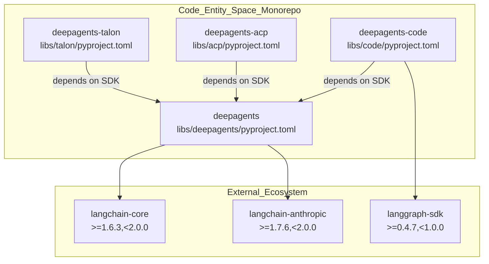
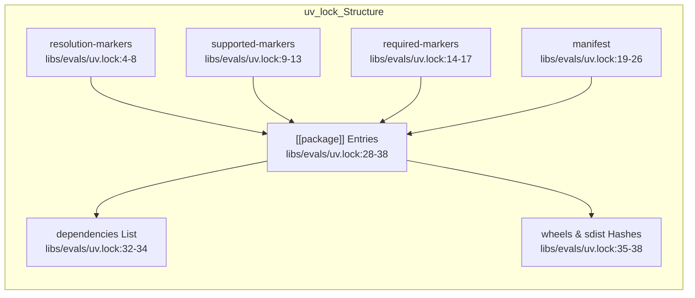
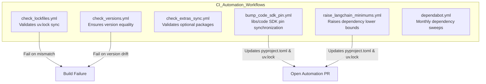

# Dependencies and Build System

Relevant source files

The following files were used as context for generating this wiki page:

- [.github/dependabot.yml](.github/dependabot.yml)
- [.github/scripts/checks/check_lockfiles_pre_commit.py](.github/scripts/checks/check_lockfiles_pre_commit.py)
- [.github/scripts/checks/raise_langchain_minimums.py](.github/scripts/checks/raise_langchain_minimums.py)
- [.github/scripts/checks/refresh_lockfiles.py](.github/scripts/checks/refresh_lockfiles.py)
- [.github/scripts/release/check_dep_freshness.py](.github/scripts/release/check_dep_freshness.py)
- [.github/scripts/release/check_release_deps.py](.github/scripts/release/check_release_deps.py)
- [.github/scripts/release/check_wheel_dep_freshness.py](.github/scripts/release/check_wheel_dep_freshness.py)
- [.github/scripts/release/resolve_python_matrix.py](.github/scripts/release/resolve_python_matrix.py)
- [.github/scripts/tests/checks/test_check_lockfiles_pre_commit.py](.github/scripts/tests/checks/test_check_lockfiles_pre_commit.py)
- [.github/scripts/tests/checks/test_raise_langchain_minimums.py](.github/scripts/tests/checks/test_raise_langchain_minimums.py)
- [.github/scripts/tests/checks/test_refresh_lockfiles.py](.github/scripts/tests/checks/test_refresh_lockfiles.py)
- [.github/scripts/tests/release/test_check_dep_freshness.py](.github/scripts/tests/release/test_check_dep_freshness.py)
- [.github/scripts/tests/release/test_check_release_deps.py](.github/scripts/tests/release/test_check_release_deps.py)
- [.github/scripts/tests/release/test_check_wheel_dep_freshness.py](.github/scripts/tests/release/test_check_wheel_dep_freshness.py)
- [.github/scripts/tests/workflows/test_release_python_matrix.py](.github/scripts/tests/workflows/test_release_python_matrix.py)
- [.github/workflows/bump_genai_prices.yml](.github/workflows/bump_genai_prices.yml)
- [.github/workflows/check_dep_freshness.yml](.github/workflows/check_dep_freshness.yml)
- [.github/workflows/check_release_deps.yml](.github/workflows/check_release_deps.yml)
- [.github/workflows/raise_langchain_minimums.yml](.github/workflows/raise_langchain_minimums.yml)
- [.release-please-manifest.json](.release-please-manifest.json)
- [libs/code/CHANGELOG.md](libs/code/CHANGELOG.md)
- [libs/code/deepagents_code/_version.py](libs/code/deepagents_code/_version.py)
- [libs/code/pyproject.toml](libs/code/pyproject.toml)
- [libs/code/uv.lock](libs/code/uv.lock)
- [libs/deepagents/CHANGELOG.md](libs/deepagents/CHANGELOG.md)
- [libs/deepagents/deepagents/_version.py](libs/deepagents/deepagents/_version.py)
- [libs/evals/uv.lock](libs/evals/uv.lock)
- [libs/talon/uv.lock](libs/talon/uv.lock)

This page documents the dependency management system, build automation, CI/CD verification workflows, and development setups across the Deep Agents monorepo. It details the utilization of the `uv` package manager, `uv.lock` architecture, `pyproject.toml` configuration parameters, dependency groups, SDK version pinning strategies, and cross-package dependency relationships.

Sources: [.github/actions/uv_setup/action.yml:3-47](), [libs/deepagents/pyproject.toml:1-35](), [libs/evals/uv.lock:1-17]()

---

## Package Overview and Cross-Package Dependencies

The Deep Agents repository is organized as a monorepo containing independently versioned and published Python packages. The ecosystem relies on `uv` workspaces and precise version specs in individual package manifests.

| Package | Purpose / Description | Build Backend | Python Version Range |
|---------|-----------------------|---------------|----------------------|
| `deepagents` | Core SDK, middleware system, filesystem, and memory | `hatchling` | `>=3.12,<4.0` |
| `deepagents-code` | Terminal coding agent built on the Deep Agents SDK | `hatchling` [libs/code/pyproject.toml:3]() | `>=3.12,<4.0` [libs/code/pyproject.toml:13]() |
| `deepagents-acp` | Agent Client Protocol (ACP) support server | `hatchling` | `>=3.12,<4.0` |
| `deepagents-talon` | Experimental long-running runtime host | `hatchling` | `>=3.12` [libs/talon/uv.lock:3]() |
| `libs/partners/*` | Partner sandbox integrations (Daytona, Modal, Runloop, Vercel) | `hatchling` | `>=3.12,<4.0` |

The core SDK (`deepagents`) forms the structural foundation, while application-level packages like `deepagents-code` and `deepagents-cli` depend directly on it alongside downstream toolkits (`langgraph-sdk`, `textual`, etc.).

**Cross-Package Dependency Topology**

Sources: [libs/code/pyproject.toml:30](), [libs/code/pyproject.toml:35](), [libs/code/pyproject.toml:41](), [libs/code/pyproject.toml:104]()

---

## Dependency Management with `uv` and `uv.lock`

The monorepo uses **`uv`** for dependency resolution and virtual environment creation. Each package directory maintains its own `uv.lock` file, pinning every transitive dependency with exact SHA-256 hashes for source distributions and platform wheels.

### Lockfile Structure and Resolution Markers

Lockfiles use `resolution-markers` arrays to capture environment-specific conditional requirements (e.g., Python full version bounds, platform checks like Windows or Emscripten) [libs/evals/uv.lock:4-8](). The `supported-markers` and `required-markers` further refine the environment constraints for which the lockfile is valid [libs/evals/uv.lock:9-17]().

**Anatomy of `uv.lock` Resolution**

CI pipelines and local development environments initialize Python and `uv` using the custom composite action `.github/actions/uv_setup/action.yml`, which configures cache dependency globs against `pyproject.toml` and `uv.lock` [.github/actions/uv_setup/action.yml:3-47]().

Sources: [.github/actions/uv_setup/action.yml:3-47](), [libs/evals/uv.lock:1-86](), [libs/code/uv.lock:1-79](), [libs/talon/uv.lock:1-74]()

---

## Build System Configuration (`pyproject.toml`) and Dependency Groups

The `deepagents-code` package configuration specifies minimum Python versions (`>=3.12,<4.0`), metadata, keywords, core production dependencies, optional extras, and developer dependency groups [libs/code/pyproject.toml:1-181]().

### Core Dependencies and Optional Extras

Core production dependencies in `libs/code/pyproject.toml` include:
- `deepagents==0.7.26` [libs/code/pyproject.toml:30]()
- `langchain>=1.4.6,<2.0.0` [libs/code/pyproject.toml:31]()
- `langgraph-checkpoint-sqlite>=3.1.2,<4.0.0` [libs/code/pyproject.toml:32]()
- `langgraph-sdk>=0.4.7,<1.0.0` [libs/code/pyproject.toml:35]()
- `textual>=8.2.8,<9.0.0` [libs/code/pyproject.toml:53]()

Optional features are organized via `[project.optional-dependencies]` [libs/code/pyproject.toml:108]():
- **Model providers**: e.g., `anthropic = ["langchain-anthropic>=1.7.6,<2.0.0"]` [libs/code/pyproject.toml:110]()
- **Sandbox providers**: e.g., `daytona = ["langchain-daytona>=0.0.7"]` [libs/code/pyproject.toml:140]()
- **Standalone integrations**: e.g., `media = ["av>=18.0.0,<19.0.0", "pillow>=12.3.0,<13.0.0"]` [libs/code/pyproject.toml:149]()

### Dependency Groups for Development and Testing

The `[dependency-groups]` table separates test runners, linters, and type checkers from runtime requirements [libs/code/pyproject.toml:168]():
- **Testing**: `textual-dev`, `build`, `hatchling`, `ruff`, `ty`, `pytest`, `pytest-asyncio`, `pytest-benchmark`, `pytest-codspeed`, `pytest-cov` [libs/code/pyproject.toml:169-181]()

Sources: [libs/code/pyproject.toml:1-181]()

---

## Build Automation, SDK Bumps, and CI Validation

To maintain repository health across multiple packages, several automated workflows and guardrails execute checks on pull requests and scheduled crons.

**Build and Release Automation Flow**

### SDK Pin Bumping Mechanism
`deepagents-code` publishes with an exact SDK pin (e.g., `deepagents==0.7.26` [libs/code/pyproject.toml:30]()). The `.release-please-manifest.json` file tracks the current versions of all published packages, including `libs/deepagents` at `0.7.26` and `libs/code` at `0.1.85` [.release-please-manifest.json:2-3](), [.release-please-manifest.json:4](). When the core SDK version moves ahead, the automated workflow `.github/workflows/bump_code_sdk_pin.yml` compares versions and opens or updates a synchronization PR [.github/workflows/bump_code_sdk_pin.yml:1-131](). The `deepagents-code` version is also explicitly defined in `libs/code/deepagents_code/_version.py` as `0.1.85` [libs/code/deepagents_code/_version.py:5](). Similarly, the `deepagents` SDK version is `0.7.26` [libs/deepagents/deepagents/_version.py:21]().

### Raising Dependency Minimums
The `.github/workflows/raise_langchain_minimums.yml` workflow automatically raises the lower bounds of LangChain-ecosystem dependencies to their latest stable PyPI releases [.github/workflows/raise_langchain_minimums.yml:1-12](). This workflow runs daily and can also be triggered manually for specific packages or dependencies [.github/workflows/raise_langchain_minimums.yml:57-88](). It updates `pyproject.toml` files and regenerates `uv.lock` files, creating a pull request with the changes [.github/workflows/raise_langchain_minimums.yml:26-31](). The script `raise_langchain_minimums.py` handles the logic for identifying raiseable requirements and rewriting manifest files [.github/scripts/checks/raise_langchain_minimums.py:1-25]().

Dependabot concurrently coordinates updates across subdirectories while ignoring internal monorepo packages to prevent circular overrides [.github/dependabot.yml:19-52]().

Sources: [.release-please-manifest.json:1-11](), [libs/code/pyproject.toml:30](), [libs/code/deepagents_code/_version.py:5](), [libs/deepagents/deepagents/_version.py:21](), [.github/workflows/bump_code_sdk_pin.yml:1-144](), [.github/dependabot.yml:1-69](), [.github/actions/uv_setup/action.yml:3-47](), [.github/workflows/raise_langchain_minimums.yml:1-144](), [.github/scripts/checks/raise_langchain_minimums.py:1-170](), [.github/scripts/tests/checks/test_raise_langchain_minimums.py:1-187]()

---

## Development Workflows and Makefile Integration

Standardized development tasks are executed via package-level `Makefile` targets. These invoke `uv run` commands scoped to the appropriate dependency groups.

| Target | Underlying Command | Role |
|--------|-------------------|------|
| `make test` | `uv run --group test pytest` | Executes test suite with coverage |
| `make lint` | `uv run --all-groups ruff check` | Runs linter checks across all source trees |
| `make type` | `uv run --all-groups ty check` | Runs static type analysis via `ty` |
| `make format` | `uv run --all-groups ruff format` | Auto-formats codebases according to `pyproject.toml` |

Sources: [libs/code/pyproject.toml:168-181]()