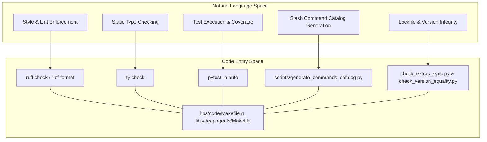
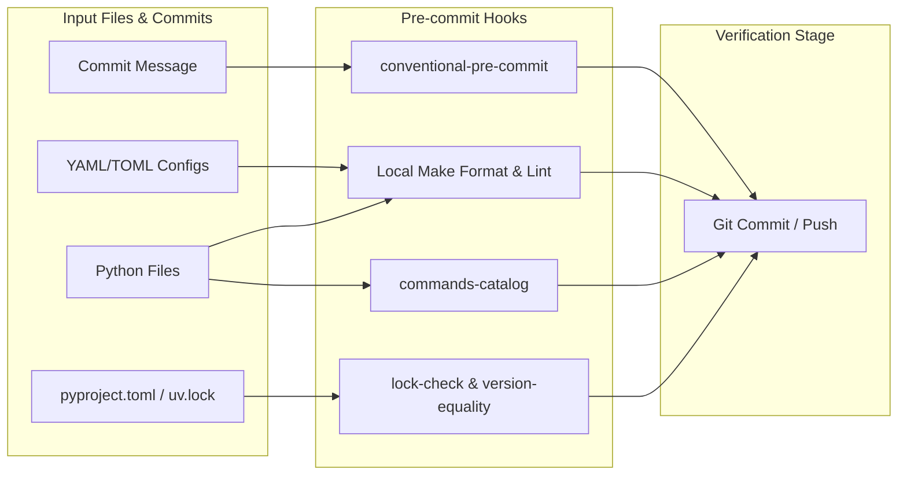

# Code Quality Tools

Relevant source files

The following files were used as context for generating this wiki page:

- [.pre-commit-config.yaml](.pre-commit-config.yaml)
- [libs/acp/Makefile](libs/acp/Makefile)
- [libs/code/Makefile](libs/code/Makefile)
- [libs/code/scripts/generate_commands_catalog.py](libs/code/scripts/generate_commands_catalog.py)
- [libs/deepagents/Makefile](libs/deepagents/Makefile)
- [libs/partners/daytona/Makefile](libs/partners/daytona/Makefile)
- [libs/partners/modal/Makefile](libs/partners/modal/Makefile)
- [libs/partners/quickjs/Makefile](libs/partners/quickjs/Makefile)
- [libs/partners/runloop/Makefile](libs/partners/runloop/Makefile)

This page documents the code quality tooling used in the Deep Agents monorepo, including linting, formatting, type checking, automated synchronization checks, generated command catalogs, and pre-commit hooks. These tools are integrated via package-level `Makefile` tasks and enforced through local development workflows and GitHub Actions CI/CD pipelines.

## Overview

The Deep Agents monorepo employs a standardized stack of code quality and verification tools across all packages (`deepagents`, `deepagents-code`, `deepagents-acp`, `deepagents-talon`, and partner sandboxes) to ensure consistency, correctness, and maintainability.

*   **Ruff**: A high-performance Python linter and formatter used for style enforcement, import sorting, and error detection [libs/deepagents/Makefile:72-73](), [libs/code/Makefile:72-73]().
*   **ty**: A static type checking wrapper used across monorepo packages [libs/deepagents/Makefile:78](), [libs/code/Makefile:80]().
*   **uv**: The primary package manager and execution engine running tasks in frozen/reproducible environments [libs/deepagents/Makefile:6](), [libs/code/Makefile:6]().
*   **Pre-commit**: Local hook enforcement ensuring adherence to formatting, commit messages, and branch naming standards [.pre-commit-config.yaml:1-117]().
*   **Automation Scripts**: Custom checks verifying version synchronization, extras alignment, and generated artifact freshness [.pre-commit-config.yaml:83-104]().

Sources: [.pre-commit-config.yaml:1-117](), [libs/deepagents/Makefile:1-97](), [libs/code/Makefile:1-127]()

## Unified Task Management (Makefile)

Each package directory contains a dedicated `Makefile` that abstracts tool invocation. This guarantees that local developer workflows match CI execution paths. Tasks default to running via `uv run` with `UV_FROZEN = true` [libs/deepagents/Makefile:6](), [libs/code/Makefile:6]().

### Core Makefile Targets Across Packages

| Target | Command / Implementation | Description |
| :--- | :--- | :--- |
| `make lint` | `ruff check` + `ruff format --diff` + `make type` | Runs all static analysis, import checks, and type validation [libs/deepagents/Makefile:70-74](), [libs/code/Makefile:70-74](). |
| `make format` | `ruff format` + `ruff check --fix` | Automatically formats files and applies safe lint fixes [libs/deepagents/Makefile:80-83](), [libs/code/Makefile:82-85](). |
| `make type` | `ty check <package>` | Runs static type checking via the `ty` tool wrapper [libs/deepagents/Makefile:77-78](), [libs/code/Makefile:80](). |
| `make test` | `pytest -n auto` | Executes parallelized unit tests with socket limitations [libs/deepagents/Makefile:19-23](), [libs/code/Makefile:25-28](). |
| `make commands-catalog` | `python scripts/generate_commands_catalog.py` | Regenerates `COMMANDS.md` from the slash command registry (`deepagents-code` only) [libs/code/Makefile:91-92](). |
| `make check` | Full gauntlet (`lint`, `check_imports`, `test`, extras/version checks) | Runs local CI parity gauntlet (`deepagents-code` only) [libs/code/Makefile:106-117](). |

### Monorepo Tooling Architecture

Sources: [libs/deepagents/Makefile:1-97](), [libs/code/Makefile:1-127](), [libs/acp/Makefile:1-55]()

## Linting, Formatting, and Type Checking

Ruff and `ty` form the core static analysis pipeline. The `lint` target executes a multi-step check:
1.  **Linter**: `ruff check` detects style violations, unused imports, and logical flaws [libs/deepagents/Makefile:72](), [libs/code/Makefile:72]().
2.  **Formatter Diff**: `ruff format --diff` ensures code conforms to standard formatting rules without making in-place modifications [libs/deepagents/Makefile:73](), [libs/code/Makefile:73]().
3.  **Type Checker**: `ty check` verifies type annotations across package sources [libs/deepagents/Makefile:78](), [libs/code/Makefile:80]().

To repair formatting issues or apply safe automated lint corrections, developers invoke `make format`, which runs `ruff format` followed by `ruff check --fix` [libs/deepagents/Makefile:80-83](), [libs/code/Makefile:82-85]().

Sources: [libs/deepagents/Makefile:58-88](), [libs/code/Makefile:58-90]()

## Pre-commit Hooks and Local Integrity

The repository configures strict pre-commit hooks under `.pre-commit-config.yaml` to prevent malformed commits, broken lockfiles, and documentation drift before changes are pushed [.pre-commit-config.yaml:1-117]().

### Pre-commit Hook Architecture

Key local hooks defined in [.pre-commit-config.yaml:57-117]() include:
*   **`deepagents` / `deepagents-code` / `evals` / `acp`**: Invokes package-specific `make format lint` rules [.pre-commit-config.yaml:57-82]().
*   **`commands-catalog`**: Ensures `COMMANDS.md` remains synchronized with `deepagents_code/command_registry.py` [.pre-commit-config.yaml:83-88]().
*   **`lock-check`**: Validates `uv.lock` consistency against `pyproject.toml` files via `check_lockfiles_pre_commit.py` [.pre-commit-config.yaml:89-93]().
*   **`extras-sync`**: Confirms optional dependency groups align with base requirements [.pre-commit-config.yaml:94-98]().
*   **`version-equality`**: Verifies `pyproject.toml` version declarations match internal `_version.py` files [.pre-commit-config.yaml:99-104]().
*   **`branch-name`**: Enforces branch naming conventions during pre-push [.pre-commit-config.yaml:111-117]().

Sources: [.pre-commit-config.yaml:1-117]()

## Generated Catalogs and Automation Scripts

Certain reference documents in the repository are strictly auto-generated to prevent drift between implementation and documentation.

### Slash Command Catalog (`COMMANDS.md`)
The `deepagents-code` package maintains a generated reference for its CLI slash commands. 
*   **Script**: `libs/code/scripts/generate_commands_catalog.py` imports `COMMANDS` and `HIDDEN_COMMANDS` directly from `deepagents_code.command_registry` [libs/code/scripts/generate_commands_catalog.py:20-23]().
*   **Generation & Verification**: Running `python scripts/generate_commands_catalog.py` writes `COMMANDS.md` [libs/code/scripts/generate_commands_catalog.py:49-85](). Passing `--check` verifies if the file is up-to-date and exits with status `1` if stale, which is enforced by both pre-commit and Makefile targets [libs/code/Makefile:91-95](), [libs/code/scripts/generate_commands_catalog.py:94-128]().

Sources: [libs/code/Makefile:91-96](), [libs/code/scripts/generate_commands_catalog.py:1-135]()

## Dependency Minimums and Synchronization

The repository uses automated GitHub Actions workflows and checks to manage LangChain-ecosystem dependency floors and workspace consistency.

*   **Raise Dependency Minimums Workflow**: `.github/workflows/raise_langchain_minimums.yml` runs a daily cron job (and supports manual dispatch) to bump lower bounds (`>=`, `~=`) of in-scope dependencies (`langchain*`, `langgraph*`, `langsmith*`, `deepagents*`) to the newest stable PyPI releases [.github/workflows/raise_langchain_minimums.yml:1-83]().
*   **Script Logic**: `.github/scripts/checks/raise_langchain_minimums.py` parses manifests, fetches compatible PyPI versions concurrently via thread pools, plans rewrites, and regenerates affected `uv.lock` files [.github/scripts/checks/raise_langchain_minimums.py:1-169]().

Sources: [.github/workflows/raise_langchain_minimums.yml:1-140](), [.github/scripts/checks/raise_langchain_minimums.py:1-169]()