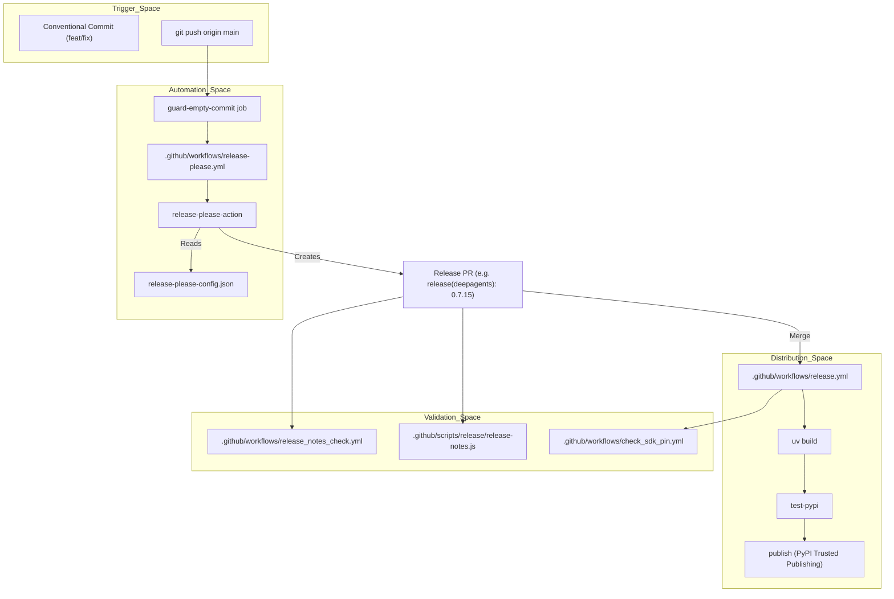
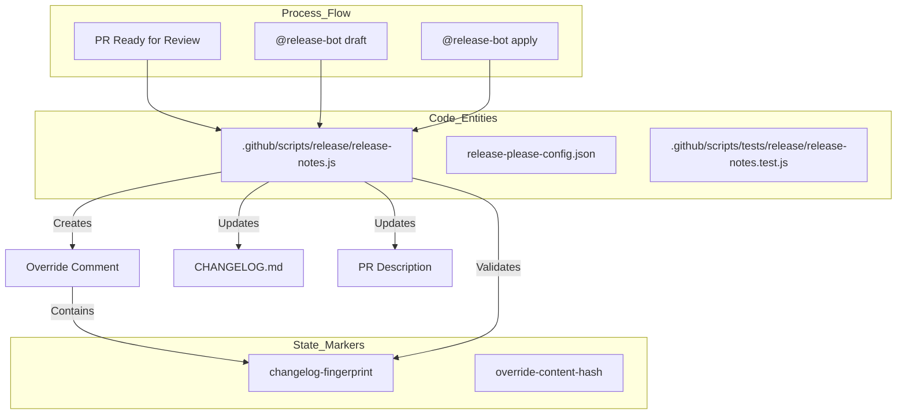
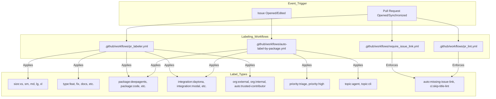

# Release Process and CI/CD

Relevant source files

The following files were used as context for generating this wiki page:

- [.github/LABELS.md](.github/LABELS.md)
- [.github/RELEASING.md](.github/RELEASING.md)
- [.github/SECRETS.md](.github/SECRETS.md)
- [.github/scripts/labeling/pr-labeler-config.json](.github/scripts/labeling/pr-labeler-config.json)
- [.github/scripts/labeling/semif-topic-classifier.js](.github/scripts/labeling/semif-topic-classifier.js)
- [.github/scripts/labeling/topic-classifier.js](.github/scripts/labeling/topic-classifier.js)
- [.github/scripts/release/draft-release-notes.js](.github/scripts/release/draft-release-notes.js)
- [.github/scripts/release/release-notes.js](.github/scripts/release/release-notes.js)
- [.github/scripts/tests/labeling/pr-labeler.test.js](.github/scripts/tests/labeling/pr-labeler.test.js)
- [.github/scripts/tests/labeling/priority-labels.test.js](.github/scripts/tests/labeling/priority-labels.test.js)
- [.github/scripts/tests/labeling/semif-topic-classifier.test.js](.github/scripts/tests/labeling/semif-topic-classifier.test.js)
- [.github/scripts/tests/labeling/sync-topic-labels.test.js](.github/scripts/tests/labeling/sync-topic-labels.test.js)
- [.github/scripts/tests/labeling/test_topic_classifier.py](.github/scripts/tests/labeling/test_topic_classifier.py)
- [.github/scripts/tests/labeling/topic-classifier.test.js](.github/scripts/tests/labeling/topic-classifier.test.js)
- [.github/scripts/tests/release/draft-release-notes.test.js](.github/scripts/tests/release/draft-release-notes.test.js)
- [.github/scripts/tests/release/release-notes.test.js](.github/scripts/tests/release/release-notes.test.js)
- [.github/scripts/tests/release/test_release_notes.py](.github/scripts/tests/release/test_release_notes.py)
- [.github/scripts/tests/release/test_release_please_workflow.py](.github/scripts/tests/release/test_release_please_workflow.py)
- [.github/scripts/tests/workflows/test_openwiki_workflow.py](.github/scripts/tests/workflows/test_openwiki_workflow.py)
- [.github/scripts/tests/workflows/test_workflow_secret_scoping.py](.github/scripts/tests/workflows/test_workflow_secret_scoping.py)
- [.github/topic-labels.json](.github/topic-labels.json)
- [.github/workflows/_benchmark.yml](.github/workflows/_benchmark.yml)
- [.github/workflows/auto-label-by-package.yml](.github/workflows/auto-label-by-package.yml)
- [.github/workflows/check_sdk_pin.yml](.github/workflows/check_sdk_pin.yml)
- [.github/workflows/ci.yml](.github/workflows/ci.yml)
- [.github/workflows/close_unchecked_issues.yml](.github/workflows/close_unchecked_issues.yml)
- [.github/workflows/dependabot_lockfile_fix.yml](.github/workflows/dependabot_lockfile_fix.yml)
- [.github/workflows/integration_tests.yml](.github/workflows/integration_tests.yml)
- [.github/workflows/openwiki-update.yml](.github/workflows/openwiki-update.yml)
- [.github/workflows/pr_labeler.yml](.github/workflows/pr_labeler.yml)
- [.github/workflows/pr_labeler_backfill.yml](.github/workflows/pr_labeler_backfill.yml)
- [.github/workflows/pr_lint.yml](.github/workflows/pr_lint.yml)
- [.github/workflows/release-please.yml](.github/workflows/release-please.yml)
- [.github/workflows/release.yml](.github/workflows/release.yml)
- [.github/workflows/release_notes.yml](.github/workflows/release_notes.yml)
- [.github/workflows/release_notes_check.yml](.github/workflows/release_notes_check.yml)
- [.github/workflows/release_please_parse_check.yml](.github/workflows/release_please_parse_check.yml)
- [.github/workflows/reopen_on_assignment.yml](.github/workflows/reopen_on_assignment.yml)
- [.github/workflows/require_issue_link.yml](.github/workflows/require_issue_link.yml)
- [.github/workflows/sync_priority_labels.yml](.github/workflows/sync_priority_labels.yml)
- [.github/workflows/sync_topic_labels.yml](.github/workflows/sync_topic_labels.yml)
- [.github/workflows/tag-external-issues.yml](.github/workflows/tag-external-issues.yml)
- [release-please-config.json](release-please-config.json)

This page describes the automated release process and CI/CD infrastructure for the Deep Agents monorepo. The system automates version bumping, conventional-commit analysis, CHANGELOG generation, curated release notes, and PyPI publishing using [release-please](https://github.com/googleapis/release-please), custom scripts, and GitHub Actions across multiple packages including the core SDK, CLI, terminal UI, and partner integrations.

---

## Release System Architecture

The release pipeline is a multi-stage process that transitions from commit analysis to artifact distribution. It enforces [Conventional Commits](https://www.conventionalcommits.org/) to determine version increments and maintain automated changelogs.

### Workflow Integration

The CI/CD suite consists of several specialized workflows:

1.  **Release Please** [.github/workflows/release-please.yml:1-10](): Analyzes `main` branch commits for all managed components to create or update package-specific release PRs. It includes a `guard-empty-commit` job to prevent global version fan-out caused by commits with no file paths [.github/workflows/release-please.yml:30-53]().
2.  **Package Release** [.github/workflows/release.yml:16-40](): The core engine that builds, tests, and publishes packages to PyPI. It handles SDK (`deepagents`), ACP (`deepagents-acp`), terminal UI (`deepagents-code`), Talon (`deepagents-talon`), and partner packages like `langchain-daytona` [.github/workflows/release.yml:122-159]().
3.  **Curated Release Notes** [.github/workflows/release-please.yml:1-10](): A specialized workflow for every managed package that uses an LLM-based bot to draft polished release notes for review before merging a release PR [.github/RELEASING.md:53-66]().

### Release Automation Flow

The following diagram bridges the "Natural Language Space" (Process steps) to the "Code Entity Space" (Workflows and Scripts).

**Release Data Flow**

Sources: [.github/workflows/release-please.yml:1-149](), [.github/workflows/release.yml:1-174](), [.github/RELEASING.md:20-50](), [.github/workflows/check_sdk_pin.yml:1-20]()

---

## Release-Please Configuration

The repository uses `release-please` to manage a multi-package monorepo. Configuration is defined in `release-please-config.json` [release-please-config.json:1-5]().

### Managed Packages
The system manages the following components independently:
*   `deepagents` (SDK) in `libs/deepagents` [.github/RELEASING.md:9]()
*   `deepagents-acp` in `libs/acp` [.github/RELEASING.md:10]()
*   `deepagents-code` (Terminal UI) in `libs/code` [.github/RELEASING.md:11]()
*   `deepagents-talon` in `libs/talon` [.github/RELEASING.md:12]()
*   Partner sandboxes: `langchain-daytona`, `langchain-modal`, `langchain-runloop`, `langchain-quickjs`, `langchain-vercel-sandbox` [.github/RELEASING.md:13-17]()

### Versioning and Conventional Commits
Version bumps are determined by commit types. All packages are currently pre-1.0, so bumps are shifted: `feat!` triggers a minor bump (0.x.0), while `feat` triggers a patch bump (0.0.x) [release-please-config.json:62-63](). Version strings are kept in sync across `pyproject.toml` and internal `_version.py` files (e.g., `libs/deepagents/deepagents/_version.py`) [release-please-config.json:66-69]().

| Commit Type | Standard ($\ge$ 1.0) | Pre-1.0 (current) | Changelog Section |
| :--- | :--- | :--- | :--- |
| `feat:` | Minor (0.x.0) | Patch (0.0.x) | Features [release-please-config.json:8-12]() |
| `feat!:` | Major (x.0.0) | Minor (0.x.0) | Features (Breaking) [.github/RELEASING.md:35]() |
| `fix:` | Patch (0.0.x) | Patch (0.0.x) | Bug Fixes [release-please-config.json:13-17]() |
| `perf:` | Patch (0.0.x) | Patch (0.0.x) | Performance Improvements [release-please-config.json:18-22]() |
| `revert:` | Patch (0.0.x) | Patch (0.0.x) | Reverted Changes [release-please-config.json:23-27]() |

Sources: [release-please-config.json:1-197](), [.github/RELEASING.md:29-38](), [libs/deepagents/deepagents/_version.py:17-22]()

---

## Curated Release Notes System

The monorepo uses a custom bot-assisted workflow to transform raw changelogs into polished release notes. This logic is implemented in `.github/scripts/release/release-notes.js` [.github/scripts/release/release-notes.js:1-10]().

### The `release-bot` Workflow
1.  **Drafting**: When a release PR is marked "Ready for Review", `release-bot` posts a polished draft as a comment [.github/RELEASING.md:58]().
2.  **Instruction**: Maintainers can provide one-off instructions like `@release-bot draft emphasize the breaking change` [.github/RELEASING.md:67]().
3.  **Application**: Once finalized, a maintainer comments `@release-bot apply`. The bot updates the package's `CHANGELOG.md` and the PR body [.github/RELEASING.md:60]().

### Metadata and Fingerprinting
The system uses hidden HTML markers to track the state of release notes and prevent stale notes from being merged [.github/scripts/release/release-notes.js:30-38]().
*   `changelog-fingerprint`: A SHA256 hash of the generated changelog section used to detect if `release-please` has added new commits since the notes were drafted [.github/scripts/release/release-notes.js:62]().
*   `release-heading-hash`: Ensures the version heading in the curated notes matches the PR version [.github/scripts/release/release-notes.js:61]().

**Release Notes Logic**

Sources: [.github/scripts/release/release-notes.js:1-139](), [.github/RELEASING.md:52-74](), [.github/scripts/tests/release/release-notes.test.js:1-112]()

---

## The Release Pipeline (`release.yml`)

The `release.yml` workflow is the primary distribution engine. It is triggered automatically when a release PR is merged via a `workflow_dispatch` call from `release-please.yml` [.github/workflows/release.yml:4-7]().

### 1. Build and Environment
The `setup` job determines the working directory based on the package input (e.g., `libs/code` for `deepagents-code`) [.github/workflows/release.yml:122-159](). It uses `uv` for dependency management with `UV_FROZEN: "true"` to ensure reproducible builds [.github/workflows/release.yml:87-88]().

### 2. SDK Pin Validation
`deepagents-code` pins an exact `deepagents==` version in `libs/code/pyproject.toml` [.github/RELEASING.md:49-51](). The release workflow includes a check to validate this pin unless explicitly bypassed via `dangerous-skip-sdk-pin-check` [.github/workflows/release.yml:71-76](). A stale pin (older than the current workspace version) will fail the release unless acknowledged [.github/workflows/check_sdk_pin.yml:148-160]().

### 3. PyPI Trusted Publishing
The pipeline uses **PyPI Trusted Publishing** (OIDC) [.github/workflows/release.yml:9-12]().
*   **Test PyPI**: Artifacts are verified on Test PyPI before final release [.github/workflows/release.yml:14]().
*   **Production PyPI**: Final publication occurs via the `publish` job using environment-scoped permissions.

Sources: [.github/workflows/release.yml:1-174](), [.github/RELEASING.md:40-52](), [.github/workflows/check_sdk_pin.yml:1-158]()

---

## Labeling Workflows and Repository Automation

The repository utilizes robust automation for pull request labeling, issue tracking, and contributor classification.

### Unified PR Labeler (`pr_labeler.yml`)
The unified PR labeler applies size, change-type, package/integration, and contributor classification labels in a single sequential workflow [.github/workflows/pr_labeler.yml:1-4](). It verifies organization membership via a secure GitHub App token and renames package component scopes in PR titles [.github/workflows/pr_labeler.yml:58-137]().

### Issue Link Requirements (`require_issue_link.yml`)
External pull requests are required to reference an approved issue (e.g., `Fixes #NNN`) and have the author assigned [.github/workflows/require_issue_link.yml:1-3](). Non-compliant external PRs receive the `auto:missing-issue-link` label and are commented on or closed automatically [.github/workflows/require_issue_link.yml:1-3]().

### Issue Tagging (`auto-label-by-package.yml`)
The `auto-label-by-package.yml` workflow automatically applies `package:*` and `integration:*` labels to issues based on the "Area" section of the issue form [.github/workflows/auto-label-by-package.yml:115-149](). It also applies `topic:*` labels using a small open model and a default `priority:triage` label to new issues [.github/workflows/auto-label-by-package.yml:64-95]().

**Labeling Workflow**

Sources: [.github/workflows/pr_labeler.yml:1-163](), [.github/workflows/require_issue_link.yml:1-148](), [.github/workflows/auto-label-by-package.yml:1-151](), [.github/workflows/pr_lint.yml:1-175]()