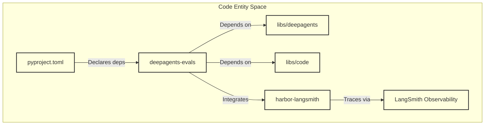
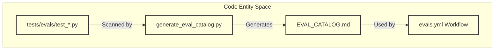
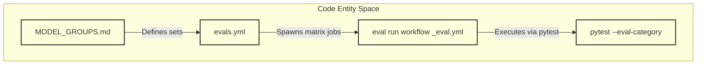
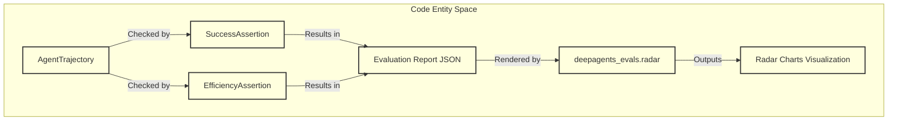
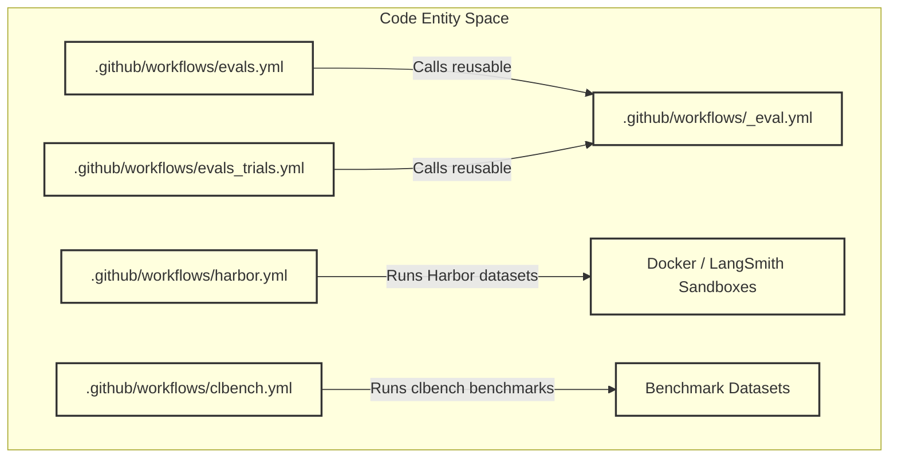

# Evals Package and Benchmark Workflows

Relevant source files

The following files were used as context for generating this wiki page:

- [.github/workflows/_eval.yml](.github/workflows/_eval.yml)
- [.github/workflows/clbench.yml](.github/workflows/clbench.yml)
- [.github/workflows/evals.yml](.github/workflows/evals.yml)
- [.github/workflows/evals_trials.yml](.github/workflows/evals_trials.yml)
- [.github/workflows/harbor.yml](.github/workflows/harbor.yml)
- [.gitignore](.gitignore)
- [LICENSE](LICENSE)
- [libs/evals/CONTRIBUTING.md](libs/evals/CONTRIBUTING.md)
- [libs/evals/EVAL_CATALOG.md](libs/evals/EVAL_CATALOG.md)
- [libs/evals/MODEL_GROUPS.md](libs/evals/MODEL_GROUPS.md)
- [libs/evals/Makefile](libs/evals/Makefile)
- [libs/evals/README.md](libs/evals/README.md)
- [libs/evals/deepagents_evals/categories.json](libs/evals/deepagents_evals/categories.json)
- [libs/evals/deepagents_evals/cli.py](libs/evals/deepagents_evals/cli.py)
- [libs/evals/deepagents_evals/radar.py](libs/evals/deepagents_evals/radar.py)
- [libs/evals/deepagents_evals/trial_summary.py](libs/evals/deepagents_evals/trial_summary.py)
- [libs/evals/scripts/composite_radar.py](libs/evals/scripts/composite_radar.py)
- [libs/evals/scripts/generate_eval_catalog.py](libs/evals/scripts/generate_eval_catalog.py)
- [libs/evals/scripts/generate_model_groups.py](libs/evals/scripts/generate_model_groups.py)
- [libs/evals/scripts/generate_radar.py](libs/evals/scripts/generate_radar.py)
- [libs/evals/scripts/run_trials.py](libs/evals/scripts/run_trials.py)
- [libs/evals/tests/evals/conftest.py](libs/evals/tests/evals/conftest.py)
- [libs/evals/tests/evals/test_iterative_constraint_satisfaction.py](libs/evals/tests/evals/test_iterative_constraint_satisfaction.py)
- [libs/evals/tests/evals/test_tool_usage_incident_graph.py](libs/evals/tests/evals/test_tool_usage_incident_graph.py)
- [libs/evals/tests/evals/test_tool_usage_relational.py](libs/evals/tests/evals/test_tool_usage_relational.py)
- [libs/evals/tests/evals/utils.py](libs/evals/tests/evals/utils.py)
- [libs/evals/tests/unit_tests/test_assertions.py](libs/evals/tests/unit_tests/test_assertions.py)
- [libs/evals/tests/unit_tests/test_category_tagging.py](libs/evals/tests/unit_tests/test_category_tagging.py)
- [libs/evals/tests/unit_tests/test_cli.py](libs/evals/tests/unit_tests/test_cli.py)
- [libs/evals/tests/unit_tests/test_eval_catalog.py](libs/evals/tests/unit_tests/test_eval_catalog.py)
- [libs/evals/tests/unit_tests/test_generate_radar_script.py](libs/evals/tests/unit_tests/test_generate_radar_script.py)
- [libs/evals/tests/unit_tests/test_model_groups.py](libs/evals/tests/unit_tests/test_model_groups.py)
- [libs/evals/tests/unit_tests/test_radar.py](libs/evals/tests/unit_tests/test_radar.py)
- [libs/evals/tests/unit_tests/test_run_trials.py](libs/evals/tests/unit_tests/test_run_trials.py)
- [libs/evals/tests/unit_tests/test_trial_summary.py](libs/evals/tests/unit_tests/test_trial_summary.py)

The purpose of this page is to document the evaluation subsystem housed within `libs/evals` (`deepagents-evals`, `deepagents_clbench`, `harbor_adapters`, and `datasets`). This package provides rigorous evaluation suites, external benchmark integrations (such as Harbor and Terminal-Bench), automated catalog generation, radar chart visualizations, LLM-backed judges, trajectory scoring, and GitHub Actions CI automation workflows.

---

## 1. Package Structure and Dependencies (`libs/evals`)

The `libs/evals` package (`deepagents-evals`) is configured via `libs/evals/pyproject.toml` [libs/evals/pyproject.toml:1-54]() and bundles dependencies required for running harness evaluations against multiple LLM providers, container sandboxes, and dataset stores. 

Key dependencies and runtime configuration include:
- **Core SDK & Code**: Local editable links to `deepagents` and `deepagents-code` (`libs/code`) [libs/evals/pyproject.toml:137-140]().
- **Harbor Integration**: Uses `harbor[langsmith]>=0.20.0,<0.21.0` and `harbor-langsmith>=0.3.0,<0.4.0` for managing trial rollouts and LangSmith observability tracing across sandbox environments [libs/evals/pyproject.toml:24-29]().
- **Model Providers**: Integrates LangChain provider wrappers for Anthropic, Baseten, DeepSeek, Fireworks, Google GenAI, Groq, Mistral, NVIDIA NIM, Ollama, OpenAI, OpenRouter, and xAI [libs/evals/pyproject.toml:35-47]().
- **Evaluation Utilities**: Utilizes `datasets`, `nltk`, `openevals>=0.2.0`, `tiktoken`, and optional `matplotlib>=3.11.0` for chart generation [libs/evals/pyproject.toml:49-62]().

**Sources:** `libs/evals/pyproject.toml` [libs/evals/pyproject.toml:1-140]()

---

## 2. Evaluation Categories, Tiers, and Catalog Generation

Evaluations within `deepagents-evals` are systematically categorized and tagged to support targeted test execution and regression gating.

### Eval Categories and Tiers
As defined in `EVAL_CATALOG.md`, the evaluation suite spans 136 evals across 8 primary categories [libs/evals/EVAL_CATALOG.md:1-13]:
1. `file_operations`: Validates file reading, writing, editing, deletion, parallel file operations, and path guards [libs/evals/EVAL_CATALOG.md:15-37].
2. `retrieval`: Tests path matching, grep regex recovery, globbing, and nested directory traversal [libs/evals/EVAL_CATALOG.md:39-49].
3. `tool_use`: Covers auto-mode authorization, goal tools, tool selection, and external benchmarks [libs/evals/EVAL_CATALOG.md:51-58].
4. `memory`: Assesses agent memory retrieval, `AGENTS.md` parsing, and memory persistence.
5. `conversation`: Evaluates multi-turn dialogue management and follow-up quality.
6. `summarization`: Tests summarization middleware and context window compaction.
7. `unit_test`: Validates core utility functions and isolated module behaviors.
8. `langchain/middleware`: Exercises middleware interception hooks and execution flows.

In addition to categories, evaluations support execution tiers:
- `baseline`: Used as a regression gate for stability and correctness.
- `hillclimb`: Used for progress tracking and agent capability improvements.

### EVAL_CATALOG Generation
The `libs/evals/scripts/generate_eval_catalog.py` script automatically scans `tests/evals/` to inspect test functions, extract category tags, and regenerate `libs/evals/EVAL_CATALOG.md` as the single source of truth [libs/evals/EVAL_CATALOG.md:1-6].

**Sources:** `libs/evals/EVAL_CATALOG.md` [libs/evals/EVAL_CATALOG.md:1-13], `libs/evals/Makefile` [libs/evals/Makefile:109-113]()

---

## 3. Model Groups and Evaluation Runners

Model selections are organized via `libs/evals/MODEL_GROUPS.md` and supported in CI workflow definitions. Models use standard provider-prefixed syntax (e.g., `provider:model` such as `anthropic:claude-sonnet-4-6` or `openai:gpt-4.1`) [.github/workflows/evals.yml:38-117].

Supported presets include:
- `frontier`, `mega`, `fast`, `open`, `open-fireworks`, `docs`
- Provider-specific presets (`anthropic`, `openai`, `google_genai`, `fireworks`, `baseten`, `groq`, `ollama`, `openrouter`, `xai`) [.github/workflows/evals.yml:48-66]

The `libs/evals/scripts/generate_model_groups.py` script is responsible for regenerating `MODEL_GROUPS.md` from the canonical registry [libs/evals/Makefile:104-106]().

**Sources:** `.github/workflows/evals.yml` [.github/workflows/evals.yml:38-117], `.github/workflows/_eval.yml` [.github/workflows/_eval.yml:1-110], `libs/evals/Makefile` [libs/evals/Makefile:104-106]()

---

## 4. LLM Judges, Trajectory Scoring, and Radar Charts

`deepagents-evals` incorporates automated evaluation metrics using `openevals` [libs/evals/pyproject.toml:51] and custom assertion modules to grade agent behaviors:
- **LLM Judges**: Evaluate qualitative outputs, reasoning steps, and follow-up quality against predefined rubrics. The `evals.yml` workflow includes an optional `analyze_failures` step that uses an LLM to analyze failed eval runs [libs/evals/.github/workflows/evals.yml:165-176]().
- **Trajectory Scoring**: The `libs/evals/tests/evals/utils.py` module defines `AgentStep` and `AgentTrajectory` data structures to capture and analyze the sequence of tool calls, intermediate states, and final artifacts produced across multi-step execution graphs [libs/evals/tests/evals/utils.py:27-71](). `SuccessAssertion` and `EfficiencyAssertion` classes provide a framework for defining correctness and efficiency checks on these trajectories [libs/evals/tests/evals/utils.py:79-142]().
- **Radar Charts**: The `libs/evals/deepagents_evals/radar.py` module processes evaluation reports and plots multi-axis radar charts comparing model capabilities across categories like file operations, tool use, retrieval, and memory [libs/evals/deepagents_evals/radar.py:1-50](). The `Makefile` includes targets `radar` and `radar-from-summary` to generate these charts [libs/evals/Makefile:92-98]().

**Sources:** `libs/evals/pyproject.toml` [libs/evals/pyproject.toml:51], `libs/evals/deepagents_evals/radar.py` [libs/evals/deepagents_evals/radar.py:1-50], `libs/evals/tests/evals/utils.py` [libs/evals/tests/evals/utils.py:27-142](), `.github/workflows/evals.yml` [libs/evals/.github/workflows/evals.yml:165-176](), `libs/evals/Makefile` [libs/evals/Makefile:92-98]()

---

## 5. Benchmark Workflows and GitHub Actions

Evaluation execution is automated via three core GitHub Actions workflows:

1. **`evals.yml`**: Manual workflow (`workflow_dispatch`) that partitions model evaluation sets into per-provider matrix jobs (`strategy.max-parallel: 1` per provider while running providers in parallel) [.github/workflows/evals.yml:1-35]. Supports custom category filters, exclude filters, eval tiers, and failure analysis [.github/workflows/evals.yml:110-176].
2. **`_eval.yml`**: Reusable workflow that executes pytest for a single model with configured environment variables (`LANGSMITH_TRACING=true`, `LANGSMITH_EXPERIMENT`) and applies CLI filtering flags (`--eval-category`, `--eval-tier`) [.github/workflows/_eval.yml:1-186]. This workflow also sets up Python and UV dependencies [libs/evals/.github/workflows/_eval.yml:130-144]().
3. **`evals_trials.yml`**: Runs the eval suite multiple times for the same model/configuration, aggregating per-trial reports into a single summary. It can run trials sequentially or in parallel [libs/evals/.github/workflows/evals_trials.yml:1-15].
4. **`harbor.yml`**: Runs external benchmark evaluations through Harbor (such as `terminal-bench/terminal-bench-2`, `sierra-research/tau3-bench`, and `harbor-index/harbor-index`) using Docker or LangSmith sandbox environments [.github/workflows/harbor.yml:1-157]. The `Makefile` provides targets like `run-terminal-bench-docker` and `run-terminal-bench-langsmith` to execute these locally [libs/evals/Makefile:74-85]().

**Sources:** `.github/workflows/evals.yml` [.github/workflows/evals.yml:1-176], `.github/workflows/_eval.yml` [.github/workflows/_eval.yml:1-186], `.github/workflows/evals_trials.yml` [libs/evals/.github/workflows/evals_trials.yml:1-15](), `.github/workflows/harbor.yml` [.github/workflows/harbor.yml:1-157], `libs/evals/Makefile` [libs/evals/Makefile:74-85]()