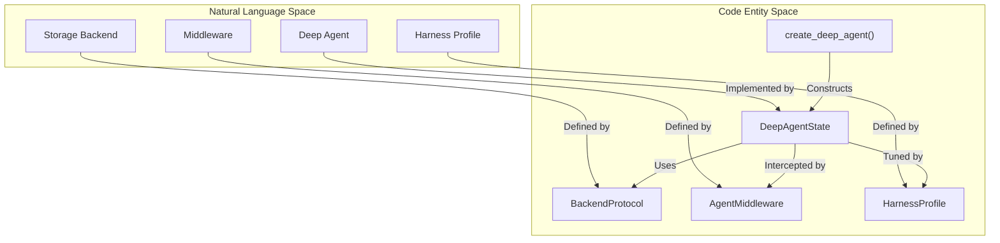
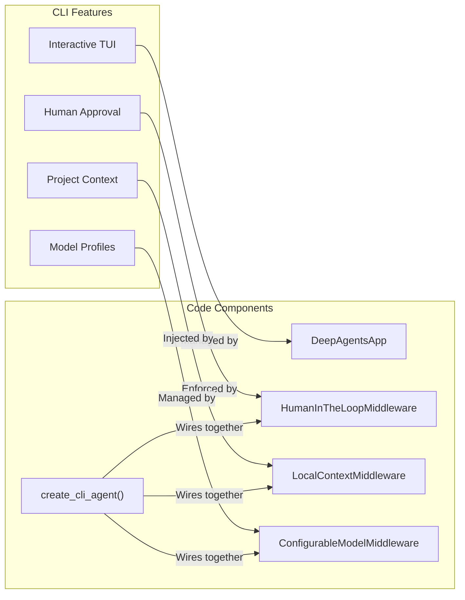

# API Reference

Relevant source files

The following files were used as context for generating this wiki page:

- [libs/deepagents/deepagents/__init__.py](libs/deepagents/deepagents/__init__.py)
- [libs/deepagents/deepagents/graph.py](libs/deepagents/deepagents/graph.py)
- [libs/deepagents/deepagents/middleware/__init__.py](libs/deepagents/deepagents/middleware/__init__.py)
- [libs/deepagents/deepagents/middleware/patch_tool_calls.py](libs/deepagents/deepagents/middleware/patch_tool_calls.py)
- [libs/deepagents/deepagents/middleware/subagents.py](libs/deepagents/deepagents/middleware/subagents.py)
- [libs/deepagents/tests/integration_tests/test_filesystem_middleware.py](libs/deepagents/tests/integration_tests/test_filesystem_middleware.py)
- [libs/deepagents/tests/integration_tests/test_subagent_middleware.py](libs/deepagents/tests/integration_tests/test_subagent_middleware.py)
- [libs/deepagents/tests/unit_tests/middleware/test_subagent_middleware_init.py](libs/deepagents/tests/unit_tests/middleware/test_subagent_middleware_init.py)
- [libs/deepagents/tests/unit_tests/test_eviction_replay.py](libs/deepagents/tests/unit_tests/test_eviction_replay.py)
- [libs/deepagents/tests/unit_tests/test_graph.py](libs/deepagents/tests/unit_tests/test_graph.py)
- [libs/deepagents/tests/unit_tests/test_subagents.py](libs/deepagents/tests/unit_tests/test_subagents.py)

This page provides an overview of the detailed API documentation for key functions, classes, and protocols in the Deep Agents monorepo. As a parent page, it summarizes the core subsystems and points to dedicated child pages for deep technical specifications, parameter lists, and edge cases.

For conceptual overviews, see [Architecture Overview](#1.3). For end-to-end usage examples, see [Examples and Tutorials](#8).

---

## API Organization

The Deep Agents monorepo is partitioned into modular packages that provide distinct layers of the framework, ranging from the core SDK to terminal UIs, agent client protocols, and maintainer utilities.

| Package | Purpose | Primary Exports |
|---------|---------|-----------------|
| `deepagents` | Core SDK and agent framework | `create_deep_agent`, `FilesystemMiddleware`, `HarnessProfile`, `BackendProtocol` [libs/deepagents/deepagents/graph.py:1-66]() |
| `deepagents-code` | Terminal UI and coding agent | `create_cli_agent`, `DeepAgentsApp`, CLI commands, TUI components [libs/deepagents/deepagents/graph.py:48-60]() |
| `deepagents-acp` | Agent Client Protocol | `AgentServerACP`, stdio communication utilities |
| `deepagents-harbor` | Harbor environment integration | `HarborSandbox` |
| `deepagents-talon` | Experimental runtime host | Channel adapters, cron scheduler, fleet export loading |

Sources: [libs/deepagents/deepagents/graph.py:1-66](), [libs/deepagents/deepagents/backends/protocol.py:1-45]()

---

## Architecture to Code Mapping

The following diagrams illustrate how high-level architectural concepts map directly to underlying code entities within the core SDK and CLI packages.

### Core SDK Entity Mapping
This diagram connects natural language agent concepts to classes and functions in the `deepagents` package.

Sources: [libs/deepagents/deepagents/graph.py:73-76](), [libs/deepagents/deepagents/backends/protocol.py:187-202](), [libs/deepagents/deepagents/profiles/harness/harness_profiles.py:64-68]()

### CLI System Entity Mapping
This diagram maps terminal features to their corresponding runtime components in `deepagents-code`.

Sources: [libs/deepagents/deepagents/graph.py:12-13](), [libs/deepagents/tests/unit_tests/test_middleware.py:107-116]()

---

## Main Entry Point References

### Agent Creation Factories
The core SDK and CLI provide primary factory functions that assemble graph topologies, bind default middleware stacks, and configure state reducers.

- **`create_deep_agent`**: Assembles a LangGraph state graph configured with `DeltaChannel` message reduction, memory middleware, skills, and filesystem tools. It also handles subagent configuration, including both synchronous (`SubAgentMiddleware`) and asynchronous (`AsyncSubAgentMiddleware`) subagents. For complete parameter references and type interactions, see [create_deep_agent](#7.1).
- **`create_cli_agent`**: Assembles the terminal-optimized agent stack, incorporating local context discovery, shell allow-lists, and interactive human-in-the-loop controls. For details, see [create_cli_agent](#7.2).

Sources: [libs/deepagents/deepagents/graph.py:73-77](), [libs/deepagents/deepagents/graph.py:165-231](), [libs/deepagents/deepagents/middleware/subagents.py:1-2](), [libs/deepagents/deepagents/middleware/async_subagents.py:1-2]()

---

## Core Protocols and Subsystems

### Middleware API
The `AgentMiddleware` interface forms the foundation of interception and prompt tuning in Deep Agents. Middleware hooks execute around model calls and tool invocations. Key middleware implementations include `FilesystemMiddleware` for file operations, `MemoryMiddleware` for context injection, `SkillsMiddleware` for skill management, `SubAgentMiddleware` for subagent delegation, `SummarizationMiddleware` for context window management, and `PatchToolCallsMiddleware` for handling dangling tool calls. For the complete interface reference, lifecycle hooks, and response types, see [Middleware API](#7.3).

Sources: [libs/deepagents/deepagents/graph.py:14-20](), [libs/deepagents/middleware/__init__.py:15-48](), [libs/deepagents/deepagents/middleware/filesystem.py:1-2](), [libs/deepagents/deepagents/middleware/memory.py:1-2](), [libs/deepagents/deepagents/middleware/skills.py:1-2](), [libs/deepagents/deepagents/middleware/subagents.py:1-2](), [libs/deepagents/deepagents/middleware/summarization.py:1-2](), [libs/deepagents/deepagents/middleware/patch_tool_calls.py:1-2]()

### Backend Protocol
The `BackendProtocol` and `SandboxBackendProtocol` define storage and execution abstractions for filesystems and local/remote shell runtimes. These protocols are implemented by various backends, such as `StateBackend` and `StoreBackend`, and can be combined using `CompositeBackend`. For required methods, async variants, and artifact roots, see [Backend Protocol](#7.4).

Sources: [libs/deepagents/deepagents/backends/protocol.py:1-45](), [libs/deepagents/deepagents/backends/protocol.py:187-208](), [libs/deepagents/tests/integration_tests/test_filesystem_middleware.py:28-30]()

### Built-in Tools Reference
Deep Agents provides batteries-included toolsets for file manipulation (`ls`, `read_file`, `write_file`, `edit_file`, `glob`, `grep`), planning (`write_todos`), execution (`execute`), and sub-agent delegation (`task`, `start_async_task`, `check_async_task`). The `task` tool is used for both isolated and forked subagents. For parameter rules and error handling, see [Built-in Tools Reference](#7.5).

Sources: [libs/deepagents/deepagents/middleware/filesystem.py:126-134](), [libs/deepagents/deepagents/middleware/subagents.py:58-65](), [libs/deepagents/tests/unit_tests/test_subagents.py:111-113]()

### CLI Command Reference
The `deepagents-code` package exposes terminal commands, environment variables, configuration keys, and slash commands. For a full breakdown of flags and options, see [CLI Command Reference](#7.6).

Sources: [libs/deepagents/deepagents/graph.py:48-60]()

### Type Definitions
Key data structures and TypedDicts—such as `FilesystemState`, `FileData`, `ExecuteResponse`, `ThreadInfo`, `SubagentMetadata`, `TokenTrackingState`, `GoalStatus`, and `ResumeState`—drive state representation. `DeepAgentState` is a core state definition that uses `DeltaChannel` for messages. For full definitions, see [Type Definitions](#7.7).

Sources: [libs/deepagents/deepagents/graph.py:73-76](), [libs/deepagents/deepagents/middleware/summarization.py:142-154](), [libs/deepagents/deepagents/middleware/subagents.py:84-101]()

### Harness Profiles API
Harness Profiles encapsulate model-specific tuning, including profile keys, merge semantics, excluded middleware, and tool visibility settings. `HarnessProfile` and `ProviderProfile` are key dataclasses for this system. For registration functions and dataclass fields, see [Harness Profiles API](#7.8).

Sources: [libs/deepagents/deepagents/profiles/harness/harness_profiles.py:64-68](), [libs/deepagents/deepagents/__init__.py:17-26]()

### Hooks API Reference
The Hooks v2 engine evaluates lifecycle events using `hooks.json` schemas, handler types, exit code policies, and aggregation rules. For complete execution details, see [Hooks API Reference](#7.9).

Sources: [libs/deepagents/deepagents/graph.py:1-66]()