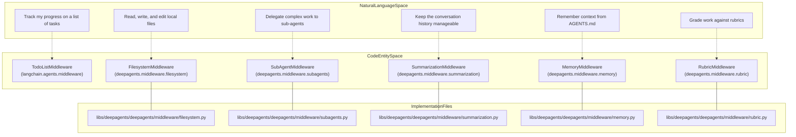
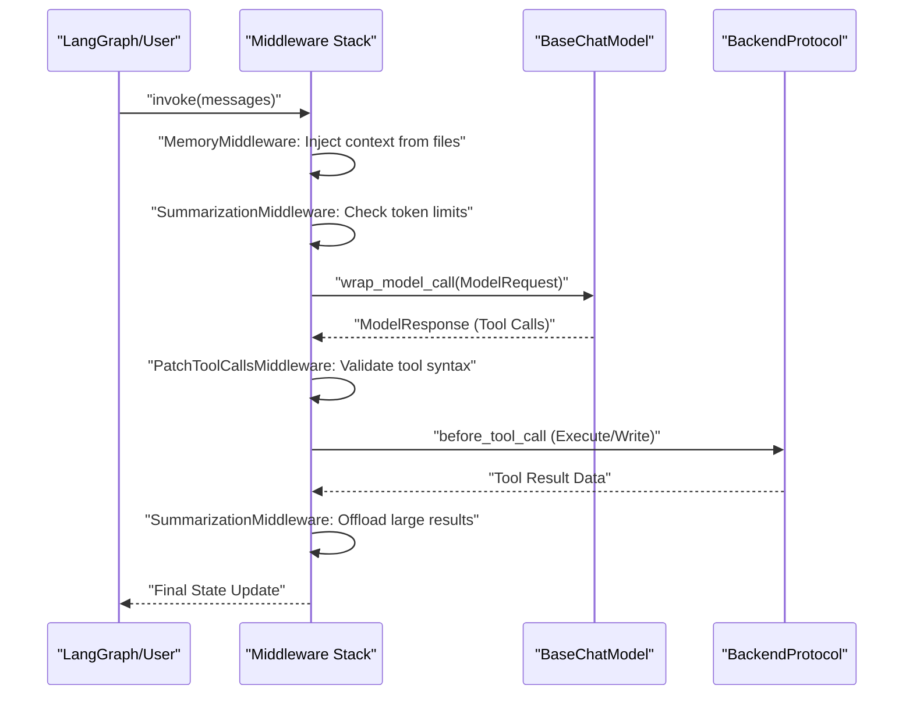

# create_deep_agent

<details>
<summary>Relevant source files</summary>

The following files were used as context for generating this wiki page:

- [libs/deepagents/deepagents/__init__.py](libs/deepagents/deepagents/__init__.py)
- [libs/deepagents/deepagents/graph.py](libs/deepagents/deepagents/graph.py)
- [libs/deepagents/deepagents/middleware/__init__.py](libs/deepagents/deepagents/middleware/__init__.py)
- [libs/deepagents/deepagents/middleware/patch_tool_calls.py](libs/deepagents/deepagents/middleware/patch_tool_calls.py)
- [libs/deepagents/deepagents/middleware/subagents.py](libs/deepagents/deepagents/middleware/subagents.py)
- [libs/deepagents/tests/integration_tests/test_filesystem_middleware.py](libs/deepagents/tests/integration_tests/test_filesystem_middleware.py)
- [libs/deepagents/tests/integration_tests/test_subagent_middleware.py](libs/deepagents/tests/integration_tests/test_subagent_middleware.py)
- [libs/deepagents/tests/unit_tests/middleware/test_subagent_middleware_init.py](libs/deepagents/tests/unit_tests/middleware/test_subagent_middleware_init.py)
- [libs/deepagents/tests/unit_tests/test_eviction_replay.py](libs/deepagents/tests/unit_tests/test_eviction_replay.py)
- [libs/deepagents/tests/unit_tests/test_graph.py](libs/deepagents/tests/unit_tests/test_graph.py)
- [libs/deepagents/tests/unit_tests/test_subagents.py](libs/deepagents/tests/unit_tests/test_subagents.py)

</details>


This page provides a complete API reference for the `create_deep_agent` function. This function is the primary entry point for constructing a fully configured Deep Agent, assembling a LangGraph `CompiledStateGraph` with integrated middleware for planning, filesystem operations, sub-agent delegation, memory management, and conversation summarization.

## Function Signature

The function is defined in [libs/deepagents/deepagents/graph.py:200-278](), though the provided snippet shows the setup leading to it.

```python
def create_deep_agent(
    model: str | BaseChatModel | None = None,
    tools: Sequence[BaseTool | Callable | dict[str, Any]] | None = None,
    *,
    system_prompt: str | SystemMessage | SystemPromptConfig | None = None,
    middleware: Sequence[AgentMiddleware] = (),
    subagents: Sequence[SubAgent | CompiledSubAgent | AsyncSubAgent] | None = None,
    skills: list[str] | None = None,
    memory: list[str] | None = None,
    response_format: ResponseFormat[ResponseT] | type[ResponseT] | dict[str, Any] | None = None,
    context_schema: type[ContextT] | None = None,
    state_schema: type[AgentState] | None = None,
    checkpointer: Checkpointer | None = None,
    store: BaseStore | None = None,
    backend: BackendProtocol | BackendFactory | None = None,
    interrupt_on: dict[str, bool | InterruptOnConfig] | None = None,
    debug: bool = False,
    name: str | None = None,
    cache: BaseCache | None = None,
) -> CompiledStateGraph:
```

Sources: [libs/deepagents/deepagents/graph.py:200-224]()

## Parameters

### `model`
**Type:** `str | BaseChatModel | None`  
**Default:** `None` (defaults to Claude 3.5 Sonnet)

The language model used by the agent. If `None`, it defaults to `ChatAnthropic(model_name="claude-sonnet-4-6")` via `_build_default_model()` [libs/deepagents/deepagents/graph.py:143-152](). Note that relying on the default model is deprecated [libs/deepagents/deepagents/graph.py:154-158]().
- **String Identifiers**: Resolved via `resolve_model()` [libs/deepagents/deepagents/graph.py:40]().
- **BaseChatModel**: A direct instance of a LangChain chat model.
- **Harness Profiles**: The function automatically resolves model-specific "harness profiles" via `_harness_profile_for_model` that apply provider-specific configurations, tune system prompts, and manage `excluded_middleware` [libs/deepagents/deepagents/graph.py:64-68]().

Sources: [libs/deepagents/deepagents/graph.py:40](), [libs/deepagents/deepagents/graph.py:64-68](), [libs/deepagents/deepagents/graph.py:143-158]()

### `tools`
**Type:** `Sequence[BaseTool | Callable | dict[str, Any]] | None`  
**Default:** `None`

Custom tools provided to the agent. `create_deep_agent` automatically injects built-in tools based on the middleware stack:
- **Planning**: `write_todos` via `TodoListMiddleware` (imported from `langchain.agents.middleware`) [libs/deepagents/deepagents/graph.py:13]().
- **Filesystem**: `ls`, `read_file`, `write_file`, `edit_file`, `glob`, `grep` via `FilesystemMiddleware` [libs/deepagents/deepagents/graph.py:51]().
- **Shell**: `execute` (enabled if the `backend` implements `SandboxBackendProtocol`) [libs/deepagents/deepagents/graph.py:35](), [libs/deepagents/deepagents/graph.py:44-45]().
- **Sub-agents**: `task` via `SubAgentMiddleware` [libs/deepagents/deepagents/graph.py:55-62]().
- **Summarization**: `compact_conversation` via `SummarizationToolMiddleware` (if enabled) [libs/deepagents/deepagents/middleware/summarization.py:10-12]().

Sources: [libs/deepagents/deepagents/graph.py:13](), [libs/deepagents/deepagents/graph.py:35](), [libs/deepagents/deepagents/graph.py:44-45](), [libs/deepagents/deepagents/graph.py:51](), [libs/deepagents/deepagents/graph.py:55-62](), [libs/deepagents/deepagents/middleware/summarization.py:10-12]()

### `system_prompt`
**Type:** `str | SystemMessage | SystemPromptConfig | None`  
**Default:** `None`

Custom instructions for the agent. The final prompt is assembled from multiple parts. While `BASE_AGENT_PROMPT` is deprecated [libs/deepagents/deepagents/graph.py:124-138](), the system supports assembly via:
1. `prefix`: Caller text placed before the base prompt.
2. `base`: Legacy `_LEGACY_BASE_AGENT_PROMPT` [libs/deepagents/deepagents/graph.py:79-121]() or a profile-specific base.
3. `suffix`: Caller text placed after the base.
4. `HarnessProfile.system_prompt_suffix`: Model-specific tuning guidance applied via `_apply_profile_prompt` [libs/deepagents/deepagents/graph.py:66]().

Sources: [libs/deepagents/deepagents/graph.py:66](), [libs/deepagents/deepagents/graph.py:79-121](), [libs/deepagents/deepagents/graph.py:124-138]()

### `middleware`
**Type:** `Sequence[AgentMiddleware]`  
**Default:** `()`

Additional custom middleware. These are applied alongside the standard stack which includes `FilesystemMiddleware`, `MemoryMiddleware`, `SkillsMiddleware`, `SubAgentMiddleware`, and `SummarizationMiddleware` [libs/deepagents/deepagents/graph.py:50-63](). The order of execution is determined by the `AgentMiddleware` interface hooks [libs/deepagents/deepagents/middleware/__init__.py:17-33]().

Sources: [libs/deepagents/deepagents/graph.py:50-63](), [libs/deepagents/deepagents/middleware/__init__.py:17-33]()

### `subagents`
**Type:** `Sequence[SubAgent | CompiledSubAgent | AsyncSubAgent] | None`  
**Default:** `None`

A list of agents that the main agent can delegate tasks to via the `task` tool.
- **`SubAgent`**: Declarative synchronous specification [libs/deepagents/deepagents/middleware/subagents.py:84]().
- **`CompiledSubAgent`**: A pre-compiled LangGraph runnable [libs/deepagents/deepagents/middleware/subagents.py:60]().
- **`AsyncSubAgent`**: Remote or background sub-agent specification [libs/deepagents/deepagents/middleware/async_subagents.py:50]().

Sources: [libs/deepagents/deepagents/graph.py:50](), [libs/deepagents/deepagents/graph.py:55-62](), [libs/deepagents/deepagents/middleware/async_subagents.py:50](), [libs/deepagents/deepagents/middleware/subagents.py:60](), [libs/deepagents/deepagents/middleware/subagents.py:84]()

### `skills` / `memory`
**Type:** `list[str] | None`  
**Default:** `None`

- **`skills`**: Paths to directories containing skill definitions, loaded via `SkillsMiddleware` [libs/deepagents/deepagents/graph.py:54]().
- **`memory`**: Paths to memory files (e.g., `AGENTS.md`) loaded via `MemoryMiddleware` [libs/deepagents/deepagents/graph.py:52]().

Sources: [libs/deepagents/deepagents/graph.py:52](), [libs/deepagents/deepagents/graph.py:54]()

### `backend`
**Type:** `BackendProtocol | BackendFactory | None`  
**Default:** `None` (defaults to `StateBackend`)

The storage and execution interface. If `None`, a `StateBackend` is initialized [libs/deepagents/deepagents/graph.py:43](). If a `SandboxBackendProtocol` is provided, the agent gains the ability to run shell commands via `execute` [libs/deepagents/deepagents/graph.py:35](), [libs/deepagents/deepagents/graph.py:45](). Complex routing can be achieved using `CompositeBackend` [libs/deepagents/deepagents/tests/integration_tests/test_filesystem_middleware.py:28]().

Sources: [libs/deepagents/deepagents/graph.py:35](), [libs/deepagents/deepagents/graph.py:43](), [libs/deepagents/deepagents/graph.py:45](), [libs/deepagents/deepagents/tests/integration_tests/test_filesystem_middleware.py:28]()

### `interrupt_on`
**Type:** `dict[str, bool | InterruptOnConfig] | None`  
**Default:** `None`

Configures Human-in-the-Loop (HITL) behavior. Maps tool names to approval requirements, triggering an interrupt before the tool is executed via `HumanInTheLoopMiddleware` [libs/deepagents/deepagents/graph.py:13]().

Sources: [libs/deepagents/deepagents/graph.py:13]()

## Architecture: Mapping Concepts to Code

### Entity Association Diagram

This diagram maps natural language capabilities to the specific Python classes and files that implement them.



Sources: [libs/deepagents/deepagents/graph.py:50-63](), [libs/deepagents/deepagents/middleware/subagents.py:55-62](), [libs/deepagents/deepagents/middleware/rubric.py:41]()

### Execution Pipeline

This sequence diagram shows how data flows through the middleware stack generated by `create_deep_agent`.



Sources: [libs/deepagents/deepagents/graph.py:50-63](), [libs/deepagents/deepagents/middleware/patch_tool_calls.py:49]()

## Implementation Details

### State Management
`create_deep_agent` uses `DeepAgentState` which implements a `DeltaChannel` on the `messages` list [libs/deepagents/deepagents/graph.py:73-77](). This reduces checkpoint growth from O(N²) to O(N) by using a specialized reducer `_messages_delta_reducer` [libs/deepagents/deepagents/graph.py:39](), [libs/deepagents/deepagents/graph.py:76]().

### Sub-Agent Processing
The function wraps all provided sub-agents into a `SubAgentMiddleware`. By default, it includes the `GENERAL_PURPOSE_SUBAGENT` [libs/deepagents/deepagents/graph.py:56](), [libs/deepagents/deepagents/middleware/subagents.py:57](). Sub-agents are accessed via the `task` tool, and can run asynchronously via `AsyncSubAgentMiddleware` [libs/deepagents/deepagents/graph.py:50]().

### Automatic Context Compaction
The `SummarizationMiddleware` automatically triggers when token usage exceeds thresholds (e.g., a fraction of the context window) [libs/deepagents/deepagents/middleware/summarization.py:64](). It offloads history to the backend as markdown files and handles media references [libs/deepagents/deepagents/middleware/summarization.py:42-51](), [libs/deepagents/deepagents/middleware/summarization.py:100-107]().

### Versioning
The package version is tracked in `__version__` [libs/deepagents/deepagents/_version.py:23](), which is used during agent construction to tag metadata in the `CompiledStateGraph` [libs/deepagents/deepagents/graph.py:42](). Editable installs are specifically marked in metadata [libs/deepagents/deepagents/graph.py:133-139]().

Sources: [libs/deepagents/deepagents/graph.py:39](), [libs/deepagents/deepagents/graph.py:42](), [libs/deepagents/deepagents/graph.py:50](), [libs/deepagents/deepagents/graph.py:56](), [libs/deepagents/deepagents/graph.py:73-77](), [libs/deepagents/deepagents/graph.py:133-139](), [libs/deepagents/deepagents/_version.py:23](), [libs/deepagents/deepagents/middleware/subagents.py:57](), [libs/deepagents/deepagents/middleware/summarization.py:42-51](), [libs/deepagents/deepagents/middleware/summarization.py:64](), [libs/deepagents/deepagents/middleware/summarization.py:100-107]()