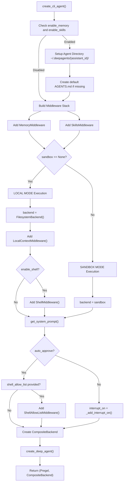

# create_cli_agent

<details>
<summary>Relevant source files</summary>

The following files were used as context for generating this wiki page:

- [libs/code/deepagents_code/_server_config.py](libs/code/deepagents_code/_server_config.py)
- [libs/code/deepagents_code/agent.py](libs/code/deepagents_code/agent.py)
- [libs/code/deepagents_code/server_graph.py](libs/code/deepagents_code/server_graph.py)
- [libs/code/tests/unit_tests/test_agent.py](libs/code/tests/unit_tests/test_agent.py)
- [libs/code/tests/unit_tests/test_server_config.py](libs/code/tests/unit_tests/test_server_config.py)
- [libs/code/tests/unit_tests/test_server_graph.py](libs/code/tests/unit_tests/test_server_graph.py)

</details>


This page provides a complete API reference for `create_cli_agent`, detailing its parameters, middleware stack configuration, `ServerConfig`, and backend factory patterns utilized within the `deepagents-code` terminal agent package.

For the core agent creation function without terminal interface features, see `create_deep_agent` in `libs/deepagents/deepagents/graph.py` [libs/deepagents/deepagents/graph.py:22-133](). For detailed middleware documentation, refer to the middleware system architecture.

---

## Function Signature and Purpose

The `create_cli_agent` function is defined at `libs/code/deepagents_code/agent.py` [libs/code/deepagents_code/agent.py:441-654]() and serves as the primary factory for assembling agents configured for CLI interactions, session persistence, skills loading, memory management, and secure execution.

```python
def create_cli_agent(
    model: str | BaseChatModel,
    assistant_id: str,
    *,
    tools: Sequence[BaseTool | Callable | dict[str, Any]] | None = None,
    sandbox: SandboxBackendProtocol | None = None,
    sandbox_type: str | None = None,
    system_prompt: str | None = None,
    auto_approve: bool = False,
    interrupt_shell_only: bool = False,
    shell_allow_list: list[str] | None = None,
    enable_ask_user: bool = False,
    enable_memory: bool = True,
    enable_skills: bool = True,
    enable_shell: bool = True,
    mcp_server_info: list[MCPServerInfo] | None = None,
    cwd: str | Path | None = None,
    project_context: ProjectContext | None = None,
    async_subagents: list[AsyncSubAgent] | None = None,
    checkpointer: BaseCheckpointSaver | None = None,
    # ... additional parameters for goal/rubric and token tracking
) -> tuple[Pregel, CompositeBackend]
```

**Purpose**: Construct a fully configured `Pregel` agent graph paired with a `CompositeBackend` [libs/code/deepagents_code/agent.py:653]() tailored for terminal-based workflows.

**Key Differences from `create_deep_agent`**:
- Automatically injects terminal middleware stack (`MemoryMiddleware`, `SkillsMiddleware`, `LocalContextMiddleware`, `ConfigurableModelMiddleware`) [libs/code/deepagents_code/agent.py:534-582]().
- Manages local persistence directories and seeds `AGENTS.md` configuration files under `~/.deepagents/{assistant_id}/` [libs/code/deepagents_code/agent.py:497-510]().
- Configures human-in-the-loop (HITL) interrupt predicates (`_add_interrupt_on()`, `_should_interrupt_tool_call`) for safety-critical operations [libs/code/deepagents_code/agent.py:615-639]().
- Switches dynamically between host `FilesystemBackend` and remote sandbox backends [libs/code/deepagents_code/agent.py:561-587]().
- Supports `ShellAllowListMiddleware` for automated non-interactive command validation [libs/code/deepagents_code/agent.py:178-235]().

Sources: [libs/code/deepagents_code/agent.py:178-235](), [libs/code/deepagents_code/agent.py:441-654]()

---

## Parameters Reference

| Parameter | Type | Default | Description |
|-----------|------|---------|-------------|
| `model` | `str \| BaseChatModel` | required | LLM model identifier (e.g., `"openai:gpt-4o"`) or pre-instantiated chat model. |
| `assistant_id` | `str` | required | Unique identifier used for state storage and directory names under `~/.deepagents/`. |
| `tools` | `Sequence[BaseTool \| Callable \| dict[str, Any]] \| None` | `None` | Optional sequence of tools (e.g., web search, custom functions) to inject into the agent. |
| `sandbox` | `SandboxBackendProtocol \| None` | `None` | Remote sandbox backend instance. If `None`, local host filesystem and shell are used. |
| `sandbox_type` | `str \| None` | `None` | Descriptor string (`"modal"`, `"runloop"`, `"daytona"`, `"langsmith"`) tuning system prompts. |
| `system_prompt` | `str \| None` | `None` | Explicit system prompt override. If `None`, dynamically generated via `get_system_prompt()`. |
| `auto_approve` | `bool` | `False` | When `True`, bypasses all HITL approval pauses and executes tool calls directly. |
| `interrupt_shell_only` | `bool` | `False` | When `True`, restricts approval interrupts exclusively to shell execution tools. |
| `shell_allow_list` | `list[str] \| None` | `None` | Permitted shell commands evaluated during non-interactive or automated runs. |
| `enable_memory` | `bool` | `True` | Enables `MemoryMiddleware` to load user and project `AGENTS.md` reference files. |
| `enable_skills` | `bool` | `True` | Enables `SkillsMiddleware` to dynamically discover and load custom skill scripts. |
| `enable_shell` | `bool` | `True` | Enables host `ShellMiddleware` when running in local filesystem mode. |
| `mcp_server_info` | `list[MCPServerInfo] \| None` | `None` | Model Context Protocol (MCP) server metadata injected into system instructions. |
| `cwd` | `str \| Path \| None` | `None` | Working directory context for file operations and execution backends. |
| `checkpointer` | `BaseCheckpointSaver \| None` | `None` | Persistence checkpointer for saving graph states and thread histories. |

Sources: [libs/code/deepagents_code/agent.py:441-462]()

---

## Agent Creation Flow and Architecture

The assembly pipeline links natural language intent and configuration settings to executable LangGraph structures and backend multiplexers.

Title: "Agent Assembly Pipeline"


Sources: [libs/code/deepagents_code/agent.py:441-654]()

---

## Backend Factory Patterns and ServerConfig

The package coordinates CLI processes and server runtimes using `ServerConfig` defined in `libs/code/deepagents_code/_server_config.py` [libs/code/deepagents_code/_server_config.py:1-1148]() and server graphs initialized in `libs/code/deepagents_code/server_graph.py` [libs/code/deepagents_code/server_graph.py:1-1124]().

### ServerConfig Serialization and Invariants
- **Environment Multiplexing**: The parent process serializes configuration parameters into environment variables prefixed with `DEEPAGENTS_CODE_SERVER_` via `ServerConfig.to_env()` [libs/code/deepagents_code/_server_config.py:299-390]().
- **Server Deserialization**: The LangGraph server subprocess reads back the configuration using `ServerConfig.from_env()` [libs/code/deepagents_code/_server_config.py:400-600]().
- **Partitioning Policies**: Fields are strictly divided between `SESSION_WORKSPACE_FIELDS` (client-claimable flags) and `PROJECT_WORKSPACE_FIELDS` (security-sensitive code execution grants resolved per checkout) [libs/code/deepagents_code/_server_config.py:34-81]().

Sources: [libs/code/deepagents_code/_server_config.py:1-1148](), [libs/code/deepagents_code/server_graph.py:1-1124]()

---

## Middleware Stack Configuration

When `create_cli_agent` executes, it composes a rich middleware stack prior to invoking the core SDK factory.

| Middleware Class | Module Path | Purpose |
|------------------|-------------|---------|
| `MemoryMiddleware` | `deepagents.middleware` | Loads hierarchical reference files from `AGENTS.md` [libs/code/deepagents_code/agent.py:534-545](). |
| `SkillsMiddleware` | `deepagents.middleware` | Discovers and registers custom Python script tools [libs/code/deepagents_code/agent.py:548-558](). |
| `LocalContextMiddleware` | `deepagents_code.local_context` | Injects Git branch status, environment runtimes, and directory trees [libs/code/deepagents_code/agent.py:564](). |
| `ConfigurableModelMiddleware` | `deepagents_code.configurable_model` | Enables dynamic model switching via `/model` commands [libs/code/deepagents_code/agent.py:465](). |
| `ShellAllowListMiddleware` | `deepagents_code.agent` | Validates terminal commands against automated rules [libs/code/deepagents_code/agent.py:178-235](). |
| `ReliableRubricMiddleware` | `deepagents_code.reliable_rubric` | Implements objective-driven acceptance criteria grading [libs/code/deepagents_code/agent.py:603](). |

Sources: [libs/code/deepagents_code/agent.py:178-235](), [libs/code/deepagents_code/agent.py:465-603]()

---

## Human-in-the-Loop and Tool Authorization

Title: "Natural Language to Code Entity HITL Mapping"
```mermaid
graph TB
    subgraph "NaturalLanguageSpace"
        NL1["User requests shell command execution"]
        NL2["Agent attempts file modification"]
        NL3["Agent initiates web search query"]
        NL4["Agent spawns sub-agent task"]
    end

    subgraph "CodeEntitySpace"
        CE1["execute" --> F1["_format_execute_description"]]
        CE2["write_file" --> F2["_format_write_file_description"]]
        CE3["web_search" --> F3["_format_web_search_description"]]
        CE4["task" --> F4["_format_task_description"]]
        
        Predicate["_should_interrupt_tool_call()"]
    end
    
    NL1 --> CE1
    NL2 --> CE2
    NL3 --> CE3
    NL4 --> CE4
    
    CE1 --> Predicate
    CE2 --> Predicate
    CE3 --> Predicate
    CE4 --> Predicate
```

**Approval Logic**:
- Critical tool handlers (`execute`, `write_file`, `web_search`, `task`) format descriptive previews using specialized formatters [libs/code/deepagents_code/agent.py:279-438]().
- The `_should_interrupt_tool_call` function inspects runtime context and store-backed `approval_mode` states to dynamically suppress or trigger interrupts [libs/code/deepagents_code/agent.py:1134-1188]().

Sources: [libs/code/deepagents_code/agent.py:261-438](), [libs/code/deepagents_code/agent.py:615-639](), [libs/code/deepagents_code/agent.py:1134-1188]()