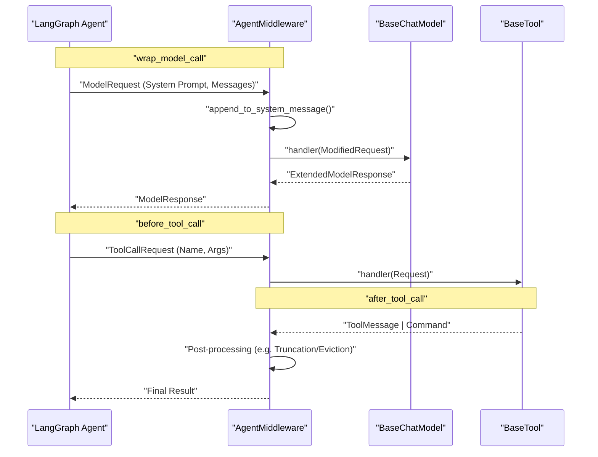
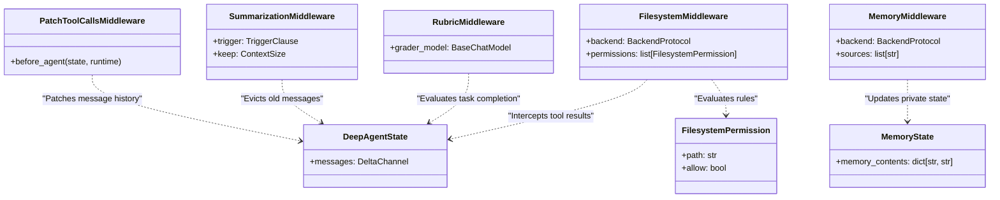

# Middleware API

Relevant source files

The following files were used as context for generating this wiki page:

- [libs/deepagents/deepagents/__init__.py](libs/deepagents/deepagents/__init__.py)
- [libs/deepagents/deepagents/graph.py](libs/deepagents/deepagents/graph.py)
- [libs/deepagents/deepagents/middleware/__init__.py](libs/deepagents/deepagents/middleware/__init__.py)
- [libs/deepagents/deepagents/middleware/patch_tool_calls.py](libs/deepagents/deepagents/middleware/patch_tool_calls.py)
- [libs/deepagents/deepagents/middleware/subagents.py](libs/deepagents/deepagents/middleware/subagents.py)
- [libs/deepagents/deepagents/middleware/summarization.py](libs/deepagents/deepagents/middleware/summarization.py)
- [libs/deepagents/tests/integration_tests/test_filesystem_middleware.py](libs/deepagents/tests/integration_tests/test_filesystem_middleware.py)
- [libs/deepagents/tests/integration_tests/test_subagent_middleware.py](libs/deepagents/tests/integration_tests/test_subagent_middleware.py)
- [libs/deepagents/tests/unit_tests/middleware/test_compact_tool.py](libs/deepagents/tests/unit_tests/middleware/test_compact_tool.py)
- [libs/deepagents/tests/unit_tests/middleware/test_subagent_middleware_init.py](libs/deepagents/tests/unit_tests/middleware/test_subagent_middleware_init.py)
- [libs/deepagents/tests/unit_tests/middleware/test_summarization_factory.py](libs/deepagents/tests/unit_tests/middleware/test_summarization_factory.py)
- [libs/deepagents/tests/unit_tests/middleware/test_summarization_middleware.py](libs/deepagents/tests/unit_tests/middleware/test_summarization_middleware.py)
- [libs/deepagents/tests/unit_tests/test_eviction_replay.py](libs/deepagents/tests/unit_tests/test_eviction_replay.py)
- [libs/deepagents/tests/unit_tests/test_graph.py](libs/deepagents/tests/unit_tests/test_graph.py)
- [libs/deepagents/tests/unit_tests/test_subagents.py](libs/deepagents/tests/unit_tests/test_subagents.py)

The Middleware API provides the primary extensibility mechanism for Deep Agents. By implementing the `AgentMiddleware` interface, developers can intercept model calls, inject system prompts, manage state via custom reducers, and provide tools to the agent.

## Overview

Middleware intercepts every LLM request before it is sent and every tool response before it is returned to the agent logic [libs/deepagents/deepagents/middleware/__init__.py:15-18](). This architecture allows for dynamic tool filtering, system-prompt injection, message transformation (e.g., summarization), and maintenance of cross-turn state [libs/deepagents/deepagents/middleware/__init__.py:21-30]().

Unlike plain tools, which are only invoked *by* the LLM, middleware runs *before* and *after* the LLM call, enabling it to modify the system prompt or tool list per-call [libs/deepagents/deepagents/middleware/__init__.py:32-41]().

Sources: [libs/deepagents/deepagents/middleware/__init__.py:1-48]()

## AgentMiddleware Interface

The `AgentMiddleware` interface is the foundation for all middleware in the system. It defines lifecycle hooks that allow for fine-grained control over the agent's execution flow.

### Methods and Lifecycle

| Method | Timing | Purpose |
|:---|:---|:---|
| `wrap_model_call` | Before/After LLM call | Intercepts `ModelRequest` to augment system prompts or modify model parameters, and processes `ModelResponse` [libs/deepagents/deepagents/middleware/subagents.py:15-16](). |
| `before_tool_call` | Before tool execution | Intercept tool inputs, validate permissions, or modify arguments [libs/deepagents/deepagents/middleware/filesystem.py:70-80](). |
| `after_tool_call` | After tool execution | Post-process tool outputs, handle result eviction, or update state [libs/deepagents/deepagents/middleware/filesystem.py:82-88](). |
| `before_agent` | Before agent loop | Handle dangling tool calls or initialize turn-specific state [libs/deepagents/deepagents/middleware/patch_tool_calls.py:17-18](). |

Sources: [libs/deepagents/deepagents/middleware/patch_tool_calls.py:11-18](), [libs/deepagents/deepagents/middleware/subagents.py:15-16](), [libs/deepagents/deepagents/middleware/filesystem.py:70-88]()

### Data Flow and Interception

The following diagram illustrates how middleware intercepts the communication between the LangGraph agent logic and external entities (Models and Tools).

**Middleware Interception Flow**

Sources: [libs/deepagents/deepagents/middleware/_utils.py:23](), [libs/deepagents/deepagents/middleware/__init__.py:15-30](), [libs/deepagents/deepagents/middleware/subagents.py:15-16]()

---

## Core Middleware Implementations

### FilesystemMiddleware
Manages the agent's interaction with the filesystem via `BackendProtocol`. It provides tools for file manipulation and enforces access control [libs/deepagents/deepagents/middleware/filesystem.py:51-52]().

*   **Tools**: Provides standard filesystem operations such as `ls`, `read_file`, `write_file`, `edit_file`, `glob`, `grep`, `execute`, and `delete` [libs/deepagents/deepagents/middleware/filesystem.py:126-134]().
*   **Permissions**: Uses `FilesystemPermission` objects to enforce access control rules [libs/deepagents/deepagents/middleware/filesystem.py:51]().
*   **Execution Support**: Dynamically filters the `execute` tool based on whether the backend supports it [libs/deepagents/deepagents/middleware/__init__.py:21-22]().

### MemoryMiddleware
Implements the memory loading mechanism to inject project-specific context from `AGENTS.md` files into the system prompt [libs/deepagents/deepagents/middleware/memory.py:2-6](). 

*   **State**: Tracks loaded contents in `MemoryState` as private state attributes [libs/deepagents/deepagents/middleware/memory.py:88-96]().
*   **Prompt Injection**: Wraps the loaded memory in `<agent_memory>` tags and appends specific guidelines for trust and verification [libs/deepagents/deepagents/middleware/memory.py:105-148]().

### SummarizationMiddleware
Automatically compacts conversation history when token usage exceeds a threshold [libs/deepagents/deepagents/middleware/summarization.py:5-6](). 

*   **Triggers**: Supports `TriggerClause` with `tokens`, `messages`, or `fraction` of context window thresholds [libs/deepagents/deepagents/middleware/summarization.py:155-166]().
*   **Offloading**: Full history is offloaded to markdown files at `/conversation_history/{session_id}.md` [libs/deepagents/deepagents/middleware/summarization.py:44-45]().
*   **Media Handling**: Extracts base64 media from evicted messages and stores them separately to keep history files text-only [libs/deepagents/deepagents/middleware/summarization.py:48-51]().

### PatchToolCallsMiddleware
Handles "dangling" tool calls—cases where an `AIMessage` contains tool calls that were never answered by a `ToolMessage` [libs/deepagents/deepagents/middleware/patch_tool_calls.py:11-12](). It intercepts the state in `before_agent` and injects error messages for malformed or cancelled calls [libs/deepagents/deepagents/middleware/patch_tool_calls.py:33-47]().

Sources: [libs/deepagents/deepagents/middleware/memory.py:1-148](), [libs/deepagents/deepagents/middleware/summarization.py:1-166](), [libs/deepagents/deepagents/middleware/patch_tool_calls.py:1-49](), [libs/deepagents/deepagents/middleware/filesystem.py:51-134]()

---

## State Management and Code Entities

Middleware updates the agent's state based on model interactions or tool results. The system uses `DeltaChannel` for `messages` in `DeepAgentState` to reduce checkpoint growth from O(N²) to O(N) [libs/deepagents/deepagents/graph.py:73-76]().

**Code Entity Association: State and Middleware**

Sources: [libs/deepagents/deepagents/graph.py:73-76](), [libs/deepagents/deepagents/middleware/memory.py:88-96](), [libs/deepagents/deepagents/middleware/summarization.py:155-166](), [libs/deepagents/deepagents/middleware/patch_tool_calls.py:11-49](), [libs/deepagents/deepagents/middleware/filesystem.py:51-52]()

### Model Configuration and Harness Profiles
Harness profiles declare how `create_deep_agent` should shape the agent's runtime behavior for a given provider or specific model spec [libs/deepagents/deepagents/profiles/harness/harness_profiles.py:9-11]().

*   **Exclusion**: Profiles can use `excluded_middleware` to strip capabilities. However, "required scaffolding" (filesystem tools, subagent dispatch, and permission enforcement) cannot be excluded [libs/deepagents/deepagents/profiles/harness/harness_profiles.py:74-79]().
*   **System Prompts**: Profiles tune prompt assembly, tool visibility, and default subagent behavior [libs/deepagents/deepagents/profiles/harness/harness_profiles.py:10-13]().

Sources: [libs/deepagents/deepagents/profiles/harness/harness_profiles.py:1-80](), [libs/deepagents/deepagents/graph.py:34-38]()