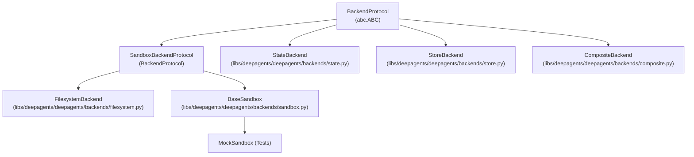
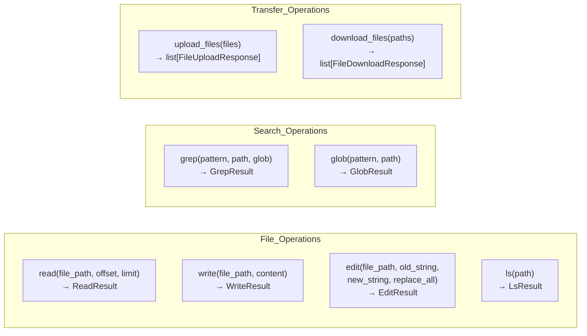
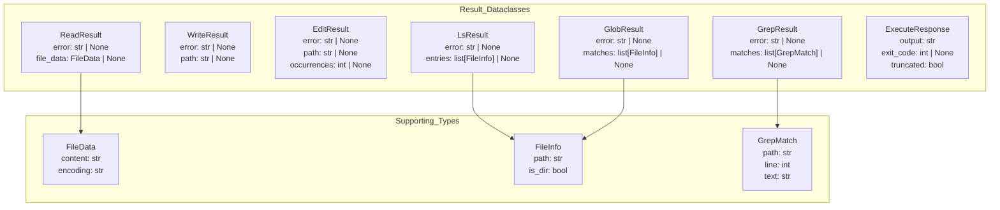

# Backend Protocol

<details>
<summary>Relevant source files</summary>

The following files were used as context for generating this wiki page:

- [libs/deepagents/deepagents/backends/composite.py](libs/deepagents/deepagents/backends/composite.py)
- [libs/deepagents/deepagents/backends/filesystem.py](libs/deepagents/deepagents/backends/filesystem.py)
- [libs/deepagents/deepagents/backends/protocol.py](libs/deepagents/deepagents/backends/protocol.py)
- [libs/deepagents/deepagents/backends/sandbox.py](libs/deepagents/deepagents/backends/sandbox.py)
- [libs/deepagents/deepagents/backends/state.py](libs/deepagents/deepagents/backends/state.py)
- [libs/deepagents/deepagents/backends/store.py](libs/deepagents/deepagents/backends/store.py)
- [libs/deepagents/deepagents/backends/utils.py](libs/deepagents/deepagents/backends/utils.py)
- [libs/deepagents/deepagents/middleware/_fs_interrupt.py](libs/deepagents/deepagents/middleware/_fs_interrupt.py)
- [libs/deepagents/deepagents/middleware/filesystem.py](libs/deepagents/deepagents/middleware/filesystem.py)
- [libs/deepagents/deepagents/middleware/permissions.py](libs/deepagents/deepagents/middleware/permissions.py)
- [libs/deepagents/tests/unit_tests/backends/test_composite_backend.py](libs/deepagents/tests/unit_tests/backends/test_composite_backend.py)
- [libs/deepagents/tests/unit_tests/backends/test_composite_backend_async.py](libs/deepagents/tests/unit_tests/backends/test_composite_backend_async.py)
- [libs/deepagents/tests/unit_tests/backends/test_file_format.py](libs/deepagents/tests/unit_tests/backends/test_file_format.py)
- [libs/deepagents/tests/unit_tests/backends/test_filesystem_backend.py](libs/deepagents/tests/unit_tests/backends/test_filesystem_backend.py)
- [libs/deepagents/tests/unit_tests/backends/test_filesystem_backend_async.py](libs/deepagents/tests/unit_tests/backends/test_filesystem_backend_async.py)
- [libs/deepagents/tests/unit_tests/backends/test_protocol.py](libs/deepagents/tests/unit_tests/backends/test_protocol.py)
- [libs/deepagents/tests/unit_tests/backends/test_sandbox_backend.py](libs/deepagents/tests/unit_tests/backends/test_sandbox_backend.py)
- [libs/deepagents/tests/unit_tests/backends/test_state_backend.py](libs/deepagents/tests/unit_tests/backends/test_state_backend.py)
- [libs/deepagents/tests/unit_tests/backends/test_state_backend_async.py](libs/deepagents/tests/unit_tests/backends/test_state_backend_async.py)
- [libs/deepagents/tests/unit_tests/backends/test_store_backend.py](libs/deepagents/tests/unit_tests/backends/test_store_backend.py)
- [libs/deepagents/tests/unit_tests/backends/test_store_backend_async.py](libs/deepagents/tests/unit_tests/backends/test_store_backend_async.py)
- [libs/deepagents/tests/unit_tests/backends/test_utils.py](libs/deepagents/tests/unit_tests/backends/test_utils.py)
- [libs/deepagents/tests/unit_tests/test_end_to_end.py](libs/deepagents/tests/unit_tests/test_end_to_end.py)
- [libs/deepagents/tests/unit_tests/test_local_sandbox_operations.py](libs/deepagents/tests/unit_tests/test_local_sandbox_operations.py)
- [libs/deepagents/tests/unit_tests/test_middleware.py](libs/deepagents/tests/unit_tests/test_middleware.py)
- [libs/deepagents/tests/unit_tests/test_middleware_async.py](libs/deepagents/tests/unit_tests/test_middleware_async.py)
- [libs/deepagents/tests/unit_tests/test_permissions.py](libs/deepagents/tests/unit_tests/test_permissions.py)

</details>


This page documents the `BackendProtocol` and `SandboxBackendProtocol` interfaces that define the contract for pluggable storage and execution backends in Deep Agents. These protocols enable agents to perform file operations (read, write, edit, ls, grep, glob) and optionally execute shell commands using different storage mechanisms (ephemeral state, persistent store, real filesystem, remote sandboxes).

For information about specific backend implementations, see [Backend Architecture](#2.7). For how backends are used in filesystem tools, see [Filesystem Operations and Built-in Tools](#2.6).

---

## Protocol Hierarchy

The backend system defines two protocol interfaces:

- **`BackendProtocol`**: Base interface for file operations (`ls`, `read`, `write`, `edit`, `grep`, `glob`, `upload`, `download`). [libs/deepagents/deepagents/backends/protocol.py:245-493]()
- **`SandboxBackendProtocol`**: Extension that adds shell execution capabilities (`execute()` method and `id` property). [libs/deepagents/deepagents/backends/protocol.py:512-561]()

### Natural Language Space to Code Entity Space: Protocols

| Concept | Code Entity | File Path |
| :--- | :--- | :--- |
| **Base Interface** | `BackendProtocol` | [libs/deepagents/deepagents/backends/protocol.py:245]() |
| **Sandbox Interface** | `SandboxBackendProtocol` | [libs/deepagents/deepagents/backends/protocol.py:512]() |
| **Execution Result** | `ExecuteResponse` | [libs/deepagents/deepagents/backends/protocol.py:495]() |
| **File Content Data** | `FileData` | [libs/deepagents/deepagents/backends/protocol.py:187]()

Title: Protocol Inheritance and Implementations

**Sources:** [libs/deepagents/deepagents/backends/protocol.py:245-523](), [libs/deepagents/deepagents/backends/sandbox.py:1-40](), [libs/deepagents/deepagents/backends/composite.py:12-32](), [libs/deepagents/deepagents/backends/filesystem.py:91-137]()

---

## BackendProtocol Interface

The `BackendProtocol` class defines the base interface that all backends must implement. It is an abstract base class that provides default async wrappers for synchronous methods. [libs/deepagents/deepagents/backends/protocol.py:245-253]()

### Core File Operations

Title: Backend Operation Flow

**Sources:** [libs/deepagents/deepagents/backends/protocol.py:266-493]()

#### `ls(path: str) -> LsResult`
Lists all files and directories in the specified directory. Returns an `LsResult` containing a list of `FileInfo` dictionaries or an error message. [libs/deepagents/deepagents/backends/protocol.py:266-279]()

#### `read(file_path: str, offset: int = 0, limit: int = 2000) -> ReadResult`
Reads file content with pagination support. For text files, returns content formatted with line numbers. For binary files, returns base64-encoded content. [libs/deepagents/deepagents/backends/protocol.py:281-316]()

#### `write(file_path: str, content: str) -> WriteResult`
Creates a new file. Returns an error if the file already exists. [libs/deepagents/deepagents/backends/protocol.py:386-409]()

#### `edit(file_path: str, old_string: str, new_string: str, replace_all: bool = False) -> EditResult`
Performs exact string replacements in an existing file. [libs/deepagents/deepagents/backends/protocol.py:411-442]()

#### `grep(pattern: str, path: str = "/", glob: str | None = None, max_count: int | None = None, context_lines: int = 0) -> GrepResult`
Searches for a regular expression `pattern` within files under `path`. Supports optional `glob` patterns for inclusion/exclusion, `max_count` for limiting matches, and `context_lines` for surrounding lines. [libs/deepagents/deepagents/backends/protocol.py:318-354]()

#### `glob(pattern: str, path: str = "/") -> GlobResult`
Finds files and directories matching a `pattern` under `path`. [libs/deepagents/deepagents/backends/protocol.py:356-382]()

#### `upload_files(files: list[tuple[str, bytes]]) -> list[FileUploadResponse]`
Uploads a list of files to the backend. [libs/deepagents/deepagents/backends/protocol.py:444-468]()

#### `download_files(paths: list[str]) -> list[FileDownloadResponse]`
Downloads a list of files from the backend. [libs/deepagents/deepagents/backends/protocol.py:470-493]()

**Sources:** [libs/deepagents/deepagents/backends/protocol.py:266-493]()

---

## SandboxBackendProtocol Extension

The `SandboxBackendProtocol` extends `BackendProtocol` to add shell command execution capabilities. This is designed for backends running in isolated environments (containers, VMs, remote hosts). [libs/deepagents/deepagents/backends/protocol.py:512-515]()

### Execute Method
```python
def execute(
    self,
    command: str,
    *,
    timeout: int | None = None,
) -> ExecuteResponse
```
Executes a shell command in the sandbox environment. [libs/deepagents/deepagents/backends/protocol.py:529-561]()

- **`command`**: Full shell command string to execute.
- **`timeout`**: Maximum time in seconds to wait for completion. Defaults to `DEFAULT_GREP_TIMEOUT` (15s) for sync phases, with `ASYNC_GREP_TIMEOUT` (35s) for async wrappers. [libs/deepagents/deepagents/backends/protocol.py:20-28]()
- **`ExecuteResponse`**: Contains `output` (combined stdout/stderr), `exit_code`, and `truncated` flag. [libs/deepagents/deepagents/backends/protocol.py:495-510]()

### Sandbox ID Property
```python
@property
def id(self) -> str
```
Returns a unique identifier for the sandbox backend instance. [libs/deepagents/deepagents/backends/protocol.py:524-527]()

---

## Result Types

All file operations return structured result objects rather than raising exceptions. This allows backends to communicate errors in a way that LLMs can interpret. [libs/deepagents/deepagents/backends/protocol.py:30-45]()

### Natural Language Space to Code Entity Space: Results

| LLM Concept | Code Entity | File Path |
| :--- | :--- | :--- |
| **Read Outcome** | `ReadResult` | [libs/deepagents/deepagents/backends/protocol.py:204]() |
| **Write Outcome** | `WriteResult` | [libs/deepagents/deepagents/backends/protocol.py:239]() |
| **Edit Outcome** | `EditResult` | [libs/deepagents/deepagents/backends/protocol.py:263]() |
| **File Meta** | `FileInfo` | [libs/deepagents/deepagents/backends/protocol.py:129]() |
| **Search Match** | `GrepMatch` | [libs/deepagents/deepagents/backends/protocol.py:159]() |

Title: Result Object Structure

**Sources:** [libs/deepagents/deepagents/backends/protocol.py:129-263](), [libs/deepagents/deepagents/backends/protocol.py:495-510]()

---

## Async Method Variants

All `BackendProtocol` methods have async variants with an `a` prefix (e.g., `aread()`, `awrite()`). The default implementations use `asyncio.to_thread()` to wrap the synchronous methods. [libs/deepagents/deepagents/backends/protocol.py:309-316](), [libs/deepagents/deepagents/backends/protocol.py:403-409]()

Backends can override these methods to provide native async implementations. For example, `FilesystemBackend` provides `aexecute` via `asyncio.create_subprocess_shell`. [libs/deepagents/deepagents/backends/filesystem.py:11-13]()

**Available Async Methods:**
- `als(path) -> LsResult` [libs/deepagents/deepagents/backends/protocol.py:277]()
- `aread(file_path, offset, limit) -> ReadResult` [libs/deepagents/deepagents/backends/protocol.py:309]()
- `awrite(file_path, content) -> WriteResult` [libs/deepagents/deepagents/backends/protocol.py:403]()
- `aedit(file_path, old_string, new_string, replace_all) -> EditResult` [libs/deepagents/deepagents/backends/protocol.py:434]()
- `agrep(pattern, path, glob) -> GrepResult` [libs/deepagents/deepagents/backends/protocol.py:354]()
- `aglob(pattern, path) -> GlobResult` [libs/deepagents/deepagents/backends/protocol.py:382]()
- `aupload_files(files) -> list[FileUploadResponse]` [libs/deepagents/deepagents/backends/protocol.py:461]()
- `adownload_files(paths) -> list[FileDownloadResponse]` [libs/deepagents/deepagents/backends/protocol.py:486]()
- `aexecute(command, timeout) -> ExecuteResponse` [libs/deepagents/deepagents/backends/protocol.py:554]()

**Sources:** [libs/deepagents/deepagents/backends/protocol.py:277](), [libs/deepagents/deepagents/backends/protocol.py:309](), [libs/deepagents/deepagents/backends/protocol.py:354](), [libs/deepagents/deepagents/backends/protocol.py:382](), [libs/deepagents/deepagents/backends/protocol.py:403](), [libs/deepagents/deepagents/backends/protocol.py:434](), [libs/deepagents/deepagents/backends/protocol.py:461](), [libs/deepagents/deepagents/backends/protocol.py:486](), [libs/deepagents/deepagents/backends/protocol.py:554](), [libs/deepagents/deepagents/backends/filesystem.py:11-13]()

---

## Implementation Patterns

### BaseSandbox
The `BaseSandbox` class implements most file operations by executing shell commands via the `execute()` method. [libs/deepagents/deepagents/backends/sandbox.py:1-13]()
- **Read**: Uses a Python one-liner command for server-side pagination and encoding detection. [libs/deepagents/deepagents/backends/sandbox.py:42]()
- **Edit**: Uses a Python script for inline replacement or temp-file uploads for large payloads. [libs/deepagents/deepagents/backends/sandbox.py:27-30]()
- **Write**: Performs pre-flight checks to create parent directories before delegating to `upload_files()`. [libs/deepagents/deepagents/backends/sandbox.py:33]()

### StateBackend
`StateBackend` stores files in ephemeral LangGraph state.
- **Read**: Fetches the `files` channel from the graph execution context. [libs/deepagents/deepagents/backends/state.py:37]()
- **Write**: Enqueues partial updates to the `files` channel. [libs/deepagents/deepagents/backends/state.py:40]()

### StoreBackend
`StoreBackend` provides persistent, cross-thread storage using LangGraph's `BaseStore`. [libs/deepagents/deepagents/backends/store.py:18]()
- **Namespacing**: Requires a `namespace` factory to scope file operations (e.g., by thread or assistant ID). [libs/deepagents/deepagents/backends/store.py:79]()

### CompositeBackend
`CompositeBackend` routes operations to different backends based on path prefixes. [libs/deepagents/deepagents/backends/composite.py:1-6]()
- **Routing**: Matches paths against `routes` (longest prefix first) and falls back to a `default` backend. [libs/deepagents/deepagents/backends/composite.py:152-171]()
- **Artifacts Root**: The `artifacts_root` parameter (if supported by the backend) defines where middleware offloads large results. [libs/deepagents/deepagents/middleware/filesystem.py:40-43]()

**Sources:** [libs/deepagents/deepagents/backends/sandbox.py:1-13](), [libs/deepagents/deepagents/backends/sandbox.py:27-30](), [libs/deepagents/deepagents/backends/sandbox.py:33](), [libs/deepagents/deepagents/backends/sandbox.py:42](), [libs/deepagents/deepagents/backends/state.py:37](), [libs/deepagents/deepagents/backends/state.py:40](), [libs/deepagents/deepagents/backends/store.py:18](), [libs/deepagents/deepagents/backends/store.py:79](), [libs/deepagents/deepagents/backends/composite.py:1-6](), [libs/deepagents/deepagents/backends/composite.py:152-171](), [libs/deepagents/deepagents/middleware/filesystem.py:40-43]()

---

## File Operation Error Mapping

The `FileOperationError` type defines standardized error literals that the LLM can interpret. [libs/deepagents/deepagents/backends/protocol.py:39-44]()

| Error Literal | Description |
| :--- | :--- |
| `file_not_found` | The requested file doesn't exist. |
| `permission_denied` | Access denied for the operation. |
| `is_directory` | Attempted to operate on a directory as a file. |
| `invalid_path` | Path syntax is malformed or contains invalid characters. |

**Sources:** [libs/deepagents/deepagents/backends/protocol.py:39-62](), [libs/deepagents/deepagents/backends/filesystem.py:21-24]()