# Built-in Tools Reference

Relevant source files

The following files were used as context for generating this wiki page:

- [libs/deepagents/deepagents/backends/filesystem.py](libs/deepagents/deepagents/backends/filesystem.py)
- [libs/deepagents/deepagents/backends/protocol.py](libs/deepagents/deepagents/backends/protocol.py)
- [libs/deepagents/deepagents/backends/sandbox.py](libs/deepagents/deepagents/backends/sandbox.py)
- [libs/deepagents/deepagents/backends/utils.py](libs/deepagents/deepagents/backends/utils.py)
- [libs/deepagents/deepagents/middleware/_fs_interrupt.py](libs/deepagents/deepagents/middleware/_fs_interrupt.py)
- [libs/deepagents/deepagents/middleware/filesystem.py](libs/deepagents/deepagents/middleware/filesystem.py)
- [libs/deepagents/deepagents/middleware/permissions.py](libs/deepagents/deepagents/middleware/permissions.py)
- [libs/deepagents/tests/unit_tests/backends/test_filesystem_backend.py](libs/deepagents/tests/unit_tests/backends/test_filesystem_backend.py)
- [libs/deepagents/tests/unit_tests/backends/test_protocol.py](libs/deepagents/tests/unit_tests/backends/test_protocol.py)
- [libs/deepagents/tests/unit_tests/backends/test_sandbox_backend.py](libs/deepagents/tests/unit_tests/backends/test_sandbox_backend.py)
- [libs/deepagents/tests/unit_tests/backends/test_utils.py](libs/deepagents/tests/unit_tests/backends/test_utils.py)
- [libs/deepagents/tests/unit_tests/test_end_to_end.py](libs/deepagents/tests/unit_tests/test_end_to_end.py)
- [libs/deepagents/tests/unit_tests/test_local_sandbox_operations.py](libs/deepagents/tests/unit_tests/test_local_sandbox_operations.py)
- [libs/deepagents/tests/unit_tests/test_middleware.py](libs/deepagents/tests/unit_tests/test_middleware.py)
- [libs/deepagents/tests/unit_tests/test_middleware_async.py](libs/deepagents/tests/unit_tests/test_middleware_async.py)
- [libs/deepagents/tests/unit_tests/test_permissions.py](libs/deepagents/tests/unit_tests/test_permissions.py)

This page provides comprehensive technical documentation for the built-in tools available in the Deep Agents framework. These tools are primarily provided through the middleware system and allow agents to interact with the filesystem, manage state, execute shell commands, delegate tasks to sub-agents, and interact with users.

## Overview

Built-in tools are injected into the agent's graph via `AgentMiddleware` implementations. When `create_deep_agent` is called, these middlewares contribute specific tools to the `ToolNode`.

### Tool Provisioning Architecture

The following diagram bridges natural language tool concepts to their underlying code entities within the `deepagents` and `deepagents-code` packages.

**Tool to Code Entity Mapping**

```mermaid
graph TB
    subgraph "Middleware Layer"
        FSM["FilesystemMiddleware"]
        SAM["SubAgentMiddleware"]
        TDM["TodoListMiddleware"]
        GTM["GoalToolsMiddleware"]
        AUM["AskUserMiddleware"]
    end

    subgraph "Filesystem Tools (filesystem.py)"
        ls["ls"]
        read["read_file"]
        write["write_file"]
        edit["edit_file"]
        glob["glob"]
        grep["grep"]
        exec["execute"]
        del["delete"]
    end

    subgraph "Delegation Tools (subagents.py)"
        task["task"]
    end

    subgraph "Planning Tools (todo_list.py)"
        wt["write_todos"]
    end

    subgraph "Goal Tools (goal_tools.py)"
        ug["update_goal"]
        gg["get_goal"]
        gr["get_rubric"]
    end

    subgraph "Interactive Tools (ask_user.py)"
        au["ask_user"]
    end

    FSM --> ls & read & write & edit & glob & grep & exec & del
    SAM --> task
    TDM --> wt
    GTM --> ug & gg & gr
    AUM --> au

    subgraph "Backend Space"
        SB["StateBackend"]
        STB["StoreBackend"]
        FSB["FilesystemBackend"]
        LSB["LocalShellBackend"]
        CB["CompositeBackend"]
    end

    ls & read & write & edit & glob & grep & del -. "BackendProtocol" .-> SB & STB & FSB & CB
    exec -. "SandboxBackendProtocol" .-> LSB
```

Sources: [libs/deepagents/deepagents/middleware/filesystem.py:126-135](), [libs/deepagents/tests/unit_tests/test_middleware.py:95-135]()

## Filesystem Tools

The `FilesystemMiddleware` provides a suite of tools for file manipulation. These tools are designed to work with any implementation of `BackendProtocol`.

### ls
Lists files and directories at a given path.

| Parameter | Type | Description |
| :--- | :--- | :--- |
| `path` | `str` | Absolute path to the directory to list. Must be absolute, not relative. |

**Implementation Detail:**
The tool calls `backend.ls(path)` [libs/deepagents/deepagents/middleware/filesystem.py:127-127](). It returns a list of paths. If the path points to a directory, it returns entries with a trailing slash (e.g., `/docs/`) [libs/deepagents/tests/unit_tests/test_middleware_async.py:100-100]().

### read_file
Reads content from a file. Supports text, multimodal image, audio, and video content.

| Parameter | Type | Default | Description |
| :--- | :--- | :--- | :--- |
| `file_path` | `str` | Required | Absolute path to the file to read. |
| `offset` | `int` | `0` | Line number to start reading from (0-indexed) or seconds for video. |
| `limit` | `int` | `100` | Maximum number of lines to read or seconds for video. |

**Key Features:**
- **Pagination:** Uses `offset` and `limit` to prevent context window overflow [libs/deepagents/deepagents/backends/sandbox.py:155-155]().
- **Line Numbering:** Output is formatted with `cat -n` style line numbers using `format_content_with_line_numbers` [libs/deepagents/deepagents/backends/utils.py:40-40]().
- **Multimodal Support:** Automatically detects media types (image, audio, video) by extension [libs/deepagents/deepagents/backends/utils.py:198-206]().
- **Video Sampling:** For video files, it extracts frames at a rate of 0.5 seconds (`_VIDEO_SAMPLING_RATE`) [libs/deepagents/deepagents/middleware/filesystem.py:188-188]().
- **Truncation Warning:** If a result is extremely large, `truncate_if_too_long` is applied [libs/deepagents/deepagents/backends/utils.py:43-43]().
- **Empty Content:** If a file exists but is empty, it returns a specific `EMPTY_CONTENT_WARNING` [libs/deepagents/deepagents/backends/utils.py:24-24]().

### write_file
Creates a new file or overwrites an existing one.

| Parameter | Type | Description |
| :--- | :--- | :--- |
| `file_path` | `str` | Absolute path where the file should be created. |
| `content` | `str` | The text content to write to the file. |

**Behavior:**
- Calls `backend.write(file_path, content)` [libs/deepagents/deepagents/middleware/filesystem.py:131-131]().
- Successfully written files return a `WriteResult` rendered as a confirmation message [libs/deepagents/deepagents/backends/protocol.py:228-243]().

### edit_file
Performs exact string replacement within a file.

| Parameter | Type | Description |
| :--- | :--- | :--- |
| `file_path` | `str` | Absolute path to the file to edit. |
| `old_string` | `str` | The exact text to find and replace. |
| `new_string` | `str` | The text to replace `old_string` with. |
| `replace_all`| `bool`| If `True`, replaces all occurrences. If `False` (default), `old_string` must be unique. |

**Constraints:**
- The agent **should** read the file before editing to ensure context awareness.
- If `replace_all=False` and multiple occurrences are found, the backend returns an error message [libs/deepagents/deepagents/backends/protocol.py:246-271]().

### glob & grep
- **glob:** Finds files matching a pattern (e.g., `**/*.py`). It supports recursive matching using `wcmatch` flags like `GLOBSTAR` [libs/deepagents/deepagents/middleware/filesystem.py:162-163]().
- **grep:** Searches for text patterns. Supports literal search via `ripgrep` (`rg`) if available on the system for performance [libs/deepagents/deepagents/backends/filesystem.py:72-88]().
- **Implementation:** Grep and Glob results are capped to prevent token overflow using `_apply_grep_max_count` [libs/deepagents/deepagents/backends/protocol.py:64-65]().

Sources: [libs/deepagents/deepagents/middleware/filesystem.py:126-135](), [libs/deepagents/deepagents/backends/protocol.py:187-271](), [libs/deepagents/deepagents/backends/utils.py:198-206](), [libs/deepagents/tests/unit_tests/test_middleware_async.py:43-183](), [libs/deepagents/backends/utils.py:40-40](), [libs/deepagents/backends/utils.py:43-43](), [libs/deepagents/backends/utils.py:24-24](), [libs/deepagents/middleware/filesystem.py:188-188](), [libs/deepagents/middleware/filesystem.py:162-163](), [libs/deepagents/backends/filesystem.py:72-88](), [libs/deepagents/backends/protocol.py:64-65]()

## Execution Tools

### execute
Executes shell commands in a sandbox environment. This tool is available if the backend implements `SandboxBackendProtocol`.

| Parameter | Type | Description |
| :--- | :--- | :--- |
| `command` | `str` | Shell command to execute in the sandbox environment. |
| `timeout` | `int` | Maximum execution time in seconds. |

**Implementation (Sandbox Backend):**
The `BaseSandbox` implementation uses shell commands for most operations, including `glob`, `grep`, and `read` [libs/deepagents/deepagents/backends/sandbox.py:6-12](). Concrete subclasses like `LocalSubprocessSandbox` implement the actual `execute` call via `subprocess.run` [libs/deepagents/tests/unit_tests/test_local_sandbox_operations.py:121-127]().

**Security and Truncation:**
- Output is captured and can be truncated if it exceeds `TOOL_RESULT_TOKEN_LIMIT` [libs/deepagents/backends/utils.py:26-26]().
- The `ExecuteResponse` includes the output and exit code [libs/deepagents/deepagents/backends/protocol.py:330-343]().

Sources: [libs/deepagents/deepagents/backends/sandbox.py:1-44](), [libs/deepagents/deepagents/backends/protocol.py:330-343](), [libs/deepagents/backends/utils.py:26-26](), [libs/deepagents/tests/unit_tests/test_local_sandbox_operations.py:121-127]()

## Security and Validation

### Path Validation and Permissions
The `FilesystemMiddleware` implements a permission system to restrict agent access.
- **FilesystemPermission:** Rules define `operations` (read/write), `paths` (glob patterns), and `mode` (allow/deny) [libs/deepagents/deepagents/middleware/filesystem.py:168-169]().
- **Recursive Delete Safety:** A recursive delete is refused if any `deny` write rule's pattern overlaps the target subtree [libs/deepagents/tests/unit_tests/test_permissions.py:122-129]().
- **Validation:** All tools use `validate_path` to ensure paths are within virtual filesystem boundaries [libs/deepagents/deepagents/backends/utils.py:85-85](). Attempts to use path traversal (e.g., `../../`) or `~` are rejected in virtual mode [libs/deepagents/deepagents/backends/filesystem.py:161-164]().

### Backend Safety (FilesystemBackend)
The `FilesystemBackend` provides a `virtual_mode` (default `True`) which acts as a virtual root for filesystem operations [libs/deepagents/deepagents/backends/filesystem.py:155-164](). When enabled, it blocks traversal and ensures all resolved paths remain within the specified `root_dir`.

Sources: [libs/deepagents/deepagents/middleware/filesystem.py:168-169](), [libs/deepagents/deepagents/backends/filesystem.py:139-168](), [libs/deepagents/tests/unit_tests/test_permissions.py:122-129](), [libs/deepagents/deepagents/backends/utils.py:85-85]()