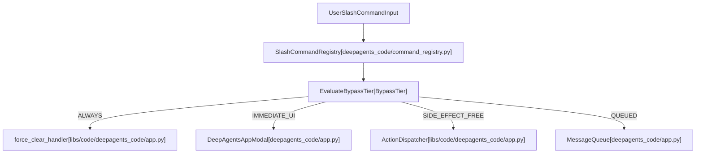
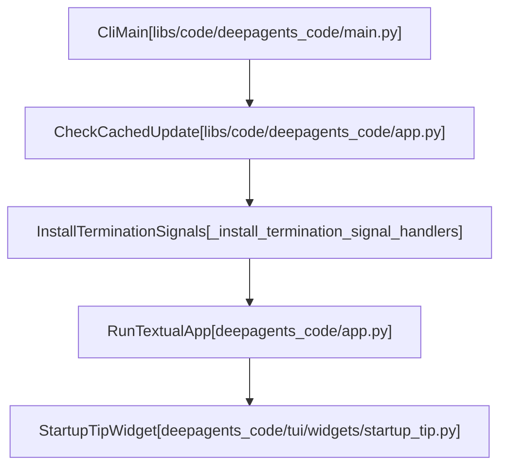

# CLI Command Reference

Relevant source files

The following files were used as context for generating this wiki page:

- [libs/code/COMMANDS.md](libs/code/COMMANDS.md)
- [libs/code/deepagents_code/_env_vars.py](libs/code/deepagents_code/_env_vars.py)
- [libs/code/deepagents_code/app.py](libs/code/deepagents_code/app.py)
- [libs/code/deepagents_code/client/commands/config.py](libs/code/deepagents_code/client/commands/config.py)
- [libs/code/deepagents_code/command_registry.py](libs/code/deepagents_code/command_registry.py)
- [libs/code/deepagents_code/config.py](libs/code/deepagents_code/config.py)
- [libs/code/deepagents_code/config_manifest.py](libs/code/deepagents_code/config_manifest.py)
- [libs/code/deepagents_code/model_config.py](libs/code/deepagents_code/model_config.py)
- [libs/code/deepagents_code/tui/widgets/startup_tip.py](libs/code/deepagents_code/tui/widgets/startup_tip.py)
- [libs/code/tests/unit_tests/conftest.py](libs/code/tests/unit_tests/conftest.py)
- [libs/code/tests/unit_tests/test_app.py](libs/code/tests/unit_tests/test_app.py)
- [libs/code/tests/unit_tests/test_command_registry.py](libs/code/tests/unit_tests/test_command_registry.py)
- [libs/code/tests/unit_tests/test_config.py](libs/code/tests/unit_tests/test_config.py)
- [libs/code/tests/unit_tests/test_config_manifest.py](libs/code/tests/unit_tests/test_config_manifest.py)
- [libs/code/tests/unit_tests/test_model_config.py](libs/code/tests/unit_tests/test_model_config.py)
- [libs/code/tests/unit_tests/test_thread_naming_app.py](libs/code/tests/unit_tests/test_thread_naming_app.py)
- [libs/code/tests/unit_tests/tui/widgets/test_startup_tip.py](libs/code/tests/unit_tests/tui/widgets/test_startup_tip.py)

This page provides a complete reference for `deepagents-code` CLI arguments, subcommands, interactive slash commands, environment variables, and configuration options.

## CLI Overview and Entry Point

The `deepagents-code` CLI is the primary entry point for interacting with the Deep Agents framework, supporting an interactive TUI, a non-interactive headless runner, and an ACP server mode.

**Entry Point**: `cli_main` in `libs/code/deepagents_code/main.py` [libs/code/deepagents_code/main.py:44-47]() (aliased to `dcode` and `deepagents-code` in `pyproject.toml`). The runtime installs termination signal handlers for graceful resource cleanup [libs/code/deepagents_code/main.py:113-118]() and performs version reporting via `build_version_text` [libs/code/deepagents_code/main.py:120-154]().

Sources: [libs/code/deepagents_code/main.py:11-47](), [libs/code/deepagents_code/main.py:113-154]()

## Global CLI Arguments and Flags

These options apply when invoking the `dcode` command to start a session.

| Flag | Argument | Description |
|:---|:---|:---|
| `-r`, `--resume` | `[ID]` | Resume thread: `-r` for most recent, `-r ID` for specific [libs/code/deepagents_code/app.py:32528]() |
| `-a`, `--agent` | `NAME` | Agent profile to use (e.g., `coder`) [libs/code/deepagents_code/app.py:32528]() |
| `-M`, `--model` | `MODEL` | Model to use (e.g., `gpt-5.5`) [libs/code/deepagents_code/app.py:32528]() |
| `--model-params` | `JSON` | Extra model kwargs (e.g., `'{"temperature": 0.7}'`) [libs/code/deepagents_code/app.py:32528]() |
| `--summarization-model` | `MODEL` | Model for context-compaction summaries [libs/code/deepagents_code/app.py:32528]() |
| `--max-retries` | `N` | Retries after a failed model request; `0` disables [libs/code/deepagents_code/app.py:32528]() |
| `--profile-override` | `JSON` | Override model profile fields as JSON [libs/code/deepagents_code/app.py:32528]() |
| `-m`, `--message` | `TEXT` | Initial prompt to auto-submit on start [libs/code/deepagents_code/app.py:32528]() |
| `-s`, `--skill` | `NAME` | Invoke a skill when the session starts [libs/code/deepagents_code/app.py:32528]() |
| `--startup-cmd` | `CMD` | Shell command to run at startup, before first prompt [libs/code/deepagents_code/app.py:32528]() |
| `-y`, `--auto-approve` | - | Enable classifier-backed Auto mode (TUI or ACP) [libs/code/deepagents_code/app.py:32528]() |
| `--auto-classifier-model` | `MODEL` | Model the Auto classifier reviews actions with [libs/code/deepagents_code/app.py:32528]() |
| `--yolo` | - | Run gated actions without review after acknowledgement [libs/code/deepagents_code/app.py:32528]() |
| `--shell-allow-list` | `LIST` | Comma-separated list of pre-approved shell commands [libs/code/deepagents_code/app.py:32528]() |
| `--json` | - | Emit machine-readable JSON output [libs/code/deepagents_code/app.py:32528]() |

Sources: [libs/code/deepagents_code/app.py:32528](), [libs/code/tests/unit_tests/test_app.py:1-210]()

## Subcommands Reference

The CLI exposes multiple subcommands for environment management, inspection, and configuration:

- **`agents <list|reset>`**: Manages agent profiles and resets them to defaults [libs/code/deepagents_code/app.py:32528]().
- **`skills <list|create|info|delete>`**: Manages agent skills [libs/code/deepagents_code/app.py:32528]().
- **`threads <list|delete>`**: Manages conversation threads and history [libs/code/deepagents_code/app.py:32528]().
- **`mcp <login>`**: Manages Model Context Protocol servers and authentication [libs/code/deepagents_code/app.py:32528]().
- **`config [get <key>|path]`**: Inspects configuration state and schema paths [libs/code/deepagents_code/app.py:32528]().
- **`auth <list|set|remove|status|path>`**: Manages provider credentials via `auth_store` [libs/code/deepagents_code/app.py:32528]().
- **`update`**: Checks for and installs software updates [libs/code/deepagents_code/app.py:32528]().
- **`doctor`**: Prints installation diagnostics [libs/code/deepagents_code/app.py:32528]().
- **`tools <install|list>`**: Manages managed binaries such as `ripgrep` [libs/code/deepagents_code/app.py:32528]().
- **`install NAME` / `uninstall NAME`**: Installs or removes optional extras [libs/code/deepagents_code/app.py:32528]().

Sources: [libs/code/deepagents_code/app.py:32528]()

## Interactive Slash Commands and Bypass Tiers

Slash commands are managed by the unified registry in `libs/code/deepagents_code/command_registry.py` [libs/code/deepagents_code/command_registry.py:1-6]() and classified by `BypassTier` to control queue execution rules [libs/code/deepagents_code/command_registry.py:18-35]().

| Command | Aliases | Description | Bypass Tier |
|:---|:---|:---|:---|
| `/agents` | - | Browse and switch between available agents | `IMMEDIATE_UI` [libs/code/deepagents_code/command_registry.py:78-83]() |
| `/auth` | `/connect` | Connect and manage provider and service credentials | `IMMEDIATE_UI` [libs/code/deepagents_code/command_registry.py:112-117]() |
| `/auto` | - | Switch to Auto approval mode or pick classifier | `IMMEDIATE_UI` [libs/code/deepagents_code/command_registry.py:85-97]() |
| `/clear` | - | Start a fresh thread | `QUEUED` [libs/code/deepagents_code/command_registry.py:120-124]() |
| `/copy` | - | Copy latest assistant message to clipboard | `QUEUED` [libs/code/deepagents_code/command_registry.py:126-129]() |
| `/context` | - | Show current context window usage | `QUEUED` [libs/code/deepagents_code/command_registry.py:131-136]() |
| `/goal` | - | Set and manage persistent objective with criteria | `QUEUED` [libs/code/deepagents_code/command_registry.py:155-166]() |
| `/mcp` | - | Manage MCP servers and authentication | `SIDE_EFFECT_FREE` [libs/code/deepagents_code/command_registry.py:180-185]() |
| `/model` | - | Switch models or edit model settings | `IMMEDIATE_UI` [libs/code/deepagents_code/command_registry.py:195]() |
| `/offload` | `/compact` | Summarize and offload older messages | `QUEUED` [libs/code/COMMANDS.md:39]() |
| `/force-clear` | - | Recover a stuck session with a fresh thread | `ALWAYS` [libs/code/deepagents_code/command_registry.py:149-153]() |

**Incognito Shell Mode**: Prefixing a command or prompt with `!!` runs local shell commands directly without injecting them into the model's conversation history [libs/code/deepagents_code/tui/widgets/startup_tip.py:51]().

Sources: [libs/code/deepagents_code/command_registry.py:18-193](), [libs/code/COMMANDS.md:1-60](), [libs/code/deepagents_code/tui/widgets/startup_tip.py:51]()

## Data Flow and Code Entity Mapping

The following diagrams bridge natural language space (user inputs and commands) to code entity space (classes and functions in `deepagents_code`).

Title: "CommandRegistrationAndDispatch"

Sources: [libs/code/deepagents_code/command_registry.py:1-74](), [libs/code/deepagents_code/app.py:1-199]()

Title: "StartupAndUpdateFlow"

Sources: [libs/code/deepagents_code/app.py:1-199](), [libs/code/deepagents_code/tui/widgets/startup_tip.py:116-143]()

## Environment Variables and Configuration Keys

The CLI behavior is modulated through environment variables and configuration files (`config.toml`).

| Variable / Key | Scope / Default | Description |
|:---|:---|:---|
| `DEEPAGENTS_CODE_AUTO_CLASSIFIER_MODEL` | Environment / Config | Model spec (`provider:model`) used by the Auto approval-mode classifier. [libs/code/deepagents_code/_env_vars.py:37-54]() |
| `DEEPAGENTS_CODE_AUTO_CLASSIFIER_TIMEOUT` | Environment / Config | Seconds the Auto approval-mode classifier may take to review one batch. [libs/code/deepagents_code/_env_vars.py:56-71]() |
| `DEEPAGENTS_CODE_MCP_TOOL_TIMEOUT` | Environment / Config | Seconds an MCP tool call may run before returning a failed tool message. [libs/code/deepagents_code/_env_vars.py:73-78]() |
| `DEEPAGENTS_CODE_AUTO_UPDATE` | Environment / Config | Toggles automatic app updates. Enabled by default. [libs/code/deepagents_code/_env_vars.py:80-82]() |
| `DEEPAGENTS_CODE_COLLAPSE_PASTES` | Environment / Config | Collapse large chat-input pastes into placeholders. Enabled by default. [libs/code/deepagents_code/_env_vars.py:84-91]() |
| `DEEPAGENTS_CODE_CURSOR_BLINK` | Environment / Config | Blink the chat input cursor. Enabled by default. [libs/code/deepagents_code/_env_vars.py:93-103]() |
| `DEEPAGENTS_CODE_CURSOR_STYLE` | Environment / Config | Chat input cursor style (`block` or `underline`). [libs/code/deepagents_code/_env_vars.py:105-110]() |
| `DEEPAGENTS_CODE_DANGEROUSLY_ENABLE_PROJECT_MCP_SERVERS` | Environment | Comma-separated project MCP server names to dangerously pre-approve. [libs/code/deepagents_code/_env_vars.py:112-133]() |
| `DEEPAGENTS_CODE_DEBUG` | Environment | Enable verbose debug logging and preserve the server subprocess log. [libs/code/deepagents_code/_env_vars.py:135-140]() |
| `DEEPAGENTS_CODE_DEBUG_COLD_CACHE` | Environment | Force the cold prompt-cache warning modal on every interactive send. [libs/code/deepagents_code/_env_vars.py:142-146]() |
| `DEEPAGENTS_CODE_RESTARTED_AFTER_UPDATE` | Internal Environment | State marker preventing recursive update restart loops [libs/code/tests/unit_tests/test_app.py:1-210]() |
| `HIDE_SPLASH_TIPS` | Environment | When truthy, suppresses random tips above the chat input widget [libs/code/deepagents_code/tui/widgets/startup_tip.py:11-12]()
| `[startup].mode` | `config.toml` | Default approval mode (`manual`, `auto`, `yolo`) [libs/code/deepagents_code/config_manifest.py:1-32]() |
| `[startup].yolo_switcher` | `config.toml` | Controls whether YOLO mode appears in the `Shift+Tab` cycle [libs/code/deepagents_code/tui/widgets/startup_tip.py:73-86]() |

Sources: [libs/code/deepagents_code/_env_vars.py:37-146](), [libs/code/deepagents_code/config_manifest.py:1-175](), [libs/code/deepagents_code/config.py:1-195](), [libs/code/deepagents_code/model_config.py:1-190](), [libs/code/deepagents_code/tui/widgets/startup_tip.py:11-12](), [libs/code/tests/unit_tests/test_app.py:1-210](), [libs/code/tests/unit_tests/test_config.py:1-180](), [libs/code/tests/unit_tests/test_config_manifest.py:1-181](), [libs/code/tests/unit_tests/test_model_config.py:1-185](), [libs/code/tests/unit_tests/tui/widgets/test_startup_tip.py:1-55]()