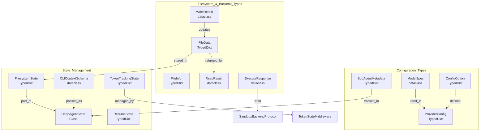
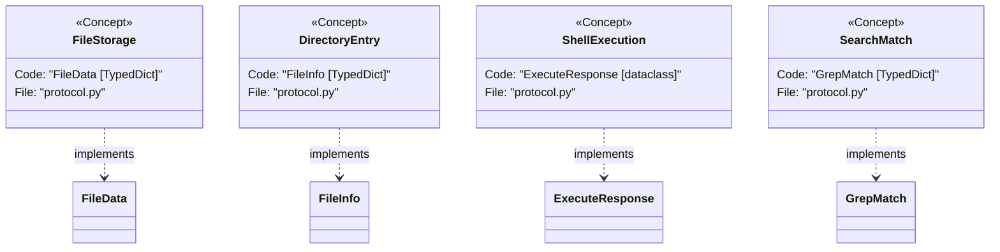
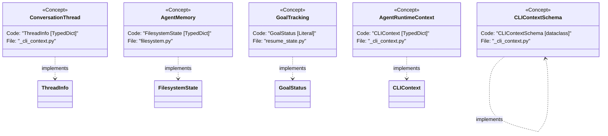

# Type Definitions

<details>
<summary>Relevant source files</summary>

The following files were used as context for generating this wiki page:

- [libs/code/deepagents_code/_cli_context.py](libs/code/deepagents_code/_cli_context.py)
- [libs/code/deepagents_code/cold_cache.py](libs/code/deepagents_code/cold_cache.py)
- [libs/code/deepagents_code/configurable_model.py](libs/code/deepagents_code/configurable_model.py)
- [libs/code/deepagents_code/resume_state.py](libs/code/deepagents_code/resume_state.py)
- [libs/code/deepagents_code/tui/modals/cold_cache.py](libs/code/deepagents_code/tui/modals/cold_cache.py)
- [libs/code/tests/unit_tests/test_cache_expiry.py](libs/code/tests/unit_tests/test_cache_expiry.py)
- [libs/code/tests/unit_tests/test_cold_cache.py](libs/code/tests/unit_tests/test_cold_cache.py)
- [libs/code/tests/unit_tests/test_configurable_model.py](libs/code/tests/unit_tests/test_configurable_model.py)
- [libs/code/tests/unit_tests/test_resume_state.py](libs/code/tests/unit_tests/test_resume_state.py)
- [libs/code/tests/unit_tests/tui/modals/test_cold_cache.py](libs/code/tests/unit_tests/tui/modals/test_cold_cache.py)
- [libs/deepagents/deepagents/__init__.py](libs/deepagents/deepagents/__init__.py)
- [libs/deepagents/deepagents/graph.py](libs/deepagents/deepagents/graph.py)
- [libs/deepagents/deepagents/middleware/__init__.py](libs/deepagents/deepagents/middleware/__init__.py)
- [libs/deepagents/deepagents/middleware/patch_tool_calls.py](libs/deepagents/deepagents/middleware/patch_tool_calls.py)
- [libs/deepagents/deepagents/middleware/subagents.py](libs/deepagents/deepagents/middleware/subagents.py)
- [libs/deepagents/tests/integration_tests/test_filesystem_middleware.py](libs/deepagents/tests/integration_tests/test_filesystem_middleware.py)
- [libs/deepagents/tests/integration_tests/test_subagent_middleware.py](libs/deepagents/tests/integration_tests/test_subagent_middleware.py)
- [libs/deepagents/tests/unit_tests/middleware/test_subagent_middleware_init.py](libs/deepagents/tests/unit_tests/middleware/test_subagent_middleware_init.py)
- [libs/deepagents/tests/unit_tests/test_eviction_replay.py](libs/deepagents/tests/unit_tests/test_eviction_replay.py)
- [libs/deepagents/tests/unit_tests/test_graph.py](libs/deepagents/tests/unit_tests/test_graph.py)
- [libs/deepagents/tests/unit_tests/test_subagents.py](libs/deepagents/tests/unit_tests/test_subagents.py)

</details>


This page provides reference documentation for key type definitions and data structures used throughout the `deepagents` codebase. These types define the contracts for agent configuration, filesystem operations, backend protocols, and state management.

## Type System Overview

The `deepagents` type system uses `TypedDict` extensively for data structures, providing type hints without runtime overhead. The architecture separates specification types (what you define) from runtime types (what the system uses internally).

### Type Category Relationships

The following diagram shows how different data structures interact across the system, from model configuration to backend results.

Title: "Data Structure Relationships"


Sources: [libs/deepagents/deepagents/backends/protocol.py:129-283](), [libs/deepagents/deepagents/middleware/filesystem.py:206-220](), [libs/deepagents/deepagents/backends/protocol.py:39-62](), [libs/code/deepagents_code/_cli_context.py:44-90]()

---

## Filesystem and Backend Types

### FileData

The standard structure for storing file contents with metadata across backends. It supports both UTF-8 text and base64-encoded binary data.

```python
class FileData(TypedDict):
    content: str
    encoding: str
    created_at: NotRequired[str]
    modified_at: NotRequired[str]
```

**Fields:**
- `content`: Plain string containing the file data (utf-8 text or base64-encoded binary) [libs/deepagents/deepagents/backends/protocol.py:190-191]().
- `encoding`: Content encoding: `"utf-8"` for text, `"base64"` for binary [libs/deepagents/deepagents/backends/protocol.py:193-194]().
- `created_at` / `modified_at`: ISO 8601 timestamps [libs/deepagents/deepagents/backends/protocol.py:196-200]().

Sources: [libs/deepagents/deepagents/backends/protocol.py:187-201](), [libs/deepagents/deepagents/middleware/filesystem.py:49-49]()

### Backend Result Objects

Backend operations return specific dataclasses or TypedDicts to ensure type safety and clear error reporting for the agent.

| Type | Purpose | Key Attributes |
| :--- | :--- | :--- |
| `ReadResult` | Result of a read operation | `error` (str), `file_data` (`FileData`), `total_lines` [libs/deepagents/deepagents/backends/protocol.py:204-221]() |
| `WriteResult` | Result of a write operation | `error` (str), `path` (str), `files_update` (dict) [libs/deepagents/deepagents/backends/protocol.py:230-243]() |
| `EditResult` | Result of an edit operation | `error`, `path`, `occurrences` (int), `files_update` [libs/deepagents/deepagents/backends/protocol.py:246-277]() |
| `ExecuteResponse` | Result of a shell command | `output` (str), `exit_code` (int), `truncated` (bool) [libs/deepagents/deepagents/backends/protocol.py:280-292]() |
| `GlobResult` | Result of a glob walk | `matches` (list[FileInfo]), `truncated` (bool) [libs/deepagents/deepagents/backends/protocol.py:223-228]() |
| `FileInfo` | Structured file listing info | `path` (str), `is_dir` (bool), `size` (int) [libs/deepagents/deepagents/backends/protocol.py:129-147]() |
| `GrepMatch` | A single match from a grep search | `path`, `line`, `text`, `context_before`, `context_after` [libs/deepagents/deepagents/backends/protocol.py:159-185]() |

Sources: [libs/deepagents/deepagents/backends/protocol.py:129-292]()

---

## Agent State and Session Types

### DeepAgentState

The core state object for a Deep Agent, extending `AgentState` with a `DeltaChannel` for messages to optimize checkpoint growth.

```python
class DeepAgentState(AgentState):
    messages: Required[Annotated[list[AnyMessage], DeltaChannel(_messages_delta_reducer, snapshot_frequency=50)]]
```
The `messages` field uses `DeltaChannel` with `_messages_delta_reducer` to store message deltas, reducing checkpoint size from O(N²) to O(N) [libs/deepagents/deepagents/graph.py:75-78]().

Sources: [libs/deepagents/deepagents/graph.py:75-78]()

### ThreadInfo

Represents metadata for a conversation thread persisted in storage.

```python
class ThreadInfo(TypedDict):
    thread_id: str
    agent_name: str
    updated_at: str
    cwd: NotRequired[str]
    message_count: NotRequired[int]
```

Sources: [libs/code/deepagents_code/_cli_context.py:1-68]()

### SubagentMetadata

A `TypedDict` used to define declarative subagents, specifying their name, description, tools, model, and other configurations.

```python
class SubAgent(TypedDict):
    name: str
    description: str
    tools: NotRequired[Sequence[BaseTool | Callable | dict[str, Any]]]
    model: NotRequired[str | BaseChatModel]
    middleware: NotRequired[list[AgentMiddleware]]
    interrupt_on: NotRequired[dict[str, bool | InterruptOnConfig]]
    skills: NotRequired[list[str]]
    permissions: NotRequired[list[FilesystemPermission]]
    response_format: NotRequired[ResponseFormat[Any] | type | dict[str, Any]]
    system_prompt: NotRequired[str]
    mode: NotRequired[Literal["isolated", "fork", "handoff"]]
    graph_id: NotRequired[str]
    url: NotRequired[str]
    headers: NotRequired[dict[str, str]]
    state_schema: NotRequired[type[AgentState]]
    default_tools: NotRequired[Sequence[BaseTool | Callable | dict[str, Any]]]
    default_middleware: NotRequired[list[AgentMiddleware]]
    default_system_prompt: NotRequired[str]
    default_interrupt_on: NotRequired[dict[str, bool | InterruptOnConfig]]
    default_permissions: NotRequired[list[FilesystemPermission]]
    default_response_format: NotRequired[ResponseFormat[Any] | type | dict[str, Any]]
```
This type is used by `SubAgentMiddleware` to configure sub-agents, allowing for isolated or forked execution modes [libs/deepagents/deepagents/middleware/subagents.py:84-176]().

Sources: [libs/deepagents/deepagents/middleware/subagents.py:84-176]()

### TokenTrackingState

A `TypedDict` used to track token usage and context window management.

```python
class TokenTrackingState(TypedDict):
    last_model_request_at: NotRequired[str]
    last_cache_model_spec: NotRequired[str]
    last_cache_endpoint: NotRequired[str]
    last_cache_model_params: NotRequired[dict[str, Any]]
```
This state is managed by `ConfigurableModelMiddleware` to persist information about the last model request, including its timestamp, specification, endpoint, and parameters. This data is crucial for features like cache expiry warnings [libs/code/deepagents_code/configurable_model.py:690-700]().

Sources: [libs/code/deepagents_code/configurable_model.py:690-700]()

### Goal and Rubric State

The goal tools and rubric middleware use specific structures to track agent progress.

- **`GoalStatus`**: A literal representing the lifecycle of a goal: `active`, `paused`, `blocked`, or `complete` [libs/code/deepagents_code/resume_state.py:80-80]().
- **`GoalRubricChannels`**: Part of the `ResumeState`, containing criteria and verification state for a specific goal's acceptance [libs/code/deepagents_code/resume_state.py:24-42]().

Sources: [libs/code/deepagents_code/resume_state.py:1-81]()

### ResumeState

A `TypedDict` that defines the structure for persisting the agent's state across sessions, including goal and rubric information.

```python
class ResumeState(TypedDict):
    goal_status: NotRequired[GoalStatus]
    goal_rubric_channels: NotRequired[GoalRubricChannels]
    last_model_request_at: NotRequired[str]
    last_cache_model_spec: NotRequired[str]
    last_cache_endpoint: NotRequired[str]
    last_cache_model_params: NotRequired[dict[str, Any]]
```
This structure is used to restore the agent's context, including its current goal, rubric evaluation progress, and details about the last model interaction for cache management [libs/code/deepagents_code/resume_state.py:75-81]().

Sources: [libs/code/deepagents_code/resume_state.py:75-81]()

### FilesystemState

Defines the structure of the `files` channel in the agent's state, used by `FilesystemMiddleware`.

```python
class FilesystemState(TypedDict):
    files: Annotated[dict[str, FileData], _file_data_reducer]
```

**Reducer Logic:** The state reducer handles updates to the filesystem state, treating `None` values in update dictionaries as deletion markers for state-based backends [libs/deepagents/deepagents/middleware/filesystem.py:198-220]().

Sources: [libs/deepagents/deepagents/middleware/filesystem.py:198-220]()

### FilesystemPermission

A dataclass defining access rules for filesystem operations, used to restrict or require approval for specific paths.

```python
@dataclass
class FilesystemPermission:
    operations: list[FilesystemOperation]
    paths: list[str]
    mode: Literal["allow", "deny", "interrupt"] = "allow"
```

**Fields:**
- `operations`: List of operations, e.g., `["read"]` or `["write"]` [libs/deepagents/deepagents/middleware/filesystem.py:123-134]().
- `paths`: List of glob patterns for restricted paths [libs/deepagents/deepagents/middleware/filesystem.py:80-80]().
- `mode`: The enforcement action. `"interrupt"` triggers a Human-in-the-Loop approval [libs/deepagents/deepagents/middleware/filesystem.py:54-54]().

Sources: [libs/deepagents/deepagents/middleware/filesystem.py:53-134]()

### CLIContextSchema

A dataclass defining the schema for runtime context passed to the agent graph, allowing per-run overrides for models, approval modes, and other settings.

```python
@dataclass
class CLIContextSchema:
    model: str | None = None
    model_params: dict[str, Any] = field(default_factory=dict)
    summarization_model: str | None = None
    profile_overrides: dict[str, Any] = field(default_factory=dict)
    model_context_limit: int | None = None
    classifier_model: str | None = None
    approval_mode: str = "manual"
    auto_approve: bool = False
    approval_mode_key: str | None = None
    thread_id: str | None = None
    turn_id: str | None = None
    hooks_snapshot_id: str | None = None
    hooks_server_events: list[str] = field(default_factory=list)
    prompt_id: str | None = None
    workspace: dict[str, Any] = field(default_factory=dict)
```
This schema is registered with LangGraph via `context_schema=` and is used to coerce the `context=` payload into a structured object for in-process runs, or to reconstruct it from JSON for remote API calls [libs/code/deepagents_code/_cli_context.py:44-90]().

Sources: [libs/code/deepagents_code/_cli_context.py:44-90]()

### CLIContext

A `TypedDict` used by clients to construct the `context=` payload for agent runs, mirroring the fields of `CLIContextSchema`.

```python
class CLIContext(TypedDict, total=False):
    model: str | None
    model_params: dict[str, Any]
    summarization_model: str | None
    profile_overrides: dict[str, Any]
    model_context_limit: int | None
    classifier_model: str | None
    approval_mode: str
    auto_approve: bool
    approval_mode_key: str | None
    thread_id: str | None
    turn_id: str | None
    hooks_snapshot_id: str | None
    hooks_server_events: list[str]
    prompt_id: str | None
    workspace: dict[str, Any]
```
This type provides a convenient way to specify runtime overrides for agent behavior, such as switching models or adjusting approval settings [libs/code/deepagents_code/_cli_context.py:168-257]().

Sources: [libs/code/deepagents_code/_cli_context.py:168-257]()

---

## Type Mapping: Natural Language to Code

The following diagrams bridge the gap between conceptual system components and their specific code implementations.

Title: "Conceptual to Code Entity Mapping Backend"


Sources: [libs/deepagents/deepagents/backends/protocol.py:129-292]()

Title: "Conceptual to Code Entity Mapping Session And Progress"


Sources: [libs/deepagents/deepagents/middleware/filesystem.py:198-220](), [libs/code/deepagents_code/_cli_context.py:44-90](), [libs/code/deepagents_code/resume_state.py:80-80](), [libs/code/deepagents_code/_cli_context.py:168-257]()

---

## Error and Format Constants

### FileOperationError

Standardized error codes used across all backend implementations to provide consistent feedback to the model.

- `file_not_found`: The requested file doesn't exist [libs/deepagents/deepagents/backends/protocol.py:59]().
- `permission_denied`: Access denied for the operation [libs/deepagents/deepagents/backends/protocol.py:60]().
- `is_directory`: Attempted to operate on a directory as a file [libs/deepagents/deepagents/backends/protocol.py:61]().
- `invalid_path`: Path syntax is malformed or contains invalid characters [libs/deepagents/deepagents/backends/protocol.py:62]().

Sources: [libs/deepagents/deepagents/backends/protocol.py:39-62]()

### Token and Timeout Constants

- `DEFAULT_GREP_TIMEOUT`: 15 seconds for a single sync grep phase [libs/deepagents/deepagents/backends/protocol.py:20-21]().
- `ASYNC_GREP_TIMEOUT`: 35 seconds, providing headroom for ripgrep timeout followed by Python fallback [libs/deepagents/deepagents/backends/protocol.py:23-28]().
- `ASYNC_GLOB_TIMEOUT`: 30 seconds for a sandbox glob round-trip [libs/deepagents/deepagents/backends/protocol.py:30-37]().
- `TOOL_RESULT_TOKEN_LIMIT`: 20,000 tokens, the threshold for large result eviction [libs/deepagents/deepagents/backends/utils.py:89-89]().

Sources: [libs/deepagents/deepagents/backends/protocol.py:20-37](), [libs/deepagents/deepagents/backends/utils.py:88-90]()