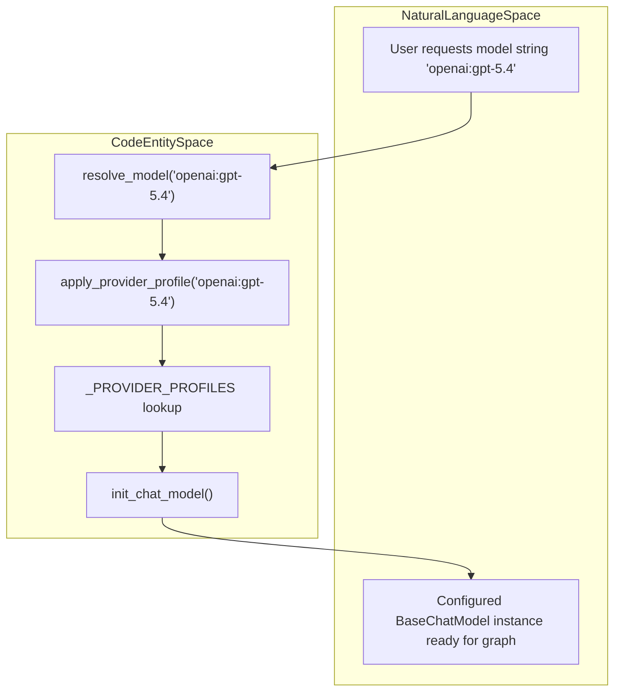
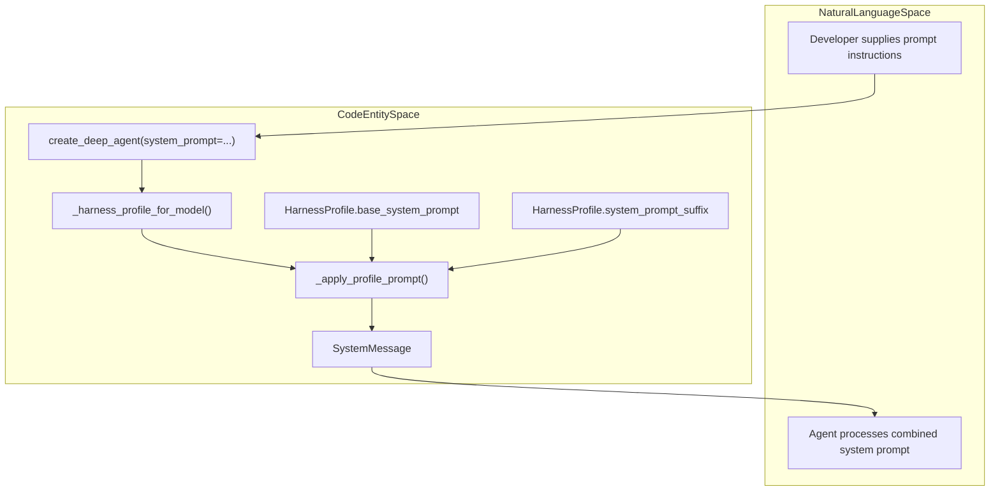

# Harness Profiles API

Relevant source files

The following files were used as context for generating this wiki page:

- [libs/deepagents/deepagents/_models.py](libs/deepagents/deepagents/_models.py)
- [libs/deepagents/deepagents/middleware/_tool_exclusion.py](libs/deepagents/deepagents/middleware/_tool_exclusion.py)
- [libs/deepagents/deepagents/profiles/__init__.py](libs/deepagents/deepagents/profiles/__init__.py)
- [libs/deepagents/deepagents/profiles/_builtin_profiles.py](libs/deepagents/deepagents/profiles/_builtin_profiles.py)
- [libs/deepagents/deepagents/profiles/_keys.py](libs/deepagents/deepagents/profiles/_keys.py)
- [libs/deepagents/deepagents/profiles/harness/_openai_codex.py](libs/deepagents/deepagents/profiles/harness/_openai_codex.py)
- [libs/deepagents/deepagents/profiles/harness/harness_profiles.py](libs/deepagents/deepagents/profiles/harness/harness_profiles.py)
- [libs/deepagents/deepagents/profiles/provider/_nvidia.py](libs/deepagents/deepagents/profiles/provider/_nvidia.py)
- [libs/deepagents/deepagents/profiles/provider/_openrouter.py](libs/deepagents/deepagents/profiles/provider/_openrouter.py)
- [libs/deepagents/deepagents/profiles/provider/provider_profiles.py](libs/deepagents/deepagents/profiles/provider/provider_profiles.py)
- [libs/deepagents/tests/unit_tests/middleware/test_tool_exclusion.py](libs/deepagents/tests/unit_tests/middleware/test_tool_exclusion.py)
- [libs/deepagents/tests/unit_tests/test_models.py](libs/deepagents/tests/unit_tests/test_models.py)

The Harness Profiles API provides a mechanism for tuning agent behavior based on the underlying model or provider without modifying call sites. It allows for fine-grained control over system prompts, tool visibility, middleware selection, and subagent configuration through a centralized registration system [libs/deepagents/deepagents/profiles/harness/harness_profiles.py:9-18]().

## Overview and Data Structures

The system is built around two primary dataclasses: `ProviderProfile`, which handles model construction and configuration, and `HarnessProfile`, which shapes the agent's runtime behavior once the model is instantiated [libs/deepagents/deepagents/profiles/harness/harness_profiles.py:9-13](), [libs/deepagents/deepagents/profiles/provider/provider_profiles.py:9-14](). These profiles are orthogonal: `ProviderProfile` controls the model-construction phase (e.g., API keys, base URLs, pre-initialization checks) via `resolve_model` and `init_chat_model` [libs/deepagents/deepagents/_models.py:35-58](), while `HarnessProfile` tunes the agent environment during graph assembly [libs/deepagents/deepagents/profiles/harness/harness_profiles.py:9-18]().

### HarnessProfile Fields

The `HarnessProfile` dataclass defines how `create_deep_agent` configures the agent's runtime environment [libs/deepagents/deepagents/profiles/harness/harness_profiles.py:9-18]().

| Field | Type | Description |
| :--- | :--- | :--- |
| `system_prompt_prefix` | `str \| None` | Text prepended to the final system prompt. |
| `system_prompt_suffix` | `str \| None` | Text appended to the final system prompt [libs/deepagents/deepagents/profiles/harness/harness_profiles.py:9-18](). |
| `base_system_prompt` | `str \| None` | Global override for the main agent's system prompt. |
| `excluded_middleware` | `Sequence[str \| type[AgentMiddleware]]` | Middleware to remove from the default stack. Cannot include scaffolding [libs/deepagents/deepagents/profiles/harness/harness_profiles.py:39-62](). |
| `extra_middleware` | `Sequence[AgentMiddleware] \| Callable[[], Sequence[AgentMiddleware]]` | Additional middleware to insert into the stack. Can be a callable to create fresh instances [libs/deepagents/deepagents/profiles/harness/_openai_codex.py:69-78](). |
| `excluded_tools` | `frozenset[str]` | Tool names to hide from the model and reject if called [libs/deepagents/deepagents/middleware/_tool_exclusion.py:34-40](). |
| `tool_overrides` | `Mapping[str, Mapping[str, Any]]` | Per-tool configuration overrides, such as description modifications. |
| `subagent_config` | `GeneralPurposeSubagentProfile` | Configures the default `general-purpose` subagent [libs/deepagents/deepagents/profiles/harness/harness_profiles.py:83-111](). |

### ProviderProfile Fields

`ProviderProfile` handles concerns that shape how `init_chat_model` assembles the client instance [libs/deepagents/deepagents/profiles/provider/provider_profiles.py:37-64]().

| Field | Type | Description |
| :--- | :--- | :--- |
| `init_kwargs` | `Mapping[str, Any]` | Static keyword arguments forwarded to `init_chat_model` [libs/deepagents/deepagents/profiles/provider/provider_profiles.py:79-81](). |
| `pre_init` | `Callable[[str], None] \| None` | Hook for side-effectful checks (e.g., version enforcement) before construction [libs/deepagents/deepagents/profiles/provider/provider_profiles.py:93-101](). |
| `init_kwargs_factory` | `Callable[[], dict[str, Any]] \| None` | Factory for dynamic kwargs derived from runtime state (e.g., environment variables) [libs/deepagents/deepagents/profiles/provider/provider_profiles.py:103-107](). |

Sources: [libs/deepagents/deepagents/profiles/harness/harness_profiles.py:9-18](), [libs/deepagents/deepagents/profiles/provider/provider_profiles.py:37-131](), [libs/deepagents/deepagents/_models.py:35-58](), [libs/deepagents/deepagents/middleware/_tool_exclusion.py:34-40](), [libs/deepagents/deepagents/profiles/harness/_openai_codex.py:69-78]()

## Profile Key Format and Validation

Both harness and provider profiles share a unified key format validated by `validate_profile_key` [libs/deepagents/deepagents/profiles/_keys.py:1-31](). Keys must follow either `provider` (e.g., `"openai"`) or `provider:model` (e.g., `"openai:gpt-5.4"`).

- The first colon acts as the structural separator between the provider name and the model identifier [libs/deepagents/deepagents/profiles/_keys.py:11-22]().
- Providers cannot contain colons, while model identifiers may contain nested colons [libs/deepagents/deepagents/profiles/_keys.py:11-22]().
- Leading or trailing whitespaces, or spaces adjacent to the colon, raise a `ValueError` [libs/deepagents/deepagents/profiles/_keys.py:32-45]().

Sources: [libs/deepagents/deepagents/profiles/_keys.py:1-45]()

## Profile Registration, Merge Semantics, and Scaffolding Protection

Profiles are registered via module functions and stored in internal registries [libs/deepagents/deepagents/profiles/harness/harness_profiles.py:15-18](), [libs/deepagents/deepagents/profiles/provider/provider_profiles.py:19-20]().

*   `register_harness_profile`: Registers a `HarnessProfile` under a specified registry key [libs/deepagents/deepagents/profiles/harness/harness_profiles.py:15-18]().
*   `register_provider_profile`: Registers a `ProviderProfile` under a specified registry key [libs/deepagents/deepagents/profiles/provider/provider_profiles.py:19-20]().
*   **Merge Semantics**: Registrations are additive. Re-registering under an existing key merges the new profile values on top of prior registrations rather than overwriting them completely [libs/deepagents/deepagents/profiles/harness/harness_profiles.py:15-18](), [libs/deepagents/deepagents/profiles/provider/provider_profiles.py:19-20]().
*   **Scaffolding Protection**: The framework prevents the exclusion of required scaffolding middleware (such as filesystem tools, subagent dispatch, and permission enforcement) [libs/deepagents/deepagents/profiles/harness/harness_profiles.py:39-80](). The function `_scaffolding_violation_label` checks entries against `_REQUIRED_MIDDLEWARE_NAMES`, raising a descriptive rejection if users attempt to strip core architecture [libs/deepagents/deepagents/profiles/harness/harness_profiles.py:39-80]().

Sources: [libs/deepagents/deepagents/profiles/harness/harness_profiles.py:39-80](), [libs/deepagents/deepagents/profiles/provider/provider_profiles.py:19-20]()

## Plugin Architecture and Entry-Point Packaging

Built-in profiles are bootstrapped lazily via `_ensure_builtin_profiles_loaded` to minimize initialization overhead [libs/deepagents/deepagents/profiles/_builtin_profiles.py:1-20]().

- **Built-in Registrations**: Modules such as `_nvidia`, `_openai`, `_openrouter`, and various Anthropic/OpenAI/Nemotron harness modules register defaults explicitly [libs/deepagents/deepagents/profiles/_builtin_profiles.py:29-38](). For example, the `_openrouter` module registers a `ProviderProfile` that enforces a minimum `langchain-openrouter` version and injects default app-attribution headers [libs/deepagents/deepagents/profiles/provider/_openrouter.py:1-12](). Similarly, `_nvidia` injects app-origin attribution headers [libs/deepagents/deepagents/profiles/provider/_nvidia.py:1-10]().
- **Third-Party Plugins**: `importlib.metadata` entry points under the groups `deepagents.provider_profiles` and `deepagents.harness_profiles` are discovered during bootstrap [libs/deepagents/deepagents/profiles/_builtin_profiles.py:56-62]().
- Each entry point resolves to a zero-argument callable performing target registrations, safely isolated so that third-party plugin failures emit warnings without aborting SDK initialization [libs/deepagents/deepagents/profiles/_builtin_profiles.py:103-160]().

Sources: [libs/deepagents/deepagents/profiles/_builtin_profiles.py:1-160](), [libs/deepagents/deepagents/profiles/provider/_openrouter.py:1-12](), [libs/deepagents/deepagents/profiles/provider/_nvidia.py:1-10]()

## Code Entity Association: Profile Resolution and Model Initialization

This diagram connects the conceptual request for an agent model to the concrete code entities involved in model resolution and provider profile application.

Title: "ProfileResolutionFlow"

Sources: [libs/deepagents/deepagents/_models.py:35-58](), [libs/deepagents/deepagents/profiles/provider/provider_profiles.py:37-131]()

## Code Entity Association: System Prompt Assembly

This diagram links natural language agent behavior instructions to the internal prompt-composition functions and data structures.

Title: "SystemPromptAssemblyFlow"

Sources: [libs/deepagents/deepagents/graph.py:76-135](), [libs/deepagents/deepagents/profiles/harness/harness_profiles.py:9-18]()