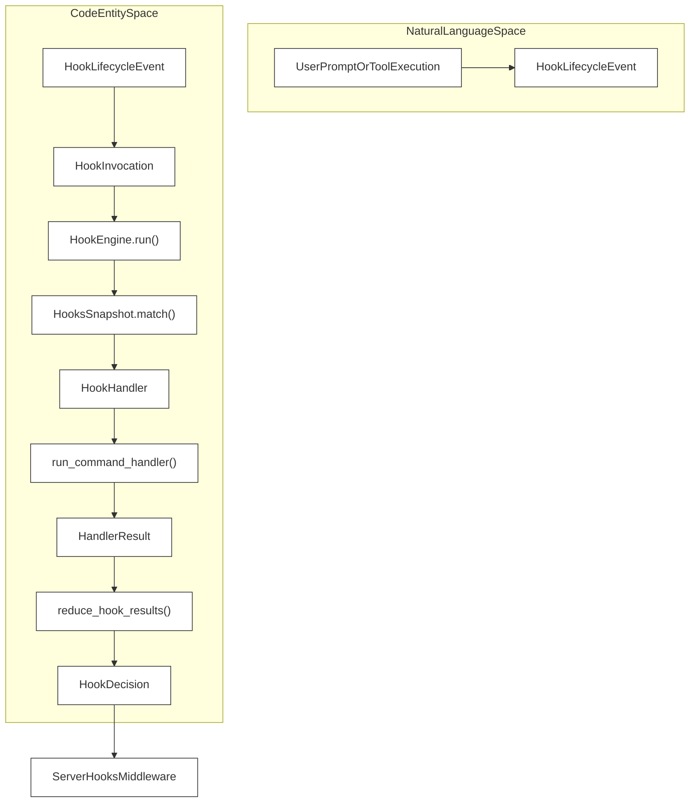
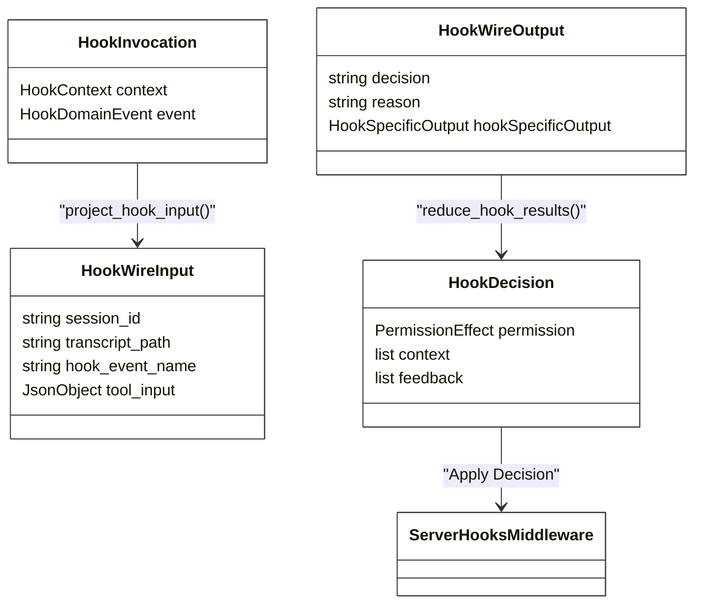

# Hooks API Reference

Relevant source files

The following files were used as context for generating this wiki page:

- [libs/code/HOOKS.md](libs/code/HOOKS.md)
- [libs/code/deepagents_code/hooks/capabilities.py](libs/code/deepagents_code/hooks/capabilities.py)
- [libs/code/deepagents_code/hooks/engine.py](libs/code/deepagents_code/hooks/engine.py)
- [libs/code/deepagents_code/hooks/env.py](libs/code/deepagents_code/hooks/env.py)
- [libs/code/deepagents_code/hooks/models/config.py](libs/code/deepagents_code/hooks/models/config.py)
- [libs/code/deepagents_code/hooks/models/domain.py](libs/code/deepagents_code/hooks/models/domain.py)
- [libs/code/deepagents_code/hooks/models/wire.py](libs/code/deepagents_code/hooks/models/wire.py)
- [libs/code/deepagents_code/hooks/projection.py](libs/code/deepagents_code/hooks/projection.py)
- [libs/code/deepagents_code/hooks/reducer.py](libs/code/deepagents_code/hooks/reducer.py)
- [libs/code/deepagents_code/hooks/runner.py](libs/code/deepagents_code/hooks/runner.py)
- [libs/code/deepagents_code/hooks/snapshot.py](libs/code/deepagents_code/hooks/snapshot.py)
- [libs/code/deepagents_code/hooks/tools.py](libs/code/deepagents_code/hooks/tools.py)
- [libs/code/tests/unit_tests/hooks/models/test_models.py](libs/code/tests/unit_tests/hooks/models/test_models.py)
- [libs/code/tests/unit_tests/hooks/test_engine.py](libs/code/tests/unit_tests/hooks/test_engine.py)
- [libs/code/tests/unit_tests/hooks/test_execution.py](libs/code/tests/unit_tests/hooks/test_execution.py)

The Hooks v2 system provides a robust mechanism for executing user-configured shell commands and event handlers at specific agent lifecycle events in the Deep Agents framework. These hooks allow for external policy enforcement, automated environment setup, transcript inspection, and integration with local development tools.

Sources: [libs/code/deepagents_code/hooks/loading.py:1-26](), [libs/code/deepagents_code/hooks/snapshot.py:1-70]()

---

## Hooks Schema (`hooks.json`)

The configuration for hooks is defined in a `hooks.json` file, typically located in `~/.deepagents/hooks.json` (User-scoped), `{project_root}/.deepagents/hooks.json` (Project-scoped), or contributed via plugin documents [libs/code/deepagents_code/hooks/loading.py:3-11]().

### Matcher Groups
Each event key in the `hooks` configuration object maps to a sequence of matcher groups. A group contains an optional `matcher` string (regex or exact match) and a list of command handler specifications [libs/code/deepagents_code/hooks/snapshot.py:113-169]().

| Field | Type | Description |
| :--- | :--- | :--- |
| `matcher` | `string` | Regex or exact match against the event's matcher field (e.g., `tool_name` or `cause`). Matches `*` or empty string for all values for that event's matcher field [libs/code/HOOKS.md:45](). |
| `hooks` | `list` | A list of `CommandHandlerSpec` objects to execute when the matcher evaluates to true [libs/code/deepagents_code/hooks/models/config.py:28-29](). |

### Handler Configuration (`CommandHandlerSpec`)
Handlers define the specific executable command or argument vector [libs/code/deepagents_code/hooks/models/config.py:11-23]().

| Field | Type | Default | Description |
| :--- | :--- | :--- | :--- |
| `type` | `string` | `"command"` | The handler type. Currently only `"command"` is supported [libs/code/deepagents_code/hooks/capabilities.py:48](). |
| `command` | `string` | Required | Shell command string to execute. Supports environment variable expansion and plugin variable resolution [libs/code/deepagents_code/hooks/snapshot.py:152-154](). |
| `argv` | `list[str]` | `null` | Optional list of arguments for direct execution (bypasses shell interpretation to avoid quoting issues) [libs/code/deepagents_code/hooks/snapshot.py:159-165](). |
| `timeout` | `float` | `600.0` | Execution timeout in seconds. Certain interactive events like `UserPromptSubmit` and `Notification` apply shorter defaults [libs/code/deepagents_code/hooks/capabilities.py:80-127](). |
| `statusMessage`| `string` | `null` | Optional UI status text displayed while the hook handler is running [libs/code/deepagents_code/hooks/snapshot.py:52](). |

Sources: [libs/code/deepagents_code/hooks/loading.py:1-26](), [libs/code/deepagents_code/hooks/models/config.py:11-29](), [libs/code/deepagents_code/hooks/snapshot.py:44-59]()

---

## Hook Lifecycle Events (`HookEvent`)

Events are originated by either the **Client** (`deepagents-code` TUI/CLI runtime) or the **Server** (`ServerHooksMiddleware` / LangGraph execution graph) [libs/code/deepagents_code/hooks/models/domain.py:36-58]().

| HookEvent | Owner | Matcher Field | Description |
| :--- | :--- | :--- | :--- |
| `SessionStart` | Client | `cause` | Triggered on session `startup`, `resume`, `clear`, or `compact` [libs/code/deepagents_code/hooks/models/domain.py:60-67](). |
| `UserPromptSubmit`| Client | None | Triggered when a user submits a prompt input [libs/code/deepagents_code/hooks/models/domain.py:172-178](). |
| `SessionEnd` | Client | `cause` | Triggered on session `clear`, `resume`, or `prompt_input_exit` [libs/code/deepagents_code/hooks/models/domain.py:69-76](). |
| `PermissionRequest`| Client | `tool_name` | Triggered before asking the user for explicit tool permissions [libs/code/deepagents_code/hooks/models/domain.py:186-191](). |
| `Notification` | Client | `notification_type`| Emitted when a lifecycle notice (e.g., `agent_completed`) occurs [libs/code/deepagents_code/hooks/models/domain.py:193-198](). |
| `PreToolUse` | Server | `tool_name` | Triggered before a tool execution begins inside the agent graph [libs/code/deepagents_code/hooks/models/domain.py:200-205](). |
| `PostToolUse` | Server | `tool_name` | Triggered after a tool execution succeeds [libs/code/deepagents_code/hooks/models/domain.py:207-219](). |
| `PostToolUseFailure`| Server | `tool_name` | Triggered after a tool execution encounters an error [libs/code/deepagents_code/hooks/capabilities.py:188-188]() |
| `PreCompact` | Server | `trigger` | Triggered prior to conversation history compaction (`manual` or `auto`) [libs/code/deepagents_code/hooks/models/domain.py:87-92](). |
| `Stop` | Server | None | Triggered after an agent stop turn [libs/code/deepagents_code/hooks/capabilities.py:188-188]() |
| `SubagentStart` | Server | `agent_name` | Triggered when a hierarchical subagent starts [libs/code/deepagents_code/hooks/capabilities.py:188-188]() |
| `SubagentStop` | Server | `agent_name` | Triggered when a hierarchical subagent stops [libs/code/deepagents_code/hooks/capabilities.py:188-188]() |

Sources: [libs/code/deepagents_code/hooks/models/domain.py:36-51](), [libs/code/deepagents_code/hooks/projection.py:113-227](), [libs/code/deepagents_code/hooks/capabilities.py:102-188]()

---

## Hook Decision Types (`HookDecision`)

Hook handlers can influence the agent's behavior by returning specific decisions. The `HookDecision` is an event-specific Pydantic model that encapsulates the aggregated outcome of all matching handlers for a given event [libs/code/deepagents_code/hooks/models/domain.py:241-471]().

For example, `PermissionRequestDecision` allows for `allow`, `deny`, or `ask` behaviors, and can include `updated_permissions` [libs/code/deepagents_code/hooks/models/domain.py:300-308](). `PreToolUseDecision` can `deny` a tool call or provide `additional_context` [libs/code/deepagents_code/hooks/models/domain.py:330-336]().

Sources: [libs/code/deepagents_code/hooks/models/domain.py:241-471](), [libs/code/deepagents_code/hooks/reducer.py:74-98]()

---

## Handler Type (`HandlerType`)

Currently, only `COMMAND` handlers are supported, which execute shell commands [libs/code/deepagents_code/hooks/capabilities.py:45-50]().

Sources: [libs/code/deepagents_code/hooks/capabilities.py:45-50]()

---

## Exit Code Policy (`ExitCodePolicy`)

The `ExitCodePolicy` defines how a non-zero exit code from a hook handler is interpreted for a specific event [libs/code/deepagents_code/hooks/capabilities.py:58-68]().

| Policy | Description |
| :--- | :--- |
| `BLOCK` | Exit code 2 blocks the operation (e.g., `UserPromptSubmit`, `PreCompact`). |
| `CONTEXT` | Exit code 2 adds diagnostic context. |
| `DENY` | Exit code 2 denies the action (e.g., `PermissionRequest`, `PreToolUse`). |
| `FEEDBACK` | Exit code 2 provides feedback (e.g., `PostToolUse`, `PostToolUseFailure`). |
| `CONTINUE_LOOP` | Exit code 2 causes the agent to continue its loop. |
| `DIAGNOSE` | Exit code 2 results in a diagnostic message. |
| `IGNORE` | Exit code 2 is ignored. |

Sources: [libs/code/deepagents_code/hooks/capabilities.py:58-68](), [libs/code/deepagents_code/hooks/runner.py:151-160]()

---

## Aggregation Policy (`AggregationPolicy`)

The `AggregationPolicy` determines how the results of multiple matching hook handlers are combined to form a single `HookDecision` [libs/code/deepagents_code/hooks/capabilities.py:70-78]().

| Policy | Description |
| :--- | :--- |
| `CONTEXT` | Aggregates `additional_context` from all handlers. |
| `PERMISSION` | Prioritizes `deny` decisions over `allow` or `none`. |
| `FEEDBACK_AND_CONTEXT` | Combines feedback and context. |
| `STOP_LOOP` | The first handler to stop processing decides the event. |
| `SIDE_EFFECT` | Handlers run for their side effects, decisions are not aggregated. |

Sources: [libs/code/deepagents_code/hooks/capabilities.py:70-78](), [libs/code/HOOKS.md:15]()

---

## `HookEngine.run()`

The `HookEngine.run()` method is the primary entry point for executing hooks. It takes a `HookInvocation` (containing the event and its context), paths to transcripts, and an optional progress callback. It returns a `HookDecision` object, which is the aggregated outcome of all executed handlers [libs/code/deepagents_code/hooks/engine.py:41-68]().

The method performs the following steps:
1.  **Match Handlers**: Uses `self.snapshot.match(invocation)` to find all relevant `HookHandler` instances for the given `invocation` [libs/code/deepagents_code/hooks/engine.py:69]().
2.  **Serialize Input**: Projects the `HookInvocation` into a JSON-compatible `HookWireInput` payload, which is sent to the stdin of the hook processes [libs/code/deepagents_code/hooks/engine.py:70-75]().
3.  **Execute Handlers**: Concurrently runs each matched `HookHandler` using `run_command_handler()`, respecting individual handler timeouts or event-specific defaults [libs/code/deepagents_code/hooks/engine.py:94-107]().
4.  **Reduce Results**: Aggregates the `HandlerResult` objects from all executed handlers into a single `HookDecision` using `self.adapter.to_domain_decision()` (which internally calls `reduce_hook_results()`) [libs/code/deepagents_code/hooks/engine.py:108-112]().

### Hook Execution Flow (Natural Language to Code Entity Space)

Title: Hook Execution Flow and Code Mapping

Sources: [libs/code/deepagents_code/hooks/engine.py:15-30](), [libs/code/deepagents_code/hooks/runner.py:46-191](), [libs/code/deepagents_code/hooks/reducer.py:74-98]()

---

## Injected Environment Variables

Hook handlers receive a sanitized process environment augmented with specific variables [libs/code/deepagents_code/hooks/env.py:19](). Plugins can also define custom `env` mappings via `PluginHooksSource` [libs/code/deepagents_code/hooks/loading.py:97-101]().

| Variable | Description |
| :--- | :--- |
| `CLAUDE_PLUGIN_ROOT` | Absolute path to the enabled plugin's root directory. |
| `PLUGIN_ROOT` | Alias for `CLAUDE_PLUGIN_ROOT`. |
| `PLUGIN_DATA` | Writable directory path for plugins to persist local state. |
| `CLAUDE_PROJECT_DIR` | Absolute path to the current project workspace [libs/code/deepagents_code/hooks/loading.py:153-162](). |

Sources: [libs/code/deepagents_code/hooks/loading.py:97-121](), [libs/code/deepagents_code/hooks/runner.py:78](), [libs/code/deepagents_code/hooks/env.py:19](), [libs/code/deepagents_code/hooks/engine.py:126-128]()

---

## Data Flow: Domain to Wire Space

Internal `HookInvocation` domain models are projected into `HookWireInput` JSON structures passed via `stdin` to subprocess handlers [libs/code/deepagents_code/hooks/projection.py:70-99]().

### Domain-to-Wire Mapping Architecture

Title: Data Flow and Wire Protocol Mapping

Sources: [libs/code/deepagents_code/hooks/projection.py:70-99](), [libs/code/deepagents_code/hooks/models/wire.py:22-54](), [libs/code/deepagents_code/hooks/reducer.py:74-98]()

---

## Server Integration: `ServerHooksMiddleware`

The `ServerHooksMiddleware` manages server-side graph interrupts and coordinates event emission across agent execution turns [libs/code/deepagents_code/hooks/server_middleware.py:1-6](). It utilizes private state keys to maintain transactional integrity:
*   **`_hooks_pre_tool_outcomes`**: Tracks results of `PreToolUse` hooks to ensure tool calls are evaluated correctly per turn [libs/code/deepagents_code/hooks/server_middleware.py:91]().
*   **`_hooks_pending_post_tools`**: Maps `tool_call_id` to execution durations for tools awaiting `PostToolUse` processing [libs/code/deepagents_code/hooks/server_middleware.py:92]().

Sources: [libs/code/deepagents_code/hooks/server_middleware.py:1-204](), [libs/code/tests/unit_tests/hooks/test_server_lifecycle.py:57-68]()

---

## Workspace Trust Model

Project-scoped hooks located under `.deepagents/hooks.json` are loaded only if the target workspace directory is marked as trusted [libs/code/deepagents_code/hooks/trust.py:24-28](). Trust decisions are persisted securely in `hooks_trust.json` based on canonical project root identification [libs/code/tests/unit_tests/hooks/test_trust.py:57-67](). Users can grant trust for the duration of an interactive session or persist permissions permanently.

Sources: [libs/code/deepagents_code/hooks/trust.py:24-28](), [libs/code/tests/unit_tests/hooks/test_trust.py:1-190]()