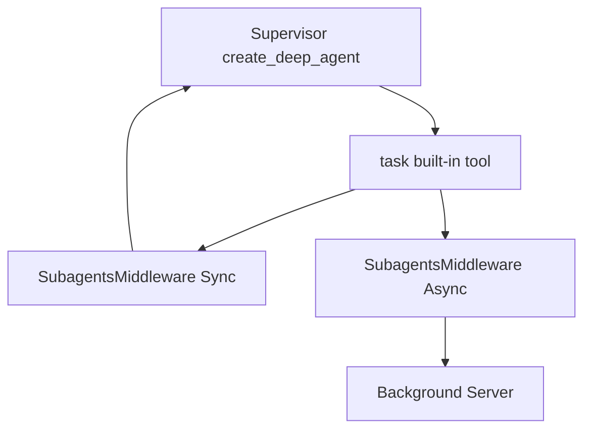
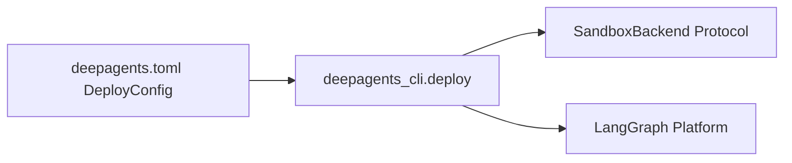

# Examples and Tutorials

<details>
<summary>Relevant source files</summary>

The following files were used as context for generating this wiki page:

- [examples/async-subagent-server/pyproject.toml](examples/async-subagent-server/pyproject.toml)
- [examples/content-builder-agent/uv.lock](examples/content-builder-agent/uv.lock)
- [examples/deep_research/pyproject.toml](examples/deep_research/pyproject.toml)
- [examples/deep_research/uv.lock](examples/deep_research/uv.lock)
- [examples/nvidia_deep_agent/pyproject.toml](examples/nvidia_deep_agent/pyproject.toml)
- [examples/nvidia_deep_agent/uv.lock](examples/nvidia_deep_agent/uv.lock)
- [examples/text-to-sql-agent/pyproject.toml](examples/text-to-sql-agent/pyproject.toml)
- [examples/text-to-sql-agent/uv.lock](examples/text-to-sql-agent/uv.lock)

</details>


This page provides practical examples and high-level tutorials demonstrating common Deep Agents usage patterns. Each example shows how to combine the core SDK components—such as `create_deep_agent`, middleware, backends, and tools—to build functional AI agents. The examples progress from basic agent creation to advanced workflows involving sub-agents, custom backends, and deployment patterns.

For detailed step-by-step guides, refer to the child pages linked in each section.

Sources: [examples/README.md:1-14]()

## Minimal Agent Creation

The simplest Deep Agents setup requires only the `create_deep_agent` function with default parameters:

```python
from deepagents import create_deep_agent

# Create agent with all default middleware and tools
agent = create_deep_agent(
    model="openai:gpt-5.5",
    system_prompt="You are a research assistant."
)

# Invoke with a message
result = agent.invoke({
    "messages": [{"role": "user", "content": "Research LangGraph and write a summary"}]
})
```

This creates an agent equipped with default model configurations, the full middleware stack (todos, memory, skills, filesystem, subagents, and summarization), all built-in tools (`ls`, `read_file`, `write_file`, `edit_file`, `glob`, `grep`, `execute`, `task`, `compact_conversation`), and an in-memory `StateBackend`.

For a detailed tutorial, see **[Basic Agent Creation](#8.1)**.

Sources: [examples/README.md:55-64]()

## Example Projects and Workflows

The repository includes several specialized examples demonstrating complex patterns in the `examples/` directory, spanning deep research, content generation, and text-to-sql planning.

| Example | Key Features Demonstrated |
|---------|---------------------------|
| **Deep Research** | Multi-step research using `Tavily`, parallel sub-agents, and strategic reflection [examples/deep_research/pyproject.toml:1-21]() |
| **Content Builder** | Configured via `AGENTS.md` memory and custom skills for multi-platform content generation [examples/content-builder-agent/pyproject.toml:1-4]() |
| **Text-to-SQL** | Planning via `write_todos`, schema exploration skills, and database interaction using `SQLAlchemy` [examples/text-to-sql-agent/pyproject.toml:1-17]() |
| **NVIDIA Deep Agent** | Multi-model orchestration using Nemotron Super and GPU-accelerated code execution via RAPIDS [examples/nvidia_deep_agent/pyproject.toml:1-19]() |
| **Async Sub-agent Server** | Self-hosted Agent Protocol server exposing a researcher as an async subagent [examples/async-subagent-server/pyproject.toml:1-15]() |
| **Ralph Loop** | Autonomous looping with fresh context each iteration, using the filesystem for persistence [examples/README.md:93-93]() |
| **Downloading Agents** | Portability pattern: agents as folders containing `AGENTS.md` and `skills/` shared via zip [examples/downloading_agents/README.md:7-9]() |

Sources: [examples/README.md:57-97](), [examples/downloading_agents/README.md:1-41](), [examples/deep_research/pyproject.toml:1-21](), [examples/content-builder-agent/pyproject.toml:1-4](), [examples/text-to-sql-agent/pyproject.toml:1-17](), [examples/nvidia_deep_agent/pyproject.toml:1-19](), [examples/async-subagent-server/pyproject.toml:1-15]()

## Memory and Skills Configuration

Deep Agents use a file-based approach to configuration. `AGENTS.md` files are parsed by `MemoryMiddleware` to inject persistent instructions and context into the system prompt. Skills are defined as standalone markdown or Python components inside a `skills/` directory and loaded dynamically by `SkillsMiddleware`.

The downloading agents pattern emphasizes that an agent is simply a self-contained folder structure containing an `AGENTS.md` memory file and a `skills/` directory [examples/downloading_agents/README.md:7-9]().

For details on setting up memory files and configuring skill precedence, see **[Memory and Skills Configuration](#8.2)**.

Sources: [examples/downloading_agents/README.md:1-41]()

## Sub-Agent Delegation Pattern

The `task` tool allows an agent managed by `create_deep_agent` to spawn specialized sub-agents with isolated or forked context windows via `SubagentsMiddleware`.

### Sub-Agent Delegation Bridging Natural Language to Code Entities


For detailed tutorials on sync/async sub-agents and frontmatter configuration, see **[Sub-Agent Workflows](#8.4)**.

Sources: [examples/README.md:33-43]()

## Deploy and Scaffolding Patterns

The `deepagents deploy` command allows users to package and ship agents to the LangGraph Platform using a `deepagents.toml` file to configure models, authentication, and execution sandboxes [examples/README.md:81-97]().

### Deployment Architecture Bridging Natural Language to Code Entities


For a complete walkthrough of deployment examples, see **[Deploy Examples](#8.6)**.

Sources: [examples/README.md:81-97]()

## deepagents-code Usage Patterns

The `deepagents-code` package (`dcode`) provides an interactive terminal UI powered by Textual for managing threads, executing slash commands, and interacting with agents [examples/README.md:21-29](). It also supports non-interactive execution for automation tasks using `--max-turns` and piped inputs.

For tutorials on interactive mode, piped input, and thread management, see **[deepagents-code Usage Patterns](#8.5)**.

Sources: [examples/README.md:21-29]()

## Talon and Channel Adapter Examples

The `deepagents-talon` package enables long-running agent hosts equipped with channel adapters (such as the WhatsApp and Telegram bridges), QR-code pairing, voice transcription, and autonomous cron scheduling [examples/README.md:87-87]().

For tutorials on Talon configuration and channel integrations, see **[Talon and Channel Adapter Examples](#8.7)**.

Sources: [examples/README.md:87-87]()

## Hooks and Plugin Examples

The Hooks v2 system permits running custom validation or automation scripts during lifecycle events like `PreToolUse` and `PostToolUse`. Plugins packaged via `plugin.json` manifests extend the environment with bundled skills and MCP tools.

For practical examples on writing `hooks.json` and managing plugins via the TUI interface, see **[Hooks and Plugin Examples](#8.8)**.

Sources: [examples/README.md:57-97]()

---

### Child Pages
- **[Basic Agent Creation](#8.1)** — Tutorial: creating a simple agent with `create_deep_agent`, invoking it, and understanding the response.
- **[Memory and Skills Configuration](#8.2)** — Tutorial: setting up `AGENTS.md` memory files, creating custom skills, and configuring skill precedence.
- **[Multi-Backend Configuration](#8.3)** — Tutorial: using `CompositeBackend` to route different paths to different storage backends.
- **[Sub-Agent Workflows](#8.4)** — Tutorial: creating specialized sub-agents, using the task tool, and configuring async sub-agents via frontmatter.
- **[deepagents-code Usage Patterns](#8.5)** — Tutorial: common deepagents-code workflows including interactive mode, piped input, and MCP OAuth login.
- **[Deploy Examples](#8.6)** — Walkthrough of the deploy example projects, `deepagents.toml` configuration, and the autonomous `ralph_mode` pattern.
- **[Talon and Channel Adapter Examples](#8.7)** — Walkthrough of Talon-based examples: WhatsApp Docker Compose, Fleet export loading, and cron scheduling.
- **[Hooks and Plugin Examples](#8.8)** — Practical examples for the Hooks v2 system and plugin manager.