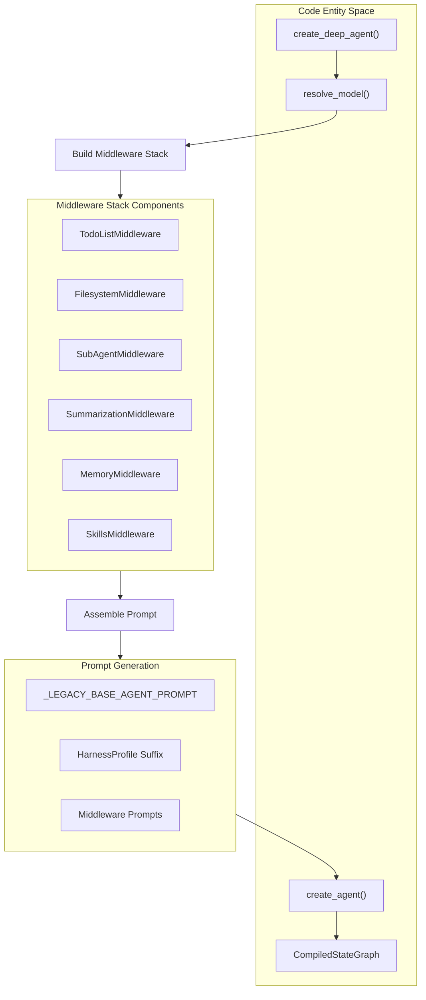
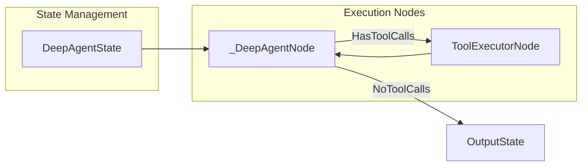
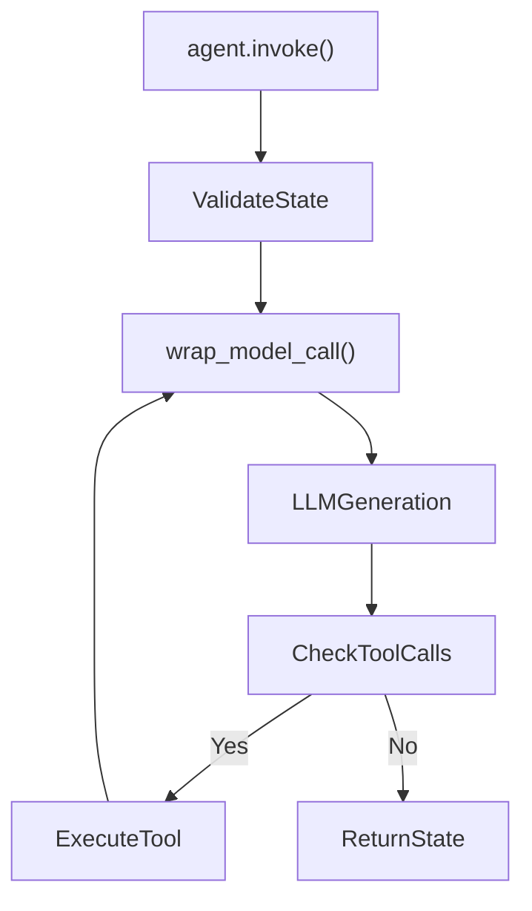
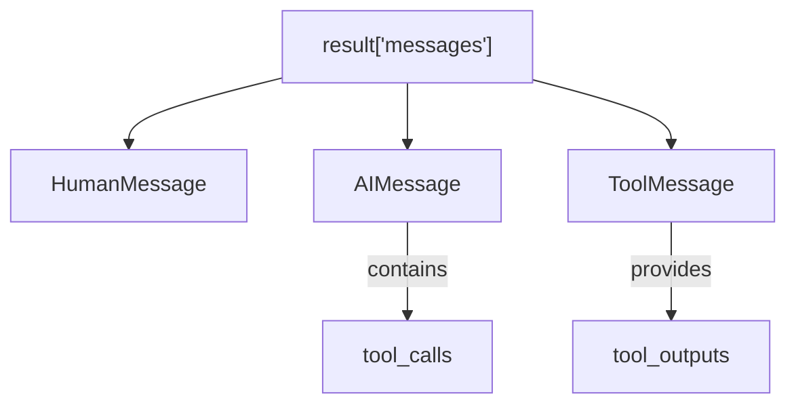
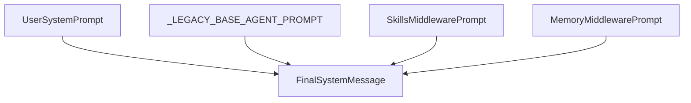

# Basic Agent Creation

<details>
<summary>Relevant source files</summary>

The following files were used as context for generating this wiki page:

- [examples/async-subagent-server/pyproject.toml](examples/async-subagent-server/pyproject.toml)
- [examples/content-builder-agent/uv.lock](examples/content-builder-agent/uv.lock)
- [examples/deep_research/pyproject.toml](examples/deep_research/pyproject.toml)
- [examples/deep_research/uv.lock](examples/deep_research/uv.lock)
- [examples/nvidia_deep_agent/pyproject.toml](examples/nvidia_deep_agent/pyproject.toml)
- [examples/nvidia_deep_agent/uv.lock](examples/nvidia_deep_agent/uv.lock)
- [examples/text-to-sql-agent/pyproject.toml](examples/text-to-sql-agent/pyproject.toml)
- [examples/text-to-sql-agent/uv.lock](examples/text-to-sql-agent/uv.lock)
- [libs/deepagents/deepagents/__init__.py](libs/deepagents/deepagents/__init__.py)
- [libs/deepagents/deepagents/graph.py](libs/deepagents/deepagents/graph.py)
- [libs/deepagents/deepagents/middleware/__init__.py](libs/deepagents/deepagents/middleware/__init__.py)
- [libs/deepagents/deepagents/middleware/patch_tool_calls.py](libs/deepagents/deepagents/middleware/patch_tool_calls.py)
- [libs/deepagents/deepagents/middleware/subagents.py](libs/deepagents/deepagents/middleware/subagents.py)
- [libs/deepagents/tests/integration_tests/test_filesystem_middleware.py](libs/deepagents/tests/integration_tests/test_filesystem_middleware.py)
- [libs/deepagents/tests/integration_tests/test_subagent_middleware.py](libs/deepagents/tests/integration_tests/test_subagent_middleware.py)
- [libs/deepagents/tests/unit_tests/middleware/test_subagent_middleware_init.py](libs/deepagents/tests/unit_tests/middleware/test_subagent_middleware_init.py)
- [libs/deepagents/tests/unit_tests/test_eviction_replay.py](libs/deepagents/tests/unit_tests/test_eviction_replay.py)
- [libs/deepagents/tests/unit_tests/test_graph.py](libs/deepagents/tests/unit_tests/test_graph.py)
- [libs/deepagents/tests/unit_tests/test_subagents.py](libs/deepagents/tests/unit_tests/test_subagents.py)

</details>


This tutorial covers the fundamentals of creating a simple agent using [`create_deep_agent`][libs/deepagents/deepagents/graph.py:3-5](), invoking it with inputs, and understanding the resulting execution state. For advanced configuration involving persistent memory, skills, or sub-agents, see [Memory and Skills Configuration]().

## Minimal Agent Creation

The entry point for building a deep agent is [`create_deep_agent`][libs/deepagents/deepagents/graph.py:3-5](). When invoked with default arguments, it initializes a model via [`resolve_model`][libs/deepagents/deepagents/graph.py:40-40]() and configures a comprehensive middleware stack including planning, filesystem operations, sub-agent delegation, and automated summarization.

```python
from deepagents import create_deep_agent

# Creates an agent with default model and standard middleware stack
agent = create_deep_agent()
result = agent.invoke({"messages": [{"role": "user", "content": "Research LangGraph and write a summary"}]})
```[libs/deepagents/deepagents/graph.py:1-60]()

By default, the agent includes:
- **Planning**: `write_todos` via `TodoListMiddleware` [libs/deepagents/tests/unit_tests/test_graph.py:15-15]().
- **Filesystem Tools**: `ls`, `read_file`, `write_file`, `edit_file`, `glob`, `grep` via [`FilesystemMiddleware`][libs/deepagents/deepagents/graph.py:51-51]().
- **Shell Execution**: `execute` tool for running system processes.
- **Sub-Agent Delegation**: `task` tool via [`SubAgentMiddleware`][libs/deepagents/deepagents/graph.py:55-62]() for isolated subtask handling.
- **Context Management**: Automatic conversation compaction via [`create_summarization_middleware`][libs/deepagents/deepagents/graph.py:63-63]().

Title: Deep Agent Assembly Flow (Natural Language to Code Entities)


Sources: [libs/deepagents/deepagents/graph.py:1-63](), [libs/deepagents/deepagents/graph.py:73-77]()

## Understanding the Agent Object

[`create_deep_agent`][libs/deepagents/deepagents/graph.py:3-5]() returns a `CompiledStateGraph` [libs/deepagents/deepagents/graph.py:28-28](). This graph manages execution state, checkpointing, and tool routing.

**Core State Architecture:**
- **State Schema**: Uses [`DeepAgentState`][libs/deepagents/deepagents/graph.py:73-77](), which inherits from LangChain's `AgentState` [libs/deepagents/deepagents/graph.py:73-73]().
- **Delta Channels**: The `messages` field is annotated with a `DeltaChannel` using [`_messages_delta_reducer`][libs/deepagents/deepagents/graph.py:39-39]() and a snapshot frequency of `50`, reducing checkpoint growth from $O(N^2)$ to $O(N)$ [libs/deepagents/deepagents/graph.py:76-76]().

**Key Execution Methods:**
- `invoke(input, config)`: Synchronously executes the graph until completion.
- `ainvoke(input, config)`: Asynchronous execution counterpart.
- `stream(input, config)`: Yields streaming updates across graph nodes.

Title: Agent Execution Cycle


Sources: [libs/deepagents/deepagents/graph.py:28-30](), [libs/deepagents/deepagents/graph.py:73-77]()

## Invoking the Agent

To execute the agent, provide an input dictionary containing a `messages` list with role-content dictionaries or LangChain message instances.

```python
from langchain_core.messages import HumanMessage

# Invoke using explicit message objects
result = agent.invoke({
    "messages": [HumanMessage(content="Analyze the current workspace directory.")]
})
```[libs/deepagents/deepagents/graph.py:12-25]()

During execution, model outputs containing tool calls are intercepted by middleware and routed to the corresponding tool implementations (e.g., filesystem tools or task delegates) before resuming generation.

Title: Model and Middleware Interaction Flow


Sources: [libs/deepagents/deepagents/graph.py:12-28](), [libs/deepagents/deepagents/middleware/subagents.py:55-60]()

## Understanding the Response

The return value of `invoke` is a dictionary conforming to [`DeepAgentState`][libs/deepagents/deepagents/graph.py:73-77]().

**Response Structure:**
- `messages`: A complete sequence of `HumanMessage`, `AIMessage`, and `ToolMessage` instances recording the entire interaction history.

```python
result = agent.invoke({"messages": [HumanMessage(content="Hello!")]})

# Inspect the final AI response content
print(result["messages"][-1].content)
```[libs/deepagents/deepagents/graph.py:73-77]()

Title: Response Message Hierarchy


Sources: [libs/deepagents/deepagents/graph.py:73-77](), [libs/deepagents/tests/unit_tests/test_subagents.py:133-140]()

## Basic Customization

### Custom Model Configuration
You can supply a specific chat model instance or a string identifier resolved via [`resolve_model`][libs/deepagents/deepagents/graph.py:40-40]():

```python
agent = create_deep_agent(
    model="anthropic:claude-3-5-sonnet-latest",
)
```[libs/deepagents/deepagents/graph.py:40-40]()

### Adding Custom Tools
Pass custom tools using the `tools` parameter to extend the agent's capabilities [libs/deepagents/deepagents/graph.py:25-25]():

```python
from langchain_core.tools import tool

@tool
def calculate_metric(value: float) -> float:
    """Calculate a custom metric."""
    return value * 2.0

agent = create_deep_agent(tools=[calculate_metric])
```[libs/deepagents/deepagents/graph.py:25-25]()

### System Prompt Customization
The agent prompt assembly combines base instructions (`_LEGACY_BASE_AGENT_PROMPT`) [libs/deepagents/deepagents/graph.py:79-121]() with contributions from middleware such as [`MemoryMiddleware`][libs/deepagents/deepagents/middleware/memory.py:52-52]() and [`SkillsMiddleware`][libs/deepagents/deepagents/middleware/skills.py:54-54](). You can override or supplement these by passing a `system_prompt` argument.

Title: System Prompt Construction


Sources: [libs/deepagents/deepagents/graph.py:79-138](), [libs/deepagents/deepagents/middleware/memory.py:52-52](), [libs/deepagents/deepagents/middleware/skills.py:54-54]()

## Next Steps
- **[Memory and Skills Configuration]()**: Set up `AGENTS.md` files and custom skill libraries.
- **[Sub-Agent Workflows]()**: Learn how to delegate work using the `task` tool.
- **[deepagents-code Overview and Installation]()**: Run agents interactively using the `dcode` terminal UI.

Sources: [libs/deepagents/deepagents/graph.py:1-163](), [libs/deepagents/deepagents/middleware/subagents.py:1-62]()