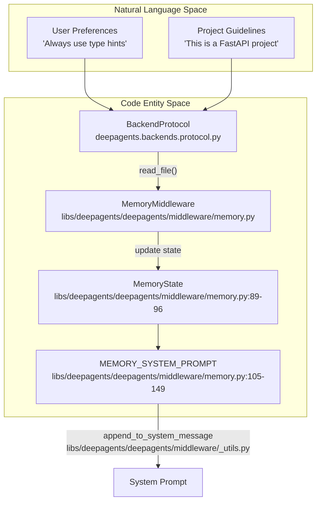
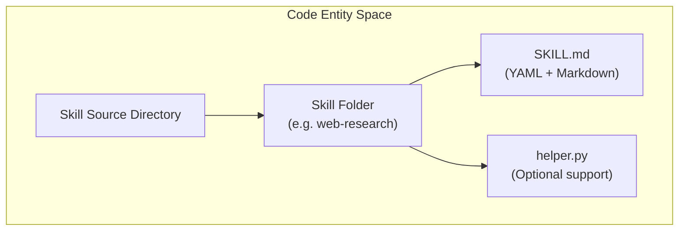
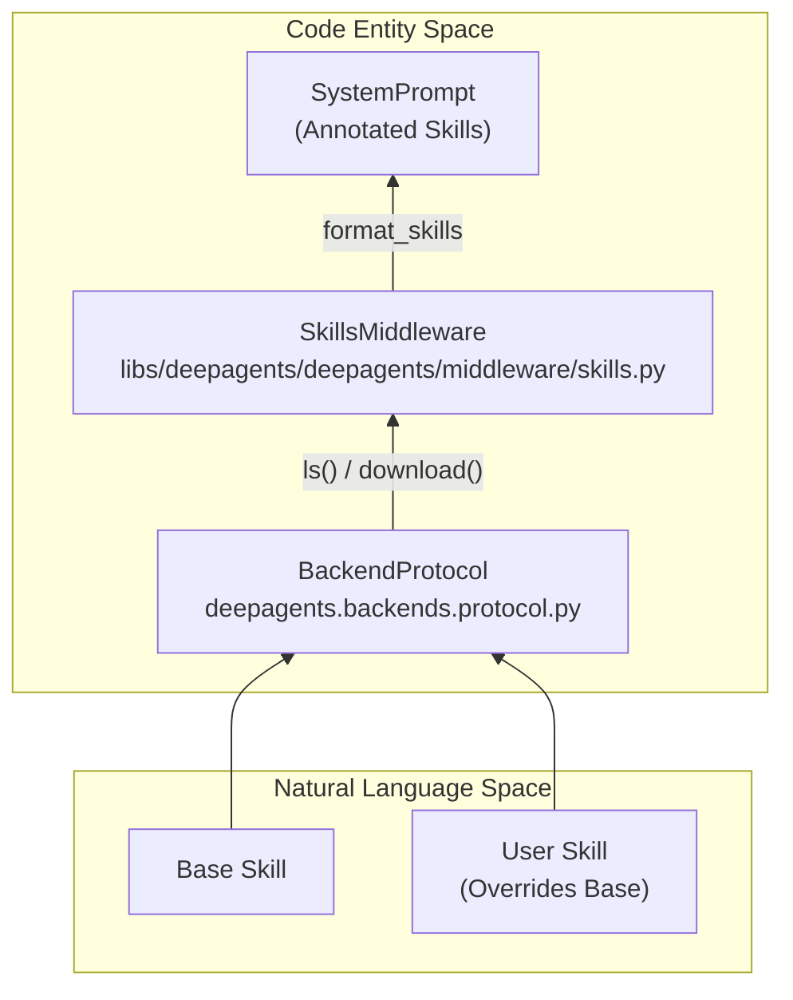
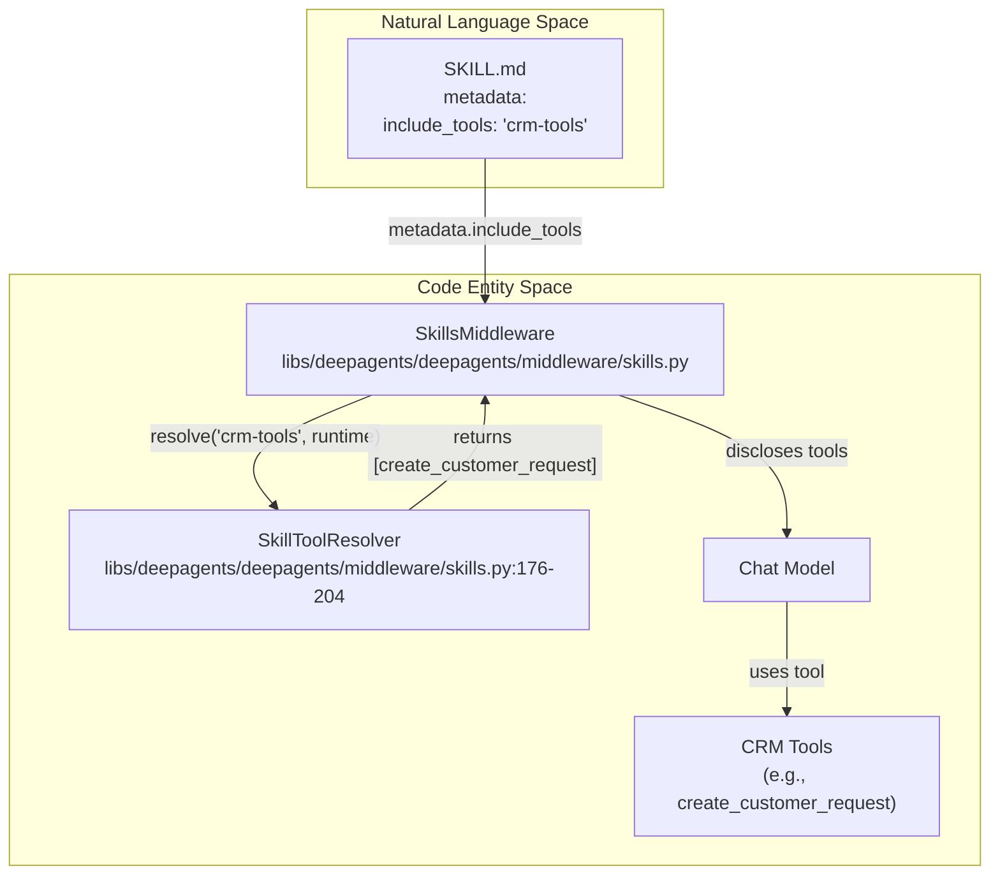

# Memory and Skills Configuration

<details>
<summary>Relevant source files</summary>

The following files were used as context for generating this wiki page:

- [libs/deepagents/deepagents/middleware/_skill_tools.py](libs/deepagents/deepagents/middleware/_skill_tools.py)
- [libs/deepagents/deepagents/middleware/memory.py](libs/deepagents/deepagents/middleware/memory.py)
- [libs/deepagents/deepagents/middleware/skills.py](libs/deepagents/deepagents/middleware/skills.py)
- [libs/deepagents/tests/integration_tests/test_deepagents.py](libs/deepagents/tests/integration_tests/test_deepagents.py)
- [libs/deepagents/tests/integration_tests/test_hitl.py](libs/deepagents/tests/integration_tests/test_hitl.py)
- [libs/deepagents/tests/unit_tests/middleware/skill_tools_support.py](libs/deepagents/tests/unit_tests/middleware/skill_tools_support.py)
- [libs/deepagents/tests/unit_tests/middleware/test_memory_middleware.py](libs/deepagents/tests/unit_tests/middleware/test_memory_middleware.py)
- [libs/deepagents/tests/unit_tests/middleware/test_memory_middleware_async.py](libs/deepagents/tests/unit_tests/middleware/test_memory_middleware_async.py)
- [libs/deepagents/tests/unit_tests/middleware/test_pinned_skills.py](libs/deepagents/tests/unit_tests/middleware/test_pinned_skills.py)
- [libs/deepagents/tests/unit_tests/middleware/test_skill_tool_resolver.py](libs/deepagents/tests/unit_tests/middleware/test_skill_tool_resolver.py)
- [libs/deepagents/tests/unit_tests/middleware/test_skill_tools.py](libs/deepagents/tests/unit_tests/middleware/test_skill_tools.py)
- [libs/deepagents/tests/unit_tests/middleware/test_skill_tools_payload.py](libs/deepagents/tests/unit_tests/middleware/test_skill_tools_payload.py)
- [libs/deepagents/tests/unit_tests/middleware/test_skills_middleware.py](libs/deepagents/tests/unit_tests/middleware/test_skills_middleware.py)
- [libs/deepagents/tests/unit_tests/middleware/test_skills_middleware_async.py](libs/deepagents/tests/unit_tests/middleware/test_skills_middleware_async.py)

</details>


This tutorial explains how to configure memory and skills for Deep Agents. Memory provides persistent context via `AGENTS.md` files, while skills provide specialized capabilities via `SKILL.md` files following the [Agent Skills specification](https://agentskills.io/specification).

---

## Memory Configuration with AGENTS.md

`MemoryMiddleware` implements support for the [AGENTS.md specification](https://agents.md/), loading context from configurable sources and injecting it into the system prompt [libs/deepagents/deepagents/middleware/memory.py:2-6](). Unlike skills (which are on-demand workflows), memory is loaded continuously and provides persistent context [libs/deepagents/deepagents/middleware/memory.py:9-11]().

### Memory Source Hierarchy

Sources are simply paths to `AGENTS.md` files that are loaded in order and combined [libs/deepagents/deepagents/middleware/memory.py:37-40](). Multiple sources are concatenated in order, so later sources appear after earlier ones in the combined prompt [libs/deepagents/deepagents/middleware/memory.py:38-40]().

**Diagram: Memory Source Loading and Data Flow**



Sources: [libs/deepagents/deepagents/middleware/memory.py:2-96](), [libs/deepagents/tests/unit_tests/middleware/test_memory_middleware.py:107-118]()

The middleware manages state via `MemoryState`, which maps source paths to their loaded content [libs/deepagents/deepagents/middleware/memory.py:89-96](). It uses the `BackendProtocol` to fetch file contents, ensuring portability across filesystem and remote storage [libs/deepagents/deepagents/middleware/memory.py:19-25](). If no memory is found, the system defaults to showing "No memory loaded" within the tags [libs/deepagents/tests/unit_tests/middleware/test_memory_middleware.py:107-118]().

Sources: [libs/deepagents/deepagents/middleware/memory.py:2-96](), [libs/deepagents/tests/unit_tests/middleware/test_memory_middleware.py:107-118]()

### Memory Guidelines and Learning

The `MemoryMiddleware` includes a comprehensive `MEMORY_SYSTEM_PROMPT` that instructs the agent on how to learn from user feedback [libs/deepagents/deepagents/middleware/memory.py:105-149]().

**Key Learning Behaviors:**
- **Trust and Verification**: Agents are warned that memory files are disk data and may be outdated; they must prioritize user requests and verified tool evidence [libs/deepagents/deepagents/middleware/memory.py:112-116]().
- **Learning from Feedback**: Capturing the "WHY" behind user corrections is a top priority to improve permanently [libs/deepagents/deepagents/middleware/memory.py:117-125]().
- **Prompt Updates**: Knowledge is saved by calling the `edit_file` tool on the `AGENTS.md` source [libs/deepagents/deepagents/middleware/memory.py:109-111]().
- **Exclusions**: Agents are strictly forbidden from storing API keys, credentials, or transient information like "I'm running late" [libs/deepagents/deepagents/middleware/memory.py:138-145]().

Sources: [libs/deepagents/deepagents/middleware/memory.py:105-149]()

---

## Skills Configuration with SKILL.md

Skills are loaded from one or more **sources**—paths in a backend where skills are organized [libs/deepagents/deepagents/middleware/skills.py:8-11](). Each skill is a directory containing a `SKILL.md` file with YAML frontmatter [libs/deepagents/deepagents/middleware/skills.py:23-29]().

### Skill Directory Structure

**Diagram: Skills Directory Layout**



Sources: [libs/deepagents/deepagents/middleware/skills.py:23-44]()

Only `SKILL.md` is required. The `SkillsMiddleware` uses backend APIs exclusively (no direct filesystem access), making it portable across storage backends [libs/deepagents/deepagents/middleware/skills.py:13-15]().

Sources: [libs/deepagents/deepagents/middleware/skills.py:13-44]()

### SKILL.md Format Specification

The `SkillsMiddleware` parses frontmatter into metadata per the [Agent Skills specification](https://agentskills.io/specification) [libs/deepagents/deepagents/middleware/skills.py:46-52]().

**Example Skill Structure:**
```markdown
---
name: web-research
description: Structured approach to conducting thorough web research
license: MIT
---

# Web Research Skill
...
```

Sources: [libs/deepagents/deepagents/middleware/skills.py:31-44](), [libs/deepagents/tests/unit_tests/middleware/test_skills_middleware.py:155-183]()

### Skill Validation Rules

The system enforces strict validation for skill metadata [libs/deepagents/deepagents/middleware/skills.py:145-148]():
- **Name**: Max 64 characters, lowercase alphanumeric and hyphens only [libs/deepagents/deepagents/middleware/skills.py:49-50](). It must match the directory name [libs/deepagents/tests/unit_tests/middleware/test_skills_middleware.py:149-153]().
- **Description**: Max 1024 characters [libs/deepagents/deepagents/middleware/skills.py:146]().
- **Security**: Maximum size for `SKILL.md` files is 10MB to prevent DoS attacks [libs/deepagents/deepagents/middleware/skills.py:162-162]().

Sources: [libs/deepagents/deepagents/middleware/skills.py:139-148](), [libs/deepagents/tests/unit_tests/middleware/test_skills_middleware.py:93-153]()

---

## Skills Source Configuration

### Precedence and Labels

Sources are loaded in order, with later sources overriding earlier ones when skills share the same name (last one wins) [libs/deepagents/deepagents/middleware/skills.py:8-11]().

**Diagram: Skill Precedence and Middleware Interaction**



Sources: [libs/deepagents/deepagents/middleware/skills.py:8-11](), [libs/deepagents/deepagents/middleware/skills.py:54-73](), [libs/deepagents/deepagents/middleware/skills.py:192-210]()

Sources can be bare paths or `(path, label)` tuples [libs/deepagents/deepagents/middleware/skills.py:206-208](). Bare paths derive labels from the final component (e.g., `/skills/user/` -> `User`), while tuples allow disambiguation [libs/deepagents/deepagents/middleware/skills.py:56-63](). Special cases like `built_in_skills` collapse to `Built-in` [libs/deepagents/deepagents/middleware/skills.py:194-204]().

Sources: [libs/deepagents/deepagents/middleware/skills.py:8-11](), [libs/deepagents/deepagents/middleware/skills.py:54-73](), [libs/deepagents/deepagents/middleware/skills.py:192-210]()

### Skill Tool Resolution

Skills can declare tools they need using `metadata.include_tools` in their `SKILL.md` frontmatter [libs/deepagents/deepagents/middleware/_skill_tools.py:46-47](). These tools are resolved by a `SkillToolResolver` [libs/deepagents/deepagents/middleware/skills.py:176-204]().

**`SkillToolResolver` Functionality:**
- Takes an `include_tools` name and the `Runtime` as input [libs/deepagents/deepagents/middleware/skills.py:176-176]().
- Returns a sequence of `BaseTool` instances [libs/deepagents/deepagents/middleware/skills.py:176-176]().
- Can be synchronous or asynchronous [libs/deepagents/deepagents/middleware/skills.py:185-186]().
- Ensures tool names are unique within the resolved set [libs/deepagents/deepagents/middleware/_skill_tools.py:86-90]().
- Resolvers should be cheap or cached, as they run on every model call [libs/deepagents/deepagents/middleware/skills.py:187-188]().

**Diagram: Skill Tool Resolution Flow**



Sources: [libs/deepagents/deepagents/middleware/skills.py:176-204](), [libs/deepagents/deepagents/middleware/_skill_tools.py:46-47](), [libs/deepagents/deepagents/middleware/_skill_tools.py:63-96]()

The `_normalize_skill_tools` function converts various input formats (sequences of tools, callables) into a consistent `SkillToolResolver` [libs/deepagents/deepagents/middleware/_skill_tools.py:63-96](). This allows for flexible tool definition, including dynamically generated tools or groups of tools [libs/deepagents/tests/unit_tests/middleware/skill_tools_support.py:113-123]().

Sources: [libs/deepagents/deepagents/middleware/_skill_tools.py:63-96](), [libs/deepagents/tests/unit_tests/middleware/skill_tools_support.py:113-123]()

### Tool Disclosure and Gating

The `SkillsMiddleware` manages the disclosure of tools to the language model. Tools are disclosed inline in the conversation history, typically right after the `SKILL.md` file that names them is read [libs/deepagents/tests/unit_tests/middleware/test_skill_tools_payload.py:120-144](). This ensures the model has access to the relevant tools when it needs them.

**Key aspects of tool disclosure:**
- **Inline Disclosure**: Tools are added to the conversation as `tool_addition` blocks (for Anthropic models) or `additional_tools` input items (for OpenAI models) [libs/deepagents/tests/unit_tests/middleware/test_skill_tools_payload.py:88-108](), [libs/deepagents/tests/unit_tests/middleware/test_skill_tools_payload.py:151-161]().
- **Gating**: Tools can be "gated" by the `defer_loading` extra parameter [libs/deepagents/middleware/_skill_tools.py:52-53](). Gated tools are not disclosed until they are explicitly searched for by the model, reducing context window pressure [libs/deepagents/tests/unit_tests/middleware/test_skill_tools_payload.py:300-320]().
- **Precedence**: If a tool is defined in multiple places (e.g., directly in `create_deep_agent` and via a skill), the one provided directly to `create_deep_agent` takes precedence [libs/deepagents/tests/unit_tests/middleware/test_skill_tools_payload.py:400-420]().

Sources: [libs/deepagents/middleware/_skill_tools.py:52-53](), [libs/deepagents/tests/unit_tests/middleware/test_skill_tools_payload.py:88-108](), [libs/deepagents/tests/unit_tests/middleware/test_skill_tools_payload.py:120-144](), [libs/deepagents/tests/unit_tests/middleware/test_skill_tools_payload.py:151-161](), [libs/deepagents/tests/unit_tests/middleware/test_skill_tools_payload.py:300-320](), [libs/deepagents/tests/unit_tests/middleware/test_skill_tools_payload.py:400-420]()

---

## Sub-Agent Configuration

Deep Agents can delegate tasks to sub-agents via the `task` tool [libs/deepagents/tests/integration_tests/test_deepagents.py:39-56](). Sub-agents are configured using sub-agent definitions that allow defining specialized models, tools, prompts, and execution modes [libs/deepagents/tests/integration_tests/test_deepagents.py:25-34]().

### Delegation Modes
- **Isolated (Default)**: The sub-agent receives only the delegated task description without parent conversation history.
- **Fork (Experimental)**: The sub-agent continues the parent's conversation, inheriting state [libs/deepagents/tests/unit_tests/test_deep_agent_streaming.py:102-111]().

Sources: [libs/deepagents/tests/integration_tests/test_deepagents.py:25-102](), [libs/deepagents/tests/unit_tests/test_deep_agent_streaming.py:92-112]()