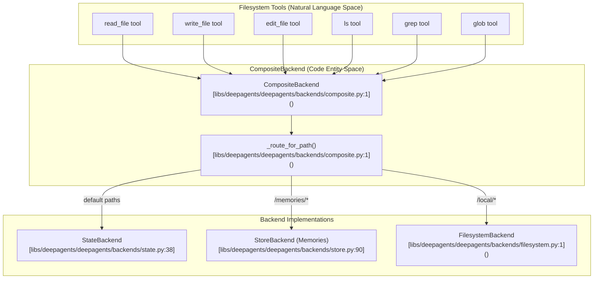
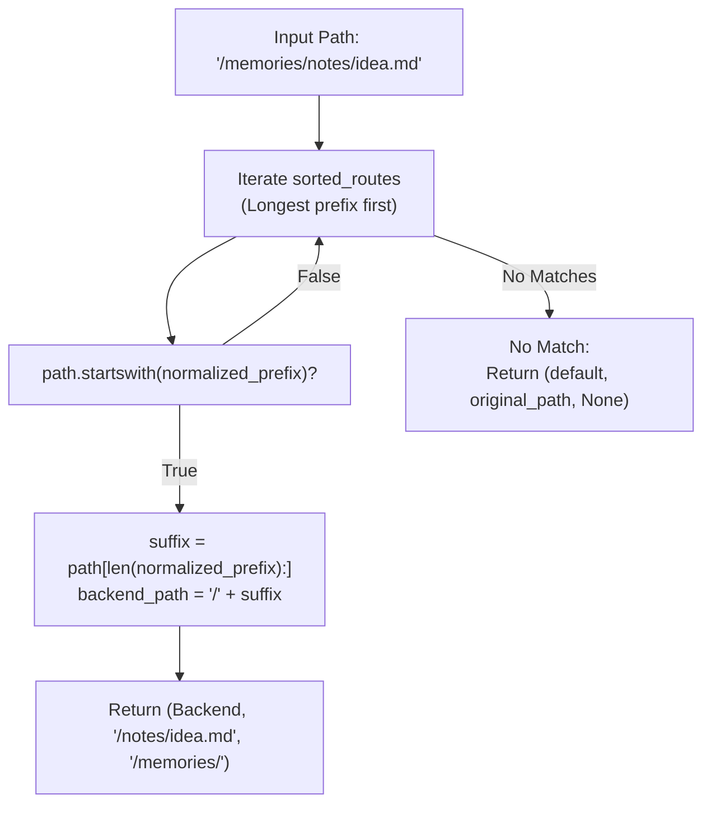
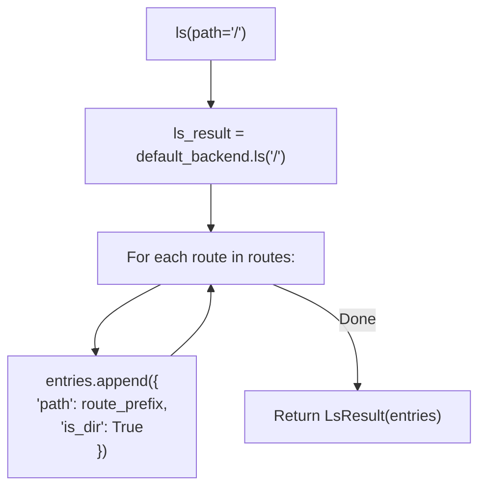
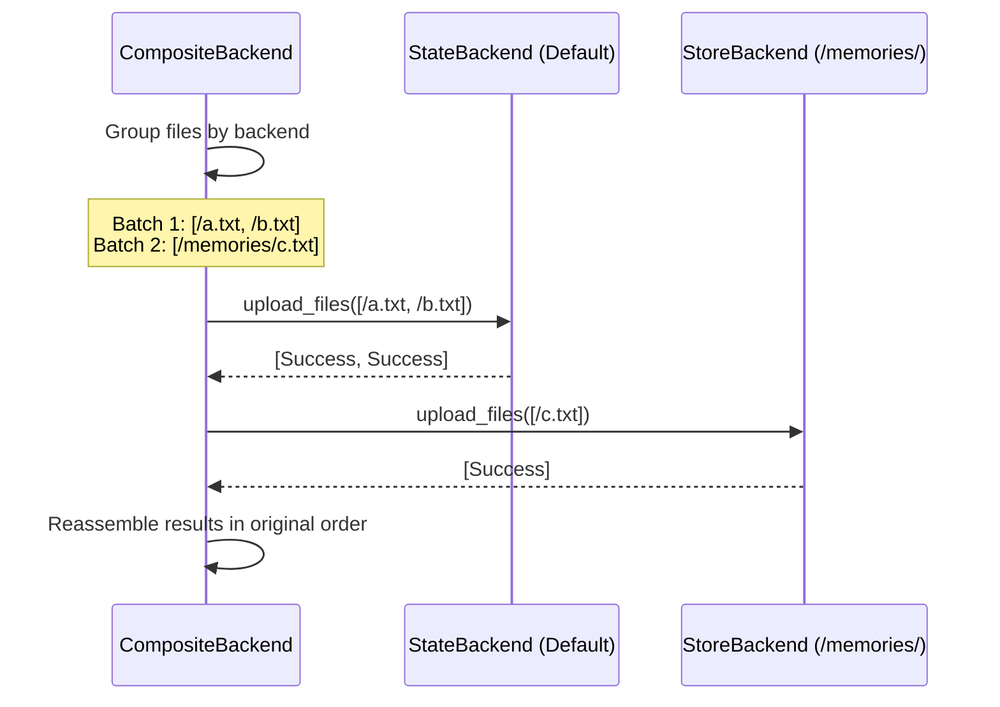

# Multi-Backend Configuration

<details>
<summary>Relevant source files</summary>

The following files were used as context for generating this wiki page:

- [libs/deepagents/deepagents/backends/composite.py](libs/deepagents/deepagents/backends/composite.py)
- [libs/deepagents/deepagents/backends/state.py](libs/deepagents/deepagents/backends/state.py)
- [libs/deepagents/deepagents/backends/store.py](libs/deepagents/deepagents/backends/store.py)
- [libs/deepagents/tests/unit_tests/backends/test_composite_backend.py](libs/deepagents/tests/unit_tests/backends/test_composite_backend.py)
- [libs/deepagents/tests/unit_tests/backends/test_composite_backend_async.py](libs/deepagents/tests/unit_tests/backends/test_composite_backend_async.py)
- [libs/deepagents/tests/unit_tests/backends/test_file_format.py](libs/deepagents/tests/unit_tests/backends/test_file_format.py)
- [libs/deepagents/tests/unit_tests/backends/test_filesystem_backend_async.py](libs/deepagents/tests/unit_tests/backends/test_filesystem_backend_async.py)
- [libs/deepagents/tests/unit_tests/backends/test_state_backend.py](libs/deepagents/tests/unit_tests/backends/test_state_backend.py)
- [libs/deepagents/tests/unit_tests/backends/test_state_backend_async.py](libs/deepagents/tests/unit_tests/backends/test_state_backend_async.py)
- [libs/deepagents/tests/unit_tests/backends/test_store_backend.py](libs/deepagents/tests/unit_tests/backends/test_store_backend.py)
- [libs/deepagents/tests/unit_tests/backends/test_store_backend_async.py](libs/deepagents/tests/unit_tests/backends/test_store_backend_async.py)

</details>


This page provides a technical guide and tutorial for configuring `CompositeBackend` to implement hybrid storage strategies. The `CompositeBackend` enables routing file operations to different storage backends based on path prefixes, allowing developers to combine ephemeral workspace storage with persistent memory, local disk access with cloud sandboxes, or multiple isolated persistent namespaces.

For general backend architecture concepts, see [2.7](). For basic agent creation patterns, see [8.1]().

## CompositeBackend Architecture

The `CompositeBackend` class [libs/deepagents/deepagents/backends/composite.py:1-6]() routes file operations to different backend implementations based on path prefixes. It implements the `BackendProtocol` interface [libs/deepagents/deepagents/backends/protocol.py:12-31]() and delegates calls using path matching rules [libs/deepagents/deepagents/backends/composite.py:1-6]().

**CompositeBackend Routing Architecture**



Sources: [libs/deepagents/deepagents/backends/composite.py:1-6](), [libs/deepagents/deepagents/backends/protocol.py:12-31](), [libs/deepagents/deepagents/backends/state.py:38](), [libs/deepagents/deepagents/backends/store.py:90](), [libs/deepagents/deepagents/backends/filesystem.py:1]()

### Path Routing Mechanism

The routing engine handles prefix matching to determine which backend handles a specific file path, stripping or retaining prefixes as needed for the target backend.

**Routing and Path Normalization Flow**



Sources: [libs/deepagents/deepagents/backends/composite.py:1-6]()

## Implementation Patterns

### Pattern 1: Ephemeral Workspace + Persistent Memories

This is the standard configuration for agents that need a temporary scratchpad for the current task but must remember information across different conversations. It uses `StateBackend` for the root and `StoreBackend` for the `/memories/` path [libs/deepagents/tests/unit_tests/backends/test_composite_backend.py:22-28]().

```python
from deepagents.backends.composite import CompositeBackend
from deepagents.backends.state import StateBackend
from deepagents.backends.store import StoreBackend
from langgraph.store.memory import InMemoryStore

mem_store = InMemoryStore() # Example store

# Configuration example
composite = CompositeBackend(
    default=StateBackend(),
    routes={"/memories/": StoreBackend(store=mem_store, namespace=lambda _rt: ("filesystem",))},
)
```

**Storage Behavior:**

| Path | Backend | Implementation Detail | Persistence |
|------|---------|-----------------------|-------------|
| `/task.txt` | `StateBackend` | Stored in LangGraph `files` state channel [libs/deepagents/deepagents/backends/state.py:94]() | Thread-scoped |
| `/memories/user.json` | `StoreBackend` | Stored via LangGraph `BaseStore` [libs/deepagents/deepagents/backends/store.py:122]() | Cross-thread |

Sources: [libs/deepagents/deepagents/backends/composite.py:1-6](), [libs/deepagents/tests/unit_tests/backends/test_composite_backend.py:22-55](), [libs/deepagents/deepagents/backends/state.py:94](), [libs/deepagents/deepagents/backends/store.py:122]()

### Pattern 2: Local Filesystem + Persistent Storage

Used in CLI tools where the agent operates on a local directory but maintains a persistent knowledge base.

```python
from deepagents.backends.composite import CompositeBackend
from deepagents.backends.filesystem import FilesystemBackend
from deepagents.backends.store import StoreBackend
from langgraph.store.memory import InMemoryStore

mem_store = InMemoryStore() # Example store

# Local project files in / + persistent memories in /memories/
fs = FilesystemBackend(root_dir="./src", virtual_mode=True)
store = StoreBackend(store=mem_store, namespace=lambda _rt: ("filesystem",))
comp = CompositeBackend(default=fs, routes={"/memories/": store})
```

Sources: [libs/deepagents/tests/unit_tests/backends/test_composite_backend.py:57-105](), [libs/deepagents/deepagents/backends/composite.py:1-6]()

## Core Method Implementations

### Directory Listing (`ls`)

The `ls()` method aggregates entries. If the path is `/`, it merges the default backend's root entries with virtual directories representing the routes [libs/deepagents/deepagents/backends/composite.py:1-6]().

**ls() Logic for Root Path**



Sources: [libs/deepagents/deepagents/backends/composite.py:1-6]()

### Search Operations (`grep` and `glob`)

Search operations are routed based on the `path` parameter. If `path="/"` or `None`, the `CompositeBackend` performs a global search across all backends and merges the results, remapping internal paths back to the virtual composite paths [libs/deepagents/deepagents/backends/composite.py:37-106]().

**Key Search Helpers:**
- `_remap_grep_path`: Prepends the route prefix to matches found in a sub-backend [libs/deepagents/deepagents/backends/composite.py:37-45]().
- `_strip_route_from_pattern`: Normalizes glob patterns so a search for `/memories/*.md` becomes `/*.md` when passed to the memories backend [libs/deepagents/deepagents/backends/composite.py:60-82]().
- `_route_glob_pattern`: Determines if a pattern can match a specific route based on anchoring [libs/deepagents/deepagents/backends/composite.py:85-106]().

Sources: [libs/deepagents/deepagents/backends/composite.py:37-106]()

### Batch File Operations

For efficiency, `upload_files` and `download_files` group files by their target backend and perform batch calls [libs/deepagents/deepagents/backends/composite.py:1-31]().

**Batching Sequence**



Sources: [libs/deepagents/deepagents/backends/composite.py:1-31](), [libs/deepagents/deepagents/backends/protocol.py:12-31]()

## Async Support

`CompositeBackend` provides full parity for asynchronous operations via `awrite`, `aread`, `als`, `agrep`, `aglob`, and `aexecute` [libs/deepagents/tests/unit_tests/backends/test_composite_backend_async.py:46-79](). These methods mirror the logic of their synchronous counterparts but await the delegated calls to the underlying backends [libs/deepagents/tests/unit_tests/backends/test_composite_backend_async.py:46-79]().

Sources: [libs/deepagents/deepagents/backends/composite.py:1-6](), [libs/deepagents/tests/unit_tests/backends/test_composite_backend_async.py:46-79]()