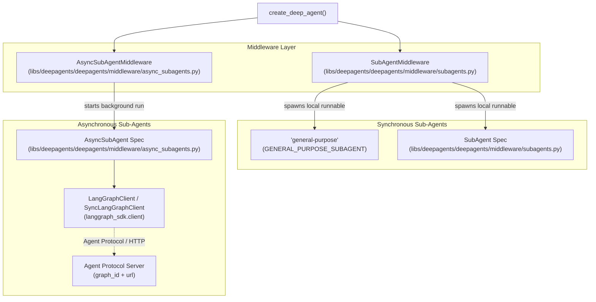

# Sub-Agent Workflows

<details>
<summary>Relevant source files</summary>

The following files were used as context for generating this wiki page:

- [examples/async-subagent-server/pyproject.toml](examples/async-subagent-server/pyproject.toml)
- [examples/content-builder-agent/uv.lock](examples/content-builder-agent/uv.lock)
- [examples/deep_research/pyproject.toml](examples/deep_research/pyproject.toml)
- [examples/deep_research/uv.lock](examples/deep_research/uv.lock)
- [examples/nvidia_deep_agent/pyproject.toml](examples/nvidia_deep_agent/pyproject.toml)
- [examples/nvidia_deep_agent/uv.lock](examples/nvidia_deep_agent/uv.lock)
- [examples/text-to-sql-agent/pyproject.toml](examples/text-to-sql-agent/pyproject.toml)
- [examples/text-to-sql-agent/uv.lock](examples/text-to-sql-agent/uv.lock)
- [libs/deepagents/deepagents/middleware/_blob_offload.py](libs/deepagents/deepagents/middleware/_blob_offload.py)
- [libs/deepagents/deepagents/middleware/_parent_notifier.py](libs/deepagents/deepagents/middleware/_parent_notifier.py)
- [libs/deepagents/deepagents/middleware/async_subagents.py](libs/deepagents/deepagents/middleware/async_subagents.py)
- [libs/deepagents/tests/unit_tests/middleware/test_blob_offload.py](libs/deepagents/tests/unit_tests/middleware/test_blob_offload.py)
- [libs/deepagents/tests/unit_tests/middleware/test_filesystem_middleware_init.py](libs/deepagents/tests/unit_tests/middleware/test_filesystem_middleware_init.py)
- [libs/deepagents/tests/unit_tests/test_async_subagents.py](libs/deepagents/tests/unit_tests/test_async_subagents.py)

</details>


This page provides a technical tutorial and reference for sub-agent workflows in Deep Agents. It covers creating specialized sub-agents, using the `task` tool in isolated versus fork modes, synchronous versus asynchronous sub-agents via `AsyncSubAgentMiddleware` and the `async-subagent-server` example, and loading custom subagents via YAML frontmatter configuration files.

---

## 1. Overview & Architecture

Sub-agents are autonomous agent instances spawned by a parent agent to handle specific subtasks. They provide context isolation, specialized toolsets, distinct model configurations, and flexible execution lifecycles.

**Diagram: Sub-Agent Types and Delegation Flow (Natural Language to Code Entity Space)**


Sources:
- [libs/deepagents/deepagents/middleware/subagents.py]()
- [libs/deepagents/deepagents/middleware/async_subagents.py]()

---

## 2. Synchronous Sub-Agents & The Task Tool

Synchronous sub-agents run locally within the same process. When the parent calls the `task` tool, execution blocks until the sub-agent returns its final message or structured result [libs/deepagents/deepagents/middleware/subagents.py:163-170]().

### SubAgent Specification
Sub-agents are defined using the `SubAgent` TypedDict, which configures their name, description, system prompt, tool list, model, middleware stack, skills, and response format [libs/deepagents/deepagents/middleware/subagents.py:66-120]().

### Isolated vs. Fork Modes
- **Isolated Mode (Default):** The sub-agent starts with a fresh conversation state containing only the delegated task description, ensuring complete context hygiene [libs/deepagents/deepagents/middleware/subagents.py:69-70]().
- **Fork Mode (`mode="fork"`):** The sub-agent inherits a copy of the parent conversation history up to the delegation point, allowing it to inspect prior dialogue [libs/deepagents/deepagents/middleware/subagents.py:70-75]().

### Recursion Protection
Sub-agents are automatically protected against recursive delegation loops. The middleware intercepts attempts by a sub-agent to invoke the `task` tool recursively [libs/deepagents/deepagents/middleware/subagents.py:61-63]().

Sources:
- [libs/deepagents/deepagents/middleware/subagents.py:46-120]()
- [libs/deepagents/tests/unit_tests/test_subagents.py:38-144]()

---

## 3. Asynchronous Sub-Agents and the async-subagent-server Example

Asynchronous sub-agents run on remote deployments (e.g., LangGraph Platform or self-hosted Agent Protocol servers). The parent agent receives a `task_id` immediately, allowing it to continue other operations while the sub-agent executes in the background [libs/deepagents/deepagents/middleware/async_subagents.py:1-7]().

### State Tracking and Tools
`AsyncSubAgentMiddleware` equips the agent with state tracking via `AsyncSubAgentState` and five core management tools [libs/deepagents/deepagents/middleware/async_subagents.py:132-171]():
- `start_async_task`: Launches a background run on the remote server [libs/deepagents/deepagents/middleware/async_subagents.py:138-142]().
- `check_async_task`: Polls the status and retrieves results using a `task_id` [libs/deepagents/deepagents/middleware/async_subagents.py:145-149]().
- `update_async_task`: Sends follow-up instructions or context to a running task [libs/deepagents/deepagents/middleware/async_subagents.py:151-155]().
- `cancel_async_task`: Stops an active remote run [libs/deepagents/deepagents/middleware/async_subagents.py:158-162]().
- `list_async_tasks`: Filters and lists tracked background tasks by status [libs/deepagents/deepagents/middleware/async_subagents.py:164-171]().

**Diagram: Async Sub-Agent Workflow**
```mermaid
graph TD
    A[Parent Agent] --> B{Call start_async_task};
    B --> C[AsyncSubAgentMiddleware.start_async_task()];
    C --> D{LangGraphClient.threads.create()};
    D --> E[Remote Agent Protocol Server];
    E --> F[Sub-Agent Execution];
    F --> G{LangGraphClient.threads.get()};
    G --> H[AsyncSubAgentMiddleware.check_async_task()];
    H --> I[Parent Agent Receives Status/Result];

    subgraph "Parent Agent State"
        J[async_tasks: Dict[str, AsyncTask]]
    end
    I -- "Updates" --> J;
```

### The async-subagent-server Example
The `async-subagent-server` example project provides a self-hosted reference implementation using FastAPI, Uvicorn, LangGraph, and `deepagents` [examples/async-subagent-server/pyproject.toml:1-15](). It exposes an Agent Protocol-compliant endpoint that handles asynchronous subagent lifecycle events over HTTP and ASGI transport.

Sources:
- [libs/deepagents/deepagents/middleware/async_subagents.py:34-181]()
- [examples/async-subagent-server/pyproject.toml:1-15]()
- [libs/deepagents/tests/unit_tests/test_async_subagents.py:107-121]()

---

## 4. Custom Subagents via YAML Frontmatter

In `deepagents-code`, custom subagents can be declared declaratively using YAML frontmatter files located in `.deepagents/agents/`.

### YAML Frontmatter Structure
A custom subagent file defines metadata and operational parameters:
```yaml
---
name: "code-reviewer"
description: "Reviews code changes for security vulnerabilities and style violations."
model: "anthropic:claude-3-5-sonnet"
tools: ["read_file", "grep", "glob"]
system_prompt: |
  You are an expert security code reviewer. Analyze the provided codebase thoroughly.
---
```

When the CLI agent initializes, it parses these files to construct specialized `SubAgent` specifications dynamically without requiring explicit Python code modifications [libs/deepagents/deepagents/middleware/subagents.py:66-120]().

Sources:
- [libs/deepagents/deepagents/middleware/subagents.py:66-120]()

---

## 5. Context Isolation and State Filtering

To prevent parent state pollution, `SubAgentMiddleware` filters out specific keys during sub-agent invocation via `_FORK_EXCLUDED_STATE_KEYS` [libs/deepagents/deepagents/middleware/subagents.py:46-52]().

| Aspect | Behavior |
|--------|----------|
| **Messages** | Sub-agents initialize with a fresh message history or a sanitized fork of the parent [libs/deepagents/deepagents/middleware/subagents.py:69-71](). |
| **Summarization** | Summarization events are folded into messages for forks; session identifiers are stripped [libs/deepagents/deepagents/middleware/subagents.py:49-51](). |
| **Permissions** | Filesystem permissions can be inherited or explicitly scoped for the sub-agent instance [libs/deepagents/deepagents/middleware/subagents.py:114-117](). |

Sources:
- [libs/deepagents/deepagents/middleware/subagents.py:46-117]()
- [libs/deepagents/middleware/filesystem.py:12-16]()

---

## 6. Summary Table: Sync vs. Async Sub-Agents

| Feature | Synchronous (`task`) | Asynchronous (`start_async_task`) |
|---------|----------------------|-----------------------------------|
| **Execution** | Blocking (local process) | Non-blocking (remote server) |
| **Context** | Ephemeral, isolated, or fork | Persistent remote thread |
| **Monitoring** | Direct return upon completion | Polling via `check_async_task` |
| **State Tracking** | Merged into parent return message | Tracked in `async_tasks` state dict [libs/deepagents/deepagents/middleware/async_subagents.py:132-135]() |
| **Transport** | Internal Python function call | HTTP / Agent Protocol [libs/deepagents/deepagents/middleware/async_subagents.py:69-74]() |

Sources:
- [libs/deepagents/deepagents/middleware/subagents.py:66-174]()
- [libs/deepagents/deepagents/middleware/async_subagents.py:34-171]()