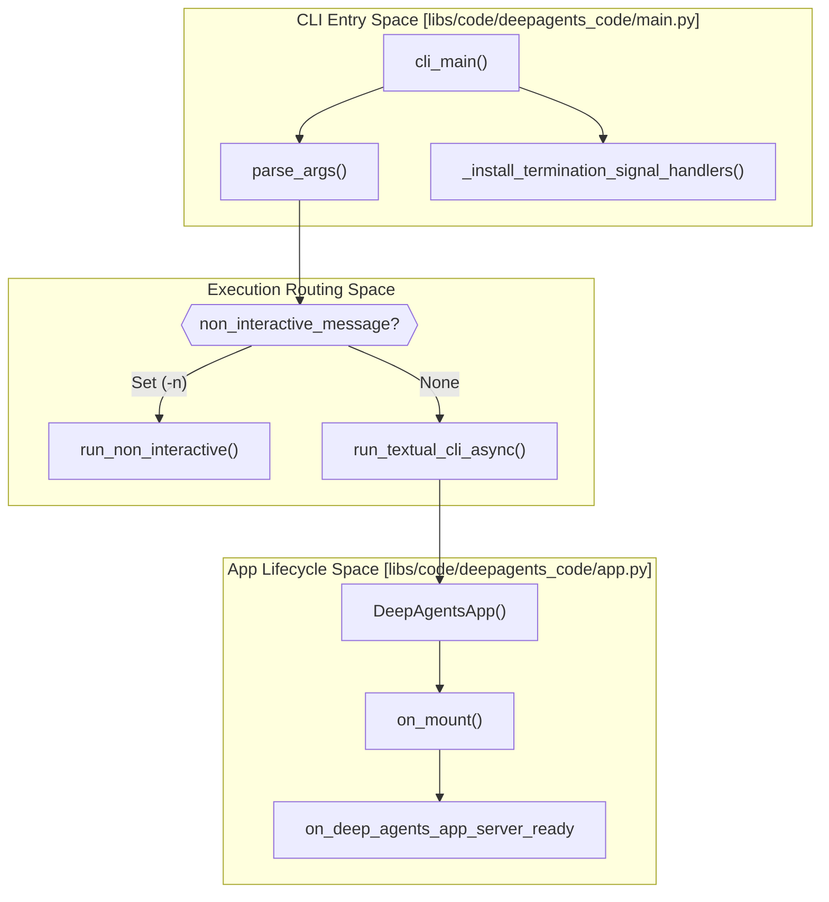
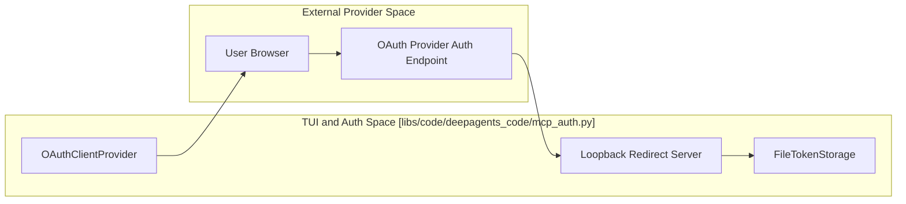
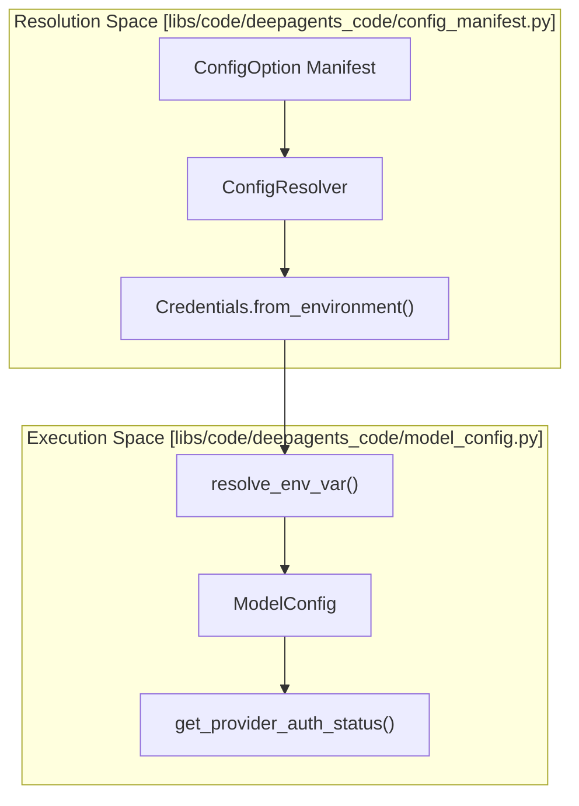

# deepagents-code Usage Patterns

Relevant source files

The following files were used as context for generating this wiki page:

- [libs/code/COMMANDS.md](libs/code/COMMANDS.md)
- [libs/code/deepagents_code/app.py](libs/code/deepagents_code/app.py)
- [libs/code/deepagents_code/command_registry.py](libs/code/deepagents_code/command_registry.py)
- [libs/code/deepagents_code/tui/widgets/startup_tip.py](libs/code/deepagents_code/tui/widgets/startup_tip.py)
- [libs/code/tests/unit_tests/test_app.py](libs/code/tests/unit_tests/test_app.py)
- [libs/code/tests/unit_tests/test_command_registry.py](libs/code/tests/unit_tests/test_command_registry.py)
- [libs/code/tests/unit_tests/test_thread_naming_app.py](libs/code/tests/unit_tests/test_thread_naming_app.py)
- [libs/code/tests/unit_tests/tui/widgets/test_startup_tip.py](libs/code/tests/unit_tests/tui/widgets/test_startup_tip.py)
- [openwiki/.claims/workflows/run-dcode-session.json](openwiki/.claims/workflows/run-dcode-session.json)
- [openwiki/workflows/index.md](openwiki/workflows/index.md)
- [openwiki/workflows/run-dcode-session.md](openwiki/workflows/run-dcode-session.md)

This page provides technical documentation and tutorials for common workflows using the `deepagents-code` package (`dcode`). It covers interactive terminal operations, automated non-interactive execution, piped input, model switching, thread management, incognito shell execution, Model Context Protocol (MCP) authentication, external editor integration, credential management via `/auth`, and the goal/rubric workflow.

---

## Command Invocation and Execution Routing

The `deepagents-code` CLI entry point parses command-line arguments to determine whether to launch the interactive Textual-based UI (`DeepAgentsApp`) or execute a headless non-interactive task via `run_non_interactive`.

### Execution Flow Architecture

**Diagram Title: `dcode` Execution Flow**
This diagram illustrates the high-level flow from CLI invocation to either interactive TUI or non-interactive execution.
Sources: [libs/code/deepagents_code/main.py:44-47](), [libs/code/deepagents_code/main.py:92-118](), [libs/code/deepagents_code/app.py:1-50]()

---

## Interactive Mode Patterns and Chat Input

Interactive mode provides a terminal interface built on the Textual framework using the `DeepAgentsApp` class [libs/code/deepagents_code/app.py:1-50]().

### Startup and Onboarding
Upon startup, the app initializes the `NotificationRegistry` for background alerts and `SessionStats` for resource and cost tracking [libs/code/deepagents_code/app.py:142-149](), [libs/code/deepagents_code/app.py:88-96](). If the environment dictates, it restores the iTerm2 cursor guide via `restore_iterm_cursor_guide` [libs/code/deepagents_code/app.py:141-142](). Startup tips are displayed above the chat input, chosen randomly from a weighted list defined in `_TIPS` [libs/code/deepagents_code/tui/widgets/startup_tip.py:23-48](). The visibility of these tips can be controlled by the `HIDE_SPLASH_TIPS` environment variable [libs/code/deepagents_code/tui/widgets/startup_tip.py:112-118]().

### Chat Input Modes and Autocomplete
The `ChatInput` widget [libs/code/deepagents_code/tui/widgets/chat_input.py]() supports distinct operational modes determined by input prefixes:
*   **Normal Mode**: Standard natural language prompt submission.
*   **Shell Mode (`!`)**: Executes local shell commands.
*   **Incognito Shell Mode (`!!`)**: Executes shell commands without recording them to thread persistence or session history logs [libs/code/deepagents_code/tui/widgets/startup_tip.py:45]().
*   **Command Mode (`/`)**: Triggers unified slash commands registered in `COMMANDS` via `command_registry.py` [libs/code/deepagents_code/command_registry.py:37-76]().

Large paste collapsing is controlled by `DEEPAGENTS_CODE_COLLAPSE_PASTES` to prevent UI rendering lags [libs/code/deepagents_code/_env_vars.py:73-81]().

### External Editor Integration
For multi-line or complex prompts, users can invoke an external system editor (resolved via the `$EDITOR` environment variable) using `Ctrl+X` or the `/editor` slash command [libs/code/deepagents_code/command_registry.py:175-179](). This writes the current buffer to a temporary file, opens the editor subprocess, and reads back the saved content. A startup tip reminds users of this functionality [libs/code/deepagents_code/tui/widgets/startup_tip.py:37]().

**Sources:** [libs/code/deepagents_code/app.py:1-50](), [libs/code/deepagents_code/app.py:88-96](), [libs/code/deepagents_code/app.py:141-149](), [libs/code/deepagents_code/_env_vars.py:73-81](), [libs/code/deepagents_code/command_registry.py:37-76](), [libs/code/deepagents_code/command_registry.py:175-179](), [libs/code/deepagents_code/tui/widgets/startup_tip.py:23-48](), [libs/code/deepagents_code/tui/widgets/startup_tip.py:112-118]()

---

## Model Context Protocol (MCP) and Authentication Workflows

`deepagents-code` integrates with MCP servers to expose external tools and resources securely.

### MCP Configuration Discovery and OAuth Login
MCP configurations are loaded from `~/.deepagents/mcp.json` and project-local `.mcp.json` files [libs/code/deepagents_code/model_config.py:28-50](). For providers requiring authentication, the system invokes an OAuth loopback flow.

**Diagram Title: MCP OAuth Login Flow**
This diagram illustrates the OAuth 2.0 loopback flow for MCP authentication.
Sources: [libs/code/deepagents_code/mcp_auth.py:21-186]()

Tokens are stored using `FileTokenStorage` under state directories with strict permissions (`0o600`) and synchronized across processes using `filelock` [libs/code/deepagents_code/mcp_auth.py:21-186](). Credentials and API keys can also be managed interactively via the `/auth` slash command [libs/code/deepagents_code/command_registry.py:112-118](). The `/mcp` command allows managing MCP servers and authentication, including login and reconnect functionality [libs/code/deepagents_code/command_registry.py:188-192]().

**Sources:** [libs/code/deepagents_code/mcp_auth.py:21-186](), [libs/code/deepagents_code/command_registry.py:112-118](), [libs/code/deepagents_code/command_registry.py:188-192]()

---

## Thread and Session Management

Sessions and conversation history are persisted locally via SQLite/sessions databases [libs/code/tests/unit_tests/test_app.py:36-41](). The `DeepAgentsApp` manages thread ownership and state, including resuming previous conversations [openwiki/.claims/workflows/run-dcode-session.json:7-17]().

*   **Thread Switching (`/threads`)**: Allows browsing and resuming past conversations [libs/code/deepagents_code/command_registry.py:52-56]().
*   **Clearing Threads (`/clear`)**: Initiates a fresh thread context while preserving session stats [libs/code/deepagents_code/command_registry.py:120-124]().
*   **Force Clearing (`/force-clear`)**: Bypasses active queues to recover stuck states immediately [libs/code/deepagents_code/command_registry.py:149-153]().
*   **Renaming Threads (`/rename`)**: Allows users to manually name the current thread or trigger automatic name generation [libs/code/deepagents_code/command_registry.py:46-50](). This can happen even when the agent is busy [libs/code/tests/unit_tests/test_thread_naming_app.py:50-64]().
*   **Cost Tracking (`/cost`)**: Evaluates accumulated token usage and USD expenditure against configured warning thresholds [libs/code/deepagents_code/command_registry.py:143-147]().

**Sources:** [libs/code/deepagents_code/command_registry.py:46-50](), [libs/code/deepagents_code/command_registry.py:52-56](), [libs/code/deepagents_code/command_registry.py:120-153](), [libs/code/tests/unit_tests/test_app.py:36-41](), [libs/code/tests/unit_tests/test_thread_naming_app.py:50-64](), [openwiki/.claims/workflows/run-dcode-session.json:7-17]()

---

## Goal and Rubric Workflow

The goal and rubric system enables agents to operate autonomously against defined objectives and acceptance criteria.

*   **Objective Definition (`/goal`)**: Sets persistent goals bounded by size limits (`GOAL_OBJECTIVE_CHAR_LIMIT`, `RUBRIC_CHAR_LIMIT`) to protect context window efficiency [libs/code/deepagents_code/goal_state_limits.py:92-96](). The `/goal` command supports various subcommands like `amend`, `pause`, `resume`, `show`, `clear`, `model`, and `max-iterations` [libs/code/deepagents_code/command_registry.py:163-174]().
*   **Rubric Evaluation**: `RubricMiddleware` evaluates outputs against acceptance criteria, tracking progress through `GoalStatus` lifecycle objects [libs/code/tests/unit_tests/test_app.py:36-41](). The `/rubric` command allows setting explicit acceptance criteria [libs/code/deepagents_code/command_registry.py:51-55]().
*   **Review Interfaces**: `GoalReviewMenu` and `GoalReviewTextArea` allow users to inspect and amend LLM-proposed objectives and graders before execution [libs/code/tests/unit_tests/test_app.py:107-111]().

**Sources:** [libs/code/deepagents_code/command_registry.py:51-55](), [libs/code/deepagents_code/command_registry.py:163-174](), [libs/code/deepagents_code/goal_state_limits.py:92-96](), [libs/code/tests/unit_tests/test_app.py:36-41](), [libs/code/tests/unit_tests/test_app.py:107-111]()

---

## Configuration and Runtime Model Management

Configuration values are resolved dynamically through the `ConfigResolver` service combining environment variables, project TOML files, and built-in defaults [libs/code/deepagents_code/config_manifest.py:1-32]().

### Configuration Resolution Architecture

**Diagram Title: Configuration Resolution Flow**
This diagram illustrates how configuration options are resolved from various sources.
Sources: [libs/code/deepagents_code/config_manifest.py:1-32](), [libs/code/deepagents_code/model_config.py:102-125]()

Environment overrides prefixed with `DEEPAGENTS_CODE_` take absolute precedence over canonical environment variables (e.g., `DEEPAGENTS_CODE_OPENAI_API_KEY` overrides `OPENAI_API_KEY`) [libs/code/deepagents_code/model_config.py:102-125](). Runtime model switching and reasoning effort adjustments are available via `/effort` and model selector screens [libs/code/deepagents_code/command_registry.py:180-185](). The `/model` command allows switching models or editing model settings [libs/code/deepagents_code/command_registry.py:38-42]().

**Sources:** [libs/code/deepagents_code/config_manifest.py:1-32](), [libs/code/deepagents_code/model_config.py:102-125](), [libs/code/deepagents_code/command_registry.py:38-42](), [libs/code/deepagents_code/command_registry.py:180-185]()

---

## Non-Interactive Automation and Piped Input

When executed with non-interactive flags or piped standard input, `deepagents-code` bypasses the Textual TUI (`DeepAgentsApp`) and delegates execution to `run_non_interactive()` [libs/code/deepagents_code/main.py:92-118](). This supports shell script automation, CI/CD tool integration, JSON structured outputs, turn limits, and timeouts.

The `dcode -n` command is used for one-task headless execution, allowing for bounded tasks with `--max-turns` and `--timeout` [openwiki/workflows/run-dcode-session.md:75-76](). Shell execution is disabled by default in non-interactive mode; it can be enabled with `--shell-allow-list recommended`, an explicit list, or `all` [openwiki/workflows/run-dcode-session.md:81-82](). Other tools are automatically approved in headless mode. The `-q` flag reserves stdout for response text and sends status, tool notices, and errors to stderr, while `--no-stream` buffers the response [openwiki/workflows/run-dcode-session.md:83-84]().

**Sources:** [libs/code/deepagents_code/main.py:92-118](), [openwiki/workflows/run-dcode-session.md:75-76](), [openwiki/workflows/run-dcode-session.md:81-84]()