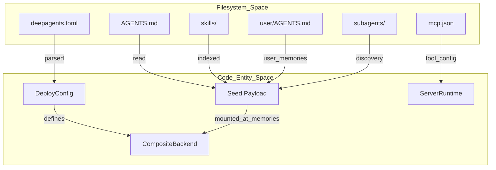
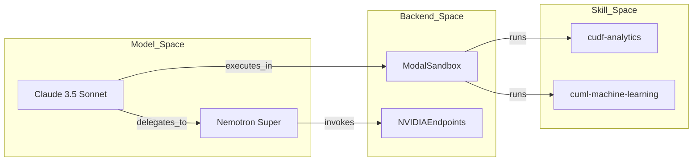
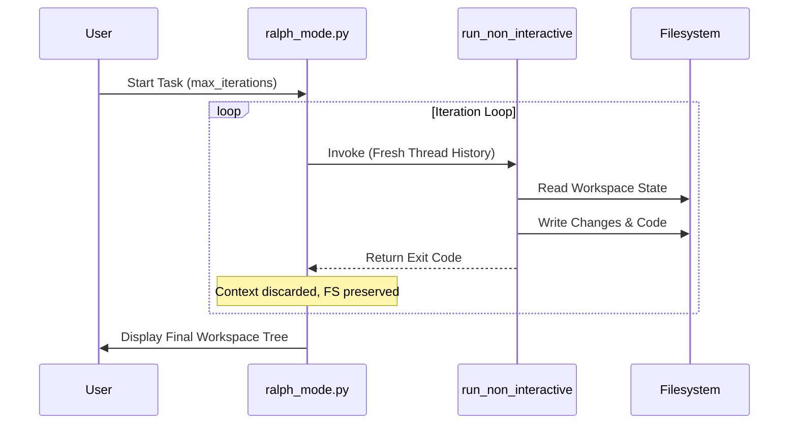

# Deploy Examples

<details>
<summary>Relevant source files</summary>

The following files were used as context for generating this wiki page:

- [.github/CODEOWNERS](.github/CODEOWNERS)
- [README.md](README.md)
- [examples/README.md](examples/README.md)
- [examples/async-subagent-server/pyproject.toml](examples/async-subagent-server/pyproject.toml)
- [examples/content-builder-agent/uv.lock](examples/content-builder-agent/uv.lock)
- [examples/deep_research/pyproject.toml](examples/deep_research/pyproject.toml)
- [examples/deep_research/uv.lock](examples/deep_research/uv.lock)
- [examples/downloading_agents/README.md](examples/downloading_agents/README.md)
- [examples/downloading_agents/content-writer.zip](examples/downloading_agents/content-writer.zip)
- [examples/nvidia_deep_agent/pyproject.toml](examples/nvidia_deep_agent/pyproject.toml)
- [examples/nvidia_deep_agent/uv.lock](examples/nvidia_deep_agent/uv.lock)
- [examples/text-to-sql-agent/pyproject.toml](examples/text-to-sql-agent/pyproject.toml)
- [examples/text-to-sql-agent/uv.lock](examples/text-to-sql-agent/uv.lock)
- [libs/code/README.md](libs/code/README.md)
- [libs/deepagents/README.md](libs/deepagents/README.md)

</details>


This page provides a comprehensive technical walkthrough of the reference deployment and execution examples provided in the Deep Agents monorepo (`examples/`). These examples demonstrate how to package, configure, and execute production-ready agents using the `deepagents deploy` system, custom backend setups, MCP integrations, multi-model orchestration, and autonomous looping frameworks like Ralph mode.

---

## Overview of Deploy Examples

The `examples/` directory houses several reference implementations showcasing different facets of agent design, configuration via `deepagents.toml`, and runtime topologies [examples/README.md:57-97]().

| Example | Key Architectural Feature | Primary Components |
| :--- | :--- | :--- |
| `deploy-coding-agent` | Autonomous coding with isolated sandbox execution | LangSmith sandbox, `AGENTS.md` worklists |
| `deploy-content-writer` | Persistent per-user memory (`user/AGENTS.md`) and authentication | `MemoryMiddleware`, `FilesystemBackend` |
| `deploy-mcp-docs-agent` | External documentation research via Model Context Protocol | `mcp.json`, MCP Client registrations |
| `deploy-gtm-agent` | Coordinated synchronous and asynchronous subagents | Sync market researcher, async content writer |
| `nvidia_deep_agent` | Multi-model orchestration with GPU-accelerated code execution | `langchain-modal`, `langchain-nvidia-ai-endpoints` [examples/nvidia_deep_agent/pyproject.toml:10-11]() |
| `ralph_mode` | Autonomous looping with fresh context per iteration | `run_non_interactive`, persistent filesystem/git [examples/README.md:93-93]() |
| `better-harness` | Outer-loop optimization driven by evaluations | Trajectory scorers, automated `SKILL.md` generators |

Sources: [examples/README.md:57-97](), [examples/nvidia_deep_agent/pyproject.toml:10-11]()

---

## Deploy Project Layout and `deepagents.toml`

All deployable examples adhere to a strict convention-based directory layout that the `deepagents deploy` bundler inspects to construct runtime payloads, mount memories, and register tools [examples/README.md:105-112]().

### Canonical Structure
```txt
my-agent/
├── deepagents.toml  # Project configuration and deployment settings
├── AGENTS.md        # System prompt and base memory
├── mcp.json         # MCP tool registrations
├── skills/          # Directory of Agent Skills (SKILL.md files)
├── subagents/       # Nested agents (sync/async)
└── user/            # Per-user writable memory template
    └── AGENTS.md    # Seeded for each new user
```

### Data Flow: Bundling to Deployment
The bundling engine processes project files and constructs a unified initialization payload containing memories, skill trees, and tool descriptors.

**Deployment Logic Association Diagram**
Title: "Mapping Filesystem to Deployment Entities"

Sources: [examples/README.md:105-112](), [examples/content-builder-agent/content_writer.py:168-174]()

---

## 1. deploy-coding-agent (Sandboxed Execution)

The `deploy-coding-agent` example highlights secure code execution using remote sandbox abstractions. 

- **Workflow**: Operates on a structured lifecycle: Plan $\rightarrow$ Implement $\rightarrow$ Review $\rightarrow$ Deliver, guided by the project root `AGENTS.md`.
- **Backend Switching**: Utilizes `LocalShellBackend` during local development and seamlessly transitions to remote sandbox drivers (such as LangSmith, Modal, Daytona, or Runloop) upon deployment.
- **Security**: Integrates shell allow-lists and path traversal checks to restrict untrusted tool calls inside the sandbox.

Sources: [examples/README.md:70-70]()

---

## 2. deploy-content-writer (Skills + User Memory)

The `deploy-content-writer` pattern showcases multi-tenant memory management where an agent preserves individual user preferences, tone profiles, and historical publishing goals across distinct invocation threads.

### Implementation Details
- **Per-User Memory**: Managed via `MemoryMiddleware`, which evaluates and mounts per-user memory files from the `user/AGENTS.md` template [examples/content-builder-agent/content_writer.py:169-169]().
- **Skills System**: Loaded dynamically from the `./skills/` directory via `SkillsMiddleware` [examples/content-builder-agent/content_writer.py:170-170]().
- **Subagent Wiring**: Employs a custom `load_subagents` helper to bind external utility definitions (such as web search tools) to sub-agent definitions [examples/content-builder-agent/content_writer.py:134-163]().
- **State Persistence**: Configured with `FilesystemBackend` to isolate runtime artifacts in the project directory [examples/content-builder-agent/content_writer.py:173-173]().

Sources: [examples/content-builder-agent/pyproject.toml:1-13](), [examples/content-builder-agent/content_writer.py:1-174]()

---

## 3. deploy-mcp-docs-agent (MCP Tools)

This reference architecture demonstrates how to integrate Model Context Protocol (MCP) servers into a deployed Deep Agent.

- **`mcp.json` Configuration**: Specifies external MCP server endpoints (e.g., documentation search endpoints, internal API gateways).
- **Tool Loading**: The agent runtime automatically instantiates MCP clients at startup, registering remote tools alongside native built-in filesystem and shell tools.
- **Trust & Authentication**: Manages OAuth login flows and trust fingerprints for secure server connections.

Sources: [examples/README.md:64-65]()

---

## 4. deploy-gtm-agent (Sync/Async Subagents)

The Go-To-Market (GTM) Strategist example illustrates the coordination of heterogeneous subagents operating under different execution semantics.

- **Market Researcher (Synchronous)**: A blocking subagent responsible for gathering and validating market data. The supervisor agent waits for completion before proceeding to synthesis.
- **Content Writer (Asynchronous)**: A background subagent dispatched via async execution channels to generate promotional copy and campaign assets concurrently.

Sources: [examples/README.md:86-87](), [examples/async-subagent-server/pyproject.toml:1-10]()

---

## 5. nvidia_deep_agent (Multi-Model GPU Skills)

The `nvidia_deep_agent` project implements a multi-model architecture combining frontier orchestration models with specialized hardware acceleration.

### GPU Execution and Skills
- **Orchestration**: A frontier model (e.g., Claude 3.5 Sonnet) handles high-level planning and task delegation.
- **Nemotron Backend**: Integrates `langchain-nvidia-ai-endpoints` to power NVIDIA Nemotron Super subagents for high-volume research and inference [examples/nvidia_deep_agent/pyproject.toml:11-11]().
- **Modal Sandbox Integration**: Utilizes `langchain-modal` to provision GPU-enabled remote containers [examples/nvidia_deep_agent/pyproject.toml:10-10]().
- **RAPIDS Data Stack**: Exposes specialized skills (`cudf-analytics`, `cuml-machine-learning`) for accelerated data processing.

**NVIDIA Agent Code Entity Mapping**
Title: "Multi-Model GPU Agent Entities"

Sources: [examples/nvidia_deep_agent/pyproject.toml:1-19]()

---

## 6. ralph_mode (Autonomous Looping)

`ralph_mode` implements an autonomous iterative execution pattern where each loop starts with a **fresh context** (empty conversation history) to eliminate token saturation, relying entirely on the filesystem and Git for worklog persistence [examples/README.md:93-93]().

### Execution Mechanics
1. **Fresh Context Initialization**: Each iteration runs with a clean thread history while preserving generated files on disk [examples/ralph_mode/README.md:13-16]().
2. **Orchestration Script**: `ralph_mode.py` executes `run_non_interactive` repeatedly, passing task descriptors and tracking exit statuses [examples/ralph_mode/ralph_mode.py:122-132]().
3. **Sandbox Support**: Allows routing iteration workloads into remote sandboxes (`--sandbox modal`, `--sandbox daytona`) [examples/ralph_mode/README.md:52-54]().

**Ralph Execution Flow**
Title: "Ralph Mode Loop Architecture"

Sources: [examples/ralph_mode/README.md:1-93](), [examples/ralph_mode/ralph_mode.py:46-155]()

---

## 7. better-harness (Eval-Driven Optimization)

The `better-harness` example demonstrates an outer-loop optimization pattern designed to iteratively improve agent harnesses based on evaluation metrics.

- **Trajectory Scoring**: Evaluates agent behavior across standardized test benchmarks, producing structured scoring artifacts.
- **Automated Skill Evolution**: An optimizer agent analyzes scoring failures and automatically generates or refines `SKILL.md` files to address capability gaps in subsequent test runs.

Sources: [examples/README.md:95-95](), [examples/deep_research/pyproject.toml:7-21]()