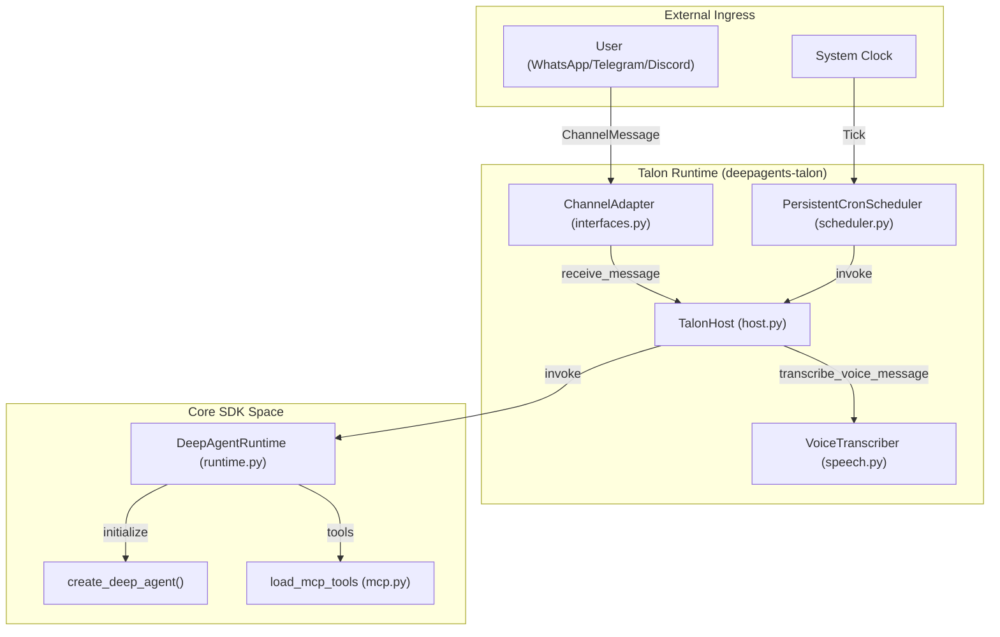
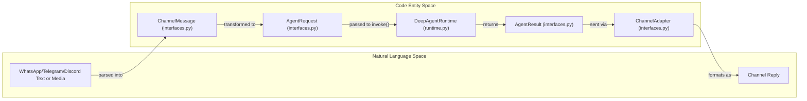

# Talon and Channel Adapter Examples

Relevant source files

The following files were used as context for generating this wiki page:

- [examples/talon/Dockerfile](examples/talon/Dockerfile)
- [examples/talon/README.md](examples/talon/README.md)
- [examples/talon/docker-compose.yml](examples/talon/docker-compose.yml)
- [libs/talon/Makefile](libs/talon/Makefile)
- [libs/talon/deepagents_talon/channels/__init__.py](libs/talon/deepagents_talon/channels/__init__.py)
- [libs/talon/deepagents_talon/channels/base.py](libs/talon/deepagents_talon/channels/base.py)
- [libs/talon/deepagents_talon/channels/whatsapp_bridge/package-lock.json](libs/talon/deepagents_talon/channels/whatsapp_bridge/package-lock.json)
- [libs/talon/deepagents_talon/channels/whatsapp_bridge/package.json](libs/talon/deepagents_talon/channels/whatsapp_bridge/package.json)
- [libs/talon/deepagents_talon/history_embeddings.py](libs/talon/deepagents_talon/history_embeddings.py)
- [libs/talon/deepagents_talon/speech.py](libs/talon/deepagents_talon/speech.py)
- [libs/talon/tests/channels/test_base.py](libs/talon/tests/channels/test_base.py)
- [libs/talon/tests/conftest.py](libs/talon/tests/conftest.py)
- [libs/talon/tests/integration_tests/test_telegram_host.py](libs/talon/tests/integration_tests/test_telegram_host.py)
- [libs/talon/tests/test_speech.py](libs/talon/tests/test_speech.py)
- [libs/talon/tests/unit_tests/test_history_embeddings.py](libs/talon/tests/unit_tests/test_history_embeddings.py)
- [libs/talon/tests/unit_tests/test_speech.py](libs/talon/tests/unit_tests/test_speech.py)

The `deepagents-talon` package provides an experimental, long-running runtime host for Deep Agents [openwiki/integrations/talon.md:3-3](). Unlike the ephemeral nature of the standard CLI or interactive TUI, Talon is designed for persistent availability, supporting background tasks via a cron scheduler and external communication through channel adapters in a single event loop [openwiki/integrations/talon.md:39-39]().

## Talon Architecture and Data Flow

Talon acts as a bridge between external communication channels and the Deep Agents SDK. It maintains state across restarts and manages a fleet of agents defined in a local assistant directory [openwiki/integrations/talon.md:39-40](). The host coordinates the lifecycle of the `AgentRuntime`, `ChannelAdapter`, and `PersistentCronScheduler` [openwiki/integrations/talon.md:39-39]().

### System Components and Entities

The following diagram illustrates how the `TalonHost` coordinates natural language communication channels and scheduled tasks with the underlying code entities.

**Talon Host Coordination Flow**

Sources: [openwiki/integrations/talon.md:39-43](), [libs/talon/deepagents_talon/cron/scheduler.py:27-58](), [libs/talon/deepagents_talon/speech.py:31-43]()

### Request and Response Mapping

This diagram bridges the gap between the "Natural Language Space" (messages) and the "Code Entity Space" (internal classes and protocols).

**Talon Entity Mapping**

Sources: [openwiki/integrations/talon.md:39-44](), [libs/talon/deepagents_talon/channels/discord.py:168-179]()

## Channel Adapters: WhatsApp, Telegram, and Discord

Talon supports multiple channel adapters, with the WhatsApp bridge, Telegram Bot API, and Discord Gateway client being primary implementations [openwiki/integrations/talon.md:39-39]().

### WhatsApp Integration
The WhatsApp channel uses a local Node.js bridge [openwiki/integrations/talon.md:39-40](). The bridge's dependencies are defined in `libs/talon/deepagents_talon/channels/whatsapp_bridge/package.json` [libs/talon/deepagents_talon/channels/whatsapp_bridge/package.json:11-14]().
- **QR Pairing**: The bridge prints a QR code to the terminal during pairing for the operator to scan [examples/talon/.env.example:51-76]().
- **Exposure Modes**: The `ChannelExposure` class [libs/talon/deepagents_talon/channels/base.py:79-108]() defines how inbound messages are handled.
    - `self`: Only messages from the paired account (or specific `OPERATOR_ID`) trigger the agent [examples/talon/.env.example:51-54]().
    - `allowlist`: Only specific chats in `DEEPAGENTS_TALON_WHATSAPP_ALLOWLIST_CHATS` or matches in `MENTION_PATTERNS` are processed [examples/talon/.env.example:51-56]().
    - `open`: Allows arbitrary senders to trigger the agent; requires explicit acknowledgement via `DEEPAGENTS_TALON_WHATSAPP_OPEN_ACK` [examples/talon/.env.example:71-76]().

### Telegram Integration
The Telegram adapter uses the Bot API with long polling [examples/talon/.env.example:77-93]().
- **Configuration**: Requires a bot token and allows filtering by user ID or chat ID in `allowlist` mode [examples/talon/.env.example:77-85]().
- **Media**: Supports inbound and outbound media, subject to the cross-channel `DEEPAGENTS_TALON_MAX_MEDIA_BYTES` cap [examples/talon/.env.example:32-33]().

### Discord Integration
The Discord adapter uses `discord.py` to connect via the Discord Gateway [libs/talon/deepagents_talon/channels/discord.py:1-4]().
- **Configuration**: Managed via `DiscordChannelConfig` parsed from `DEEPAGENTS_TALON_DISCORD_BOT_TOKEN`, `DEEPAGENTS_TALON_DISCORD_EXPOSURE`, and allowed user lists [libs/talon/deepagents_talon/channels/discord.py:75-156]().
- **Slash Commands**: Supports registering Talon chat commands as native Discord application commands when `DEEPAGENTS_TALON_DISCORD_SLASH_COMMANDS=true` [libs/talon/deepagents_talon/channels/discord.py:104-111]().

### Voice Transcription
Talon provides opt-in inbound voice transcription via `DEEPAGENTS_TALON_VOICE_TRANSCRIPTION_ENABLED=true` [libs/talon/deepagents_talon/speech.py:125-156](). The `build_voice_transcriber` function [libs/talon/deepagents_talon/speech.py:125-156]() determines which transcriber to use.
- **Local Model**: Defaults to `nvidia/parakeet-tdt-0.6b-v3` using the Transformers library [libs/talon/deepagents_talon/speech.py:25-28](). The `LocalParakeetVoiceTranscriber` class [libs/talon/deepagents_talon/speech.py:51-84]() handles local transcription.
- **OpenAI Model**: Can be configured to use the OpenAI SDK transcription path by setting `DEEPAGENTS_TALON_VOICE_TRANSCRIPTION_MODEL` to a non-Parakeet model [libs/talon/deepagents_talon/speech.py:86-123](). The `OpenAIVoiceTranscriber` class [libs/talon/deepagents_talon/speech.py:86-123]() handles OpenAI-based transcription.
- **Media Type Eligibility**: Only media types in `ASR_ELIGIBLE_MEDIA_TYPES` (voice, video, audio) are considered for transcription [libs/talon/deepagents_talon/channels/base.py:31-32](), [libs/talon/deepagents_talon/speech.py:192-196]().

Sources: [examples/talon/.env.example:51-112](), [libs/talon/deepagents_talon/channels/discord.py:75-156](), [libs/talon/deepagents_talon/speech.py:31-156](), [libs/talon/deepagents_talon/channels/base.py:79-108](), [libs/talon/deepagents_talon/channels/whatsapp_bridge/package.json:11-14]()

## Fleet Export Loading

Talon provides utilities to import agent configurations exported from external orchestration or management platforms, materializing the agent manifest, skills, and tools into the local assistant directory [openwiki/integrations/talon.md:41-45]().

- **Fleet Directory**: Configure the source directory via environment configuration or fleet loaders [openwiki/integrations/talon.md:41-45]().
- **OAuth Handling**: Supports secure credential integration and re-minting on authorization errors during export loading.

Sources: [openwiki/integrations/talon.md:41-45]()

## Cron Scheduling and Persistence

Talon includes a `PersistentCronScheduler` that allows agents to manage and execute recurring tasks [libs/talon/deepagents_talon/cron/scheduler.py:27-58]().

### Job Management
- **Persistence**: Jobs are stored in structured records (e.g., `jobs.json`) within the assistant's state directory [libs/talon/deepagents_talon/cron/jobs.py:26-31]().
- **Tools**: Agents are exposed to cron tools to create, list, edit, and remove their own schedules [libs/talon/deepagents_talon/cron/scheduler.py:27-58]().
- **Silence Suppression**: Jobs returning the `[SILENT]` sentinel have their delivery suppressed while still recording successful execution [libs/talon/deepagents_talon/cron/scheduler.py:19-20](), [libs/talon/deepagents_talon/cron/scheduler.py:146-162]().

### Execution Flow
1. **Trigger**: The scheduler identifies due jobs during its tick loop (`tick_once`) [libs/talon/deepagents_talon/cron/scheduler.py:76-83]().
2. **Dispatch**: The scheduler claims the job, runs the agent handler, and records success or error states [libs/talon/deepagents_talon/cron/scheduler.py:114-188]().

Sources: [libs/talon/deepagents_talon/cron/scheduler.py:27-189](), [libs/talon/deepagents_talon/cron/jobs.py:26-177]()

## History Adapters and Vector Embeddings

Talon supports optional long-term conversation search through vector embeddings and history archives [libs/talon/deepagents_talon/history_adapters.py:43-65](). The `HistoryEmbeddings` class [libs/talon/deepagents_talon/history_embeddings.py:37-77]() handles the loading and embedding of models.
- **Adapters**: Supports `local` (using `sentence-transformers` with models like Qwen), `atlas` (MongoDB Atlas), `voyage` (Voyage AI), and `openai` (OpenAI embeddings) [libs/talon/deepagents_talon/history_adapters.py:87-120]().
- **Bounded Concurrency**: `BoundedEmbeddings` wraps embedding clients to bound HTTP concurrency and pool complete document chunks without unexpected truncation [libs/talon/deepagents_talon/history_adapters.py:157-168]().

Sources: [libs/talon/deepagents_talon/history_adapters.py:43-168](), [libs/talon/deepagents_talon/history_embeddings.py:37-77]()

## Environment Variable Reference

The following table summarizes common environment settings used to configure Talon and its channel adapters.

| Variable | Description | Default |
| :--- | :--- | :--- |
| `AGENT_ASSISTANT_ID` | Identifier for namespacing assistant state [examples/talon/.env.example:2-2](). | `talon-local` |
| `AGENT_MODEL` | Provider/Model ID for the agent [examples/talon/.env.example:3-3](). | `openai:gpt-5.2` |
| `DEEPAGENTS_TALON_WORKSPACE` | Working directory for the agent [examples/talon/.env.example:13-14](). | `.` |
| `DEEPAGENTS_TALON_VOICE_TRANSCRIPTION_ENABLED` | Enables local ASR transcription [examples/talon/.env.example:46-46](). | `true` |
| `DEEPAGENTS_TALON_WHATSAPP_ENABLED` | Enables the WhatsApp bridge adapter [examples/talon/.env.example:52-52](). | `false` |
| `DEEPAGENTS_TALON_TELEGRAM_ENABLED` | Enables the Telegram bot adapter [examples/talon/.env.example:79-79](). | `false` |
| `DEEPAGENTS_TALON_DISCORD_ENABLED` | Enables the Discord bot adapter [examples/talon/.env.example:96-96](). | `false` |

Sources: [examples/talon/.env.example:1-113]()

## Security Considerations and Local/Docker Execution

Talon is an **experimental runtime** with a single-operator design [openwiki/integrations/talon.md:37-37]().
- **Isolation Boundaries**: It does not implement multi-tenant boundaries or sandbox-backed execution isolation out of the box [openwiki/integrations/talon.md:37-37]().
- **Credential Safety**: Channel access should be treated as direct access to the operator's agent, model credentials, MCP tools, and local host resources [openwiki/integrations/talon.md:37-37]().

### Docker Compose Topology
The `talon-whatsapp` example provides a pre-configured Docker topology combining the Python Talon host and the Node.js WhatsApp bridge [examples/talon/docker-compose.yml:1-15](). Volumes are mounted for `~/.deepagents/` to persist session state and QR pairing data across container restarts. The `Dockerfile` [examples/talon/Dockerfile:1-67]() sets up the environment, installs dependencies, and copies necessary files for the Talon host and WhatsApp bridge.

Sources: [openwiki/integrations/talon.md:37-38](), [examples/talon/docker-compose.yml:1-24](), [examples/talon/Dockerfile:1-67]()