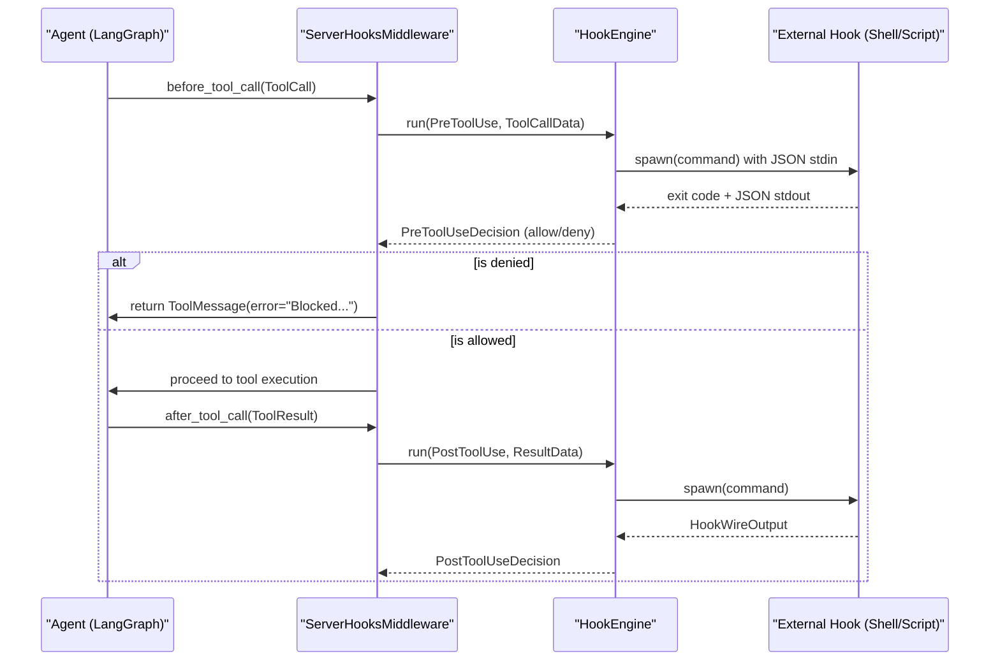
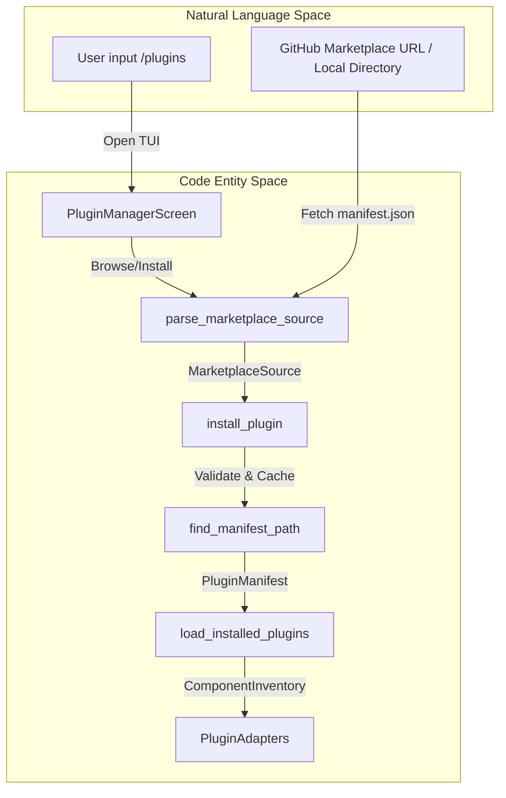

# Hooks and Plugin Examples

<details>
<summary>Relevant source files</summary>

The following files were used as context for generating this wiki page:

- [libs/code/HOOKS.md](libs/code/HOOKS.md)
- [libs/code/deepagents_code/hooks/capabilities.py](libs/code/deepagents_code/hooks/capabilities.py)
- [libs/code/deepagents_code/hooks/engine.py](libs/code/deepagents_code/hooks/engine.py)
- [libs/code/deepagents_code/hooks/env.py](libs/code/deepagents_code/hooks/env.py)
- [libs/code/deepagents_code/hooks/models/config.py](libs/code/deepagents_code/hooks/models/config.py)
- [libs/code/deepagents_code/hooks/models/domain.py](libs/code/deepagents_code/hooks/models/domain.py)
- [libs/code/deepagents_code/hooks/models/wire.py](libs/code/deepagents_code/hooks/models/wire.py)
- [libs/code/deepagents_code/hooks/projection.py](libs/code/deepagents_code/hooks/projection.py)
- [libs/code/deepagents_code/hooks/reducer.py](libs/code/deepagents_code/hooks/reducer.py)
- [libs/code/deepagents_code/hooks/runner.py](libs/code/deepagents_code/hooks/runner.py)
- [libs/code/deepagents_code/hooks/snapshot.py](libs/code/deepagents_code/hooks/snapshot.py)
- [libs/code/deepagents_code/hooks/tools.py](libs/code/deepagents_code/hooks/tools.py)
- [libs/code/deepagents_code/plugins/discovery.py](libs/code/deepagents_code/plugins/discovery.py)
- [libs/code/deepagents_code/plugins/manifest.py](libs/code/deepagents_code/plugins/manifest.py)
- [libs/code/deepagents_code/plugins/marketplace.py](libs/code/deepagents_code/plugins/marketplace.py)
- [libs/code/deepagents_code/plugins/models.py](libs/code/deepagents_code/plugins/models.py)
- [libs/code/deepagents_code/tui/modals/plugin_manager/__init__.py](libs/code/deepagents_code/tui/modals/plugin_manager/__init__.py)
- [libs/code/deepagents_code/tui/modals/plugin_manager/content.py](libs/code/deepagents_code/tui/modals/plugin_manager/content.py)
- [libs/code/deepagents_code/tui/modals/plugin_manager/models.py](libs/code/deepagents_code/tui/modals/plugin_manager/models.py)
- [libs/code/deepagents_code/tui/modals/plugin_manager/plugin_manager.tcss](libs/code/deepagents_code/tui/modals/plugin_manager/plugin_manager.tcss)
- [libs/code/deepagents_code/tui/modals/plugin_manager/state.py](libs/code/deepagents_code/tui/modals/plugin_manager/state.py)
- [libs/code/deepagents_code/tui/modals/plugin_manager/tabs.py](libs/code/deepagents_code/tui/modals/plugin_manager/tabs.py)
- [libs/code/tests/unit_tests/hooks/models/test_models.py](libs/code/tests/unit_tests/hooks/models/test_models.py)
- [libs/code/tests/unit_tests/hooks/test_engine.py](libs/code/tests/unit_tests/hooks/test_engine.py)
- [libs/code/tests/unit_tests/hooks/test_execution.py](libs/code/tests/unit_tests/hooks/test_execution.py)
- [libs/code/tests/unit_tests/plugins/test_marketplace.py](libs/code/tests/unit_tests/plugins/test_marketplace.py)
- [libs/code/tests/unit_tests/plugins/test_plugins_p0.py](libs/code/tests/unit_tests/plugins/test_plugins_p0.py)
- [libs/code/tests/unit_tests/tui/modals/plugin_manager/test_structure.py](libs/code/tests/unit_tests/tui/modals/plugin_manager/test_structure.py)

</details>


The purpose of this page is to provide practical, code-level examples and architectural details for the Hooks v2 system and the Plugin Manager in `deepagents-code`. Hooks allow interception of agent lifecycle events via external shell commands or scripts, while plugins package these hooks alongside skills and MCP servers into redistributable manifests.

## Hooks v2 System

Hooks are configured via `hooks.json` files and evaluated by the `HookEngine` [libs/code/deepagents_code/hooks/engine.py:15-60](). Each hook receives a structured JSON payload on `stdin` and communicates decisions via exit codes and `stdout`.

### Lifecycle Event Flow

The following diagram bridges natural language configuration space to code entities within the hooks runtime architecture.

**Diagram: Tool Execution Hook Flow**

**Sources:** [libs/code/deepagents_code/hooks/engine.py:15-60](), [libs/code/deepagents_code/hooks/runtime.py:49-142]()

### Configuration (`hooks.json`) and Precedence

Hooks v2 configurations are loaded and merged from three cascading sources in highest-to-lowest precedence order [libs/code/deepagents_code/hooks/loading.py:1-26]:
1. **Project Scope:** `{project_root}/.deepagents/hooks.json` [libs/code/deepagents_code/hooks/loading.py:153-162]()
2. **User Scope:** `~/.deepagents/hooks.json` [libs/code/deepagents_code/hooks/loading.py:165-174]()
3. **Plugin Scope:** `hooks.json` documents contributed by enabled plugins [libs/code/deepagents_code/hooks/loading.py:97-121]()

#### Example: Writing a Project-Scoped `hooks.json`
This example demonstrates a project-scoped hooks configuration that validates `Bash` commands and audits `Write` actions.

```json
{
  "hooks": {
    "PreToolUse": [
      {
        "matcher": "Bash",
        "hooks": [
          {
            "type": "command",
            "command": "python3 check_safety.py",
            "statusMessage": "Verifying command safety"
          }
        ]
      }
    ],
    "PostToolUse": [
      {
        "matcher": "Write",
        "hooks": [
          {
            "type": "command",
            "command": "echo \"File written: $(jq -r .tool_input.path)\" >> audit.log"
          }
        ]
      }
    ]
  }
}
```
The `HookEvent` types like `PreToolUse` and `PostToolUse` are defined in `deepagents_code.hooks.models.domain.HookEvent` [libs/code/deepagents_code/hooks/models/domain.py:38-51](). The `matcher` field allows filtering events based on tool names or notification types [libs/code/deepagents_code/hooks/snapshot.py:136-178](). The `command` field specifies the shell command to execute, and `statusMessage` provides user feedback in the TUI.
**Sources:** [libs/code/deepagents_code/hooks/loading.py:1-26](), [libs/code/deepagents_code/hooks/models/config.py:1-50](), [libs/code/deepagents_code/hooks/models/domain.py:38-51](), [libs/code/deepagents_code/hooks/snapshot.py:136-178]()

### Workspace Trust Model

Project-scoped hooks execute arbitrary shell commands and therefore require explicit workspace trust [libs/code/deepagents_code/tests/unit_tests/hooks/test_trust.py:1-29].
*   **Trust Check:** `WorkspaceTrust` checks whether the project root has been approved via `trust_project_hooks` [libs/code/deepagents_code/hooks/trust.py:1-50]().
*   **Persistence:** Trust grants are stored in a permission store under the user configuration directory with strict file permissions (`0o600`) [libs/code/deepagents_code/tests/unit_tests/hooks/test_trust.py:57-67]().
*   **Session vs Persistent:** Interactive prompts allow temporary session-only grants or persistent approvals [libs/code/deepagents_code/tests/unit_tests/hooks/test_trust.py:127-139]().

**Sources:** [libs/code/deepagents_code/hooks/trust.py:1-50](), [libs/code/deepagents_code/tests/unit_tests/hooks/test_trust.py:57-67]()

---

## Plugin System

Plugins bundle skills, MCP servers, and hooks into redistributable units [libs/code/deepagents_code/plugins/models.py:54-79]().

### Plugin Manifest (`plugin.json`)

A plugin exposes its identity and components through a manifest file (`plugin.json` or `.claude-plugin/plugin.json`) [libs/code/deepagents_code/plugins/manifest.py:39-55]().

```json
{
  "name": "code-quality-pro",
  "version": "1.1.0",
  "description": "Advanced linting and security hooks",
  "author": "Engineering Team",
  "skills": "./skills",
  "hooks": "./hooks/hooks.json",
  "mcpServers": {
    "linter": {
      "command": "node",
      "args": ["${CLAUDE_PLUGIN_ROOT}/dist/server.js"]
    }
  }
}
```
The `PluginManifest` dataclass [libs/code/deepagents_code/plugins/models.py:54-79]() defines the structure for these manifests, including `name`, `version`, `description`, `author`, and paths to `skills`, `hooks`, and `mcpServers`. The `resolve_relative_path` function [libs/code/deepagents_code/plugins/manifest.py:89-127]() ensures that all component paths declared in the manifest are relative to the plugin's root and do not escape it, enhancing security.
**Sources:** [libs/code/deepagents_code/plugins/manifest.py:39-55](), [libs/code/deepagents_code/plugins/models.py:54-79](), [libs/code/deepagents_code/plugins/manifest.py:89-127]()

### Installing a Plugin from a Marketplace

The plugin manager parses marketplace sources (`parse_marketplace_source`) and materializes plugins [libs/code/deepagents_code/plugins/marketplace.py:142-201]().

**Diagram: Plugin Management and Installation Architecture**

The `PluginManagerScreen` [libs/code/deepagents_code/tui/modals/plugin_manager/__init__.py:89-166]() orchestrates the user interaction for discovering, installing, and managing plugins. The `install_plugin` function [libs/code/deepagents_code/plugins/__init__.py:17-19]() handles the actual installation process, which involves fetching the plugin source, validating its manifest, and caching its components. The `MarketplaceRecord` [libs/code/deepagents_code/plugins/models.py:201-209]() stores information about installed marketplaces.
**Sources:** [libs/code/deepagents_code/tui/modals/plugin_manager/__init__.py:85-155](), [libs/code/deepagents_code/plugins/marketplace.py:142-201](), [libs/code/deepagents_code/plugins/manifest.py:39-55](), [libs/code/deepagents_code/tui/modals/plugin_manager/__init__.py:89-166](), [libs/code/deepagents_code/plugins/__init__.py:17-19](), [libs/code/deepagents_code/plugins/models.py:201-209]()

### Using `PluginManagerScreen`

The interactive `PluginManagerScreen` provides tabs for managing discoveries, installed extensions, marketplaces, diagnostics, and settings [libs/code/deepagents_code/tui/modals/plugin_manager/__init__.py:85-127]().
*   **State Tracking:** Tracks `load_state` flags (`enabled`, `disabled`, `pending_reload`, `error`) [libs/code/deepagents_code/tui/modals/plugin_manager/content.py:28-36](). The `_load_state_label` function [libs/code/deepagents_code/tui/modals/plugin_manager/content.py:28-36]() generates user-friendly labels for these states.
*   **Reload Prompt:** When plugin states change, exiting prompts the user to run `/reload` to synchronize MCP servers and hooks into the live session [libs/code/deepagents_code/tui/modals/plugin_manager/__init__.py:88-93](). The `test_plugin_manager_keeps_modal_mounted_through_reload_prompt` test [libs/code/libs/code/tests/unit_tests/tui/modals/plugin_manager/test_structure.py:101-159]() demonstrates this behavior.
*   **Plugin Options:** The `_plugin_options` function [libs/code/deepagents_code/tui/modals/plugin_manager/content.py:12-25]() generates the selectable options for plugins, including spacers for visual separation.
*   **Installed Details:** The `_installed_details_options` function [libs/code/deepagents_code/tui/modals/plugin_manager/content.py:97-111]() provides actions like "Disable plugin" or "Uninstall" for installed plugins.

**Sources:** [libs/code/deepagents_code/tui/modals/plugin_manager/__init__.py:85-155](), [libs/code/deepagents_code/tui/modals/plugin_manager/content.py:28-36](), [libs/code/libs/code/tests/unit_tests/tui/modals/plugin_manager/test_structure.py:101-159](), [libs/code/deepagents_code/tui/modals/plugin_manager/content.py:12-25](), [libs/code/deepagents_code/tui/modals/plugin_manager/content.py:97-111]()