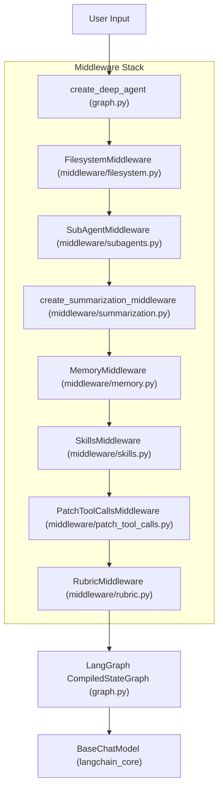
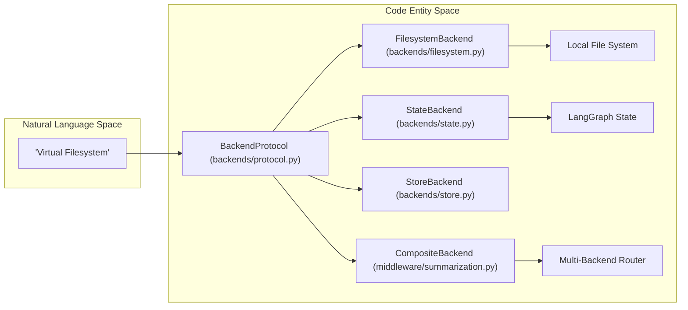

# Glossary

Relevant source files

The following files were used as context for generating this wiki page:

- [libs/code/COMMANDS.md](libs/code/COMMANDS.md)
- [libs/code/deepagents_code/app.py](libs/code/deepagents_code/app.py)
- [libs/code/deepagents_code/command_registry.py](libs/code/deepagents_code/command_registry.py)
- [libs/code/deepagents_code/tui/widgets/startup_tip.py](libs/code/deepagents_code/tui/widgets/startup_tip.py)
- [libs/code/tests/unit_tests/test_app.py](libs/code/tests/unit_tests/test_app.py)
- [libs/code/tests/unit_tests/test_command_registry.py](libs/code/tests/unit_tests/test_command_registry.py)
- [libs/code/tests/unit_tests/test_thread_naming_app.py](libs/code/tests/unit_tests/test_thread_naming_app.py)
- [libs/code/tests/unit_tests/tui/widgets/test_startup_tip.py](libs/code/tests/unit_tests/tui/widgets/test_startup_tip.py)
- [libs/deepagents/deepagents/__init__.py](libs/deepagents/deepagents/__init__.py)
- [libs/deepagents/deepagents/graph.py](libs/deepagents/deepagents/graph.py)
- [libs/deepagents/deepagents/middleware/__init__.py](libs/deepagents/deepagents/middleware/__init__.py)
- [libs/deepagents/deepagents/middleware/patch_tool_calls.py](libs/deepagents/deepagents/middleware/patch_tool_calls.py)
- [libs/deepagents/deepagents/middleware/subagents.py](libs/deepagents/deepagents/middleware/subagents.py)
- [libs/deepagents/tests/integration_tests/test_filesystem_middleware.py](libs/deepagents/tests/integration_tests/test_filesystem_middleware.py)
- [libs/deepagents/tests/integration_tests/test_subagent_middleware.py](libs/deepagents/tests/integration_tests/test_subagent_middleware.py)
- [libs/deepagents/tests/unit_tests/middleware/test_subagent_middleware_init.py](libs/deepagents/tests/unit_tests/middleware/test_subagent_middleware_init.py)
- [libs/deepagents/tests/unit_tests/test_eviction_replay.py](libs/deepagents/tests/unit_tests/test_eviction_replay.py)
- [libs/deepagents/tests/unit_tests/test_graph.py](libs/deepagents/tests/unit_tests/test_graph.py)
- [libs/deepagents/tests/unit_tests/test_subagents.py](libs/deepagents/tests/unit_tests/test_subagents.py)
- [libs/talon/README.md](libs/talon/README.md)
- [libs/talon/deepagents_talon/__main__.py](libs/talon/deepagents_talon/__main__.py)
- [libs/talon/deepagents_talon/config.py](libs/talon/deepagents_talon/config.py)
- [libs/talon/deepagents_talon/host.py](libs/talon/deepagents_talon/host.py)
- [libs/talon/deepagents_talon/interfaces.py](libs/talon/deepagents_talon/interfaces.py)
- [libs/talon/deepagents_talon/model_selection.py](libs/talon/deepagents_talon/model_selection.py)
- [libs/talon/deepagents_talon/runtime.py](libs/talon/deepagents_talon/runtime.py)
- [libs/talon/tests/test_host.py](libs/talon/tests/test_host.py)
- [libs/talon/tests/test_runtime.py](libs/talon/tests/test_runtime.py)
- [libs/talon/tests/unit_tests/test_model_selection.py](libs/talon/tests/unit_tests/test_model_selection.py)

This glossary defines the technical terms, architectural patterns, abbreviations, and domain-specific concepts used throughout the Deep Agents monorepo. It serves as a comprehensive reference for onboarding engineers navigating the intersection of LangGraph primitives, Deep Agents core abstractions, terminal UI components, and the Talon runtime host.

---

## 1. Core Concepts & SDK

### Deep Agent
The primary functional unit of the framework. Unlike a raw LLM or a simple chain, a Deep Agent is a compiled state machine (`CompiledStateGraph`) equipped with opinionated capabilities: planning, persistent memory, sub-agent delegation, and automated context summarization [libs/deepagents/deepagents/graph.py:1-6](). Created via `create_deep_agent` [libs/deepagents/deepagents/graph.py:3-5]().
*   **Sources:** [libs/deepagents/deepagents/graph.py:1-6]()

### LangGraph & DeltaChannel
Deep Agents is built natively on **LangGraph**, which implements the Pregel model for distributed graph execution. `DeltaChannel` is used on graph message states to reduce checkpoint growth from $O(N^2)$ to $O(N)$ by streaming state deltas [libs/deepagents/deepagents/graph.py:73-76]().
*   **Sources:** [libs/deepagents/deepagents/graph.py:22-25](), [libs/deepagents/deepagents/graph.py:73-76]()

### AgentMiddleware
An abstraction layer intercepting agent execution flow. Middleware can modify system prompts, wrap model calls, or filter tool inputs and outputs [libs/deepagents/deepagents/graph.py:14-15]().
*   **Sources:** [libs/deepagents/deepagents/graph.py:14-15](), [libs/deepagents/deepagents/middleware/summarization.py:84-85]()

### create_deep_agent & create_cli_agent
*   `create_deep_agent`: The primary SDK function for assembling an agent graph with default models, middleware, and memory [libs/deepagents/deepagents/graph.py:3-5]().
*   `create_cli_agent`: Factory function within `deepagents-code` that layers CLI-specific middleware, shell allow-lists, and configuration onto a deep agent.
*   **Sources:** [libs/deepagents/deepagents/graph.py:3-5]()

---

## 2. Backends & Storage

### BackendProtocol & SandboxBackendProtocol
`BackendProtocol` is a standardized interface for filesystem and state operations, abstracting whether data resides on local disk, graph state, or a remote store [libs/deepagents/deepagents/graph.py:44](). `SandboxBackendProtocol` extends this to provide isolated execution shells.
*   **Sources:** [libs/deepagents/deepagents/graph.py:43-45]()

### CompositeBackend & ContextHubBackend
*   `CompositeBackend`: A routing backend that aggregates multiple `BackendProtocol` implementations by path prefix.
*   `ContextHubBackend`: Connects backend operations to external context providers.
*   **Sources:** [libs/deepagents/deepagents/graph.py:43-45]()

### artifacts_root
The base directory configured on execution backends where agent-generated artifacts and files are safely stored [libs/deepagents/deepagents/backends/protocol.py]().
*   **Sources:** [libs/deepagents/deepagents/backends/protocol.py]()

---

## 3. Communication & Protocols

### ACP (Agent Client Protocol)
A standardized protocol allowing external clients to communicate with Deep Agents running in a server process via `stdio` or HTTP channels [libs/code/deepagents_code/app.py]().
*   **Sources:** [libs/code/deepagents_code/app.py]()

### MCP (Model Context Protocol)
A protocol connecting LLMs to external data sources and custom tools. Managed via `mcp.json`, trust fingerprints, and OAuth client providers (`mcp_auth`) [libs/code/tests/unit_tests/test_app.py:33-33]().
*   **Sources:** [libs/code/tests/unit_tests/test_app.py:33-33]()

---

## 4. Specialized Middleware

### MemoryMiddleware & AGENTS.md
Manages persistent long-term memory by loading contextual instructions from `AGENTS.md` files located in project roots or user directories [libs/deepagents/deepagents/graph.py:52]().
*   **Sources:** [libs/deepagents/deepagents/graph.py:52]()

### SkillsMiddleware & Skills
Dynamic loading mechanism that discovers executable skill directories and registers them as tools for the agent [libs/deepagents/deepagents/graph.py:54]().
*   **Sources:** [libs/deepagents/deepagents/graph.py:54]()

### FilesystemMiddleware & FilesystemPermission
Enforces security and access control rules for built-in filesystem tools (`ls`, `read_file`, `write_file`, etc.) based on ordered permission lists [libs/deepagents/deepagents/graph.py:51]().
*   **Sources:** [libs/deepagents/deepagents/graph.py:51]()

### SummarizationMiddleware
Monitors conversation token usage against thresholds, automatically compacting old message histories and offloading records to persistent storage [libs/deepagents/deepagents/middleware/summarization.py:5-12]().
*   **Sources:** [libs/deepagents/deepagents/middleware/summarization.py:5-12]()

### SubAgentMiddleware & isolated vs fork mode
Facilitates sub-agent task delegation via the `task` tool [libs/deepagents/deepagents/middleware/subagents.py:1-2]().
*   `isolated`: Subagent receives only the delegated description without parent conversation context (default).
*   `fork`: Subagent continues the parent's conversation thread directly [libs/deepagents/deepagents/middleware/subagents.py:66-72]().
*   **Sources:** [libs/deepagents/deepagents/middleware/subagents.py:1-72]()

### GoalToolsMiddleware, RubricMiddleware & GraderVerdict
*   `GoalToolsMiddleware`: Tracks high-level objectives and progress states.
*   `RubricMiddleware`: Performs automated or assisted self-evaluation against acceptance criteria.
*   `GraderVerdict`: The outcome structure produced during rubric evaluations.
*   **Sources:** [libs/deepagents/deepagents/middleware/rubric.py]()

### ReplMiddleware & QuickJS snapshot
Embeds an interpreted JavaScript/Python environment (via QuickJS or local interpreters) into the agent loop with fast snapshot persistence [libs/talon/README.md]().
*   **Sources:** [libs/talon/README.md]()

---

## 5. Configuration, Runtime & CLI

### dcode & TextualUIAdapter
*   `dcode`: The terminal command for launching the `deepagents-code` interactive terminal UI [libs/code/deepagents_code/app.py:54-57]().
*   `TextualUIAdapter`: Bridges LangGraph event streams to the Textual-based TUI framework [libs/code/deepagents_code/app.py:121]().
*   **Sources:** [libs/code/deepagents_code/app.py:54-121]()

### ConfigResolver, ConfigOption & managed config
The unified configuration resolution engine (`ConfigResolver`) that merges managed TOML provider files, environment variables, and user configuration option declarations (`ConfigOption`) [libs/code/deepagents_code/config_manifest.py:1-32]().
*   **Sources:** [libs/code/deepagents_code/config_manifest.py:1-32]()

### workspace snapshot, dotenv provenance & ServerConfig
*   `workspace snapshot`: Captured point-in-time state of project files and config during initialization.
*   `dotenv provenance`: Tracking dictionaries (`_dotenv_provenance`) recording which `.env` file injected specific environment variables into the process [libs/code/deepagents_code/config.py:125-126]().
*   `ServerConfig` / `make_graph`: Configuration and graph-builder structures for running agent servers in client-server mode.
*   **Sources:** [libs/code/deepagents_code/config.py:125-126]()

### HarnessProfile & ProviderProfile
Dataclasses configuring system prompts, tool visibility tunings, and excluded middleware sets tailored to specific model families [libs/deepagents/deepagents/profiles/harness/harness_profiles.py:64-68]().
*   **Sources:** [libs/deepagents/deepagents/profiles/harness/harness_profiles.py:64-68]()

### AutoMode, ApprovalMode & auto_classifier
*   `AutoMode` / `ApprovalMode`: HITL configuration states governing automatic tool execution or escalation.
*   `auto_classifier`: A dedicated smaller model instance used to classify and authorize risky tool calls automatically without human interruption [libs/code/deepagents_code/_env_vars.py:37-54]().
*   **Sources:** [libs/code/deepagents_code/_env_vars.py:37-54]()

### Slash Commands (/offload, /auth)
*   `/offload`: Command to manually trigger conversation offloading and history compaction [libs/code/COMMANDS.md:40]().
*   `/auth`: Command to manage credentials, MCP tokens, and provider authentication in the TUI [libs/code/COMMANDS.md:16]().
*   **Sources:** [libs/code/COMMANDS.md:16](), [libs/code/COMMANDS.md:40]()

---

## 6. Hooks & Plugins

### HookEngine, HookEvent & hooks.json
The execution engine (`HookEngine`) for Hooks v2. It listens to lifecycle events (`HookEvent`) defined in `hooks.json` configuration files across user, project, or plugin scopes.
*   **Sources:** [libs/code/deepagents_code/app.py:135-142]()

### workspace trust & PluginManifest / MarketplaceSource
*   `workspace trust`: Security boundary ensuring unverified project hooks or MCP servers require explicit user acknowledgment.
*   `PluginManifest` / `MarketplaceSource`: Declarative manifests (`plugin.json`) and source registries for extending `deepagents-code` with bundled skills, MCP servers, and hooks.
*   **Sources:** [libs/code/deepagents_code/app.py]()

---

## 7. Talon Runtime Host

### Talon & channel adapter
`deepagents-talon` is the experimental local runtime host for long-running Deep Agents [libs/talon/README.md:1-4](). Channel adapters bridge external platforms (WhatsApp, Telegram, Discord) into unified agent conversations [libs/talon/deepagents_talon/host.py:34-46]().
*   **Sources:** [libs/talon/README.md:1-4](), [libs/talon/deepagents_talon/host.py:34-46]()

### cron scheduler & Fleet export
*   `cron scheduler`: A persistent background scheduler supporting agent-driven cron tasks [libs/talon/README.md:11-13]().
*   `Fleet export`: Serialization format for exporting multi-agent topologies and task history.
*   **Sources:** [libs/talon/README.md:11-13]()

### sandbox provider
A configurable backend for executing shell and file tools in an isolated environment, such as LangSmith, Daytona, Modal, Runloop, or Vercel. Talon supports various sandbox providers, allowing tools to run remotely rather than on the host [libs/talon/README.md:66-70]().
*   **Sources:** [libs/talon/README.md:66-70]()

---

## 8. Evals, Release & Ecosystem

### Harbor & eval tiers
*   `Harbor`: Evaluation harness package (`deepagents-evals`) for running benchmark suites (Terminal-Bench, Tau3, etc.) against agents [.github/workflows/harbor.yml:1-4]().
*   `eval tiers`: Categorization of evaluation runs into security regression gates (`baseline`) and progress tracking (`hillclimb`) [.github/workflows/evals.yml:148-157]().
*   **Sources:** [.github/workflows/evals.yml:148-157](), [.github/workflows/harbor.yml:1-4]()

### model groups, rollouts & shards
*   `model groups`: Predefined sets of evaluated LLMs cataloged in `MODEL_GROUPS.md` [.github/workflows/evals.yml:39-41]().
*   `rollouts`: Multiple execution attempts per benchmark task ($K$ trials) evaluated for pass@K rates [.github/workflows/harbor.yml:133-137]().
*   `shards`: Partitioned matrix jobs distributing evaluation workloads across parallel CI runners [.github.com/langchain-ai/deepagents/blob/main/.github/workflows/evals.yml:3-5]().
*   **Sources:** [.github.com/langchain-ai/deepagents/blob/main/.github/workflows/evals.yml:3-41](), [.github.com/langchain-ai/deepagents/blob/main/.github/workflows/harbor.yml:133-137]()

### release-please, trusted publishing & uv.lock
*   `release-please`: Automation tool managing semantic versioning, changelogs, and GitHub releases.
*   `trusted publishing`: Secure PyPI publishing mechanism avoiding long-lived API tokens via OIDC.
*   `uv.lock`: Lockfile enforcing deterministic dependency resolutions across monorepo packages.
*   **Sources:** [libs/code/deepagents_code/update_check.py:166-167]()

### openwiki
An internal maintainer wiki for documentation and development guidelines [libs/deepagents/README.md:1-10]().
*   **Sources:** [libs/deepagents/README.md:1-10]()

---

## System Architecture Diagrams

### Code Entity Space: Middleware Execution Stack
This diagram illustrates how Natural Language requests and tool calls flow through specific middleware classes before hitting the LangGraph core.

**Sources:** [libs/deepagents/deepagents/graph.py:42-65](), [libs/deepagents/deepagents/middleware/summarization.py:1-10](), [libs/deepagents/deepagents/middleware/subagents.py:1-12]()

### Code Entity Space: Backend Abstraction Mapping
This diagram shows how storage concepts map to concrete backend protocol implementations.

**Sources:** [libs/deepagents/deepagents/graph.py:43-45](), [libs/deepagents/deepagents/middleware/summarization.py:96]()

---

## Terminology Reference Table

| Term | Definition | Code Site |
| :--- | :--- | :--- |
| **assistant_id** | Unique identifier for an agent configuration namespace. | [libs/code/deepagents_code/_constants.py:66]() |
| **interrupt_on** | LangGraph config dict determining which nodes require HITL approval. | [libs/deepagents/deepagents/graph.py:13]() |
| **UV Workspace** | Monorepo dependency management standard. | [libs/code/deepagents_code/update_check.py:166-167]() |
| **SubagentMetadata** | Metadata tracking sub-agent execution context and lineage. | [libs/deepagents/deepagents/middleware/subagents.py:55-59]() |
| **TokenTrackingState** | TypedDict for tracking token consumption across graph execution. | [libs/deepagents/deepagents/middleware/_state.py:47]() |
| **artifacts_root** | Base directory path for agent output files. | [libs/deepagents/deepagents/backends/protocol.py]() |
| **FilesystemPermission** | Rule definitions restricting filesystem access. | [libs/deepagents/deepagents/middleware/filesystem.py:51]() |
| **auth_store** | Local credential store managed via `/auth`. | [libs/code/deepagents_code/ui.py:138-139]() |
| **AutoMode** | Classifier-backed tool execution mode without manual prompts. | [libs/code/deepagents_code/main.py:35]() |
| **HookEngine** | Execution engine for lifecycle hook scripts. | [libs/code/tests/unit_tests/hooks/test_engine.py:1-10]() |
| **HITL** | Human-in-the-Loop. Refers to mechanisms requiring human approval for certain agent actions, such as tool calls. | [libs/deepagents/deepagents/graph.py:13]() |
| **WorkspaceBinding** | The association of a running agent server with a specific local directory, enabling context injection and file operations within that workspace. | [libs/talon/deepagents_talon/runtime.py:111]() |
| **PluginManifest** | A `plugin.json` file describing a plugin's components, such as skills, MCP servers, and hooks. | [libs/code/deepagents_code/app.py]() |
| **MarketplaceSource** | A registry or URL from which plugins can be discovered and installed. | [libs/code/deepagents_code/app.py]() |
| **QuickJS snapshot** | A persistent state of the QuickJS JavaScript runtime, allowing for fast resumption of interpreted code. | [libs/talon/README.md]() |
| **channel adapter** | A component in Talon that bridges external communication platforms (e.g., Slack, WhatsApp) to the agent's conversation system. | [libs/talon/deepagents_talon/host.py:34-46]() |
| **eval tiers** | Categories for evaluation runs, such as `baseline` for security regressions and `hillclimb` for tracking progress. | [.github.com/langchain-ai/deepagents/blob/main/.github/workflows/evals.yml:148-157]() |
| **model groups** | Predefined collections of LLMs used in evaluations, often cataloged in `MODEL_GROUPS.md`. | [.github.com/langchain-ai/deepagents/blob/main/.github/workflows/evals.yml:39-41]() |
| **release-please** | An automation tool for managing semantic versioning, generating changelogs, and creating GitHub releases. | [libs/code/deepagents_code/update_check.py:166-167]() |
| **trusted publishing** | A secure method for publishing Python packages to PyPI using OIDC, eliminating the need for long-lived API tokens. | [libs/code/deepagents_code/update_check.py:166-167]() |
| **openwiki** | An internal wiki for maintainers, containing documentation and development guidelines. | [libs/deepagents/README.md:1-10]() |

**Sources:** [libs/deepagents/deepagents/graph.py](), [libs/code/deepagents_code/app.py](), [libs/deepagents/deepagents/middleware/summarization.py](), [libs/code/deepagents_code/main.py](), [libs/code/deepagents_code/update_check.py](), [libs/talon/README.md](), [libs/talon/deepagents_talon/host.py:34-46](), [.github.com/langchain-ai/deepagents/blob/main/.github/workflows/evals.yml:39-157](), [libs/deepagents/README.md:1-10]()