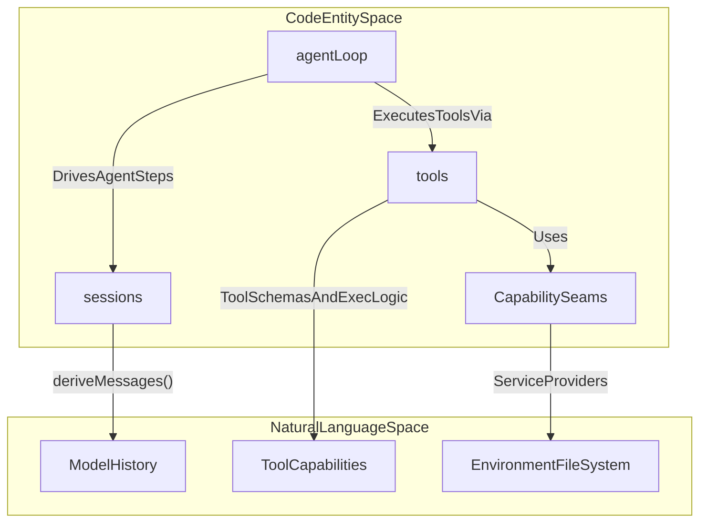
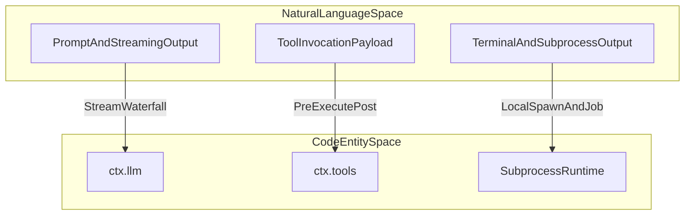
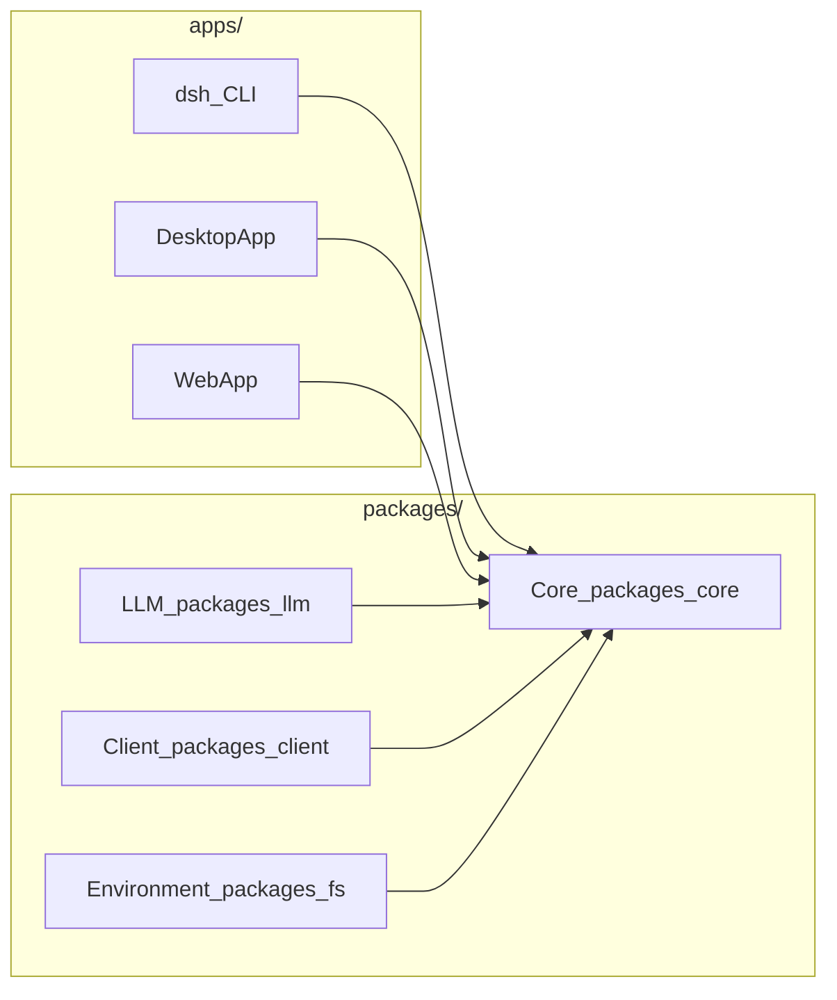

# Overview

Relevant source files

The following files were used as context for generating this wiki page:

- [apps/web/tests/scaffold.ts](apps/web/tests/scaffold.ts)
- [apps/web/tsconfig.json](apps/web/tsconfig.json)
- [docs/architecture.i18n.yaml](docs/architecture.i18n.yaml)
- [docs/architecture.md](docs/architecture.md)
- [docs/architecture.zh.md](docs/architecture.zh.md)
- [docs/capability-seams.i18n.yaml](docs/capability-seams.i18n.yaml)
- [docs/capability-seams.md](docs/capability-seams.md)
- [docs/capability-seams.zh.md](docs/capability-seams.zh.md)
- [docs/config-catalog.i18n.yaml](docs/config-catalog.i18n.yaml)
- [docs/config-catalog.md](docs/config-catalog.md)
- [docs/config-catalog.zh.md](docs/config-catalog.zh.md)
- [docs/event-producer-consumer.i18n.yaml](docs/event-producer-consumer.i18n.yaml)
- [docs/event-producer-consumer.md](docs/event-producer-consumer.md)
- [docs/event-producer-consumer.zh.md](docs/event-producer-consumer.zh.md)
- [docs/module-graph.i18n.yaml](docs/module-graph.i18n.yaml)
- [docs/module-graph.md](docs/module-graph.md)
- [docs/module-graph.zh.md](docs/module-graph.zh.md)
- [docs/subsystems/core.i18n.yaml](docs/subsystems/core.i18n.yaml)
- [docs/subsystems/core.md](docs/subsystems/core.md)
- [docs/subsystems/core.zh.md](docs/subsystems/core.zh.md)
- [packages/core/agent-loop/README.i18n.yaml](packages/core/agent-loop/README.i18n.yaml)
- [packages/core/agent-loop/README.md](packages/core/agent-loop/README.md)
- [packages/core/agent-loop/README.zh.md](packages/core/agent-loop/README.zh.md)
- [packages/core/agent-loop/src/agent.ts](packages/core/agent-loop/src/agent.ts)
- [packages/core/agent-loop/src/index.ts](packages/core/agent-loop/src/index.ts)
- [packages/core/agent-loop/tests/agent.spec.ts](packages/core/agent-loop/tests/agent.spec.ts)
- [packages/core/agent-loop/tests/cancel.spec.ts](packages/core/agent-loop/tests/cancel.spec.ts)
- [packages/core/agent-loop/tests/config-session-id.spec.ts](packages/core/agent-loop/tests/config-session-id.spec.ts)
- [packages/core/agent-loop/tests/contract-regressions.spec.ts](packages/core/agent-loop/tests/contract-regressions.spec.ts)
- [packages/core/agent-loop/tests/coverage-edges.spec.ts](packages/core/agent-loop/tests/coverage-edges.spec.ts)
- [packages/core/agent-loop/tests/interception.spec.ts](packages/core/agent-loop/tests/interception.spec.ts)
- [packages/core/agent-loop/tests/loop.spec.ts](packages/core/agent-loop/tests/loop.spec.ts)
- [packages/core/agent-loop/tests/resume.spec.ts](packages/core/agent-loop/tests/resume.spec.ts)
- [packages/core/agent-loop/tests/scope-lifecycle.spec.ts](packages/core/agent-loop/tests/scope-lifecycle.spec.ts)
- [packages/core/agent/README.i18n.yaml](packages/core/agent/README.i18n.yaml)
- [packages/core/agent/README.md](packages/core/agent/README.md)
- [packages/core/agent/README.zh.md](packages/core/agent/README.zh.md)
- [packages/core/agent/src/index.ts](packages/core/agent/src/index.ts)
- [packages/core/agent/src/types.ts](packages/core/agent/src/types.ts)
- [packages/core/agent/tests/agent.spec.ts](packages/core/agent/tests/agent.spec.ts)
- [packages/extensions/tool-cordis/src/api-catalog.ts](packages/extensions/tool-cordis/src/api-catalog.ts)
- [pnpm-lock.yaml](pnpm-lock.yaml)
- [scripts/gen-cordis-catalog.ts](scripts/gen-cordis-catalog.ts)
- [scripts/gen-doc-graphs.ts](scripts/gen-doc-graphs.ts)
- [scripts/type-equiv.manifest.json](scripts/type-equiv.manifest.json)
- [scripts/verify-package-readme-model-experience.ts](scripts/verify-package-readme-model-experience.ts)
- [tsconfig.base.json](tsconfig.base.json)
- [tsconfig.client.json](tsconfig.client.json)
- [tsconfig.host.json](tsconfig.host.json)

DeepSeek Harness (`dsh`) is a modular, plugin-based agent harness designed to build, test, and deploy LLM-based agents across diverse execution environments [docs/architecture.md:1-12]().

Sources: [docs/architecture.md:1-12]()

---

## Core Philosophy: Everything is a Plugin & Capability Seams

The cornerstone of DeepSeek Harness architecture is its **everything-is-a-plugin** design, realized through a vendored version of the `Cordis` framework [docs/architecture.md:7-12](). 

Every system component—model adapters, tool registries, session persistence stores, agent driving loops—is implemented as a Cordis plugin. This allows features to be introduced, replaced, or extended solely by layering plugins without any privileged core component [docs/architecture.md:7-12]().

Functionality is organized via the **capability seam** pattern, dividing roles as follows:
1. **Service Definition**: Abstract interface declarations for capabilities (e.g., `ctx.llm`, `ctx.tools`, `ctx.sessions`) [packages/extensions/tool-cordis/src/api-catalog.ts:83-146]().
2. **Service Provider**: Concrete implementations fulfilling those contracts [docs/architecture.md:55-66]().
3. **Consumers**: Features or tools consuming these capabilities [docs/architecture.md:55-66]().

Sources: [docs/architecture.md:7-66](), [packages/extensions/tool-cordis/src/api-catalog.ts:83-146]()

---

## System Architecture: Bridging Natural Language Space and Code Entities

DeepSeek Harness bridges the agent’s natural language operational space with concrete code entities implementing core functionality.

### Diagram 1: Natural Language Concepts to Code Entities (Agent Loop)

Sources: [docs/architecture.md:55-66](), [packages/extensions/tool-cordis/src/api-catalog.ts:104-131]()

### Diagram 2: Natural Language Concepts to Code Entities (LLM & Execution)

Sources: [docs/architecture.md:65-66](), [packages/extensions/tool-cordis/src/api-catalog.ts:83-146]()

Sources: [docs/architecture.md:55-66](), [packages/extensions/tool-cordis/src/api-catalog.ts:83-146]()

---

## Monorepo Layout & Package Families

The repository is structured to group packages into meaningful capability families [docs/module-graph.md:4-7](). For details, see [Monorepo Structure & Package Families](#1.2).

- **apps/** — Entry points including CLI, desktop, and web UI.
- **packages/** — Core logic organized by function (`core/`, `llm/`, `client/`, `fs/`, `session/`, etc.) [docs/module-graph.md:10-123]().
- **vendor/** — Vendored Cordis framework source.
- **native/, python/, scripts/, benchmarks/** — Support utilities and native addons.

### Diagram 3: High-Level Monorepo Structure and Dependency Flow

Sources: [docs/module-graph.md:4-123](), [docs/architecture.md:41-54]()

For details, see [Monorepo Structure & Package Families](#1.2).

Sources: [docs/module-graph.md:4-123](), [docs/architecture.md:41-54]()

---

## Getting Started & Development Setup

Developing or contributing to DeepSeek Harness requires a modern Node.js environment and `pnpm` [pnpm-lock.yaml:1-6]().

For details on how to clone, install, run, and develop locally, see [Getting Started & Development Setup](#1.1).

Sources: [pnpm-lock.yaml:1-6](), [docs/architecture.md:31-40]()

---

## Wiki Navigation

- **[Getting Started & Development Setup](#1.1)** — Setup, CLI usage, TypeScript aggregates, and quality gates.
- **[Monorepo Structure & Package Families](#1.2)** — Directory layout, package grouping, and rules.
- **[Core Architecture](#2)** — Cordis plugin framework, plugin composition, capability seams, and event system.
- **[Agent System](#3)** — Agent lifecycle, tools, session persistence, subagent orchestration, and LLM adapters.
- **[Execution Environment](#4)** — Filesystem, shell, sandboxing, native platform binaries.
- **[API Layer & Host-Client Bridge](#5)** — Host-server JSON-RPC, Typert RPC generation, client runtime.
- **[Web UI](#6)** — Browser-side plugin UI composition and views.
- **[Extensions & Integrations](#7)** — Optional packages including ACP protocol, Python SDK, skill systems.
- **[Testing & Quality Infrastructure](#8)** — Testing strategies, CI/CD, benchmarks.
- **[Documentation & Internationalization](#9)** — Docs, bilingual verification, VitePress site.
- **[Glossary](#10)** — Definitions of terms and jargon for onboarding.

Sources: [docs/architecture.md:1-74]()