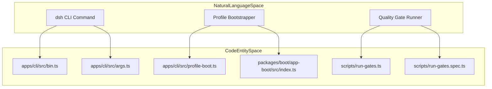
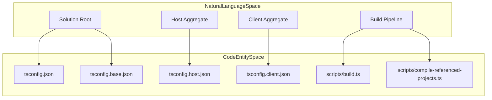
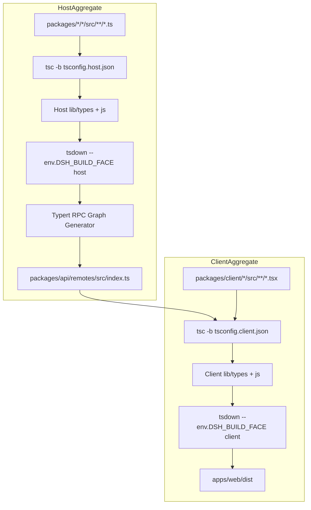
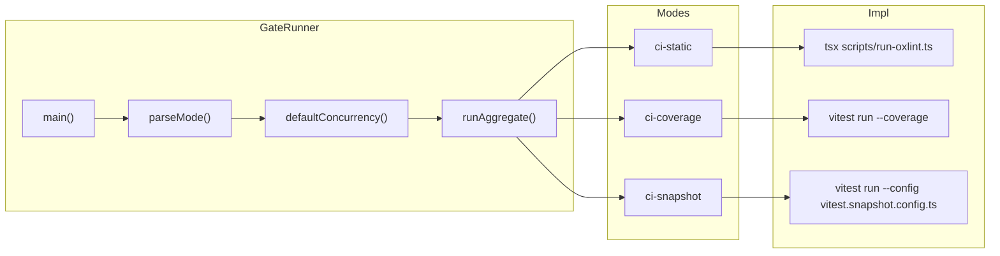

# Getting Started & Development Setup

<details>
<summary>Relevant source files</summary>

The following files were used as context for generating this wiki page:

- [.agents/notes/implemented/architecture/2026-09-09-consumer-owned-startup-strictness.i18n.yaml](.agents/notes/implemented/architecture/2026-09-09-consumer-owned-startup-strictness.i18n.yaml)
- [.agents/notes/implemented/architecture/2026-09-09-consumer-owned-startup-strictness.md](.agents/notes/implemented/architecture/2026-09-09-consumer-owned-startup-strictness.md)
- [.agents/notes/implemented/architecture/2026-09-09-consumer-owned-startup-strictness.zh.md](.agents/notes/implemented/architecture/2026-09-09-consumer-owned-startup-strictness.zh.md)
- [.agents/notes/implemented/architecture/2026-09-09-profile-resolution-generations.i18n.yaml](.agents/notes/implemented/architecture/2026-09-09-profile-resolution-generations.i18n.yaml)
- [.agents/notes/implemented/architecture/2026-09-09-profile-resolution-generations.md](.agents/notes/implemented/architecture/2026-09-09-profile-resolution-generations.md)
- [.agents/notes/implemented/architecture/2026-09-09-profile-resolution-generations.zh.md](.agents/notes/implemented/architecture/2026-09-09-profile-resolution-generations.zh.md)
- [.agents/notes/implemented/architecture/2026-09-19-profile-resolution-lookup-order.i18n.yaml](.agents/notes/implemented/architecture/2026-09-19-profile-resolution-lookup-order.i18n.yaml)
- [.agents/notes/implemented/architecture/2026-09-19-profile-resolution-lookup-order.md](.agents/notes/implemented/architecture/2026-09-19-profile-resolution-lookup-order.md)
- [.agents/notes/implemented/architecture/2026-09-19-profile-resolution-lookup-order.zh.md](.agents/notes/implemented/architecture/2026-09-19-profile-resolution-lookup-order.zh.md)
- [.agents/notes/implemented/process/2026-07-21-serial-cross-platform-ci-reference.i18n.yaml](.agents/notes/implemented/process/2026-07-21-serial-cross-platform-ci-reference.i18n.yaml)
- [.agents/notes/implemented/process/2026-07-21-serial-cross-platform-ci-reference.md](.agents/notes/implemented/process/2026-07-21-serial-cross-platform-ci-reference.md)
- [.agents/notes/implemented/process/2026-07-21-serial-cross-platform-ci-reference.zh.md](.agents/notes/implemented/process/2026-07-21-serial-cross-platform-ci-reference.zh.md)
- [.agents/notes/implemented/process/2026-07-26-ci-failover-runbook.i18n.yaml](.agents/notes/implemented/process/2026-07-26-ci-failover-runbook.i18n.yaml)
- [.agents/notes/implemented/process/2026-07-26-ci-failover-runbook.md](.agents/notes/implemented/process/2026-07-26-ci-failover-runbook.md)
- [.agents/notes/implemented/process/2026-07-26-ci-failover-runbook.zh.md](.agents/notes/implemented/process/2026-07-26-ci-failover-runbook.zh.md)
- [.agents/notes/implemented/process/2026-07-27-worktree-local-lefthook.i18n.yaml](.agents/notes/implemented/process/2026-07-27-worktree-local-lefthook.i18n.yaml)
- [.agents/notes/implemented/process/2026-07-27-worktree-local-lefthook.md](.agents/notes/implemented/process/2026-07-27-worktree-local-lefthook.md)
- [.agents/notes/implemented/process/2026-07-27-worktree-local-lefthook.zh.md](.agents/notes/implemented/process/2026-07-27-worktree-local-lefthook.zh.md)
- [.agents/notes/implemented/process/2026-08-08-native-windows-pull-request-ci.i18n.yaml](.agents/notes/implemented/process/2026-08-08-native-windows-pull-request-ci.i18n.yaml)
- [.agents/notes/implemented/process/2026-08-08-native-windows-pull-request-ci.md](.agents/notes/implemented/process/2026-08-08-native-windows-pull-request-ci.md)
- [.agents/notes/implemented/process/2026-08-08-native-windows-pull-request-ci.zh.md](.agents/notes/implemented/process/2026-08-08-native-windows-pull-request-ci.zh.md)
- [.github/workflows/build-exe-for-python-sdk.yml](.github/workflows/build-exe-for-python-sdk.yml)
- [.github/workflows/ci-master.yml](.github/workflows/ci-master.yml)
- [.github/workflows/ci.yml](.github/workflows/ci.yml)
- [.github/workflows/docs-pages.yml](.github/workflows/docs-pages.yml)
- [.github/workflows/e2e.yml](.github/workflows/e2e.yml)
- [.github/workflows/pi-ai-provider-e2e.yml](.github/workflows/pi-ai-provider-e2e.yml)
- [.github/workflows/release-publish.yml](.github/workflows/release-publish.yml)
- [.github/workflows/sandbox.yml](.github/workflows/sandbox.yml)
- [.gitlab-ci.yml](.gitlab-ci.yml)
- [AGENTS.md](AGENTS.md)
- [apps/cli/README.i18n.yaml](apps/cli/README.i18n.yaml)
- [apps/cli/README.md](apps/cli/README.md)
- [apps/cli/README.zh.md](apps/cli/README.zh.md)
- [apps/cli/package.json](apps/cli/package.json)
- [apps/cli/reference/README.i18n.yaml](apps/cli/reference/README.i18n.yaml)
- [apps/cli/reference/README.md](apps/cli/reference/README.md)
- [apps/cli/reference/README.zh.md](apps/cli/reference/README.zh.md)
- [apps/cli/src/args.ts](apps/cli/src/args.ts)
- [apps/cli/src/bin.ts](apps/cli/src/bin.ts)
- [apps/cli/src/profile-boot.ts](apps/cli/src/profile-boot.ts)
- [apps/cli/tests/args.spec.ts](apps/cli/tests/args.spec.ts)
- [apps/cli/tests/built-bin.e2e.ts](apps/cli/tests/built-bin.e2e.ts)
- [apps/cli/tests/profiles/headless/tests/profile-resolution.ts](apps/cli/tests/profiles/headless/tests/profile-resolution.ts)
- [apps/cli/tests/profiles/web/tests/web-best-effort-startup.expected.e2e.ts](apps/cli/tests/profiles/web/tests/web-best-effort-startup.expected.e2e.ts)
- [apps/cli/tests/profiles/web/tests/web-failure-matrix.expected.e2e.ts](apps/cli/tests/profiles/web/tests/web-failure-matrix.expected.e2e.ts)
- [apps/cli/tests/web-agent-presets.e2e.ts](apps/cli/tests/web-agent-presets.e2e.ts)
- [apps/cli/tsconfig.json](apps/cli/tsconfig.json)
- [apps/web/tests/shipped-composition.e2e.ts](apps/web/tests/shipped-composition.e2e.ts)
- [docs/development.i18n.yaml](docs/development.i18n.yaml)
- [docs/development.md](docs/development.md)
- [docs/development.zh.md](docs/development.zh.md)
- [docs/user/develop/basic/publish.i18n.yaml](docs/user/develop/basic/publish.i18n.yaml)
- [docs/user/develop/basic/publish.md](docs/user/develop/basic/publish.md)
- [docs/user/develop/basic/publish.zh.md](docs/user/develop/basic/publish.zh.md)
- [package.json](package.json)
- [packages/README.i18n.yaml](packages/README.i18n.yaml)
- [packages/README.md](packages/README.md)
- [packages/README.zh.md](packages/README.zh.md)
- [packages/boot/app-boot/README.i18n.yaml](packages/boot/app-boot/README.i18n.yaml)
- [packages/boot/app-boot/README.md](packages/boot/app-boot/README.md)
- [packages/boot/app-boot/README.zh.md](packages/boot/app-boot/README.zh.md)
- [packages/boot/app-boot/src/index.ts](packages/boot/app-boot/src/index.ts)
- [packages/boot/app-boot/src/profile-resolution/legacy-links.ts](packages/boot/app-boot/src/profile-resolution/legacy-links.ts)
- [packages/boot/app-boot/src/profile-resolution/resolver.ts](packages/boot/app-boot/src/profile-resolution/resolver.ts)
- [packages/boot/app-boot/src/profile-resolution/service.ts](packages/boot/app-boot/src/profile-resolution/service.ts)
- [packages/boot/app-boot/src/profile-resolution/worker-bootstrap.ts](packages/boot/app-boot/src/profile-resolution/worker-bootstrap.ts)
- [packages/boot/app-boot/src/profile.ts](packages/boot/app-boot/src/profile.ts)
- [packages/boot/app-boot/tests/app-boot.spec.ts](packages/boot/app-boot/tests/app-boot.spec.ts)
- [packages/boot/app-boot/tests/profile-resolution-service.spec.ts](packages/boot/app-boot/tests/profile-resolution-service.spec.ts)
- [packages/boot/app-boot/tests/profile-resolution-worker-bootstrap.spec.ts](packages/boot/app-boot/tests/profile-resolution-worker-bootstrap.spec.ts)
- [packages/boot/app-boot/tests/profile-resolution.spec.ts](packages/boot/app-boot/tests/profile-resolution.spec.ts)
- [packages/boot/app-boot/tests/profile.spec.ts](packages/boot/app-boot/tests/profile.spec.ts)
- [packages/boot/app-boot/tests/user-patches.spec.ts](packages/boot/app-boot/tests/user-patches.spec.ts)
- [packages/llm/llm-pi-ai/tests/provider-apis.e2e.ts](packages/llm/llm-pi-ai/tests/provider-apis.e2e.ts)
- [packages/sandbox/sandbox-local/tests/packed-install.e2e.ts](packages/sandbox/sandbox-local/tests/packed-install.e2e.ts)
- [packages/subagent/subagent-claude-code/package.json](packages/subagent/subagent-claude-code/package.json)
- [packages/subagent/subagent-codex/package.json](packages/subagent/subagent-codex/package.json)
- [scripts/build.spec.ts](scripts/build.spec.ts)
- [scripts/build.ts](scripts/build.ts)
- [scripts/ci-workflow.spec.ts](scripts/ci-workflow.spec.ts)
- [scripts/compile-referenced-projects.ts](scripts/compile-referenced-projects.ts)
- [scripts/install-lefthook.mjs](scripts/install-lefthook.mjs)
- [scripts/install-lefthook.spec.ts](scripts/install-lefthook.spec.ts)
- [scripts/release/verify.ts](scripts/release/verify.ts)
- [scripts/run-gates.spec.ts](scripts/run-gates.spec.ts)
- [scripts/run-gates.ts](scripts/run-gates.ts)
- [scripts/wine-windows-gates.sh](scripts/wine-windows-gates.sh)
- [tsconfig.json](tsconfig.json)
- [vitest.config.ts](vitest.config.ts)

</details>


This page provides the technical foundation for setting up, building, and developing DeepSeek Harness (`dsh`) locally. It covers monorepo prerequisites, pnpm workspace layout rules, the `dsh` CLI and profile booting system (`apps/cli/src/profile-boot.ts`), the isolated Host vs. Client TypeScript aggregate architecture (`tsconfig.host.json` and `tsconfig.client.json`), and the bounded quality gate runner (`scripts/run-gates.ts`).

---

## 1. Environment Prerequisites

The repository enforces strict runtime engine floors and workspace configuration rules to manage its plugin-based Cordis architecture and native binaries.

- **Node.js**: Requires Node.js `>=24.9.0` [package.json:8-10], [docs/development.md:11]. Continuous integration workflows validate compatibility across Node version 24 and 26 [scripts/ci-workflow.spec.ts:38-41].
- **pnpm**: Version `11.28.5` is pinned via package management metadata [package.json:7]. If `pnpm --version` does not resolve directly, enable Corepack using `corepack enable` [docs/development.md:13].
- **Git**: Version 2.26 or newer is required to support worktree-specific configuration extensions [docs/development.md:14].
- **API Key**: A `DEEPSEEK_API_KEY` stored in a root `.env` file is required for live model integration tests, headless demos, and end-to-end scenarios [docs/development.md:15].

Sources: `[package.json:7-10]`, `[docs/development.md:9-16]`, `[scripts/ci-workflow.spec.ts:38-41]()`

---

## 2. Installation & Monorepo Workspace Layout

To clone the repository and install workspace dependencies:

```bash
git clone https://github.com/deepseek-ai/deepseek-harness.git
cd deepseek-harness
pnpm install
```

### Workspace Structure

- The root `package.json` defines workspaces across `vendor/*`, `packages/*/*`, `native/system`, `native/system/packages/*`, `apps/*`, and `website` [package.json:11-18].
- `pnpm install` triggers repository setup scripts that configure worktree-local Lefthook hooks through `scripts/install-lefthook.mjs` [docs/development.md:32-35].
- A custom translation-pairing Git merge driver is registered for `.i18n.yaml` sidecar files to maintain synchronization between bilingual documentation pairs [docs/development.i18n.yaml:1-5].

If hooks are missing because dependencies were restored from cache or `postinstall` was skipped, install them manually:

```bash
node scripts/install-lefthook.mjs
```

Sources: `[package.json:11-18]`, `[docs/development.md:25-44]`, `[docs/development.i18n.yaml:1-5]()`

---

## Diagram: Natural Language Space to Code Entity Space (Setup & Boot)

The following diagram bridges natural language concepts of CLI invocation, profile booting, and quality gate execution to their concrete code entities in the repository.



Sources: `[apps/cli/src/bin.ts:1-1]`, `[apps/cli/src/args.ts:1-1]`, `[apps/cli/src/profile-boot.ts:1-1]`, `[packages/boot/app-boot/src/index.ts:1-1]`, `[scripts/run-gates.ts:1-10]()`

---

## 3. The dsh CLI & Profile Booting System

The primary command-line interface entry point is defined in `apps/cli/src/bin.ts`, with argument parsing handled by `apps/cli/src/args.ts` and runtime profile loading coordinated through `apps/cli/src/profile-boot.ts` and `@deepseek-ai/dsh-app-boot` (`packages/boot/app-boot/src/index.ts`).

### Profile Booting Implementation

The app-boot loader is responsible for:
- Resolving configuration layers, environment variables, and user patch files (`cordis.patch.yml`).
- Assembling ordered bundles and dependency graphs.
- Bootstrapping the Cordis service container and context tree.

| Command                                   | Purpose                                                        |
|-------------------------------------------|----------------------------------------------------------------|
| `pnpm dsh web`                            | Launches the Web UI server and client runtime [packages/boot/app-boot/README.zh.md:12-50]. |
| `pnpm dsh --profile headless "<task>"`    | Runs a single task headlessly and exits [AGENTS.md:103]. |
| `pnpm run demo:ptc -- "<task>"`            | Runs plaintext chat (PTC) headless demo [AGENTS.md:104]. |

Sources: `[AGENTS.md:101-105]`, `[packages/boot/app-boot/src/index.ts:1-1]`, `[packages/boot/app-boot/README.zh.md:12-50]()`

---

## Diagram: Natural Language Space to Code Entity Space (TypeScript & Build Aggregates)

This diagram maps the conceptual Host and Client compilation domains to their respective solution files, aggregate configurations, and builder scripts.



Sources: `[tsconfig.json:1-1]`, `[docs/development.md:57-73]`, `[scripts/build.ts:1-1]()`

---

## 4. TypeScript Aggregates: Host vs. Client Build System

Because both Host (Node.js) and Client (Browser) codebases declaration-merge the Cordis `Context` interface under identical keys with different service definitions, combining them into a single `ts.Program` causes type collisions. DeepSeek Harness maintains two isolated TypeScript aggregates [docs/development.md:57-73]:

- **Host Aggregate (`tsconfig.host.json`)**: Covers Node.js runtime code, agent logic, tool execution, and server-side API remotes [docs/development.md:64].
- **Client Aggregate (`tsconfig.client.json`)**: Covers browser UI components, client runtime, and remote stubs [docs/development.md:65].
- **Shared Facade (`tsconfig.base.json`)**: Contains shared compiler options and paths mapping without an `include` field, serving as the resolution target for Vite and Vitest [docs/development.md:66].

### Build Pipeline & Data Flow



Sources: `[package.json:23-28]`, `[docs/development.md:57-96]()`

---

## 5. Quality Gate System & Execution Runner

Quality gates, static analysis, unit tests, and coverage checks are orchestrated by `scripts/run-gates.ts` and validated via bounded worker scheduling.

### Gate Modes and Concurrency

- **Modes**: Named aggregates such as `ci-primary`, `ci-static`, `ci-coverage`, `ci-unit`, `ci-snapshot`, and `check-all` control which test and static verification suites execute [scripts/run-gates.ts:19-38].
- **Concurrency**: Default worker allocations are computed based on available system CPUs or overridden via `DSH_GATE_CONCURRENCY` [scripts/run-gates.ts:127-134].
- **Fail Fast**: Enabled via `DSH_GATE_FAIL_FAST=1` to abort remaining gates upon the first blocking failure [scripts/run-gates.ts:119-132].

### Diagram: Quality Gate Execution Flow



Sources: `[scripts/run-gates.ts:1-177]`, `[scripts/run-gates.spec.ts:1-10]()`

---

## 6. Local Development Workflow & Best Practices

- **Typecheck Verification**: Run `pnpm run typecheck` to validate the complete Host aggregate and client contracts [package.json:54-55].
- **Test Coverage**: Run `pnpm run test:coverage` to execute Vitest suites under the per-file 100% coverage requirement [package.json:62].
- **Bilingual Documentation Sync**: After updating `.i18n.yaml` translation files, synchronize pairs using:
  ```bash
  pnpm run verify-translation-pairing --write <target>
  ```
- **Cleanup**: To safely purge build artifacts and workspace residue, run `pnpm run clean` [package.json:52], [AGENTS.md:85].

Sources: `[package.json:52-62]`, `[AGENTS.md:83-105]`, `[docs/development.md:1-76]()`