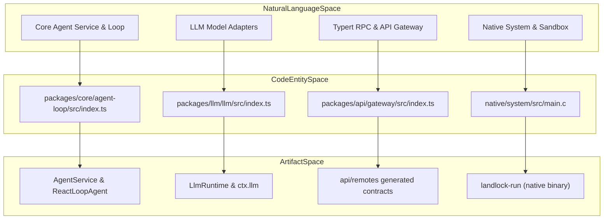
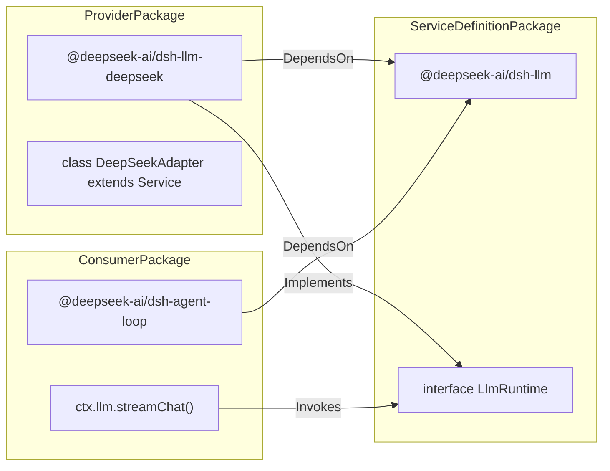

# Monorepo Structure & Package Families

Relevant source files

The following files were used as context for generating this wiki page:

- [.agents/notes/implemented/process/2026-07-30-generated-third-party-notices.i18n.yaml](.agents/notes/implemented/process/2026-07-30-generated-third-party-notices.i18n.yaml)
- [.agents/notes/implemented/process/2026-07-30-generated-third-party-notices.md](.agents/notes/implemented/process/2026-07-30-generated-third-party-notices.md)
- [.agents/notes/implemented/process/2026-07-30-generated-third-party-notices.zh.md](.agents/notes/implemented/process/2026-07-30-generated-third-party-notices.zh.md)
- [.agents/notes/implemented/process/2026-08-10-npm-release-sequences.i18n.yaml](.agents/notes/implemented/process/2026-08-10-npm-release-sequences.i18n.yaml)
- [.agents/notes/implemented/process/2026-08-10-npm-release-sequences.md](.agents/notes/implemented/process/2026-08-10-npm-release-sequences.md)
- [.agents/notes/implemented/process/2026-08-10-npm-release-sequences.zh.md](.agents/notes/implemented/process/2026-08-10-npm-release-sequences.zh.md)
- [.agents/notes/implemented/process/2026-10-05-pr-artifact-typechecks.i18n.yaml](.agents/notes/implemented/process/2026-10-05-pr-artifact-typechecks.i18n.yaml)
- [.agents/notes/implemented/process/2026-10-05-pr-artifact-typechecks.md](.agents/notes/implemented/process/2026-10-05-pr-artifact-typechecks.md)
- [.agents/notes/implemented/process/2026-10-05-pr-artifact-typechecks.zh.md](.agents/notes/implemented/process/2026-10-05-pr-artifact-typechecks.zh.md)
- [.github/workflows/build-preview-cloudflare.yml](.github/workflows/build-preview-cloudflare.yml)
- [.github/workflows/release-vendor-publish.yml](.github/workflows/release-vendor-publish.yml)
- [.github/workflows/release-vendor.yml](.github/workflows/release-vendor.yml)
- [.github/workflows/release.yml](.github/workflows/release.yml)
- [THIRD_PARTY_NOTICES.md](THIRD_PARTY_NOTICES.md)
- [apps/desktop/scripts/runtime-patch-policy.ts](apps/desktop/scripts/runtime-patch-policy.ts)
- [apps/desktop/tests/prepare-runtime-patches.spec.ts](apps/desktop/tests/prepare-runtime-patches.spec.ts)
- [docs/cookbook/adding-a-package.i18n.yaml](docs/cookbook/adding-a-package.i18n.yaml)
- [docs/cookbook/adding-a-package.md](docs/cookbook/adding-a-package.md)
- [docs/cookbook/adding-a-package.zh.md](docs/cookbook/adding-a-package.zh.md)
- [docs/cookbook/adding-a-vendored-package.i18n.yaml](docs/cookbook/adding-a-vendored-package.i18n.yaml)
- [docs/cookbook/adding-a-vendored-package.zh.md](docs/cookbook/adding-a-vendored-package.zh.md)
- [lefthook.yml](lefthook.yml)
- [packages/boot/plugin-market/README.i18n.yaml](packages/boot/plugin-market/README.i18n.yaml)
- [packages/boot/plugin-market/README.md](packages/boot/plugin-market/README.md)
- [packages/boot/plugin-market/README.zh.md](packages/boot/plugin-market/README.zh.md)
- [packages/experimental/README.i18n.yaml](packages/experimental/README.i18n.yaml)
- [packages/experimental/README.md](packages/experimental/README.md)
- [packages/experimental/README.zh.md](packages/experimental/README.zh.md)
- [packages/llm/llm-pi-ai/package.json](packages/llm/llm-pi-ai/package.json)
- [packages/llm/llm-pi-ai/tests/sdk-options.spec.ts](packages/llm/llm-pi-ai/tests/sdk-options.spec.ts)
- [pnpm-workspace.yaml](pnpm-workspace.yaml)
- [scripts/check-workspace-constraints.spec.ts](scripts/check-workspace-constraints.spec.ts)
- [scripts/check-workspace-constraints.ts](scripts/check-workspace-constraints.ts)
- [scripts/gen-third-party-notices.spec.ts](scripts/gen-third-party-notices.spec.ts)
- [scripts/gen-third-party-notices.ts](scripts/gen-third-party-notices.ts)
- [scripts/preview-workflow.spec.ts](scripts/preview-workflow.spec.ts)
- [scripts/release/bump.ts](scripts/release/bump.ts)
- [scripts/release/families.spec.ts](scripts/release/families.spec.ts)
- [scripts/release/families.ts](scripts/release/families.ts)
- [scripts/release/pack.ts](scripts/release/pack.ts)
- [scripts/release/process.ts](scripts/release/process.ts)
- [scripts/release/publish.spec.ts](scripts/release/publish.spec.ts)
- [scripts/release/publish.ts](scripts/release/publish.ts)
- [scripts/release/tarball.ts](scripts/release/tarball.ts)
- [scripts/release/verify-packed-install.ts](scripts/release/verify-packed-install.ts)
- [scripts/tests/ci-release-selfhosted.spec.ts](scripts/tests/ci-release-selfhosted.spec.ts)

## Purpose and Scope

This page details the DeepSeek Harness (`dsh`) monorepo layout, describing the directory structure (`apps/`, `packages/`, `vendor/`, `examples/`, `native/`, `python/`, `scripts/`), package grouping into capability families, workspace invariant checks, dependency protocols, and publication sequences [pnpm-workspace.yaml:1-30](), [scripts/check-workspace-constraints.ts:27-33](), [.agents/notes/implemented/process/2026-08-10-npm-release-sequences.md:19-28](). It governs how the core product, extensions, native components, and tooling coexist in a unified workspace.

Sources: [pnpm-workspace.yaml:1-30](), [scripts/check-workspace-constraints.ts:27-33](), [.agents/notes/implemented/process/2026-08-10-npm-release-sequences.md:19-28]()

---

## Directory Layout & Workspaces

The monorepo is organized as a `pnpm` workspace defined across multiple directory trees. Workspace discovery walks configured globs in `scripts/check-workspace-constraints.ts` to validate manifest invariants [scripts/check-workspace-constraints.ts:27-33](), [scripts/check-workspace-constraints.ts:140-152]().

| Directory | Role / Scope | Notable Contents |
|---|---|---|
| `apps/` | Deployable applications and runtime shells | CLI launcher (`apps/cli`), Electron desktop shell (`apps/desktop`), SPA Web UI (`apps/web`) [scripts/check-workspace-constraints.ts:32]() |
| `packages/` | Main functional npm packages organized by domain | Core logic, agent system, LLM integration, UI components, API, sandboxing, and experimental modules [scripts/check-workspace-constraints.ts:29]() |
| `vendor/` | Source-vendored and locally patched upstream dependencies | Cordis framework (`@deepseek-ai/cordis`, `@deepseek-ai/cosmokit`, etc.) forked in place [scripts/check-workspace-constraints.ts:28](), [scripts/check-workspace-constraints.ts:34-44]() |
| `examples/` | Standalone example applications and demonstration setups | Integration examples, custom adapters, and SDK usage references |
| `native/` | Platform-specific system integration layers | Node native addons, prebuild packages, and sandbox confinement binaries [scripts/check-workspace-constraints.ts:30-31](), [scripts/check-workspace-constraints.ts:45-51]() |
| `python/` | Python SDK and standalone runtime distribution | Python SDK (`deepseek-harness-sdk`) and executable build scaffolding |
| `scripts/` | Developer tooling, release pipelines, and CI/CD helpers | Workspace constraint checks, release pack/publish scripts, and dependency verification tools [scripts/check-workspace-constraints.ts:1-6](), [.agents/notes/implemented/process/2026-08-10-npm-release-sequences.md:15]() |

### Monorepo Entity Mapping: Natural Language to Code Space

This diagram links major functional domains in informal terms to precise code entities and build configuration entrypoints.

Sources: [scripts/check-workspace-constraints.ts:27-55](), [tsdown.config.ts:1-36]()

---

## Package Families & Capability Groups

Packages within `packages/` and `vendor/` are grouped into capability families. The build process uses `tsdown` with environment flags (`DSH_BUILD_FACE`) to compile host and client artifacts concurrently across workspace packages [tsdown.config.ts:7-36]().

### 1. Core Spine & Agent Loop (`packages/core/`)
- **`dsh-core` / `dsh-agent`**: Core domain logic for agent services, session integration, and prompt compilation spine.
- **`dsh-agent-loop`**: Implements stateful agent logic managing turn/step lifecycles and inbox execution.
- **`dsh-tools`**: Central tool registry managing execution pipelines.

### 2. LLM & Inference Adapters (`packages/llm/`)
- **`dsh-llm`**: Declares the `LlmRuntime` service interface abstracting streaming LLM providers.
- **`dsh-llm-deepseek`**, **`dsh-llm-pi-ai`**: Concrete adapters implementing LLM runtimes.

### 3. Execution Environments & Sandboxing (`packages/fs/`, `packages/sandbox/`)
- **`dsh-fs` / `dsh-fs-local`**: Filesystem service definitions and local OS-native implementation.
- **`dsh-sandbox`**: Process confinement layer supporting Landlock on Linux and Windows ACL restrictions.

### 4. Durable Storage & Session Retrieval (`packages/session/`)
- **`dsh-session`**: Manages append-only logs of `SessionEvent`s with SQLite and JSONL backends.
- **`dsh-session-query`**: Logical session corpus retrieval and lineage traversal.

### 5. API Layer & Client Runtime (`packages/api/`, `packages/client/`)
- **`dsh-api-gateway`**: HTTP/SSE gateway exposing backend services [scripts/verify-package-dependencies.spec.ts:146-147]().
- **`dsh-client-*`**: Modular browser-side UI client plugins, slot renderers, and state stores.

### Capability Seam Data Flow

Sources: [tsdown.config.ts:7-36](), [scripts/verify-package-dependencies.spec.ts:146-147]()

---

## Workspace Constraints, Dependency Protocols & Release Sequences

Monorepo integrity is enforced by automated constraint checks (`scripts/check-workspace-constraints.ts`) and dependency policy validation (`scripts/verify-package-dependencies.ts`) [scripts/check-workspace-constraints.ts:1-6](), [scripts/verify-package-dependencies.spec.ts:10-28]().

### 1. Workspace Dependency Protocols
- **Internal DSH References:** All dependencies between workspace members belonging to the `dsh` family must use the exact `workspace:*` protocol [scripts/check-workspace-constraints.spec.ts:53-58]().
- **Vendored & Native References:** Dependencies pointing to vendored Cordis packages or native addons must use the `workspace:~` protocol [scripts/check-workspace-constraints.spec.ts:61-67]().

### 2. Three Independent Publication Sequences
As documented in release specifications, packages are categorized into three independent release sequences, preventing cross-family version locking issues [.agents/notes/implemented/process/2026-08-10-npm-release-sequences.md:19-28]():
- **`dsh` Family:** Public members of `packages/*/*` and `apps/*` sharing a unified version baseline (`0.0.x`) with the workspace root [.agents/notes/implemented/process/2026-08-10-npm-release-sequences.md:25]().
- **Vendored Framework (`vendor/`):** Nine rescoped Cordis packages, each maintaining independent version lines [.agents/notes/implemented/process/2026-08-10-npm-release-sequences.md:26]().
- **Native System Packages (`native/system/packages/*`):** Platform-specific binaries with separate build workflows [.agents/notes/implemented/process/2026-08-10-npm-release-sequences.md:27]().

### 3. Package Dependency & Optional Import Policies
- **Client/Host Policies:** The dependency policy (`scripts/package-dependency-policy.ts`) classifies packages into client-facing UI components and host services, governing allowed peer relays and flattened host dependencies [scripts/package-dependency-policy.ts:13-96]().
- **Optional Dependencies:** Optional dependencies or peer dependencies marked optional are strictly guarded against module-scope execution loads to prevent runtime failures in installations missing those optional packages [.agents/notes/implemented/process/2026-08-10-npm-release-sequences.md:95-101]().

Sources: [scripts/check-workspace-constraints.ts:1-6](), [scripts/check-workspace-constraints.spec.ts:53-67](), [.agents/notes/implemented/process/2026-08-10-npm-release-sequences.md:19-101](), [scripts/package-dependency-policy.ts:13-96]()