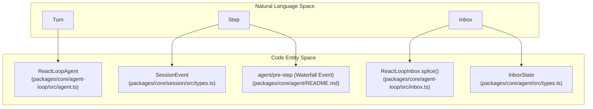
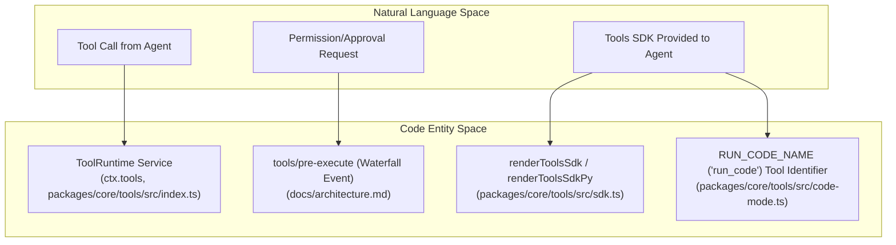

# Glossary

Relevant source files

The following files were used as context for generating this wiki page:

- [.agents/skills/dsh-client-ui-ux/SKILL.md](.agents/skills/dsh-client-ui-ux/SKILL.md)
- [.agents/skills/dsh-code-review/SKILL.md](.agents/skills/dsh-code-review/SKILL.md)
- [.agents/skills/dsh-error-handling/SKILL.md](.agents/skills/dsh-error-handling/SKILL.md)
- [.agents/skills/dsh-responsive-ui/SKILL.md](.agents/skills/dsh-responsive-ui/SKILL.md)
- [apps/web/tests/scaffold.ts](apps/web/tests/scaffold.ts)
- [apps/web/tsconfig.json](apps/web/tsconfig.json)
- [docs/AGENTS.md](docs/AGENTS.md)
- [docs/architecture.i18n.yaml](docs/architecture.i18n.yaml)
- [docs/architecture.md](docs/architecture.md)
- [docs/architecture.zh.md](docs/architecture.zh.md)
- [docs/capability-seams.i18n.yaml](docs/capability-seams.i18n.yaml)
- [docs/capability-seams.md](docs/capability-seams.md)
- [docs/capability-seams.zh.md](docs/capability-seams.zh.md)
- [docs/config-catalog.i18n.yaml](docs/config-catalog.i18n.yaml)
- [docs/config-catalog.md](docs/config-catalog.md)
- [docs/config-catalog.zh.md](docs/config-catalog.zh.md)
- [docs/event-producer-consumer.i18n.yaml](docs/event-producer-consumer.i18n.yaml)
- [docs/event-producer-consumer.md](docs/event-producer-consumer.md)
- [docs/event-producer-consumer.zh.md](docs/event-producer-consumer.zh.md)
- [docs/glossary.i18n.yaml](docs/glossary.i18n.yaml)
- [docs/glossary.md](docs/glossary.md)
- [docs/glossary.zh.md](docs/glossary.zh.md)
- [docs/module-graph.i18n.yaml](docs/module-graph.i18n.yaml)
- [docs/module-graph.md](docs/module-graph.md)
- [docs/module-graph.zh.md](docs/module-graph.zh.md)
- [docs/subsystems/core.i18n.yaml](docs/subsystems/core.i18n.yaml)
- [docs/subsystems/core.md](docs/subsystems/core.md)
- [docs/subsystems/core.zh.md](docs/subsystems/core.zh.md)
- [docs/testing.i18n.yaml](docs/testing.i18n.yaml)
- [docs/testing.md](docs/testing.md)
- [docs/testing.zh.md](docs/testing.zh.md)
- [packages/AGENTS.md](packages/AGENTS.md)
- [packages/core/agent-loop/README.i18n.yaml](packages/core/agent-loop/README.i18n.yaml)
- [packages/core/agent-loop/README.md](packages/core/agent-loop/README.md)
- [packages/core/agent-loop/README.zh.md](packages/core/agent-loop/README.zh.md)
- [packages/core/agent-loop/src/agent.ts](packages/core/agent-loop/src/agent.ts)
- [packages/core/agent-loop/src/index.ts](packages/core/agent-loop/src/index.ts)
- [packages/core/agent-loop/tests/agent.spec.ts](packages/core/agent-loop/tests/agent.spec.ts)
- [packages/core/agent-loop/tests/cancel.spec.ts](packages/core/agent-loop/tests/cancel.spec.ts)
- [packages/core/agent-loop/tests/config-session-id.spec.ts](packages/core/agent-loop/tests/config-session-id.spec.ts)
- [packages/core/agent-loop/tests/contract-regressions.spec.ts](packages/core/agent-loop/tests/contract-regressions.spec.ts)
- [packages/core/agent-loop/tests/coverage-edges.spec.ts](packages/core/agent-loop/tests/coverage-edges.spec.ts)
- [packages/core/agent-loop/tests/interception.spec.ts](packages/core/agent-loop/tests/interception.spec.ts)
- [packages/core/agent-loop/tests/loop.spec.ts](packages/core/agent-loop/tests/loop.spec.ts)
- [packages/core/agent-loop/tests/resume.spec.ts](packages/core/agent-loop/tests/resume.spec.ts)
- [packages/core/agent-loop/tests/scope-lifecycle.spec.ts](packages/core/agent-loop/tests/scope-lifecycle.spec.ts)
- [packages/core/agent/README.i18n.yaml](packages/core/agent/README.i18n.yaml)
- [packages/core/agent/README.md](packages/core/agent/README.md)
- [packages/core/agent/README.zh.md](packages/core/agent/README.zh.md)
- [packages/core/agent/src/index.ts](packages/core/agent/src/index.ts)
- [packages/core/agent/src/types.ts](packages/core/agent/src/types.ts)
- [packages/core/agent/tests/agent.spec.ts](packages/core/agent/tests/agent.spec.ts)
- [packages/extensions/tool-cordis/src/api-catalog.ts](packages/extensions/tool-cordis/src/api-catalog.ts)
- [pnpm-lock.yaml](pnpm-lock.yaml)
- [scripts/doc-budgets.manifest.json](scripts/doc-budgets.manifest.json)
- [scripts/gen-cordis-catalog.ts](scripts/gen-cordis-catalog.ts)
- [scripts/gen-doc-graphs.ts](scripts/gen-doc-graphs.ts)
- [scripts/type-equiv.manifest.json](scripts/type-equiv.manifest.json)
- [scripts/verify-package-readme-model-experience.ts](scripts/verify-package-readme-model-experience.ts)
- [tsconfig.base.json](tsconfig.base.json)
- [tsconfig.client.json](tsconfig.client.json)
- [tsconfig.host.json](tsconfig.host.json)

This glossary defines key codebase-specific terms, jargon, abbreviations, and domain concepts used throughout the DeepSeek Harness (`dsh`) repository. It serves as a technical reference for onboarding engineers to understand how natural language and domain concepts are mapped and implemented as code entities within the system.

---

## Core Concepts & Framework

### Cordis
The foundational plugin framework used by `dsh`. Cordis organizes system functionality as injectable, reversible plugin units operating on a shared typed `Context` (`ctx`). All subsystems—such as the agent loop, tools, session persistence, LLM adapters, and UI—are implemented as Cordis plugins. This design allows an extensible, no-privileged-core architecture where new plugins can be added alongside existing ones without core modification. Plugins contribute services, event declarations, and reversible effects.
Sources: [docs/architecture.md:9-14]()

### Context (`ctx`)
The shared typed object that represents the current runtime environment within `dsh`. It is passed to and injected in all plugins. Each capability exposes its API surface on a unique key of `ctx`. For example:
- `ctx.llm` — LLM interaction (query, streaming)
- `ctx.tools` — Tool registry and execution service
- `ctx.sessions` — Session log and persistence layer
- `ctx.agentLoop` — Agent driver instance services
This central context unifies services and event dispatch in a composable fashion.
Sources: [docs/architecture.md:61-70]()

### Service
An abstract capability interface contributed by plugins to the `ctx`. Services define contracts and allow interchangeable implementations. They provide the API for domain functionality such as tool execution or session management.
For example, the tool runtime service (`ctx.tools`) coordinates tool registration, guarded invocation, and SDK generation.
Sources: [docs/architecture.md:61-70]()

### Profile
A profile is a named, runtime composition of ordered bundles and optional patch overlays that define a running instance of DeepSeek Harness. Profiles reside in the Harness home directory (`$DSH_HOME/profiles/`). They specify which bundles load and their layering order, optionally including user patches (`cordis.patch.yml`). Profiles form declarative boot configurations for different application modes (e.g., `web`, `headless`, `sdk`). Profiles allow dynamic updates via hot patch reloads.
Sources: [docs/architecture.md:19-27]()

### Bundle
A bundle is a packaged collection of Cordis YAML config rows and plugin code modules forming a feature or subsystem. Bundles are composable and patchable. Bundles correspond to discrete units of capability such as the base runtime (`dsh-base`), the web UI (`dsh-web-app`), or tooling. Bundles declare themselves in their `package.json` under the `dsh.bundle` field.
Sources: [docs/architecture.md:21-25]()

### Capability Seam
An architectural pattern in `dsh` where each domain capability is represented by a service interface with interchangeable implementations. Consumers depend on the seam interface, not concrete providers, enabling extensibility and pluggable backend substitution. Major seams include:
- Filesystem (`ctx.fs`)
- Tooling (`ctx.tools`)
- Subprocess (`ctx.subprocess`)
- Sandbox (`ctx.sandbox`)
Providers implement the seam interface and are injected during plugin composition.
Sources: [docs/architecture.md:73-75]()

---

## Agent & Execution Loop

### Turn
A fundamental unit of conversation or agent activity spanning an input claim through one or more output productions, finalizing when no work remains pending. Turns are tracked and bounded in the `ReactLoopAgent`. Each turn encompasses multiple steps that correspond to incremental LLM request cycles and tool calls.
Sources: [docs/architecture.md:88-90]()

### Step
A step is a single logical iteration within a turn consisting primarily of one LLM call followed by any resulting tool executions. Steps are reflected in the `agent/pre-step` waterfall event and the append-only session event stream. Each step produces user-visible messages and effects.
Sources: [docs/architecture.md:88-90]()

### Inbox
The thread-safe message queue of user inputs, steering messages, and injections for an Agent. The inbox supports splice operations that combine claiming (consuming), inserting, and clearing messages with indexed targeting for "next-step" or "next-turn" messages. Its implementation is `ReactLoopInbox` which manages the state for the agent loop.

Inbox types:
- `InboxState` — typed memory state with user-message arrays [packages/core/agent/src/types.ts:41-44]()
- `InboxWireState` — JSON-safe serializable form for streaming/projection [packages/core/agent/src/types.ts:53-56]()

Sources: [packages/core/agent-loop/src/agent.ts:99](), [packages/core/agent/src/types.ts:39-56]()

### Waterfall Event
A Cordis event pattern where multiple listeners run sequentially. Each listener calls a `next()` continuation to propagate the event or halt it, allowing layered interception, augmentation, or rejection. Examples include:
- `agent/pre-step` — decides acceptance or rejection of the next step input [docs/architecture.md:96-97]()
- `tools/pre-execute` — approval or transformation of a tool call before execution [docs/architecture.md:105-106]()

Sources: [docs/architecture.md:96-97]()

### Code Mode
A special execution mode where the agent outputs code snippets instead of direct tool calls. The canonical tool `run_code` executes code dynamically, interfacing with an SDK-generated API exposing available tools to the code. This approach supports complex logic expression beyond direct tool calls.
Sources: [packages/core/agent-loop/README.md:75]()

#### Mapping: Natural Language to Agent Loop Code Entities

Sources: [docs/architecture.md:88-97](), [packages/core/agent-loop/src/agent.ts:98-138](), [packages/core/agent-loop/src/inbox.ts:1-10](), [packages/core/agent/src/types.ts:39-44](), [packages/core/agent/README.md:66-67](), [packages/core/session/src/types.ts:10-50]()

---

## Data & Persistence

### Session Log
A durable append-only event log persisting all session data including conversation turns, model messages, tool invocations, and state changes. This log forms the ground truth of a session’s memory and state. Events are represented as typed `SessionEvent` unions and streamed into session projections and UI.
Sources: [docs/architecture.md:76-78]()

### Surface
An in-memory projection built from the session log that optimizes session state queries and maintains derived views, such as conversation threads or prompt contexts. Surfaces enable incremental reuse avoiding repeated full history scans.
Sources: [packages/core/agent-loop/src/agent.ts:128]()

### deriveMessages()
A core utility reading session events to produce a filtered, annotated message list for LLM prompt assembly. Handles filtering, deduplication, and metadata for constructing model inputs.
Sources: [packages/core/agent-loop/README.md:75]()

### SCHEMA_VERSION
A monotonic schema version integer used by the SQLite persistence backend to ensure compatibility and migrate persisted session files.
Sources: [docs/AGENTS.md:40]()

---

## Tooling & Interaction

### Tool Runtime (`ctx.tools`)
The service managing the registration, catalog, and guarded execution lifecycle of tools exposed to agents. Coordinates tool schemas, input validation, guarded execution, and orchestrates the execution waterfall phases: `pre-execute`, `execute`, and `post-execute`.
Sources: [docs/architecture.md:64-65]()

### Tool Execution Waterfall
Tool invocation is structured into three waterfall event phases:
- **Pre-execute:** Invocation approval, access control, or modification decides whether to permit or transform the call. [docs/architecture.md:105-106]()
- **Execute:** The synchronous or asynchronous function implementing the tool’s effect. [docs/architecture.md:105-106]()
- **Post-execute:** Side-effects after execution, such as logging or call result transformation. [docs/architecture.md:105-106]()

Sources: [docs/architecture.md:105-106]()

### Approval Seam
A capability seam used to solicit approval or permission for tool execution via interactive waterfall events (`approval/request`). Enables policy-driven or human-in-the-loop decision making before sensitive operations proceed.
Sources: [docs/architecture.md:22]()

#### Mapping: Natural Language to Tooling & SDK Code Entities

Sources: [docs/architecture.md:64-65](), [docs/architecture.md:105-106]()

---

## Domain Jargon & Abbreviations

| Term | Meaning | Code Reference |
|---|---|---|
| **ACP** | Agent Client Protocol: an automation-centric RPC protocol for driving agents, including subagent orchestration. | [docs/architecture.md:18]() |
| **BFF** | Backend-For-Frontend: the API layer, often implemented using the Typert RPC framework, serving the Web UI client. | [docs/architecture.md:51]() |
| **DSH_HOME** | The default filesystem directory where DeepSeek Harness stores user data such as profiles and presets. Defaults to `~/.dsh`. | [docs/architecture.md:15]() |
| **Landlock** | Linux kernel security module utilized by the sandbox-local provider to enforce filesystem access restrictions securely. | [docs/architecture.md:22]() |
| **MCP** | Model Context Protocol: bridging external tooling systems as native tools within `dsh`. | [docs/architecture.md:22]() |
| **Typert** | Type-safe RPC code generation framework powering Host/Client remote declarations and proxies. Uses decorators `@Remote`, `@RemoteScope`. | [packages/core/agent/src/types.ts:11-12]() |
| **Zstandard** | A high-performance compression algorithm used internally for compacting session artifacts and persisted data. | Internal detail, no direct file |

Sources: [docs/architecture.md:15-51](), [packages/core/agent/src/types.ts:11-12]()

---

# Summary

This glossary provides a focused overview of key terminology and domain concepts in DeepSeek Harness with precision mappings to source code entities. It highlights core architectural paradigms such as the pervasive use of the Cordis plugin and context model, the agent execution loop with turn/step/inbox abstractions, session persistence as an append-only event log, and tool runtime with guarded execution via waterfall events and an SDK code generation mode. The included diagrams visualize how natural language and domain parlance map cleanly to classes, services, event types, and plugins—facilitating onboarding and effective system extension.

---

Sources:
- [docs/AGENTS.md:40]()
- [docs/architecture.md:9-14]()
- [docs/architecture.md:15]()
- [docs/architecture.md:18]()
- [docs/architecture.md:19-27]()
- [docs/architecture.md:21-25]()
- [docs/architecture.md:22]()
- [docs/architecture.md:51]()
- [docs/architecture.md:61-70]()
- [docs/architecture.md:64-65]()
- [docs/architecture.md:73-75]()
- [docs/architecture.md:76-78]()
- [docs/architecture.md:88-90]()
- [docs/architecture.md:96-97]()
- [docs/architecture.md:105-106]()
- [packages/core/agent-loop/README.md:75]()
- [packages/core/agent-loop/src/agent.ts:98-138]()
- [packages/core/agent-loop/src/inbox.ts:1-10]()
- [packages/core/agent/README.md:66-67]()
- [packages/core/agent/src/types.ts:11-12]()
- [packages/core/agent/src/types.ts:39-56]()
- [packages/core/agent/src/types.ts:69-78]()
- [packages/core/session/src/types.ts:10-50]()