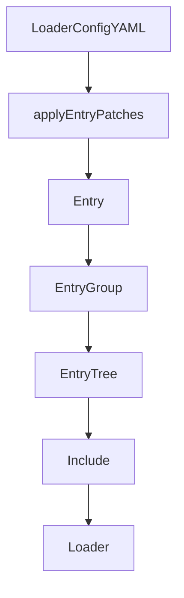
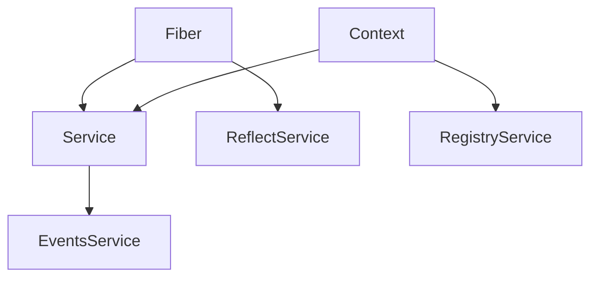

# Cordis Framework & Vendored Dependencies

<details>
<summary>Relevant source files</summary>

The following files were used as context for generating this wiki page:

- [docs/cordis-api/fiber.i18n.yaml](docs/cordis-api/fiber.i18n.yaml)
- [docs/cordis-api/fiber.md](docs/cordis-api/fiber.md)
- [docs/cordis-api/fiber.zh.md](docs/cordis-api/fiber.zh.md)
- [packages/boot/app-boot/tests/loader-shape.compat.spec.ts](packages/boot/app-boot/tests/loader-shape.compat.spec.ts)
- [scripts/cordis-config-access.spec.ts](scripts/cordis-config-access.spec.ts)
- [scripts/loader-volatile-update.spec.ts](scripts/loader-volatile-update.spec.ts)
- [vendor/README.md](vendor/README.md)
- [vendor/cordis/README.md](vendor/cordis/README.md)
- [vendor/cordis/package.json](vendor/cordis/package.json)
- [vendor/cordis/src/context.ts](vendor/cordis/src/context.ts)
- [vendor/cordis/src/events.ts](vendor/cordis/src/events.ts)
- [vendor/cordis/src/fiber.ts](vendor/cordis/src/fiber.ts)
- [vendor/cordis/src/logger.ts](vendor/cordis/src/logger.ts)
- [vendor/cordis/src/reflect.ts](vendor/cordis/src/reflect.ts)
- [vendor/cordis/src/registry.ts](vendor/cordis/src/registry.ts)
- [vendor/cordis/src/service.ts](vendor/cordis/src/service.ts)
- [vendor/cosmokit/package.json](vendor/cosmokit/package.json)
- [vendor/group/package.json](vendor/group/package.json)
- [vendor/hmr/package.json](vendor/hmr/package.json)
- [vendor/hmr/src/index.ts](vendor/hmr/src/index.ts)
- [vendor/include/package.json](vendor/include/package.json)
- [vendor/include/src/index.ts](vendor/include/src/index.ts)
- [vendor/loader/package.json](vendor/loader/package.json)
- [vendor/loader/src/config/entry.ts](vendor/loader/src/config/entry.ts)
- [vendor/loader/src/config/group.ts](vendor/loader/src/config/group.ts)
- [vendor/loader/src/config/isolate.ts](vendor/loader/src/config/isolate.ts)
- [vendor/loader/src/config/tree.ts](vendor/loader/src/config/tree.ts)
- [vendor/loader/src/index.ts](vendor/loader/src/index.ts)
- [vendor/loader/src/internal.ts](vendor/loader/src/internal.ts)
- [vendor/logger-console/package.json](vendor/logger-console/package.json)
- [vendor/logger-console/src/browser.ts](vendor/logger-console/src/browser.ts)
- [vendor/logger-console/src/index.ts](vendor/logger-console/src/index.ts)
- [vendor/schemastery/package.json](vendor/schemastery/package.json)
- [vendor/timer/package.json](vendor/timer/package.json)

</details>


DeepSeek Harness (`dsh`) is architected around the **Cordis** plugin framework, a modular system enabling a fully pluggable runtime via scoped `Context`s `[vendor/cordis/src/context.ts:1-40]()`, plugin lifecycles, and reversible effect management. This design ensures that all subsystems—from agents and tools to event buses and configuration loaders—are implemented as composable and replaceable plugins, connected through Cordis's capability seam pattern.

To ensure auditability, deterministic behavior, and allow local patching for harness-specific requirements, the Cordis framework and its primary dependencies are **vendored** into the `vendor/` directory under the `@deepseek-ai` namespace `[vendor/README.md:3-5]()`. This page provides a comprehensive deep dive into the vendored Cordis sources: detailing the plugin lifecycle and fiber disposal, service injection via `Context` declaration merging, local modifications, and the loader's configuration patching mechanisms.

---

## 1. Vendored Dependencies & Local Modifications

### 1.1 Vendored Package Catalog

The `vendor/` directory holds full source copies of the Cordis framework and foundational libraries, pinned to specific upstream commits to guarantee stability and control over the framework layer `[vendor/README.md:10-26]()`.

| Directory (`vendor/`) | Scoped npm Name | Upstream Package | Version | Role in Cordis Framework |
|---|---|---|---|---|
| `cordis/` | `@deepseek-ai/cordis` | cordis | 4.0.0-rc.7 | Core plugin lifecycle, DI context, fiber lifecycle, event bus `[vendor/README.md:19]()`. |
| `loader/` | `@deepseek-ai/cordis-plugin-loader` | `@cordisjs/plugin-loader` | 1.0.0-rc.5 | Implements hierarchical plugin loading, config patching, entry trees `[vendor/README.md:20]`, `[vendor/loader/package.json:2-4]()`. |
| `schemastery/` | `@deepseek-ai/schemastery` | schemastery | 3.18.0 | Structural schema validation for configuration `[vendor/README.md:18]`, `[vendor/schemastery/package.json:2-4]()`. |
| `cosmokit/` | `@deepseek-ai/cosmokit` | cosmokit | 1.8.1 | General utilities like `deepEqual`, volatile refs `[vendor/README.md:17]`, `[vendor/cosmokit/package.json:2-4]()`. |
| `include/` | `@deepseek-ai/cordis-plugin-include` | `@cordisjs/plugin-include` | 1.0.4 | Entry patching engine for layered configs (`applyEntryPatches`) `[vendor/README.md:21]`, `[vendor/include/package.json:2-4]()`. |
| `group/` | `@deepseek-ai/cordis-plugin-group` | `@cordisjs/plugin-group` | 1.0.0 | Support for grouped plugin entries `[vendor/README.md:22]`, `[vendor/group/package.json:2-4]()`. |
| `timer/` | `@deepseek-ai/cordis-plugin-timer` | `@cordisjs/plugin-timer` | 1.1.4 | Timer services exposed via Cordis `[vendor/README.md:23]`, `[vendor/timer/package.json:2-4]()`. |
| `hmr/` | `@deepseek-ai/cordis-plugin-hmr` | `@cordisjs/plugin-hmr` | 1.0.15 | Hot Module Replacement (HMR) framework integration `[vendor/README.md:24]`, `[vendor/hmr/package.json:2-4]()`. |
| `logger-console/` | `@deepseek-ai/cordis-plugin-logger-console` | `@cordisjs/plugin-logger-console` | 1.0.0 | Console logging plugin service `[vendor/README.md:25]`, `[vendor/logger-console/package.json:2-4]()`. |

Third-party dependencies like `js-yaml`, `chokidar`, `picomatch`, `@standard-schema/spec`, and `supports-color` remain external on npm and are not vendored `[vendor/README.md:27-29]()`. Certain Cordis packages (e.g., `reggol`, `@cordisjs/unyaml`) are intentionally excluded since they are unused by the harness `[vendor/README.md:31]()`.

Sources: `[vendor/README.md:11-31]`, `[vendor/loader/package.json:1-45]`, `[vendor/cordis/package.json:1-51]()`

---

### 1.2 Local Modifications & Hardening

The vendored Cordis sources include extensive patches and local adaptations for lifecycle correctness and ease of integration:

- **Fiber lifecycle hardening** (`[vendor/cordis/src/fiber.ts]()`): Locally closes three reentrant disposal gaps. An effect's owner-list wrapper is registered before its setup body runs, so an unload begun from inside setup awaits setup and every collected cleanup; synchronous setup failure removes the wrapper and rolls back collected cleanup. Async cleanup stays owner-visible until quiescence, and Cordis's internal effect composition joins an already-running cleanup while repeated public disposer calls retain their upstream single-shot result. Effect creation is rejected while the owner is `UNLOADING` (`[vendor/README.md:41]()`).
- **Manifest and tsconfig regeneration**: All vendored `package.json` and `tsconfig.json` files are regenerated for Harness releases, scoped under `@deepseek-ai`, with precise type declaration metadata and build outputs. Internal TypeScript imports use explicit `.ts` extensions, compliant with NodeNext module resolution `[vendor/README.md:38-40]()`.
- **HMR localization removal**: Removed `.yml` locale imports and i18n calls from `[vendor/hmr/src/index.ts]()` due to missing runtime YAML loader hooks (`@cordisjs/unyaml`). These only supplied config description translations which are unused in the harness context `[vendor/README.md:37]()`.
- **Build configuration overrides**: Custom `tsdown.config.ts` files are provided for packages like `schemastery` and `logger-console` to handle dual ESM+CJS outputs and node/browser entry splits `[vendor/README.md:41]()`.

Sources: `[vendor/README.md:33-42]`, `[vendor/hmr/src/index.ts:1-40]()`

---

## 2. Cordis Plugin Lifecycle & Fiber Disposal

The fundamental runtime unit in Cordis is the **`Fiber`** (`[vendor/cordis/src/fiber.ts]()`), representing an isolated plugin instance controlling resource lifecycles and effect management.

### 2.1 Fiber State Machine & Disposal Flow

Fibers transition through explicit lifecycle states:
- `PENDING`: Setup is in progress; effect registration allowed (`[vendor/README.md:41]()`).
- `LOADING`: Configuration/loading phase.
- `ACTIVE`: Fully activated; normal operation (`[vendor/loader/src/config/entry.ts:147-147]()`).
- `UNLOADING`: Disposal has started; no new effects accepted (`[vendor/README.md:41]()`).
- `DISPOSED`: Final state; all resources released.

Disposal is invoked via `fiber.dispose()`. The disposal logic carefully manages reentrancy and cleanup:
- Prevents registration of new effects once unloading starts (`[vendor/README.md:41]()`).
- Runs cleanup callbacks in the reverse order of registration (`[vendor/cordis/src/reflect.ts]()`) to properly unwind side-effects.
- Child fibers are disposed prior to the parent fiber.
- Captures exceptions from teardown callbacks individually so one observer cannot block others (`[vendor/README.md:41]()`).

Diagram: Cordis Fiber Disposal Sequence
```mermaid
sequenceDiagram
    participant Caller as "Caller"
    participant Fiber as "Fiber"
    participant ReflectService as "ReflectService"
    participant Service as "Service"

    Caller->>Fiber: "dispose()"
    Fiber->>Fiber: "set_state_to_UNLOADING; reject new effects"
    Fiber->>ReflectService: "run cleanup callbacks in reverse order"
    ReflectService->>Service: "unregister and stop dependent services"
    Fiber->>Fiber: "set state to DISPOSED"
    Fiber-->>Caller: "disposal promise resolves"
```

Sources: `[vendor/README.md:41-41]`, `[vendor/cordis/src/fiber.ts:1-50]`, `[vendor/cordis/src/reflect.ts:1-30]`, `[vendor/cordis/src/service.ts:1-40]()`

---

## 3. Service Injection & Context Declaration Merging

Cordis provides a hierarchical dependency injection system centered on the **`Context`** object (`[vendor/cordis/src/context.ts:1-40]()`) which acts as a container for service instances managed by the **`Service`** base class (`[vendor/cordis/src/service.ts:1-40]()`).

- `Context` instances are layered; child contexts prototype-link to parents, supporting scoped service lifetimes (e.g., per-agent or per-fiber).
- Services declare their dependencies which Cordis resolves and injects at runtime (`[vendor/cordis/src/service.ts:1-40]()`).
- TypeScript **declaration merging** is used heavily to extend `Context` interfaces with subsystem-specific service keys, such as `ctx.agents`, `ctx.session`, `ctx.tools`, and `ctx.llm`.

Effect registrations (event listeners, disposers, service initializations) are managed as reversible composite effects tracked by a fiber's lifecycle through **`ReflectService`** (`[vendor/cordis/src/reflect.ts:1-30]()`), ensuring automatic cleanup on unload.

Sources: `[vendor/cordis/src/context.ts:1-40]`, `[vendor/cordis/src/service.ts:1-40]`, `[vendor/cordis/src/reflect.ts:1-30]()`

---

## 4. Cordis Loader & Configuration Patching

The Cordis **Loader plugin** (`[vendor/loader/src/index.ts]()`) composes the plugin runtime tree from declarative config files written in YAML or JSON. Key aspects include:
- Defines nested plugin entries via **`Entry`** (`[vendor/loader/src/config/entry.ts:43-62]()`), **`EntryGroup`** (`[vendor/loader/src/config/group.ts]()`), and **`EntryTree`** (`[vendor/loader/src/config/tree.ts]()`) classes, enabling complex hierarchical plugin activation.
- Supports composable patch layers through the include plugin's **`applyEntryPatches`** function (`[vendor/include/src/index.ts:57-127]()`), which merges patch lists into base entries immutably using `structuredClone` and stable id mapping.
- Allows runtime evaluation of configuration using `!!js` expressions against the `Context` of the loader entry via `entry.evaluate()` (`[vendor/loader/src/config/entry.ts:97-99]()`), enabling dynamic enabling/disabling and computed values.
- Implements volatile-only configuration updates via `entry._commitVolatile()` (`[vendor/loader/src/config/entry.ts:164-188]()`) to update reactive references without remounting active fibers when only volatile config fields change.

Diagram: Loader Entry Tree & Patch Application


Sources: `[vendor/loader/src/index.ts:1-50]`, `[vendor/include/src/index.ts:57-127]`, `[vendor/loader/src/config/entry.ts:43-188]`, `[vendor/loader/src/config/group.ts:1-30]`, `[vendor/loader/src/config/tree.ts:1-30]()`

---

## 5. Cordis Event Bus & Waterfall Semantics

Cordis includes an event bus (**`EventsService`**, `[vendor/cordis/src/events.ts]()`) that supports:
- Persistent events, such as session logs (`agent/created`) that append to durable stores.
- Transient lifecycle events (`agent/pre-step`), which repeatedly occur during agent operation.
- Capability seam events, like `llm/stream`, allowing runtime interception and gradual effect handling.

Some event classes use a **waterfall pattern**: listeners receive a `next()` callback they must call to pass control downstream, enabling interceptors to veto or augment processing. This pattern supports flexible inter-plugin cooperation and capability orchestration `[vendor/cordis/src/events.ts:1-60]()`.

Sources: `[vendor/cordis/src/events.ts:1-60]()`

---

## 6. Architecture Association Diagrams

The following diagrams map natural language components of the Cordis framework to the key code entities referenced in DeepSeek Harness, aiding comprehension and navigation.

### 6.1 Cordis Core & Fiber Plugin Structure



This diagram shows the central role of `Context` and `Fiber` in managing services, reflecting registrations, events, and plugin states.

Sources: `[vendor/cordis/src/context.ts:1-40]`, `[vendor/cordis/src/fiber.ts:1-50]`, `[vendor/cordis/src/service.ts:1-40]`, `[vendor/cordis/src/reflect.ts:1-30]`, `[vendor/cordis/src/events.ts:1-60]`, `[vendor/cordis/src/registry.ts:1-40]()`