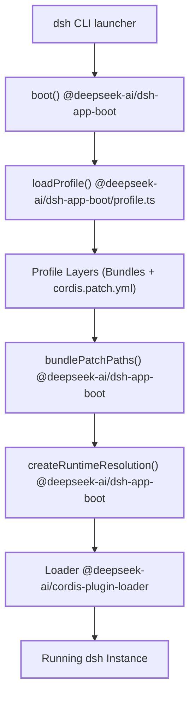
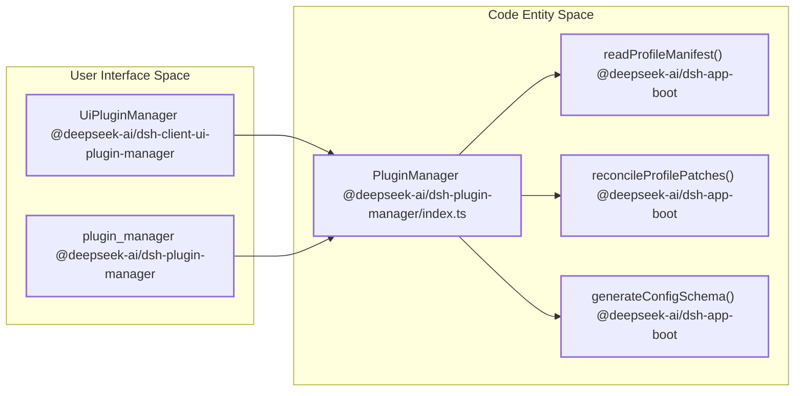

# Plugin Composition: Profiles, Bundles & Configuration

Relevant source files

The following files were used as context for generating this wiki page:

- [apps/cli/composition.md](apps/cli/composition.md)
- [apps/web/tests/expected/deepseek-messages-settings/cards.expected.md](apps/web/tests/expected/deepseek-messages-settings/cards.expected.md)
- [apps/web/tests/expected/models-settings-recovery/stored-error.expected.md](apps/web/tests/expected/models-settings-recovery/stored-error.expected.md)
- [apps/web/tests/expected/models-settings/catalog-inputs.expected.md](apps/web/tests/expected/models-settings/catalog-inputs.expected.md)
- [apps/web/tests/expected/models-settings/configured.expected.md](apps/web/tests/expected/models-settings/configured.expected.md)
- [apps/web/tests/expected/models-settings/declared-edit.expected.md](apps/web/tests/expected/models-settings/declared-edit.expected.md)
- [apps/web/tests/expected/models-settings/declared.expected.md](apps/web/tests/expected/models-settings/declared.expected.md)
- [apps/web/tests/expected/models-settings/empty.expected.md](apps/web/tests/expected/models-settings/empty.expected.md)
- [apps/web/tests/expected/models-settings/image-only.expected.md](apps/web/tests/expected/models-settings/image-only.expected.md)
- [apps/web/tests/expected/onboarding-deepseek-config/default-models.expected.md](apps/web/tests/expected/onboarding-deepseek-config/default-models.expected.md)
- [apps/web/tests/expected/onboarding-deepseek-config/models.expected.md](apps/web/tests/expected/onboarding-deepseek-config/models.expected.md)
- [apps/web/tests/expected/onboarding-usable-provider/dismissed.expected.md](apps/web/tests/expected/onboarding-usable-provider/dismissed.expected.md)
- [apps/web/tests/onboarding-deepseek-config.e2e.ts](apps/web/tests/onboarding-deepseek-config.e2e.ts)
- [docs/subsystems/boot.i18n.yaml](docs/subsystems/boot.i18n.yaml)
- [docs/subsystems/boot.md](docs/subsystems/boot.md)
- [docs/subsystems/boot.zh.md](docs/subsystems/boot.zh.md)
- [packages/boot/plugin-manager/README.i18n.yaml](packages/boot/plugin-manager/README.i18n.yaml)
- [packages/boot/plugin-manager/README.md](packages/boot/plugin-manager/README.md)
- [packages/boot/plugin-manager/README.zh.md](packages/boot/plugin-manager/README.zh.md)
- [packages/boot/plugin-manager/src/index.ts](packages/boot/plugin-manager/src/index.ts)
- [packages/boot/plugin-manager/src/types.ts](packages/boot/plugin-manager/src/types.ts)
- [packages/boot/plugin-manager/tests/manager.spec.ts](packages/boot/plugin-manager/tests/manager.spec.ts)
- [packages/bundle/base/README.i18n.yaml](packages/bundle/base/README.i18n.yaml)
- [packages/bundle/base/README.md](packages/bundle/base/README.md)
- [packages/bundle/base/README.zh.md](packages/bundle/base/README.zh.md)
- [packages/bundle/base/cordis.patch.yml](packages/bundle/base/cordis.patch.yml)
- [packages/bundle/base/package.json](packages/bundle/base/package.json)
- [packages/bundle/base/tests/base.spec.ts](packages/bundle/base/tests/base.spec.ts)
- [packages/bundle/headless/README.i18n.yaml](packages/bundle/headless/README.i18n.yaml)
- [packages/bundle/headless/README.md](packages/bundle/headless/README.md)
- [packages/bundle/headless/README.zh.md](packages/bundle/headless/README.zh.md)
- [packages/bundle/headless/src/index.ts](packages/bundle/headless/src/index.ts)
- [packages/bundle/headless/src/json-stream.ts](packages/bundle/headless/src/json-stream.ts)
- [packages/bundle/headless/src/startup.ts](packages/bundle/headless/src/startup.ts)
- [packages/bundle/headless/tests/headless.spec.ts](packages/bundle/headless/tests/headless.spec.ts)
- [packages/bundle/headless/tests/json-stream.spec.ts](packages/bundle/headless/tests/json-stream.spec.ts)
- [packages/bundle/headless/tests/startup.spec.ts](packages/bundle/headless/tests/startup.spec.ts)
- [packages/bundle/web-app/README.i18n.yaml](packages/bundle/web-app/README.i18n.yaml)
- [packages/bundle/web-app/README.md](packages/bundle/web-app/README.md)
- [packages/bundle/web-app/README.zh.md](packages/bundle/web-app/README.zh.md)
- [packages/bundle/web-app/cordis.patch.yml](packages/bundle/web-app/cordis.patch.yml)
- [packages/bundle/web-app/package.json](packages/bundle/web-app/package.json)
- [packages/bundle/web-app/src/index.ts](packages/bundle/web-app/src/index.ts)
- [packages/bundle/web-app/tests/web-app.spec.ts](packages/bundle/web-app/tests/web-app.spec.ts)
- [packages/llm/llm-deepseek/src/models.ts](packages/llm/llm-deepseek/src/models.ts)
- [packages/llm/llm-deepseek/tests/runtime.spec.ts](packages/llm/llm-deepseek/tests/runtime.spec.ts)

## Purpose and Scope

This page details the implementation mechanics of how a running DeepSeek Harness (`dsh`) instance is assembled from ordered patch layers organized into **profiles** and **bundles**, merged with configuration files (`cordis.yml` and `cordis.patch.yml`), and projected into the active Cordis service graph tree. It covers profile discovery, bundle patch resolution (`bundlePatchPaths`), runtime package resolution interception (`createRuntimeResolution`), plugin management (`PluginManager`), the configuration catalog, and introspection utilities such as `--dump-config` and `--dump-config-schema`.

Sources: `packages/boot/app-boot/src/index.ts:1-50`(), `packages/boot/app-boot/src/profile.ts:1-148`(), `packages/boot/plugin-manager/src/index.ts:1-100`()

---

## Composition Layers: Profiles & Bundles

A running `dsh` instance is instantiated by selecting a **Profile**, which anchors a specific configuration and plugin set, and loading an ordered list of **Bundles**, which package related plugins along with their declarative patch files (`cordis.patch.yml`).

### Profiles

- A **profile** is stored under `$DSH_HOME/profiles/<profile-name>` and contains a `package.json` declaring `dsh.profile` (with an ordered `bundles` list) alongside a user-editable `cordis.patch.yml` override file `[packages/boot/app-boot/src/profile.ts:1-14]()`.
- Profiles allow a single installation to ship multiple distinct application surfaces (e.g., `web`, `headless`, `acp`, `sdk`) `[packages/boot/app-boot/README.md:1-50]()`.
- `loadProfile()` reads the profile manifest, validates its structure, and gathers its resolved layers `[packages/boot/app-boot/src/profile.ts:67-104]()`.

### Bundles

- Bundles are npm packages declaring a `"dsh.bundle.patch"` field that references one or more patch files `[packages/boot/app-boot/src/profile.ts:58-75]()`.
- `bundlePatchFiles()` and `bundlePatchPaths()` parse and resolve these declarations into absolute filesystem paths `[packages/boot/app-boot/src/profile.ts:58-76]()`.
- Shipped bundles include `@deepseek-ai/dsh-base` (the core plugin runtime) and surface overlays like `@deepseek-ai/dsh-web-app` `[packages/bundle/base/cordis.patch.yml:1-15]`, `[packages/bundle/web-app/cordis.patch.yml:1-16]()`.

### Diagram: Composition Assembly & Profile Boot Flow

This diagram bridges natural language deployment roles (CLI Launcher, Profile Loader, Cordis Loader) to their precise code entities (`boot()`, `loadProfile()`, `bundlePatchPaths()`, `createRuntimeResolution()`).

Sources: `packages/boot/app-boot/src/index.ts:9-108`(), `packages/boot/app-boot/src/profile.ts:58-104`()

---

## Profile Resolution and Package Routing

The profile resolution subsystem isolates dependency graphs across installations and profiles:

- `createRuntimeResolution()` constructs an immutable `RuntimeResolution` structure mapping package names, physical directories, versions, and scopes (`installation` vs `profile`) `[packages/boot/app-boot/src/profile.ts:124-147]()`.
- Runtime resolution interception hooks into Node.js ESM and CommonJS loaders to route bare specifier imports to the correct physical paths without breaking fallback behavior `[packages/boot/app-boot/tests/profile-resolution.spec.ts:1-30]()`.

Sources: `packages/boot/app-boot/src/profile.ts:124-147`(), `packages/boot/app-boot/tests/profile-resolution.spec.ts:1-30`()

---

## Plugin Lifecycle, Toggles & Plugin Manager

The `@deepseek-ai/dsh-plugin-manager` package provides administrative control over running profile plugins:

- `PluginManager` handles runtime enabling, disabling, bundle installation, and removal `[packages/boot/plugin-manager/src/index.ts:1-78]()`.
- Toggling a plugin modifies the `disabled` property of the matching entry in the profile's `cordis.patch.yml` `[packages/boot/plugin-manager/README.md:36-41]()`.
- Peer dependency versions against `@deepseek-ai/dsh` are verified via `evaluatePluginCompatibility()` before loading or installing plugins `[packages/boot/app-boot/src/index.ts:22-26]()`.

### Diagram: Plugin Management and Configuration Pipeline

This diagram connects user-facing administrative surfaces (`UiPluginManager`, `plugin_manager` tool) to core backend code entities (`PluginManager`, `readProfileManifest()`, `reconcileProfilePatches()`, `generateConfigSchema()`).

Sources: `packages/boot/plugin-manager/src/index.ts:1-30`(), `packages/boot/app-boot/src/index.ts:20-33`()

---

## Configuration Mechanism, Expressions (`!!js`) & Config Catalog

Cordis Loader entries define declarative plugins with an `id`, `name`, `inject`, and a `config` block `[packages/bundle/web-app/cordis.patch.yml:1-56]()`.

- JavaScript expressions are interpolated using the `!!js` YAML tag, allowing values to dynamically access the Cordis `Context` or host environment `[packages/boot/app-boot/src/index.ts:41-45]()`.
- `generateConfigSchema()` and `createConfigProjector()` inspect loaded modules to generate JSON Schema 2020-12 representations of the configuration tree `[packages/boot/app-boot/src/index.ts:31-33]()`.

Sources: `packages/boot/app-boot/src/index.ts:31-45`(), `packages/bundle/web-app/cordis.patch.yml:40-56`()

---

## Summary

- A **Profile** serves as a personalized or deployment runtime environment wrapping ordered **Bundles**.
- `loadProfile()` and `bundlePatchPaths()` assemble patch layers into an ordered execution stack `[packages/boot/app-boot/src/profile.ts:58-104]()`.
- `createRuntimeResolution()` intercepts module resolution to ensure correct package boundaries `[packages/boot/app-boot/tests/profile-resolution.spec.ts:1-30]()`.
- `PluginManager` handles persistent state modifications, dependency validation, and HMR reloads `[packages/boot/plugin-manager/src/index.ts:1-78]()`.
- Configuration evaluation supports `!!js` expressions evaluated against the active Cordis Context `[packages/boot/app-boot/src/index.ts:41-45]()`.

Sources: `packages/boot/app-boot/src/index.ts:41-45`(), `packages/boot/app-boot/src/profile.ts:58-104`(), `packages/boot/plugin-manager/src/index.ts:1-78`()