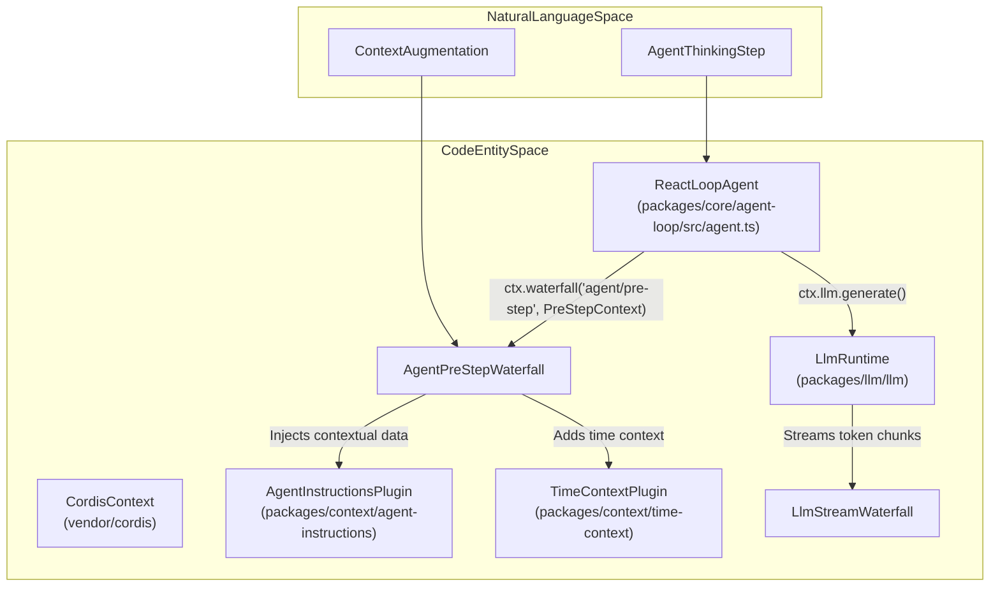
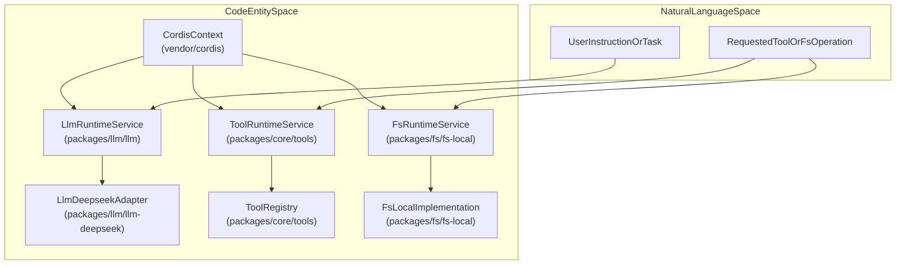

# Event Bus & Capability Seams

Relevant source files

The following files were used as context for generating this wiki page:

- [apps/web/tests/scaffold.ts](apps/web/tests/scaffold.ts)
- [apps/web/tsconfig.json](apps/web/tsconfig.json)
- [docs/architecture.i18n.yaml](docs/architecture.i18n.yaml)
- [docs/architecture.md](docs/architecture.md)
- [docs/architecture.zh.md](docs/architecture.zh.md)
- [docs/capability-seams.i18n.yaml](docs/capability-seams.i18n.yaml)
- [docs/capability-seams.md](docs/capability-seams.md)
- [docs/capability-seams.zh.md](docs/capability-seams.zh.md)
- [docs/config-catalog.i18n.yaml](docs/config-catalog.i18n.yaml)
- [docs/config-catalog.md](docs/config-catalog.md)
- [docs/config-catalog.zh.md](docs/config-catalog.zh.md)
- [docs/event-producer-consumer.i18n.yaml](docs/event-producer-consumer.i18n.yaml)
- [docs/event-producer-consumer.md](docs/event-producer-consumer.md)
- [docs/event-producer-consumer.zh.md](docs/event-producer-consumer.zh.md)
- [docs/module-graph.i18n.yaml](docs/module-graph.i18n.yaml)
- [docs/module-graph.md](docs/module-graph.md)
- [docs/module-graph.zh.md](docs/module-graph.zh.md)
- [docs/subsystems/core.i18n.yaml](docs/subsystems/core.i18n.yaml)
- [docs/subsystems/core.md](docs/subsystems/core.md)
- [docs/subsystems/core.zh.md](docs/subsystems/core.zh.md)
- [packages/core/agent-loop/README.i18n.yaml](packages/core/agent-loop/README.i18n.yaml)
- [packages/core/agent-loop/README.md](packages/core/agent-loop/README.md)
- [packages/core/agent-loop/README.zh.md](packages/core/agent-loop/README.zh.md)
- [packages/core/agent-loop/src/agent.ts](packages/core/agent-loop/src/agent.ts)
- [packages/core/agent-loop/src/index.ts](packages/core/agent-loop/src/index.ts)
- [packages/core/agent-loop/tests/agent.spec.ts](packages/core/agent-loop/tests/agent.spec.ts)
- [packages/core/agent-loop/tests/cancel.spec.ts](packages/core/agent-loop/tests/cancel.spec.ts)
- [packages/core/agent-loop/tests/config-session-id.spec.ts](packages/core/agent-loop/tests/config-session-id.spec.ts)
- [packages/core/agent-loop/tests/contract-regressions.spec.ts](packages/core/agent-loop/tests/contract-regressions.spec.ts)
- [packages/core/agent-loop/tests/coverage-edges.spec.ts](packages/core/agent-loop/tests/coverage-edges.spec.ts)
- [packages/core/agent-loop/tests/interception.spec.ts](packages/core/agent-loop/tests/interception.spec.ts)
- [packages/core/agent-loop/tests/loop.spec.ts](packages/core/agent-loop/tests/loop.spec.ts)
- [packages/core/agent-loop/tests/resume.spec.ts](packages/core/agent-loop/tests/resume.spec.ts)
- [packages/core/agent-loop/tests/scope-lifecycle.spec.ts](packages/core/agent-loop/tests/scope-lifecycle.spec.ts)
- [packages/core/agent/README.i18n.yaml](packages/core/agent/README.i18n.yaml)
- [packages/core/agent/README.md](packages/core/agent/README.md)
- [packages/core/agent/README.zh.md](packages/core/agent/README.zh.md)
- [packages/core/agent/src/index.ts](packages/core/agent/src/index.ts)
- [packages/core/agent/src/types.ts](packages/core/agent/src/types.ts)
- [packages/core/agent/tests/agent.spec.ts](packages/core/agent/tests/agent.spec.ts)
- [packages/extensions/tool-cordis/src/api-catalog.ts](packages/extensions/tool-cordis/src/api-catalog.ts)
- [pnpm-lock.yaml](pnpm-lock.yaml)
- [scripts/gen-cordis-catalog.ts](scripts/gen-cordis-catalog.ts)
- [scripts/gen-doc-graphs.ts](scripts/gen-doc-graphs.ts)
- [scripts/type-equiv.manifest.json](scripts/type-equiv.manifest.json)
- [scripts/verify-package-readme-model-experience.ts](scripts/verify-package-readme-model-experience.ts)
- [tsconfig.base.json](tsconfig.base.json)
- [tsconfig.client.json](tsconfig.client.json)
- [tsconfig.host.json](tsconfig.host.json)

This page explains the event-driven communication model of DeepSeek Harness (`dsh`), covering session and agent events, pre-step and stream waterfalls via the Cordis plugin framework (`vendor/cordis`), the capability seam abstraction pattern, and comprehensive event producer-consumer mappings across harness packages.

---

## 1. Event-Driven Communication Model

DeepSeek Harness employs an event-driven architecture built upon the Cordis plugin framework (`vendor/cordis`). Communication between decoupled subsystems is mediated by a central event bus supporting three primary dispatch patterns:

- **`emit`**: One-to-many notifications where multiple listeners receive the event without affecting each other.
- **`serial`**: Ordered, synchronous delivery where handlers run one after another.
- **`waterfall`**: Sequential data transformation where each handler receives input from the previous and may modify or short-circuit the flow.

This design allows structured and extensible composition of asynchronous operations in complex workflows such as agent turns and streaming LLM generation.

### 1.1 Session & Agent Events

The lifecycle of an agent and its interactions are broadcast via the event bus. The `sessions` service manages runtime state persistence and event distribution. The agent loop (`agent-loop`) emits pivotal events during its lifecycle, allowing other plugins and subsystems to listen and react accordingly.

Key events declared in `packages/core/agent/src/runtime-types.ts` include:

| Event Name | Dispatch Mode | Declared Line Range | Description |
| --- | --- | --- | --- |
| `agent/created` | `serial` | `[packages/core/agent/src/runtime-types.ts:290-298]()` | Dispatched when a new agent instance is initialized. Serves for initialization hooks. |
| `agent/pre-step` | `waterfall` | `[packages/core/agent/src/runtime-types.ts:350-365]()` | A critical waterfall where plugins inject context and modify agent steps before LLM calls execute. |
| `agent/status` | `emit` | `[packages/core/agent/src/runtime-types.ts:309-316]()` | Broadcasts state changes (`idle`, `running`) of the agent loop. |
| `agent/inbox/claimed` | `emit` | `[packages/core/agent/src/runtime-types.ts:328-335]()` | The driver claims a message from the inbox to start processing a turn. |

Packages such as `agent-instructions`, `goal-round-driver`, `hooks-codex`, and `plan-mode` listen on these events to enrich agent behavior, coordinate tooling, or adjust execution flow.

Sources:
- `[packages/core/agent/src/runtime-types.ts:290-365]()`
- `[vendor/cordis]()`

---

### Diagram 1: Agent Step Execution — From Natural Language Space to Code Entities

This diagram illustrates how the agent loop interprets a conceptual step in natural language and triggers concrete code workflows using Cordis `ctx` event waterfalls and service method calls.

Sources:
- `[docs/event-producer-consumer.md:11-23]()`
- `[vendor/cordis]()`

---

## 2. LLM & Stream Waterfalls

LLM interactions are managed via the `llm` service registry, which dispatches to provider adapters (e.g., `llm-deepseek`, `llm-pi-ai`). Streaming responses occur as waterfalls over token chunks (`agent/assistant-stream`), allowing middleware such as token metering, reasoning extractors, or error recovery components (`llm-retry`) to intercept and transform streams before they arrive at clients or UI views.

Sources:
- `[docs/event-producer-consumer.md:11-30]()`
- `[packages/core/agent/src/runtime-types.ts:399-410]()`

---

## 3. Capability Seams Pattern

Capability seams are Cordis service keys representing abstract interfaces for sensitive or environment-specific functionalities. Instead of hard-coding environment dependencies, DeepSeek Harness relies on seams to supply implementations at runtime via Cordis injection.

This enables the core agent and tool loops to remain portable and environment agnostic, allowing the same plugins to operate transparently over local filesystems, sandboxes, remote APIs, or other runtime environments.

### 3.1 Key Capability Seams

| Seam (Cordis Service Key) | Purpose | Primary Implementation | Key Consumers |
|---------------------------|---------|------------------------|---------------|
| `ctx.llm` | LLM Provider Abstraction | `llm-deepseek`, `llm-pi-ai` | `agent-loop`, `compaction-basic` |
| `ctx.fs` | Filesystem Access | `fs-local` | `tool-fs`, `agent-instructions` |
| `ctx.tools` | Tool Registry & Execution | `tools` | `agent-loop`, `subagent` |
| `ctx.agents` | Agent Registry & Lifecycle | `agent` | `api-gateway`, `acp` |
| `ctx.systemPrompt` | Prompt Assembly & Injection | `system-prompt` | `agent-loop` |

Sources:
- `[docs/config-catalog.md:15-56]()`
- `[docs/module-graph.md:40-49]()`

---

### Diagram 2: Capability Seam Pattern — Mapping User Intent to Abstracted Code Entities

This diagram shows that user or agent instructions (natural language) map to invocation of abstracted capability seams via the Cordis context, which then dispatch to runtime implementations in the codebase.

Sources:
- `[docs/config-catalog.md:15-56]()`
- `[docs/module-graph.md:40-49]()`

---

## 4. Event Producer-Consumer Map & Data Flow

Harness packages communicate strictly via events declared on the Cordis context, enabling loosely coupled and extensible integration. The complete matrix of producers and consumers is automatically verified during doc sync (`[docs/event-producer-consumer.md:4-30]()`).

### 4.1 Event Producer-Consumer Matrix Highlights

| Event | Mode | Producer Package | Consumer Packages (Listeners) |
|---|---|---|---|
| `agent/inbox/inserted` | `emit` | `agent-loop` | `goal-round-driver`, `subagent` |
| `agent/request-error` | `waterfall` | `agent-loop` | `compaction-basic`, `llm-retry` |
| `agent/pre-step` | `waterfall` | `agent-loop` | `agent-instructions`, `time-context`, `plan-mode`, `tool-skill` |
| `agent/status` | `emit` | `agent-loop` | `agent`, `goal-round-driver`, `session-controller` |
| `agent/assistant-stream` | `emit` | `agent-loop` | `headless`, `session-controller` |

Sources:
- `[docs/event-producer-consumer.md:8-30]()`

---

### 4.2 Data Flow: Tool Execution Seam & Event Interception

The invocation and execution of a tool by an agent proceeds through well-defined event waterfalls using the `tools` capability seam:

1. The `agent-loop` detects tool call requests extracted from streaming LLM output.
2. The `tools/pre-execute` waterfall runs, where interceptors like `hooks-codex` or `hooks-claude-code` can inspect or modify the call parameters.
3. The tool registry dispatches to the concrete tool implementation, which may reach into environment seams like `ctx.fs` or `ctx.shell`.
4. After execution, the `tools/post-execute` waterfall processes results for cleanup or enrichment.
5. Execution outcome events are recorded and published through the session log for consistent replay or auditing.

Sources:
- `[docs/event-producer-consumer.md:8-30]()`
- `[packages/extensions/tool-cordis/src/api-catalog.ts:15-48]()`