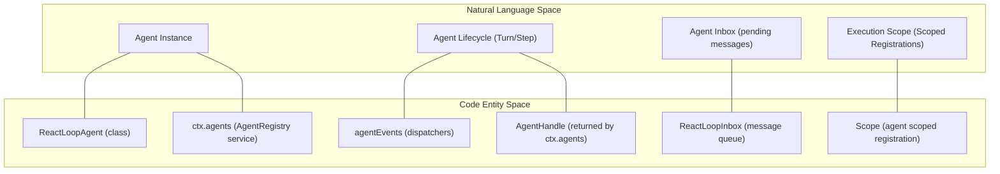
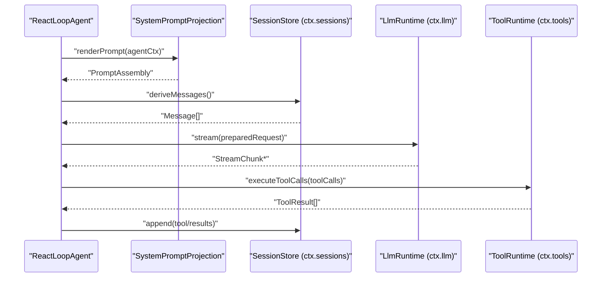

# Agent System

Relevant source files

The following files were used as context for generating this wiki page:

- [docs/architecture.i18n.yaml](docs/architecture.i18n.yaml)
- [docs/architecture.md](docs/architecture.md)
- [docs/architecture.zh.md](docs/architecture.zh.md)
- [docs/subsystems/core.i18n.yaml](docs/subsystems/core.i18n.yaml)
- [docs/subsystems/core.md](docs/subsystems/core.md)
- [docs/subsystems/core.zh.md](docs/subsystems/core.zh.md)
- [packages/core/agent-loop/README.i18n.yaml](packages/core/agent-loop/README.i18n.yaml)
- [packages/core/agent-loop/README.md](packages/core/agent-loop/README.md)
- [packages/core/agent-loop/README.zh.md](packages/core/agent-loop/README.zh.md)
- [packages/core/agent-loop/src/agent.ts](packages/core/agent-loop/src/agent.ts)
- [packages/core/agent-loop/src/index.ts](packages/core/agent-loop/src/index.ts)
- [packages/core/agent-loop/tests/agent.spec.ts](packages/core/agent-loop/tests/agent.spec.ts)
- [packages/core/agent-loop/tests/cancel.spec.ts](packages/core/agent-loop/tests/cancel.spec.ts)
- [packages/core/agent-loop/tests/config-session-id.spec.ts](packages/core/agent-loop/tests/config-session-id.spec.ts)
- [packages/core/agent-loop/tests/contract-regressions.spec.ts](packages/core/agent-loop/tests/contract-regressions.spec.ts)
- [packages/core/agent-loop/tests/coverage-edges.spec.ts](packages/core/agent-loop/tests/coverage-edges.spec.ts)
- [packages/core/agent-loop/tests/interception.spec.ts](packages/core/agent-loop/tests/interception.spec.ts)
- [packages/core/agent-loop/tests/loop.spec.ts](packages/core/agent-loop/tests/loop.spec.ts)
- [packages/core/agent-loop/tests/resume.spec.ts](packages/core/agent-loop/tests/resume.spec.ts)
- [packages/core/agent-loop/tests/scope-lifecycle.spec.ts](packages/core/agent-loop/tests/scope-lifecycle.spec.ts)
- [packages/core/agent/README.i18n.yaml](packages/core/agent/README.i18n.yaml)
- [packages/core/agent/README.md](packages/core/agent/README.md)
- [packages/core/agent/README.zh.md](packages/core/agent/README.zh.md)
- [packages/core/agent/src/index.ts](packages/core/agent/src/index.ts)
- [packages/core/agent/src/types.ts](packages/core/agent/src/types.ts)
- [packages/core/agent/tests/agent.spec.ts](packages/core/agent/tests/agent.spec.ts)

The Agent System is the core orchestration layer of DeepSeek Harness (`dsh`) [packages/core/agent/src/types.ts:15-46](). It manages the lifecycle, creation, driving, conversation turn progression, and tool execution of autonomous agents within the modular, plugin-driven Cordis framework [packages/core/agent-loop/src/agent.ts:70-160](). This system operates by composing durable session logs, live agent handles, scoped contexts, and event-driven workflows [docs/architecture.md:74-87]().

This page provides a high-level overview of the key components and their relationships in the agent system. For detailed technical information, implementation specifics, and advanced features, see the linked child pages:
- [Agent Loop & Lifecycle](#3.1) — Deep dive into `ReactLoopAgent`: turn/step state machine, inbox management, cancellation, epoch headers, maintenance mode, and publication transactions.
- [Tool Registry & Execution Pipeline](#3.2) — Covers `ToolRuntime`: tool registration, pre/execute/post waterfall, Code Mode (`run_code` + SDK generation), scheduling, and SDK rendering.
- [Session Log & Persistence](#3.3) — Explains the append-only `SessionEvent` log, Surface projection, `deriveMessages()`, forking/lineage, and persistence backends.
- [Subagent Orchestration](#3.4) — How parent agents delegate to child agents: one-shot vs. continuable, in-process vs. out-of-process drivers (ACP, Codex, Claude Code, DSH SDK).
- [LLM Adapters & Streaming](#3.5) — The `LlmRuntime` seam, adapter registration, streaming protocol, retry policies, and token metering.

---

## Core Components & Entity Mapping

At the heart of the agent system are agents modeled as turn-based state machines [packages/core/agent-loop/src/agent.ts:18-37](). A **Turn** may consist of zero or more **Steps**, where each step typically corresponds to an LLM request and tool-call execution [packages/core/agent-loop/README.md:11-94](). This flow is carefully recorded in the durable session log and projected live for UI, plugins, and orchestrators to consume [docs/architecture.md:59-64]().

Key packages and services orchestrate the agent lifecycle and execution:

| Service / Class | Context Key | Responsibility |
|-----------------|-------------|----------------|
| `AgentRegistry` (`@deepseek-ai/dsh-agent`) [packages/core/agent/src/types.ts:15-46]() | `ctx.agents` | Provides live agent handles and registry. Manages creation, resuming, cancellation, and event observability for agents. |
| `AgentLoop` (`@deepseek-ai/dsh-agent-loop`) [packages/core/agent-loop/README.md:26-38]() | `ctx.agentLoop` | Implements the default agent driver—the event loop driving turns, steps, and requests. |
| `ReactLoopAgent` (`@deepseek-ai/dsh-agent-loop/src/agent.ts`) [packages/core/agent-loop/src/agent.ts:98-138]() | N/A | Concrete `Agent` implementation driving turn/step state machine, inbox management, and interaction with system prompt and runtime context projections. |
| `ReactLoopInbox` | N/A | Manages pending message queues (`next-turn` and `next-step`) for the agent [packages/core/agent-loop/src/agent.ts:132-132](). |
| `Scope` (`@deepseek-ai/dsh-scope`) | Library, no key | Agent-scoped registrations and lifecycles supporting per-agent isolated registrations of tools, prompt sections, and listeners [docs/architecture.md:64-64](). |

Diagram: Natural Language to Code Entity Mapping

Sources: [packages/core/agent-loop/src/agent.ts:98-169](), [packages/core/agent/src/types.ts:15-46](), [packages/core/agent/README.md:28-67](), [docs/architecture.md:74-87]()

---

## 3.1 Agent Loop & Lifecycle

The `@deepseek-ai/dsh-agent-loop` package implements the default agent lifecycle driver, realized primarily by the `ReactLoopAgent` class [packages/core/agent-loop/src/agent.ts:98-138](). This driver manages:

- Creation and resumption of agent sessions bound to durable logs [packages/core/agent-loop/README.md:59-71]().
- Driving the agent as a turn- and step-based state machine [packages/core/agent-loop/src/agent.ts:42-51]().
- Managing pending inputs in per-agent inboxes (with separate queues for `next-turn` and `next-step`) [packages/core/agent/src/types.ts:38-45]().
- Assembling prompt sections including user messages, system prompt, and tool schemas [packages/core/agent-loop/src/agent.ts:132-138]().
- Executing the lifecycle workflow: dispatching model requests, streaming responses, executing tool calls, and appending new session events [packages/core/agent-loop/src/agent.ts:100-112]().

For detailed implementation specifics, see [Agent Loop & Lifecycle](#3.1).

Sources: [docs/architecture.md:74-101](), [packages/core/agent-loop/src/agent.ts:70-160](), [packages/core/agent-loop/README.md:11-94]()

---

## 3.2 Tool Registry & Execution Pipeline

Central to agent capabilities is the tool execution pipeline managed by the `ToolRuntime` service (`ctx.tools`) [docs/architecture.md:61-61](). It provides:

- Registration and scoping of tools to agents and contexts.
- A guarded waterfall lifecycle for tool calls broken into `pre-execute`, `execute`, and `post-execute` hooks [packages/core/agent-loop/tests/contract-regressions.spec.ts:99-105]().
- Support for parallel-safe concurrent tool calls with a configurable limit (`maxParallelToolCalls`), alongside exclusive calls [packages/core/agent-loop/README.md:46-57]().
- A "Code Mode" combining tool execution with SDK code generation.

For full functional and configuration details, see [Tool Registry & Execution Pipeline](#3.2).

Sources: [docs/architecture.md:65-65](), [packages/core/agent-loop/README.md:73-74](), [packages/core/agent-loop/tests/contract-regressions.spec.ts:99-105]()

---

## 3.3 Session Log & Persistence

The session log, managed by the `SessionStore` (`ctx.sessions`), is the single source of truth for conversation state and tool outcomes [docs/architecture.md:59-59]().

- An append-only log of `SessionEvent` objects representing user, assistant, system messages, tool calls, and boundaries [packages/core/agent/src/types.ts:89-104]().
- Session projections derive live in-memory views such as message chains (`deriveMessages()`), inbox states, and rich runtime context [packages/core/agent-loop/tests/contract-regressions.spec.ts:75-78]().
- Persistence backends support JSONL and SQLite file formats.

See [Session Log & Persistence](#3.3) for an extensive technical exposition.

Sources: [docs/architecture.md:61-64](), [docs/architecture.md:68-71](), [packages/core/agent-loop/src/inbox.ts:10-40]()

---

## 3.4 Subagent Orchestration

Complex agent scenarios require delegation and teamwork. The subagent orchestration subsystem enables agents to manage child agents with flexible lifecycles.

- Subagents operate in one-shot mode (single turn) or as continuable multi-turn sessions [packages/core/agent/README.md:30-33]().
- Drivers include in-process loops, or out-of-process agents connected via protocols such as ACP (Agent Client Protocol), Codex, Claude Code, or through the DSH SDK.
- Policy inheritance mechanisms allow parent agents to control or restrict child agent capabilities.

For a deeper understanding, see [Subagent Orchestration](#3.4).

Sources: [packages/core/agent/README.md:28-35]()

---

## 3.5 LLM Adapters & Streaming

The `LlmRuntime` seam, accessible via `ctx.llm`, abstracts the heterogeneity of LLM providers and streaming protocols [docs/architecture.md:65-65]().

- Registers adapters that normalize prompt preparation, request routing, and streaming response consumption.
- Supports advanced features like token metering, retry policies, and reasoning effort metadata [packages/core/agent-loop/README.md:50-52]().
- Implements streaming chunk and block assembly facilitating continuous streaming of assistant responses [packages/core/agent-loop/tests/loop.spec.ts:103-111]().
- Includes out-of-the-box adapter implementations for DeepSeek and Pi.ai services.

Consult [LLM Adapters & Streaming](#3.5) for the detailed adapter lifecycle and streaming protocol.

Sources: [docs/architecture.md:60-62](), [packages/core/agent-loop/src/agent.ts:19-28](), [packages/core/agent-loop/tests/loop.spec.ts:103-111]()

---

## Service Interaction Overview

Diagram: Agent Step Subsystem Interaction

Sources: [packages/core/agent-loop/src/agent.ts:18-37](), [packages/core/agent-loop/README.md:11-76](), [docs/architecture.md:74-102]()

---

# See Also

- [Agent Loop & Lifecycle](#3.1)
- [Tool Registry & Execution Pipeline](#3.2)
- [Session Log & Persistence](#3.3)
- [Subagent Orchestration](#3.4)
- [LLM Adapters & Streaming](#3.5)

---
Sources:
- docs/architecture.md:3-102
- packages/core/agent-loop/src/agent.ts:1-171
- packages/core/agent-loop/README.md:1-94
- packages/core/agent/src/types.ts:1-56