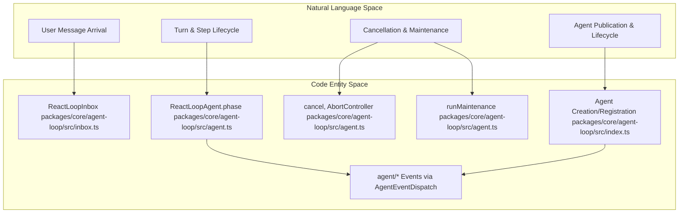
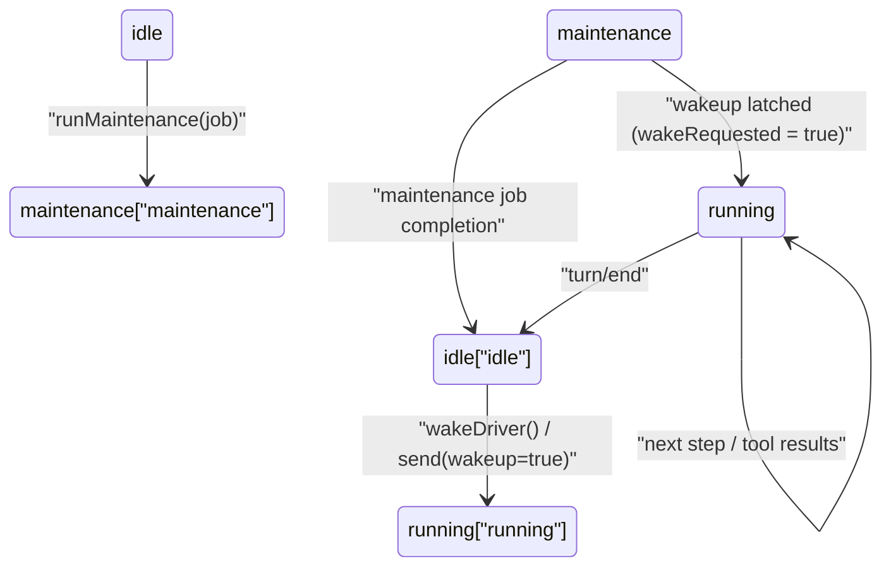
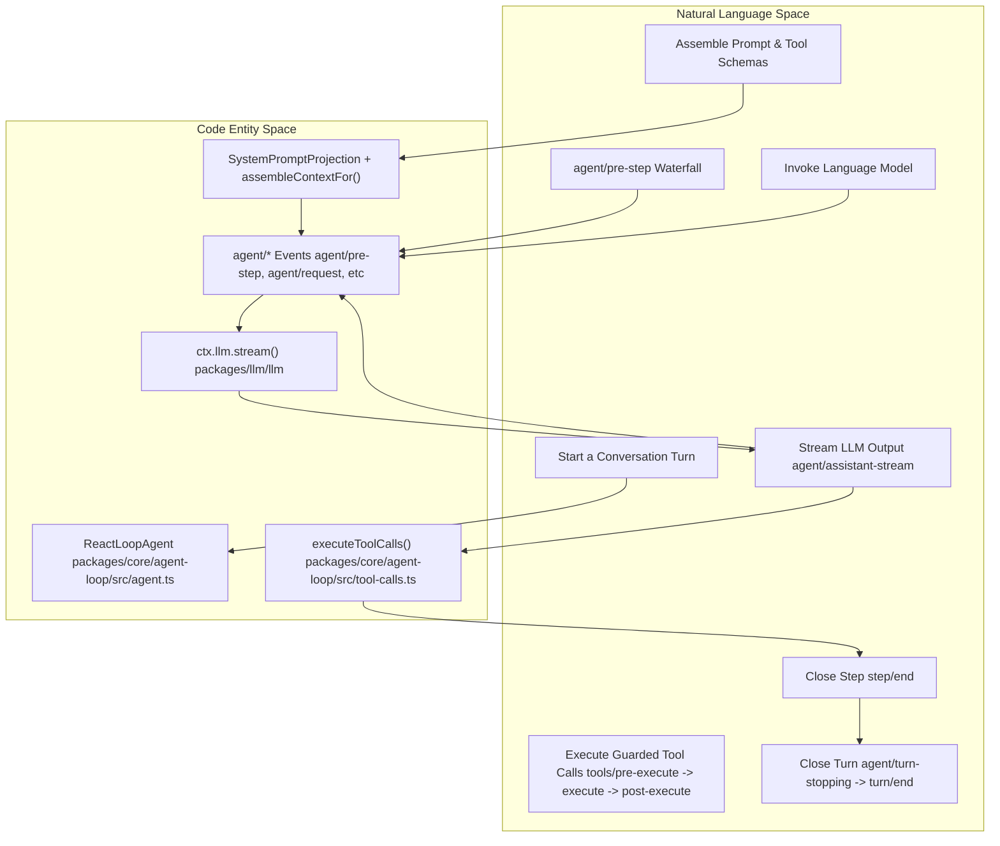
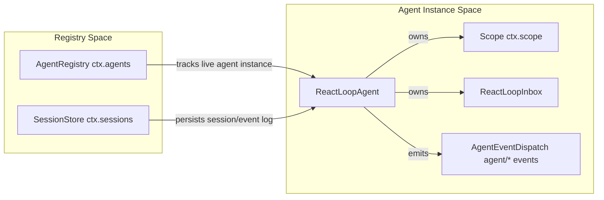

# Agent Loop & Lifecycle

Relevant source files

The following files were used as context for generating this wiki page:

- [docs/architecture.i18n.yaml](docs/architecture.i18n.yaml)
- [docs/architecture.md](docs/architecture.md)
- [docs/architecture.zh.md](docs/architecture.zh.md)
- [docs/subsystems/core.i18n.yaml](docs/subsystems/core.i18n.yaml)
- [docs/subsystems/core.md](docs/subsystems/core.md)
- [docs/subsystems/core.zh.md](docs/subsystems/core.zh.md)
- [packages/core/agent-loop/README.i18n.yaml](packages/core/agent-loop/README.i18n.yaml)
- [packages/core/agent-loop/README.md](packages/core/agent-loop/README.md)
- [packages/core/agent-loop/README.zh.md](packages/core/agent-loop/README.zh.md)
- [packages/core/agent-loop/src/agent.ts](packages/core/agent-loop/src/agent.ts)
- [packages/core/agent-loop/src/index.ts](packages/core/agent-loop/src/index.ts)
- [packages/core/agent-loop/tests/agent.spec.ts](packages/core/agent-loop/tests/agent.spec.ts)
- [packages/core/agent-loop/tests/cancel.spec.ts](packages/core/agent-loop/tests/cancel.spec.ts)
- [packages/core/agent-loop/tests/config-session-id.spec.ts](packages/core/agent-loop/tests/config-session-id.spec.ts)
- [packages/core/agent-loop/tests/contract-regressions.spec.ts](packages/core/agent-loop/tests/contract-regressions.spec.ts)
- [packages/core/agent-loop/tests/coverage-edges.spec.ts](packages/core/agent-loop/tests/coverage-edges.spec.ts)
- [packages/core/agent-loop/tests/interception.spec.ts](packages/core/agent-loop/tests/interception.spec.ts)
- [packages/core/agent-loop/tests/loop.spec.ts](packages/core/agent-loop/tests/loop.spec.ts)
- [packages/core/agent-loop/tests/resume.spec.ts](packages/core/agent-loop/tests/resume.spec.ts)
- [packages/core/agent-loop/tests/scope-lifecycle.spec.ts](packages/core/agent-loop/tests/scope-lifecycle.spec.ts)
- [packages/core/agent-loop/tests/tool-order.spec.ts](packages/core/agent-loop/tests/tool-order.spec.ts)
- [packages/core/agent/README.i18n.yaml](packages/core/agent/README.i18n.yaml)
- [packages/core/agent/README.md](packages/core/agent/README.md)
- [packages/core/agent/README.zh.md](packages/core/agent/README.zh.md)
- [packages/core/agent/src/index.ts](packages/core/agent/src/index.ts)
- [packages/core/agent/src/types.ts](packages/core/agent/src/types.ts)
- [packages/core/agent/tests/agent.spec.ts](packages/core/agent/tests/agent.spec.ts)
- [packages/core/system-prompt/README.i18n.yaml](packages/core/system-prompt/README.i18n.yaml)
- [packages/core/system-prompt/README.md](packages/core/system-prompt/README.md)
- [packages/core/system-prompt/README.zh.md](packages/core/system-prompt/README.zh.md)
- [packages/core/system-prompt/src/index.ts](packages/core/system-prompt/src/index.ts)
- [packages/core/system-prompt/tests/scoped.spec.ts](packages/core/system-prompt/tests/scoped.spec.ts)
- [packages/core/system-prompt/tests/system-prompt.spec.ts](packages/core/system-prompt/tests/system-prompt.spec.ts)
- [packages/core/system-prompt/tests/tool-order.spec.ts](packages/core/system-prompt/tests/tool-order.spec.ts)
- [packages/core/tools/tests/scoped.spec.ts](packages/core/tools/tests/scoped.spec.ts)

This page provides a deep technical dive into the `ReactLoopAgent` implementation within DeepSeek Harness (`dsh`), covering its internal turn/step state machine, inbox management, cancellation protocols, maintenance mode, epoch headers for request consistency, and publication transaction patterns [packages/core/agent-loop/src/agent.ts:68-170](), [packages/core/agent-loop/src/index.ts:96-146]().

---

## Overview of ReactLoopAgent

The `ReactLoopAgent` class serves as the default concrete agent driver in `dsh`, fulfilling the public `Agent` contract [packages/core/agent-loop/src/agent.ts:72](). It handles the complete lifecycle of an execution session from message intake through model requests and tool execution loops [packages/core/agent-loop/src/agent.ts:72-112]().

Key architectural characteristics include:
- Consumes incoming user messages via an append-only `ReactLoopInbox` instance backed by session projections that reflect `agent/inbox/spliced` events [packages/core/agent-loop/src/agent.ts:36,99-106]().
- Manages conversation progress across discrete `turn` and `step` boundaries, materialized as durable session log events `turn/start`, `turn/end`, `step/start`, and `step/end` [docs/architecture.zh.md:86-107]().
- Uses Cordis event taxonomies for plugin-based observation and extension, emitting `agent/*` domain events such as `agent/pre-step`, `agent/request`, `agent/assistant-stream`, and `agent/turn-stopping` [docs/architecture.md:11-14]().
- Implements cooperative cancellation of active turns and queued input via `AbortController` signals passing JSON-safe cancellation causes [packages/core/agent-loop/src/agent.ts:79-94,149-155]().
- Supports a dedicated maintenance mode to run exclusive background jobs, pausing main loop execution, latching wake requests during maintenance [packages/core/agent-loop/src/agent.ts:44-50,157-174]().

### Natural Language to Code Entity Relationship for ReactLoopAgent

Sources:
- [docs/architecture.md:11-14]()
- [docs/architecture.zh.md:86-107]()
- [packages/core/agent-loop/src/agent.ts:35-50]()
- [packages/core/agent-loop/src/agent.ts:72-112]()
- [packages/core/agent-loop/src/index.ts:96-146]()

---

## Turn/Step State Machine

### Concepts
- **Turn:** A logical conversation segment spanning zero or more steps. A turn opens when the first input message is claimed and closes when no further work remains owed, coordinated by durable `turn/start` and `turn/end` events [docs/architecture.zh.md:86-107]().
- **Step:** A single request-response cycle with the LLM, including execution of any called tools; bound by `step/start` and `step/end` events [docs/architecture.zh.md:86-107]().

### Internal State Phases
`ReactLoopAgent` manages its lifecycle via a private `phase` variable representing one of three discriminated states [packages/core/agent-loop/src/agent.ts:41-50]():
- `idle`: Waiting passively for new input or maintenance wakes.
- `maintenance`: Running an exclusive maintenance job. Incoming wake requests during maintenance are latched and deferred.
- `running`: Actively processing a turn and step, including message intake, model requests, streaming, and tool execution.

### Agent Phase State Machine

Sources:
- [docs/architecture.zh.md:86-107]()
- [packages/core/agent-loop/src/agent.ts:41-50]()
- [packages/core/agent-loop/src/agent.ts:74]()
- [packages/core/agent-loop/src/agent.ts:157-174]()

---

## Inbox Management: Followup, Steer, Inject

`ReactLoopAgent` manages input via a strongly consistent durable inbox implemented by `ReactLoopInbox` [packages/core/agent-loop/src/agent.ts:36,99-106](). This inbox tracks two distinct message queues reflected as session projections, modifiable only via normalized splice operations recorded as `agent/inbox/spliced` session events [packages/core/agent/README.md:71]().

### Inbox Targets
- `next-turn`: Messages intended to start a new conversation turn [packages/core/agent/src/types.ts:39]().
- `next-step`: Messages targeted at the next step inside the current turn [packages/core/agent/src/types.ts:39]().

### Public Input API

| Method | Inbox Target | Wakes Driver? | Description |
|---|---|---|---|
| `followup()` | `next-turn` | Yes | Queue a message for the next conversation turn [packages/core/agent/README.md:47]() |
| `steer()` | `next-step` | Yes | Queue a message for insertion at the next step of ongoing turn [packages/core/agent/README.md:47]() |
| `inject()` | `next-step` | No | Injects model-facing context messages without waking the driver [packages/core/agent/README.md:47]() |

All methods enqueue messages into the inbox via the `splice()` function, which normalizes all inserts, edits, and removals into `agent/inbox/spliced` events to preserve durability and enable live projections [packages/core/agent-loop/src/agent.ts:128-171]().

Sources:
- [packages/core/agent-loop/README.md:71]()
- [packages/core/agent-loop/src/agent.ts:128-171]()
- [packages/core/agent/src/types.ts:39-45]()

---

## Execution Lifecycle (Turn Flow)

The agent orchestrates a turn and step lifecycle with strict sequencing to assemble prompts, submit model requests, stream responses, perform tool execution, and log all facts durably [docs/architecture.zh.md:84-110](), [packages/core/agent-loop/src/agent.ts:39]().

### Turn & Step Flow Summary
1. **Turn Start**: Claim `next-step` input plus one queued `next-turn` message [docs/architecture.zh.md:88-89]().
2. **Prompt Assembly**: Build system prompt, tool schemas, and runtime context projections. Assemble full prompt history with `assembleContextFor()` [packages/core/agent-loop/src/agent.ts:31-33]().
3. **Pre-Step Decision**: Emit synchronous waterfall `agent/pre-step` to accept, reject, or rewrite the input batch [docs/architecture.zh.md:90-93]().
4. **Step Start**: Log `step/start`, commit `agent/request` event with the resolved LLM call configuration, and append accepted user messages [docs/architecture.zh.md:94-97]().
5. **Model Request**: Issue streaming request to the LLM adapter via `ctx.llm.prepareCall()` and `ctx.llm.stream()` [docs/architecture.zh.md:95,100]().
6. **Stream Processing**: Emit `agent/assistant-stream` lifecycle events to signal start, chunks, and completion of output [docs/architecture.zh.md:100-102]().
7. **Tool Execution**: Execute called tools through guarded pre/execute/post waterfalls (`tools/pre-execute`, `tools/execute`, `tools/post-execute`) [docs/architecture.zh.md:103]().
8. **Step End**: Log `step/end` event. If more owed work or input arrives, continue next step; otherwise, emit `agent/turn-stopping` and close turn with `turn/end` [docs/architecture.zh.md:104-107]().

### Mapping: Natural Language to Code Entities

Sources:
- [docs/architecture.zh.md:84-110]()
- [packages/core/agent-loop/src/agent.ts:31-40]()
- [packages/core/agent-loop/src/agent.ts:103-106]()

---

## Cancellation & Maintenance Mechanics

### Cooperative Cancellation via `cancel()`
The `ReactLoopAgent` provides a cancellation API that aborts current turn activities and clears or optionally preserves the inbox [packages/core/agent-loop/src/agent.ts:149-171]().

Cancellation uses an `AbortController` signal per turn, which aborts ongoing LLM streams and tool execution. Internally, `cancel()`:
- Aborts the active abort signal with a JSON-safe cancellation cause sanitized by `abortedCancelCause()` [packages/core/agent-loop/src/agent.ts:79-95]().
- Clears inbox messages unless `keepInbox` option is set [packages/core/agent-loop/README.md:75]().
- Emits `agent/inbox` events reflecting removals with `outcome: 'canceled'` [packages/core/agent/src/types.ts:101]().
- Allows application code to distinguish if cancellation was triggered by user, parent, hook, or disposal [packages/core/agent-loop/src/agent.ts:79-95]().

### Maintenance Mode via `runMaintenance()`
The agent supports an exclusive maintenance mode to run background jobs without concurrency conflicts [packages/core/agent-loop/src/agent.ts:44-50,157-174]():
- When invoked, the agent enters a `maintenance` phase with a dedicated abort controller.
- Incoming wake requests during maintenance do not start turns immediately but are latched.
- After maintenance completes successfully, if wake requests were latched, the agent transitions to running with a wakeup call.

Sources:
- [packages/core/agent-loop/src/agent.ts:80-95]()
- [packages/core/agent-loop/src/agent.ts:149-174]()
- [packages/core/agent-loop/tests/cancel.spec.ts:62-145]()

---

## Epoch Headers & Publication Transaction Pattern

### Epoch Headers: Anchoring Model Requests
Each model request starts with an immutable `EpochHeader` capturing the exact resolved call configuration and adapter defaults at that request time to ensure stable replay [packages/core/agent-loop/src/agent.ts:63-70]().
- Adapter default fields like `reasoningEffort` or `maxTokens` are removed from proposals before pre-step listeners revise to re-resolve them, preserving protocol correctness [packages/core/agent-loop/src/agent.ts:64-70]().
- The header is durably appended as a `request/header` event in the session log [packages/core/agent-loop/README.md:92]().
- `request/context` events capture provider, model, and context window, but only logged when changed [packages/core/agent-loop/README.md:92-93]().

### Atomic Publication Transaction for Agent Lifecycle
Agent creation and session registration utilize an atomic publish pattern [packages/core/agent-loop/src/index.ts:96-146]():
1. **Preparation**: Instantiate a `ReactLoopAgent` with scoped context, create a new or resume an existing session without publishing [packages/core/agent-loop/README.md:61]().
2. **Setup**: Run the optional user-supplied `setup(agentCtx, agent)` callback that configures tools, prompts, and listeners scoped to the agent [packages/core/agent/README.md:43]().
3. **Publication**: Atomically publish the agent's session to `ctx.sessions` and register the agent instance in `ctx.agents`. Duplicate session detection disallows multiple agents sharing the same session [packages/core/agent-loop/tests/config-session-id.spec.ts:112-129]().
4. **Teardown**: Disposing the agent aborts loops, unregisters events, disposes the scope, and removes it from registries, ensuring resource cleanup [packages/core/agent/README.md:40]().

### Agent & Registry Interaction Diagram

Sources:
- [packages/core/agent-loop/README.md:61]()
- [packages/core/agent-loop/README.md:92-94]()
- [packages/core/agent-loop/src/agent.ts:63-70]()
- [packages/core/agent-loop/src/agent.ts:96-112]()
- [packages/core/agent-loop/src/index.ts:96-146]()
- [packages/core/agent-loop/tests/config-session-id.spec.ts:112-129]()

---

# Summary

The `ReactLoopAgent` implements the core conversational lifecycle inside DeepSeek Harness using:
- A well-defined finite state machine that manages `idle`, `maintenance`, and `running` phases [packages/core/agent-loop/src/agent.ts:41-50]().
- A durable inbox based on recorded session events for consistent user and steering input management [packages/core/agent/src/types.ts:95-103]().
- A detailed turn and step lifecycle handing prompt assembly, model invocation, streaming, tool execution, and rich event hooks [docs/architecture.zh.md:84-110]().
- Cooperative cancellation and robust management of asynchronous LLM streaming and tool calls [packages/core/agent-loop/src/agent.ts:79-95]().
- Atomic transaction patterns for creation, publication, and teardown of agents to guarantee consistent system state [packages/core/agent-loop/src/index.ts:96-146]().

---

# Additional References
- For detailed implementation and dispatch logic of `ReactLoopAgent`, see [packages/core/agent-loop/src/agent.ts:68-170]().
- For agent creation, lifecycle orchestration, and projection definitions, see [packages/core/agent-loop/src/index.ts:96-146]().
- For inbox projections and message type declarations, see [packages/core/agent/src/types.ts:38-70]().