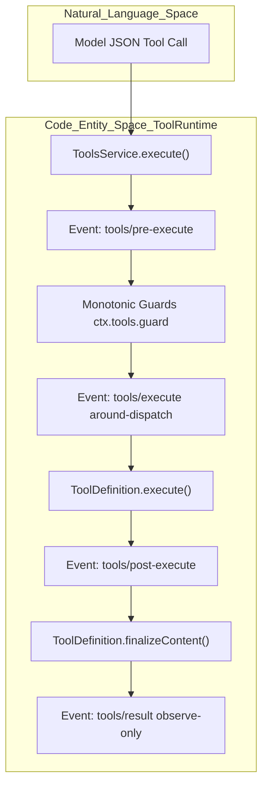
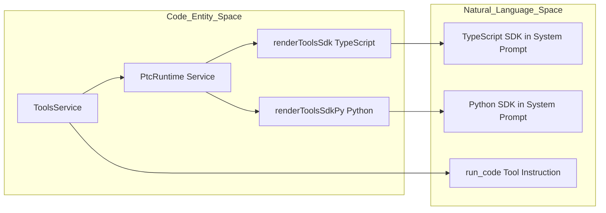

# Tool Registry & Execution Pipeline

<details>
<summary>Relevant source files</summary>

The following files were used as context for generating this wiki page:

- [apps/cli/tests/optional-bundle-transitions.e2e.ts](apps/cli/tests/optional-bundle-transitions.e2e.ts)
- [docs/tool-catalog.i18n.yaml](docs/tool-catalog.i18n.yaml)
- [docs/tool-catalog.md](docs/tool-catalog.md)
- [docs/tool-catalog.zh.md](docs/tool-catalog.zh.md)
- [packages/core/session/tests/json.spec.ts](packages/core/session/tests/json.spec.ts)
- [packages/core/tools/README.i18n.yaml](packages/core/tools/README.i18n.yaml)
- [packages/core/tools/README.md](packages/core/tools/README.md)
- [packages/core/tools/README.zh.md](packages/core/tools/README.zh.md)
- [packages/core/tools/src/index.ts](packages/core/tools/src/index.ts)
- [packages/core/tools/src/json-schema.ts](packages/core/tools/src/json-schema.ts)
- [packages/core/tools/src/schema.ts](packages/core/tools/src/schema.ts)
- [packages/core/tools/tests/gen-tool-catalog.spec.ts](packages/core/tools/tests/gen-tool-catalog.spec.ts)
- [packages/core/tools/tests/json-schema.spec.ts](packages/core/tools/tests/json-schema.spec.ts)
- [packages/core/tools/tests/properties.spec.ts](packages/core/tools/tests/properties.spec.ts)
- [packages/core/tools/tests/schema.spec.ts](packages/core/tools/tests/schema.spec.ts)
- [packages/core/tools/tests/tools.spec.ts](packages/core/tools/tests/tools.spec.ts)
- [packages/extensions/cordis-host-runner/README.i18n.yaml](packages/extensions/cordis-host-runner/README.i18n.yaml)
- [packages/extensions/cordis-host-runner/README.md](packages/extensions/cordis-host-runner/README.md)
- [packages/extensions/cordis-host-runner/README.zh.md](packages/extensions/cordis-host-runner/README.zh.md)
- [packages/extensions/cordis-host-runner/src/guard.ts](packages/extensions/cordis-host-runner/src/guard.ts)
- [packages/extensions/cordis-host-runner/tests/sandbox.spec.ts](packages/extensions/cordis-host-runner/tests/sandbox.spec.ts)
- [packages/ptc-runtime/ptc-runtime-node/README.i18n.yaml](packages/ptc-runtime/ptc-runtime-node/README.i18n.yaml)
- [packages/ptc-runtime/ptc-runtime-node/README.md](packages/ptc-runtime/ptc-runtime-node/README.md)
- [packages/ptc-runtime/ptc-runtime-node/README.zh.md](packages/ptc-runtime/ptc-runtime-node/README.zh.md)
- [packages/ptc-runtime/ptc-runtime-node/src/bootstrap.ts](packages/ptc-runtime/ptc-runtime-node/src/bootstrap.ts)
- [packages/ptc-runtime/ptc-runtime-node/src/evaluators/index.ts](packages/ptc-runtime/ptc-runtime-node/src/evaluators/index.ts)
- [packages/ptc-runtime/ptc-runtime-node/src/evaluators/types.ts](packages/ptc-runtime/ptc-runtime-node/src/evaluators/types.ts)
- [packages/ptc-runtime/ptc-runtime-node/src/evaluators/vm-script-await.ts](packages/ptc-runtime/ptc-runtime-node/src/evaluators/vm-script-await.ts)
- [packages/ptc-runtime/ptc-runtime-node/src/evaluators/vm-script.ts](packages/ptc-runtime/ptc-runtime-node/src/evaluators/vm-script.ts)
- [packages/ptc-runtime/ptc-runtime-node/src/execution.ts](packages/ptc-runtime/ptc-runtime-node/src/execution.ts)
- [packages/ptc-runtime/ptc-runtime-node/src/index.ts](packages/ptc-runtime/ptc-runtime-node/src/index.ts)
- [packages/ptc-runtime/ptc-runtime-node/src/json-wire.ts](packages/ptc-runtime/ptc-runtime-node/src/json-wire.ts)
- [packages/ptc-runtime/ptc-runtime-node/src/persistent-process.ts](packages/ptc-runtime/ptc-runtime-node/src/persistent-process.ts)
- [packages/ptc-runtime/ptc-runtime-node/src/process.ts](packages/ptc-runtime/ptc-runtime-node/src/process.ts)
- [packages/ptc-runtime/ptc-runtime-node/src/protocol.ts](packages/ptc-runtime/ptc-runtime-node/src/protocol.ts)
- [packages/ptc-runtime/ptc-runtime-node/src/worker.ts](packages/ptc-runtime/ptc-runtime-node/src/worker.ts)
- [packages/ptc-runtime/ptc-runtime-node/tests/bootstrap.spec.ts](packages/ptc-runtime/ptc-runtime-node/tests/bootstrap.spec.ts)
- [packages/ptc-runtime/ptc-runtime-node/tests/execution-mode.spec.ts](packages/ptc-runtime/ptc-runtime-node/tests/execution-mode.spec.ts)
- [packages/ptc-runtime/ptc-runtime-node/tests/host-failures.spec.ts](packages/ptc-runtime/ptc-runtime-node/tests/host-failures.spec.ts)
- [packages/ptc-runtime/ptc-runtime-node/tests/persistent-built.e2e.ts](packages/ptc-runtime/ptc-runtime-node/tests/persistent-built.e2e.ts)
- [packages/ptc-runtime/ptc-runtime-node/tests/persistent-host.spec.ts](packages/ptc-runtime/ptc-runtime-node/tests/persistent-host.spec.ts)
- [packages/ptc-runtime/ptc-runtime-node/tests/persistent-process.spec.ts](packages/ptc-runtime/ptc-runtime-node/tests/persistent-process.spec.ts)
- [packages/ptc-runtime/ptc-runtime-node/tests/persistent.spec.ts](packages/ptc-runtime/ptc-runtime-node/tests/persistent.spec.ts)
- [packages/ptc-runtime/ptc-runtime-node/tests/process-main.spec.ts](packages/ptc-runtime/ptc-runtime-node/tests/process-main.spec.ts)
- [packages/ptc-runtime/ptc-runtime-node/tests/runtime.spec.ts](packages/ptc-runtime/ptc-runtime-node/tests/runtime.spec.ts)
- [packages/ptc-runtime/ptc-runtime-node/tests/script-process.spec.ts](packages/ptc-runtime/ptc-runtime-node/tests/script-process.spec.ts)
- [packages/ptc-runtime/ptc-runtime-node/tests/vm-script.spec.ts](packages/ptc-runtime/ptc-runtime-node/tests/vm-script.spec.ts)
- [packages/workflow/workflow-ptc/src/guest-source.ts](packages/workflow/workflow-ptc/src/guest-source.ts)
- [scripts/gen-tool-catalog.ts](scripts/gen-tool-catalog.ts)
- [scripts/snapshots/python-sdk-single-exe/minimal/model-visible.json](scripts/snapshots/python-sdk-single-exe/minimal/model-visible.json)
- [scripts/snapshots/python-sdk-single-exe/minimal/win-x64/model-visible.json](scripts/snapshots/python-sdk-single-exe/minimal/win-x64/model-visible.json)
- [snapshots/sdk/desktop-context/tool-schemas.expected.json](snapshots/sdk/desktop-context/tool-schemas.expected.json)
- [snapshots/sdk/desktop-ptc-context/system-prompt.expected.md](snapshots/sdk/desktop-ptc-context/system-prompt.expected.md)
- [snapshots/sdk/ptc-cancel/session.v4.jsonl](snapshots/sdk/ptc-cancel/session.v4.jsonl)
- [snapshots/sdk/sdk.snapshot.ts](snapshots/sdk/sdk.snapshot.ts)
- [snapshots/session/ptc-script-fresh/tool-schemas.expected.json](snapshots/session/ptc-script-fresh/tool-schemas.expected.json)
- [snapshots/web/cordis-tool-round/tool-schemas.expected.json](snapshots/web/cordis-tool-round/tool-schemas.expected.json)
- [snapshots/web/fresh-round-trip/tool-schemas.expected.json](snapshots/web/fresh-round-trip/tool-schemas.expected.json)
- [snapshots/web/minimal-preset/tool-schemas.expected.json](snapshots/web/minimal-preset/tool-schemas.expected.json)
- [snapshots/web/official-subagent-bundle/system-prompt.expected.md](snapshots/web/official-subagent-bundle/system-prompt.expected.md)
- [snapshots/web/optional-string-editor/session.v4.jsonl](snapshots/web/optional-string-editor/session.v4.jsonl)
- [snapshots/web/optional-string-editor/system-prompt.expected.md](snapshots/web/optional-string-editor/system-prompt.expected.md)
- [snapshots/web/optional-string-editor/tool-schemas.expected.json](snapshots/web/optional-string-editor/tool-schemas.expected.json)
- [snapshots/web/ptc-round/system-prompt.expected.md](snapshots/web/ptc-round/system-prompt.expected.md)

</details>


The `ToolRuntime` service (registered under the Cordis context key `tools`) is the centralized subsystem in DeepSeek Harness responsible for managing the lifecycle of tools: their registration, discovery, policy enforcement, and execution. It coordinates how tools are presented to the model (either via native Function Calling schemas or through Code Mode with SDK generation), enforces concurrent execution limits and cancellation, and exposes tool schemas into the system prompt assembly for model consumption.

This page provides a comprehensive technical overview of the `ToolRuntime` implementation (`ToolsService`), the execution pipeline’s structured waterfall events, Code Mode orchestration, scheduling with cooperative cancellation, and the generated tool catalog which documents all shipped tools.

Sources: [packages/core/tools/src/index.ts:1-133](), [packages/core/tools/README.md:7-92]()

---

## 1. Tool Registration & Discovery

Tools are registered as `ToolDefinition` objects that specify model-visible metadata, parameter schemas, output shapes, renderers, and core execution logic.

### Registration Architecture

- **Scoped Layers:** Tools are registered in scoped layers using `@deepseek-ai/dsh-scope` (`ScopedLayers`, `scopeOf`, `scopeTarget`), enabling global, per-agent, or context-sensitive overrides. An agent-local tool registration shadows global definitions of the same name [packages/core/tools/src/index.ts:63-71](), [packages/core/tools/src/index.ts:128-153]().
- **Visibility Filtering:** Using `ctx.tools.restrict(filter)` per-agent allow/deny masks can be applied dynamically, intersecting and respecting scoped registrations [packages/core/tools/README.md:83-87]().
- **Schema Projection:** The registry projects registered `ToolDefinition` objects into wire-visible `ToolSchema` objects exposing only necessary properties (`name`, `description`, `parameters`) [packages/core/tools/README.md:83-87]().
- **Schema Validation:** JSON Schemas are validated at registration time using `assertSupportedJsonSchema` to ensure correctness and compatibility [packages/core/tools/src/index.ts:11-16](), [packages/core/tools/src/index.ts:136-136]().

### Usage Example

```ts
import { readFile } from 'node:fs/promises'
import type { Context } from '@deepseek-ai/cordis'
import { defineTool } from '@deepseek-ai/dsh-tools'

declare const ctx: Context

ctx.tools.register(defineTool({
  name: 'read_file',
  description: 'Read a file from disk.',
  parameters: {
    path: { type: 'string', required: true, description: 'Absolute file path' },
    offset: { type: 'number' },
    limit: { type: 'number' },
  },
  output: {
    schema: { type: 'string' },
    render: (_args, value) => [{ type: 'text', text: value }],
  },
  async execute(args, exec) {
    return readFile(args.path, { encoding: 'utf8', signal: exec.signal })
  },
}))
```

Sources: [packages/core/tools/src/index.ts:7-82](), [packages/core/tools/README.md:28-84](), [docs/tool-catalog.md:8-10]()

---

## 2. Execution Pipeline Waterfall

The tool execution pipeline is a structured waterfall sequence of asynchronous events and synchronous guards managing tool calls from model invocation through policy decisions and result finalization.

### Pipeline Stages

1. **`tools/pre-execute`** (asynchronous waterfall event): Listeners decide whether to `allow`, `deny`, or `ask` for approval via `PreToolDecision`.
2. **Monotonic Guards**: Synchronously registered via `ctx.tools.guard()` after pre-execution; only allow rejection reasons.
3. **`tools/execute`** (around-dispatch waterfall): Wraps call dispatch, supporting retries, timeout enforcement, or instrumentation.
4. **Tool Body Dispatch**: Invokes the registered tool's `execute` method with validated arguments and cancellation signal.
5. **`tools/post-execute`** (asynchronous waterfall): Allows inspection or replacement of results and attaching contextual metadata.
6. **`finalizeContent`**: The tool's optional final content normalization step producing canonical presentation content.
7. **`tools/result`** (observe-only event): Publishes the frozen final result for observers.

### Pipeline Data Flow Diagram

Title: "Tool Execution Pipeline Flow"



Sources: [packages/core/tools/src/index.ts:137-190](), [packages/core/tools/README.md:83-87]()

---

## 3. Code Mode (run_code + SDK Generation)

DeepSeek Harness supports an advanced Code Mode where the LLM produces programs that invoke tools indirectly.

### Core Components

- **`run_code` Tool**: A reserved tool identified by `RUN_CODE_NAME` (`'run_code'`) serving as a program execution host within the tool pipeline [packages/core/tools/src/index.ts:12-16](), [packages/core/tools/src/index.ts:145-147]().
- **SDK Generation**: Depending on the runtime language (`ctx.ptcRuntime.language`), the registry resolves SDK renderers (`renderToolsSdk` for TypeScript, `renderToolsSdkPy` for Python) to generate strongly typed SDKs injected into the system prompt [packages/core/tools/README.md:66-82]().

### SDK Renderer Dispatch Table

| Language | SDK Renderer Function | File Reference |
| --- | --- | --- |
| `typescript` | `renderToolsSdk` | `packages/core/tools/src/ts-types.ts` |
| `python` | `renderToolsSdkPy` | `packages/core/tools/src/py-types.ts` |

### Code Mode Logical Pipeline Diagram

Title: "Code Mode SDK Generation and Dispatch Pipeline"



Sources: [packages/core/tools/src/index.ts:24-65](), [packages/core/tools/src/py-types.ts:1-101](), [packages/core/tools/README.md:66-79]()

---

## 4. Scheduling & Cooperative Cancellation

### Concurrency Control

- The configuration parameter `maxParallelSubCalls` sets the concurrency cap for overlapping sub-calls spawned by a `run_code` program [packages/core/tools/README.md:76-80]().

### Cancellation Protocol

- Every tool execution receives an `AbortSignal` (`exec.signal`) which tool bodies must observe for cooperative cancellation [packages/core/tools/README.md:124-127]().
- Early cancellation results in `TOOL_ABORTED_BEFORE_DISPATCH`, while mid-execution cancellation produces `TOOL_ABORTED` [packages/core/tools/tests/tools.spec.ts:10-15]().

Sources: [packages/core/tools/src/index.ts:149-163](), [packages/core/tools/README.md:53-56](), [packages/core/tools/tests/tools.spec.ts:10-15]()

---

## 5. Generated Tool Catalog Overview

The `docs/tool-catalog.md` file documents every model-visible tool schema delivered by shipped plugins.

### Generation Process

- The generation script (`scripts/gen-tool-catalog.ts`) boots all declared `tool-*` plugin packages in a Cordis context to harvest runtime-assembled schemas [docs/tool-catalog.md:8-10](), [scripts/gen-tool-catalog.ts:1-128]().
- Completeness is verified in CI via `pnpm run verify-tool-catalog` [docs/tool-catalog.md:1-8]().

Sources: [docs/tool-catalog.md:1-40](), [scripts/gen-tool-catalog.ts:1-128](), [packages/core/tools/tests/gen-tool-catalog.spec.ts:25-96]()