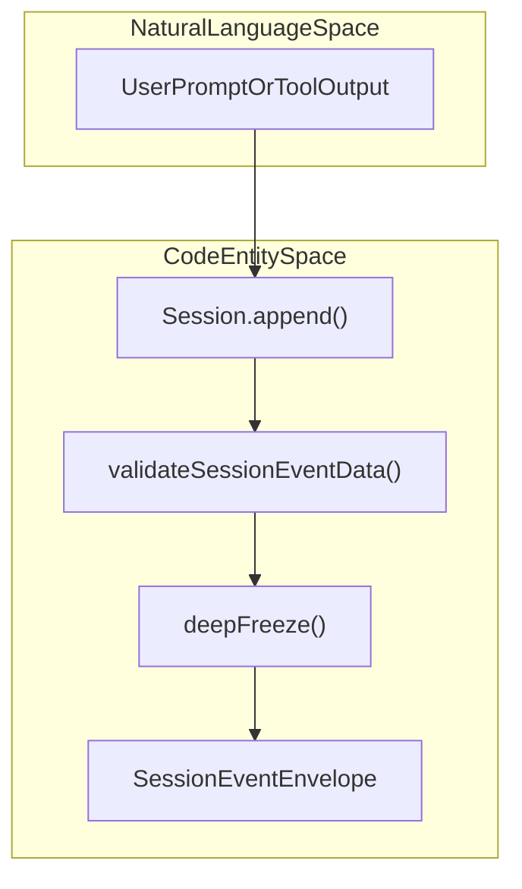
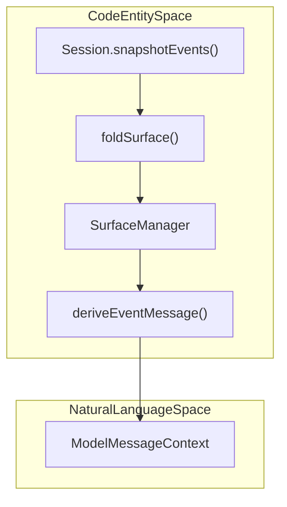
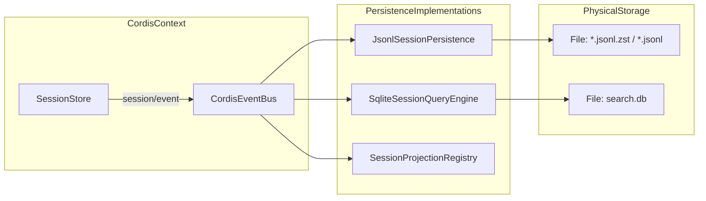

# Session Log & Persistence

Relevant source files

The following files were used as context for generating this wiki page:

- [.agents/notes/implemented/architecture/2026-08-10-session-log-version-mechanism.i18n.yaml](.agents/notes/implemented/architecture/2026-08-10-session-log-version-mechanism.i18n.yaml)
- [.agents/notes/implemented/architecture/2026-08-10-session-log-version-mechanism.md](.agents/notes/implemented/architecture/2026-08-10-session-log-version-mechanism.md)
- [.agents/notes/implemented/architecture/2026-08-10-session-log-version-mechanism.zh.md](.agents/notes/implemented/architecture/2026-08-10-session-log-version-mechanism.zh.md)
- [.agents/notes/implemented/architecture/2026-09-01-parent-owned-subagent-catalog.i18n.yaml](.agents/notes/implemented/architecture/2026-09-01-parent-owned-subagent-catalog.i18n.yaml)
- [.agents/notes/implemented/architecture/2026-09-01-parent-owned-subagent-catalog.md](.agents/notes/implemented/architecture/2026-09-01-parent-owned-subagent-catalog.md)
- [.agents/notes/implemented/architecture/2026-09-01-parent-owned-subagent-catalog.zh.md](.agents/notes/implemented/architecture/2026-09-01-parent-owned-subagent-catalog.zh.md)
- [docs/persistence-catalog.i18n.yaml](docs/persistence-catalog.i18n.yaml)
- [docs/persistence-catalog.md](docs/persistence-catalog.md)
- [docs/persistence-catalog.zh.md](docs/persistence-catalog.zh.md)
- [docs/persistence-changes/historical-formats/README.i18n.yaml](docs/persistence-changes/historical-formats/README.i18n.yaml)
- [docs/persistence-changes/historical-formats/README.md](docs/persistence-changes/historical-formats/README.md)
- [docs/persistence-changes/historical-formats/README.zh.md](docs/persistence-changes/historical-formats/README.zh.md)
- [docs/persistence-schema.json](docs/persistence-schema.json)
- [docs/subsystems/persistence.i18n.yaml](docs/subsystems/persistence.i18n.yaml)
- [docs/subsystems/persistence.md](docs/subsystems/persistence.md)
- [docs/subsystems/persistence.zh.md](docs/subsystems/persistence.zh.md)
- [docs/subsystems/session-projection.i18n.yaml](docs/subsystems/session-projection.i18n.yaml)
- [docs/subsystems/session-projection.md](docs/subsystems/session-projection.md)
- [docs/subsystems/session-projection.zh.md](docs/subsystems/session-projection.zh.md)
- [docs/subsystems/session.i18n.yaml](docs/subsystems/session.i18n.yaml)
- [docs/subsystems/session.md](docs/subsystems/session.md)
- [docs/subsystems/session.zh.md](docs/subsystems/session.zh.md)
- [packages/core/agent-loop/tests/request-reconstruction.spec.ts](packages/core/agent-loop/tests/request-reconstruction.spec.ts)
- [packages/core/session/README.i18n.yaml](packages/core/session/README.i18n.yaml)
- [packages/core/session/README.md](packages/core/session/README.md)
- [packages/core/session/README.zh.md](packages/core/session/README.zh.md)
- [packages/core/session/src/index.ts](packages/core/session/src/index.ts)
- [packages/core/session/src/surface.ts](packages/core/session/src/surface.ts)
- [packages/core/session/src/types.ts](packages/core/session/src/types.ts)
- [packages/core/session/tests/session.spec.ts](packages/core/session/tests/session.spec.ts)
- [packages/core/session/tests/surface.spec.ts](packages/core/session/tests/surface.spec.ts)
- [packages/session-query/session-query-sqlite/README.md](packages/session-query/session-query-sqlite/README.md)
- [packages/session-query/session-query-sqlite/src/index.ts](packages/session-query/session-query-sqlite/src/index.ts)
- [packages/session-query/session-query-sqlite/src/query.ts](packages/session-query/session-query-sqlite/src/query.ts)
- [packages/session-query/session-query-sqlite/src/schema.ts](packages/session-query/session-query-sqlite/src/schema.ts)
- [packages/session-query/session-query-sqlite/tests/query.spec.ts](packages/session-query/session-query-sqlite/tests/query.spec.ts)
- [packages/session-query/session-query-sqlite/tests/sqlite.spec.ts](packages/session-query/session-query-sqlite/tests/sqlite.spec.ts)
- [packages/session-query/session-query/README.i18n.yaml](packages/session-query/session-query/README.i18n.yaml)
- [packages/session-query/session-query/README.md](packages/session-query/session-query/README.md)
- [packages/session-query/session-query/README.zh.md](packages/session-query/session-query/README.zh.md)
- [packages/session-query/session-query/src/corpus.ts](packages/session-query/session-query/src/corpus.ts)
- [packages/session-query/session-query/src/index.ts](packages/session-query/session-query/src/index.ts)
- [packages/session-query/session-query/src/observation.ts](packages/session-query/session-query/src/observation.ts)
- [packages/session-query/session-query/src/tracing.ts](packages/session-query/session-query/src/tracing.ts)
- [packages/session-query/session-query/tests/observation.spec.ts](packages/session-query/session-query/tests/observation.spec.ts)
- [packages/session-query/session-query/tests/session-query.spec.ts](packages/session-query/session-query/tests/session-query.spec.ts)
- [packages/session-query/session-query/tests/tracing.spec.ts](packages/session-query/session-query/tests/tracing.spec.ts)
- [packages/session/session-persistence-jsonl/README.i18n.yaml](packages/session/session-persistence-jsonl/README.i18n.yaml)
- [packages/session/session-persistence-jsonl/README.md](packages/session/session-persistence-jsonl/README.md)
- [packages/session/session-persistence-jsonl/README.zh.md](packages/session/session-persistence-jsonl/README.zh.md)
- [packages/session/session-persistence-jsonl/src/format.ts](packages/session/session-persistence-jsonl/src/format.ts)
- [packages/session/session-persistence-jsonl/src/generation.ts](packages/session/session-persistence-jsonl/src/generation.ts)
- [packages/session/session-persistence-jsonl/src/index.ts](packages/session/session-persistence-jsonl/src/index.ts)
- [packages/session/session-persistence-jsonl/src/migration-verifier.ts](packages/session/session-persistence-jsonl/src/migration-verifier.ts)
- [packages/session/session-persistence-jsonl/src/worker.ts](packages/session/session-persistence-jsonl/src/worker.ts)
- [packages/session/session-persistence-jsonl/tests/built-migration-worker.e2e.ts](packages/session/session-persistence-jsonl/tests/built-migration-worker.e2e.ts)
- [packages/session/session-persistence-jsonl/tests/catalog-migration.spec.ts](packages/session/session-persistence-jsonl/tests/catalog-migration.spec.ts)
- [packages/session/session-persistence-jsonl/tests/generation.spec.ts](packages/session/session-persistence-jsonl/tests/generation.spec.ts)
- [packages/session/session-persistence-jsonl/tests/jsonl.spec.ts](packages/session/session-persistence-jsonl/tests/jsonl.spec.ts)
- [packages/session/session-persistence-jsonl/tests/migration-verifier-real.spec.ts](packages/session/session-persistence-jsonl/tests/migration-verifier-real.spec.ts)
- [packages/session/session-persistence-jsonl/tests/migration-verifier.spec.ts](packages/session/session-persistence-jsonl/tests/migration-verifier.spec.ts)
- [packages/session/session-persistence-jsonl/tests/zstd.spec.ts](packages/session/session-persistence-jsonl/tests/zstd.spec.ts)
- [packages/session/session-persistence-jsonl/tsdown.config.ts](packages/session/session-persistence-jsonl/tsdown.config.ts)
- [packages/session/session-persistence/README.i18n.yaml](packages/session/session-persistence/README.i18n.yaml)
- [packages/session/session-persistence/README.md](packages/session/session-persistence/README.md)
- [packages/session/session-persistence/README.zh.md](packages/session/session-persistence/README.zh.md)
- [packages/session/session-persistence/src/index.ts](packages/session/session-persistence/src/index.ts)
- [packages/session/session-persistence/tests/storage-contract.spec.ts](packages/session/session-persistence/tests/storage-contract.spec.ts)
- [packages/session/session-projection-cache/README.i18n.yaml](packages/session/session-projection-cache/README.i18n.yaml)
- [packages/session/session-projection-cache/README.md](packages/session/session-projection-cache/README.md)
- [packages/session/session-projection-cache/README.zh.md](packages/session/session-projection-cache/README.zh.md)
- [packages/session/session-projection-cache/package.json](packages/session/session-projection-cache/package.json)
- [packages/session/session-projection-cache/src/index.ts](packages/session/session-projection-cache/src/index.ts)
- [packages/session/session-projection-cache/src/spec.ts](packages/session/session-projection-cache/src/spec.ts)
- [packages/session/session-projection-cache/tests/cache.spec.ts](packages/session/session-projection-cache/tests/cache.spec.ts)
- [packages/session/session-projection-cache/tests/fixtures.spec.ts](packages/session/session-projection-cache/tests/fixtures.spec.ts)
- [packages/session/session-projection-cache/tsconfig.json](packages/session/session-projection-cache/tsconfig.json)
- [packages/session/session-projection/README.i18n.yaml](packages/session/session-projection/README.i18n.yaml)
- [packages/session/session-projection/README.md](packages/session/session-projection/README.md)
- [packages/session/session-projection/README.zh.md](packages/session/session-projection/README.zh.md)
- [packages/session/session-projection/src/index.ts](packages/session/session-projection/src/index.ts)
- [packages/session/session-projection/tests/registry.spec.ts](packages/session/session-projection/tests/registry.spec.ts)
- [packages/subagent/subagent/src/catalog.ts](packages/subagent/subagent/src/catalog.ts)
- [packages/subagent/subagent/tests/catalog.spec.ts](packages/subagent/subagent/tests/catalog.spec.ts)

## Purpose and Scope
This page describes the core event-sourced session system (`@deepseek-ai/dsh-session`), the derived LLM message history projection (`@deepseek-ai/dsh-session/surface`), session forking and lineage management, persistence backends including JSONL and SQLite (`@deepseek-ai/dsh-session-persistence-jsonl`, `@deepseek-ai/dsh-session-query-sqlite`), state projections (`@deepseek-ai/dsh-session-projection`), and session-query/tracing capabilities (`@deepseek-ai/dsh-session-query`) [packages/core/session/README.md:1-13](), [packages/core/session/src/index.ts:1-7](). It explains how user interactions and agent steps are durably recorded as an append-only event log, how a model-visible Surface is derived, and how events are persisted and queried.

Sources: [packages/core/session/README.md:1-13](), [packages/core/session/src/index.ts:1-7]()

---

## Session Event Log

A `Session` maintains an immutable append-only log of `SessionEvent`s, each containing a typed payload and enveloping metadata [packages/core/session/src/index.ts:1-7](), [packages/core/session/src/types.ts:31-131](). This event log is the single source of truth for reconstructing conversational history and agent states.

### Event Envelope Structure

Each `SessionEvent` is an object with these key fields:

| Field | Type | Description |
|-------|------|-------------|
| `type` | `SessionEventType` | The unique event type, e.g. `user/message`, `turn/start`. |
| `seq` | `SessionSeq` | Monotonically increasing zero-based sequence number within this session. |
| `time` | `number` | Unix epoch milliseconds timestamp of event creation. |
| `data` | `SessionEventMap[K]` | The event-specific payload data. |
| `sourceEventSeqs?` | `SessionSeq[]` | For surface events, references to prior source events affecting this event. |
| `surfaceOp?` | `SurfaceOp` | Surface projection operation metadata, indicating if the event appends or replaces part of the model-visible conversation surface. |
| `ignorable?` | `true` | Marks an event that clients can safely skip if unrecognized or unsupported. |

Every event is sequence-ordered and immutable. The current session format version is `4` per `SESSION_FORMAT_VERSION` [packages/core/session/src/types.ts:88-89](). Session creation headers are validated via `validateSessionHeader()` to guarantee structural integrity before entering store ownership [packages/core/session/src/index.ts:95-137]().

Title: Natural Language Space to Code Entity Space: Event Ingestion

Sources: [packages/core/session/src/index.ts:40-137](), [packages/core/session/src/types.ts:31-131](), [packages/core/session/README.md:40-50](), [docs/persistence-catalog.md:1-12]()

---

## Surface Projection & `deriveMessages()`

The **Surface** is a specialized projection of the session log consisting only of **surface-eligible events** that produce LLM-consuming messages [packages/core/session/src/surface.ts:22-56](): 

- `system/message`
- `developer/message`
- `user/message`
- `assistant/message`
- `tool/result`

The Surface is mutable by **positional replacement** operations on ranges of the surface, allowing history compaction or correction of prior entries while preserving older log data [packages/core/session/src/surface.ts:50-56](), [packages/core/session/src/surface.ts:89-106]().

### Message Derivation with `deriveMessages()`

The session method `deriveMessages()` recomputes the current LLM-visible message array from the Surface by projecting each surface node event to a `Message` instance using `deriveEventMessage()` [packages/core/session/src/index.ts:42-47](), [packages/core/session/src/surface.ts:119-158]().

Key behaviors include:  
- Events of type `user/message` and others return their own message content directly.  
- Empty content system, developer, and assistant messages are projected as `null` (no message).  
- Intermediate assistant attempt events and log-only events do not produce surface messages.  
- Plugins may declare content-changing events with `@messageProjection` and register pure projection definitions (`ctx.sessions.registerMessageProjection()`) [packages/core/session/README.md:54]().

Title: Natural Language Space to Code Entity Space: Surface Derivation

Sources: [packages/core/session/src/surface.ts:22-158](), [packages/core/session/README.md:40-56]()

---

## Session Forking & Lineage

The `SessionStore` (`ctx.sessions`) manages `Session` instances, enabling creation and *forking* of sessions [packages/core/session/src/index.ts:39-41](), [packages/core/session/README.md:32-38](). Forking clones a prefix of an existing live session's event log into a new session, establishing a parent-child lineage.

### Forking Implementation Details

- **Fork Method:** `ctx.sessions.fork(sourceSession, boundary?, childSessionId?)` copies events from the parent's start up to the inclusive boundary `SessionSeq` (defaulting to the last event) into a new child session [packages/core/session/README.md:32-38]().  
- **Fork Seed:** The `buildForkSeed()` function (in `dsh-session/fork`) attaches a special inherited marker event identifying the fork boundary, adds necessary tool result error events, and closes steps and turns inherited to the child to maintain consistency [packages/core/session/README.md:66-69](), [packages/core/session/src/index.ts:25-27]().  
- **Session Header:** The child session header records the `parentSession` id and sets `isSeeded: true` to mark its fork provenance [packages/core/session/src/types.ts:94-131]().  

This mechanism allows agents to resume or branch conversation threads with historical fidelity.

Sources: [packages/core/session/README.md:32-69](), [packages/core/session/src/index.ts:25-41](), [packages/core/session/src/types.ts:94-131]()

---

## Persistence Backends & Projections

Persistence is implemented as a plugin concern that subscribes to the session event feed (`session/event`) for live event ingestion and to the `session/flush` event for durability checkpoints [packages/core/session/src/index.ts:70-87]().

### JSONL Backend (`session-persistence-jsonl`)

- Stores event log data and session headers as compressed or plain-text JSON Lines files on disk, called *generation files* [packages/session/session-persistence-jsonl/tests/jsonl.spec.ts:1-24]().  
- Supports checksummed Zstandard (`zstd`) compression or plain JSONL (`none`).  
- Uses atomic rename and generation numbering to ensure consistent durable writes.  
- The session header is a distinct JSON object stored as the first line.  
- Events are appended continuously in order, supporting efficient recovery and streaming reads.  

### SQLite Backend (`session-query-sqlite`)

- Provides text indexing (FTS5) and query capabilities over session events [packages/session-query/session-query-sqlite/src/index.ts]().  
- Opens a SQLite database file with schema optimized for full-text search and event filtering.  
- Indexes text content extracted from relevant surface events (`user/message`, `assistant/message`, `tool/result`).  

### Session Projections (`dsh-session-projection`)

- The session projection registry (`ctx.sessionProjections`) hosts multiple **projection units**, each a pure synchronous fold driven over the session event stream to maintain derived state [packages/session/session-projection/src/index.ts:1-93]().  
- Each `ProjectionDefinition` registers: a `key` namespace, JSON-schema validated `stateSchema`, initial state `init()`, pure event `apply(state,event)`, and optionally a client-view `wire` projection [packages/session/session-projection/src/index.ts:81-131]().  
- Projections update internal state incrementally as new events arrive, enabling low-latency read caching via handles (`ProjectionHandle`) [packages/session/session-projection/src/index.ts:51-71]().

Title: Persistence and Event Flow

Sources: [packages/core/session/src/index.ts:70-87](), [packages/session/session-persistence-jsonl/tests/jsonl.spec.ts:1-24](), [packages/session-query/session-query-sqlite/src/index.ts](), [packages/session/session-projection/src/index.ts:1-131]()

---

## Format Migrations & Durability

- Session log format versioning uses a monotonic integer (`SESSION_FORMAT_VERSION` = 4), stamped into headers and emitted events [packages/core/session/src/types.ts:88-90]().  
- Format migrations are controlled by strict semantic rules; minimal breaking changes require new versions and careful migration workflows.  
- Appends reject invalid or unsupported event payloads to maintain durability of read/caching consumers [packages/core/session/src/index.ts:92-135]().

Sources: [packages/core/session/src/index.ts:92-135](), [packages/core/session/src/types.ts:88-90]()

---

## Session Query & Tracing

- The SQLite-backed session query engine supports rich corpus-wide session querying and event tracing [packages/session-query/session-query-sqlite/src/index.ts]().  
- Event metadata fields enable correlation and filtering.  
- Query APIs serve UI tools and diagnostics for tracing session lineage, examining event sequences, and cross-session analysis.

Sources: [packages/session-query/session-query-sqlite/src/index.ts]()

---

# Summary Table

| Domain | Key Components | Description |
| ------ | -------------- | ----------- |
| **Session Log** | `Session`, `SessionEvent`, `SessionSeq`, `SessionId` | Append-only immutable event streams recording agent interactions. |
| **Surface Projection** | `SurfaceManager`, `deriveMessages()`, `SurfaceEvent` | Derives model-visible message history with append/replace operations. |
| **Forking & Lineage** | `SessionStore.fork()`, `buildForkSeed`, session `parentSession` header | Copies event prefixes and tracks session ancestry. |
| **Persistence Backends** | `JsonlSessionPersistence`, `SqliteSessionQueryEngine` | JSONL generation files (+ zstd compression) and SQLite full-text search storage. |
| **Projections** | `SessionProjectionRegistry`, `ProjectionDefinition` units, `SessionProjectionCache` | Pure state folds updating derived session state and views. |
| **Format Migrations** | `SESSION_FORMAT_VERSION`, migration notes/documents | Controlled evolution of storage format with backward compatibility. |
| **Session-Query & Tracing** | SQLite FTS, query API | Corpus search, event lookup, and tracing across sessions. |

Sources: [packages/core/session/README.md:1-69](), [packages/core/session/src/index.ts:1-138](), [packages/core/session/src/surface.ts:1-162](), [packages/core/session/src/types.ts:1-131](), [packages/session/session-persistence-jsonl/tests/jsonl.spec.ts:1-174](), [packages/session/session-projection/src/index.ts:1-131](), [packages/session-query/session-query-sqlite/src/index.ts](), [docs/persistence-catalog.md:1-42]()