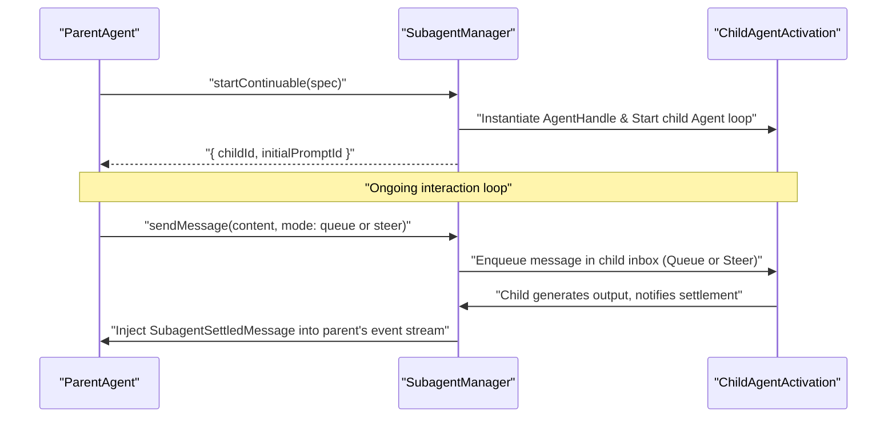

# Subagent Orchestration

<details>
<summary>Relevant source files</summary>

The following files were used as context for generating this wiki page:

- [.agents/notes/implemented/architecture/2026-09-09-awaited-agent-creation.i18n.yaml](.agents/notes/implemented/architecture/2026-09-09-awaited-agent-creation.i18n.yaml)
- [.agents/notes/implemented/architecture/2026-09-09-awaited-agent-creation.md](.agents/notes/implemented/architecture/2026-09-09-awaited-agent-creation.md)
- [.agents/notes/implemented/architecture/2026-09-09-awaited-agent-creation.zh.md](.agents/notes/implemented/architecture/2026-09-09-awaited-agent-creation.zh.md)
- [.agents/notes/implemented/bug-fix/2026-10-25-shared-preset-delegation-tools.i18n.yaml](.agents/notes/implemented/bug-fix/2026-10-25-shared-preset-delegation-tools.i18n.yaml)
- [.agents/notes/implemented/bug-fix/2026-10-25-shared-preset-delegation-tools.md](.agents/notes/implemented/bug-fix/2026-10-25-shared-preset-delegation-tools.md)
- [.agents/notes/implemented/bug-fix/2026-10-25-shared-preset-delegation-tools.zh.md](.agents/notes/implemented/bug-fix/2026-10-25-shared-preset-delegation-tools.zh.md)
- [.agents/notes/implemented/feature/2026-08-15-product-subagent-noninteractive-permissions.i18n.yaml](.agents/notes/implemented/feature/2026-08-15-product-subagent-noninteractive-permissions.i18n.yaml)
- [.agents/notes/implemented/feature/2026-08-15-product-subagent-noninteractive-permissions.md](.agents/notes/implemented/feature/2026-08-15-product-subagent-noninteractive-permissions.md)
- [.agents/notes/implemented/feature/2026-08-15-product-subagent-noninteractive-permissions.zh.md](.agents/notes/implemented/feature/2026-08-15-product-subagent-noninteractive-permissions.zh.md)
- [.agents/notes/implemented/feature/2026-08-24-user-authorized-subagent-model-routes.i18n.yaml](.agents/notes/implemented/feature/2026-08-24-user-authorized-subagent-model-routes.i18n.yaml)
- [.agents/notes/implemented/feature/2026-08-24-user-authorized-subagent-model-routes.md](.agents/notes/implemented/feature/2026-08-24-user-authorized-subagent-model-routes.md)
- [.agents/notes/implemented/feature/2026-08-24-user-authorized-subagent-model-routes.zh.md](.agents/notes/implemented/feature/2026-08-24-user-authorized-subagent-model-routes.zh.md)
- [apps/cli/tests/profiles/subagent-preset-switch.overlay.yml](apps/cli/tests/profiles/subagent-preset-switch.overlay.yml)
- [docs/subsystems/subagent.i18n.yaml](docs/subsystems/subagent.i18n.yaml)
- [docs/subsystems/subagent.md](docs/subsystems/subagent.md)
- [docs/subsystems/subagent.zh.md](docs/subsystems/subagent.zh.md)
- [packages/subagent/subagent-acp/README.i18n.yaml](packages/subagent/subagent-acp/README.i18n.yaml)
- [packages/subagent/subagent-acp/README.md](packages/subagent/subagent-acp/README.md)
- [packages/subagent/subagent-acp/README.zh.md](packages/subagent/subagent-acp/README.zh.md)
- [packages/subagent/subagent-acp/src/index.ts](packages/subagent/subagent-acp/src/index.ts)
- [packages/subagent/subagent-acp/src/run.ts](packages/subagent/subagent-acp/src/run.ts)
- [packages/subagent/subagent-acp/tests/mock-acp-server.ts](packages/subagent/subagent-acp/tests/mock-acp-server.ts)
- [packages/subagent/subagent-acp/tests/subagent-acp.spec.ts](packages/subagent/subagent-acp/tests/subagent-acp.spec.ts)
- [packages/subagent/subagent-claude-code/README.i18n.yaml](packages/subagent/subagent-claude-code/README.i18n.yaml)
- [packages/subagent/subagent-claude-code/README.md](packages/subagent/subagent-claude-code/README.md)
- [packages/subagent/subagent-claude-code/README.zh.md](packages/subagent/subagent-claude-code/README.zh.md)
- [packages/subagent/subagent-claude-code/src/index.ts](packages/subagent/subagent-claude-code/src/index.ts)
- [packages/subagent/subagent-claude-code/src/process.ts](packages/subagent/subagent-claude-code/src/process.ts)
- [packages/subagent/subagent-claude-code/src/run.ts](packages/subagent/subagent-claude-code/src/run.ts)
- [packages/subagent/subagent-claude-code/tests/messages-fixture.ts](packages/subagent/subagent-claude-code/tests/messages-fixture.ts)
- [packages/subagent/subagent-claude-code/tests/real-product.spec.ts](packages/subagent/subagent-claude-code/tests/real-product.spec.ts)
- [packages/subagent/subagent-claude-code/tests/subagent-claude-code.spec.ts](packages/subagent/subagent-claude-code/tests/subagent-claude-code.spec.ts)
- [packages/subagent/subagent-codex/README.i18n.yaml](packages/subagent/subagent-codex/README.i18n.yaml)
- [packages/subagent/subagent-codex/README.md](packages/subagent/subagent-codex/README.md)
- [packages/subagent/subagent-codex/README.zh.md](packages/subagent/subagent-codex/README.zh.md)
- [packages/subagent/subagent-codex/src/run.ts](packages/subagent/subagent-codex/src/run.ts)
- [packages/subagent/subagent-codex/src/wire.ts](packages/subagent/subagent-codex/src/wire.ts)
- [packages/subagent/subagent-codex/tests/real-deepseek.e2e.ts](packages/subagent/subagent-codex/tests/real-deepseek.e2e.ts)
- [packages/subagent/subagent-codex/tests/real-product.spec.ts](packages/subagent/subagent-codex/tests/real-product.spec.ts)
- [packages/subagent/subagent-codex/tests/responses-fixture.ts](packages/subagent/subagent-codex/tests/responses-fixture.ts)
- [packages/subagent/subagent-codex/tests/subagent-codex.spec.ts](packages/subagent/subagent-codex/tests/subagent-codex.spec.ts)
- [packages/subagent/subagent/README.i18n.yaml](packages/subagent/subagent/README.i18n.yaml)
- [packages/subagent/subagent/README.md](packages/subagent/subagent/README.md)
- [packages/subagent/subagent/README.zh.md](packages/subagent/subagent/README.zh.md)
- [packages/subagent/subagent/src/index.ts](packages/subagent/subagent/src/index.ts)
- [packages/subagent/subagent/src/out-of-process.ts](packages/subagent/subagent/src/out-of-process.ts)
- [packages/subagent/subagent/src/types.ts](packages/subagent/subagent/src/types.ts)
- [packages/subagent/subagent/tests/continuation.spec.ts](packages/subagent/subagent/tests/continuation.spec.ts)
- [packages/subagent/subagent/tests/run-settlement.spec.ts](packages/subagent/subagent/tests/run-settlement.spec.ts)
- [packages/subagent/subagent/tests/service.spec.ts](packages/subagent/subagent/tests/service.spec.ts)
- [packages/subagent/tool-subagent-control/README.i18n.yaml](packages/subagent/tool-subagent-control/README.i18n.yaml)
- [packages/subagent/tool-subagent-control/README.md](packages/subagent/tool-subagent-control/README.md)
- [packages/subagent/tool-subagent-control/README.zh.md](packages/subagent/tool-subagent-control/README.zh.md)
- [packages/subagent/tool-subagent-control/src/index.ts](packages/subagent/tool-subagent-control/src/index.ts)
- [packages/subagent/tool-subagent-control/src/list-agents.ts](packages/subagent/tool-subagent-control/src/list-agents.ts)
- [packages/subagent/tool-subagent-control/tests/list-agents.spec.ts](packages/subagent/tool-subagent-control/tests/list-agents.spec.ts)
- [packages/subagent/tool-subagent-control/tests/tool-subagent-control.spec.ts](packages/subagent/tool-subagent-control/tests/tool-subagent-control.spec.ts)
- [packages/subagent/tool-subagent/README.i18n.yaml](packages/subagent/tool-subagent/README.i18n.yaml)
- [packages/subagent/tool-subagent/README.md](packages/subagent/tool-subagent/README.md)
- [packages/subagent/tool-subagent/README.zh.md](packages/subagent/tool-subagent/README.zh.md)
- [packages/subagent/tool-subagent/package.json](packages/subagent/tool-subagent/package.json)
- [packages/subagent/tool-subagent/src/index.ts](packages/subagent/tool-subagent/src/index.ts)
- [packages/subagent/tool-subagent/src/list-models.ts](packages/subagent/tool-subagent/src/list-models.ts)
- [packages/subagent/tool-subagent/tests/list-models.spec.ts](packages/subagent/tool-subagent/tests/list-models.spec.ts)
- [packages/subagent/tool-subagent/tests/model-selection-settings.spec.ts](packages/subagent/tool-subagent/tests/model-selection-settings.spec.ts)
- [packages/subagent/tool-subagent/tests/preset-selection.spec.ts](packages/subagent/tool-subagent/tests/preset-selection.spec.ts)
- [packages/subagent/tool-subagent/tests/tool-subagent.spec.ts](packages/subagent/tool-subagent/tests/tool-subagent.spec.ts)
- [packages/test-support/session-snapshot/tests/fixtures/parent-agent-preset.ts](packages/test-support/session-snapshot/tests/fixtures/parent-agent-preset.ts)
- [snapshots/session/subagent-agent-preset/cordis.snapshot.yml](snapshots/session/subagent-agent-preset/cordis.snapshot.yml)
- [snapshots/session/subagent-agent-preset/cordis.yml](snapshots/session/subagent-agent-preset/cordis.yml)

</details>


## Purpose and Scope

Subagent orchestration in DeepSeek Harness (`dsh`) provides a dedicated capability seam that enables parent agents to delegate tasks to child agents. This system abstracts various child execution modes—whether one-shot or continuable—and supports multiple provider backends, including in-process and out-of-process drivers such as Agent Client Protocol (ACP), Codex, Claude Code, and the DSH SDK. The orchestration layer encompasses unified lifecycle management, capability validation, policy inheritance, and result reporting [packages/subagent/subagent/src/index.ts:1-62]().

Sources:
- [packages/subagent/subagent/src/index.ts:1-62]()

---

## Overview of the Subagent Seam

The core service for delegation is `SubagentRuntime` exposed as `ctx.subagents`, which acts as a registry for named subagent providers. Each provider implements a unique backend mechanism for creating and managing child agents, and the runtime routes requests according to the selected provider name [packages/subagent/subagent/src/index.ts:1-29]().

Two principal delegation modes exist:

| Mode | Lifecycle Characteristics | Ownership Model |
| --- | --- | --- |
| **One-shot** | The child agent runs a single session to completion, produces a final result, and is then disposed. | Ownership transfers fully to the caller via a returned `SubagentRun` object [packages/subagent/subagent/README.md:12](). |
| **Continuable** | The child agent session is durable, lives across multiple turns, and processes follow-up messages or interruptions. | Managed by `SubagentManager`, which maintains an in-process activation handle representing the child [packages/subagent/subagent/README.md:12](). |

Sources:
- [packages/subagent/subagent/src/index.ts:1-29]()
- [packages/subagent/subagent/README.md:10-22]()

---

## Architecture and Data Flow

The orchestration process bridges natural language level delegation (such as a model's tool invocation) and the underlying code entities and infrastructure that execute the child run.

### Diagram 1: Subagent Delegation Entry & Provider Routing

```mermaid
graph TD
    subgraph "NaturalLanguageSpace"
        A["ModelToolCall (prompt, description)"] -->|Calls tool-subagent tool| B["ToolDefinition: @deepseek-ai/dsh-tool-subagent"]
    end

    subgraph "CodeEntitySpace"
        B -->|ctx.subagents.start() or startContinuable()| C["SubagentRuntime (packages/subagent/subagent/src/index.ts)"]
        C -->|Delegation validation and routing| D["SubagentProvider Interface Implementations"]

        subgraph "Providers"
          D --> E["In-Process Providers"]
          D --> F["Out-of-Process Providers"]

          subgraph "In-Process"
            E1["SpawnProvider\n(packages/subagent/subagent-spawn-in-process)"]
            E2["ForkProvider\n(packages/subagent/subagent-fork-in-process)"]
          end

          subgraph "Out-of-Process"
            F1["AcpProvider\n(packages/subagent/subagent-acp)"]
            F2["ClaudeCodeProvider\n(packages/subagent/subagent-claude-code)"]
            F3["CodexProvider\n(packages/subagent/subagent-codex)"]
          end
        end

        F1 -->|spawns ACP subprocess & manages JSON-RPC protocol\n(packages/subagent/subagent-acp/src/run.ts)| G1["SubprocessHandle"]
        F2 -->|manages Anthropic Claude SDK process\n(packages/subagent/subagent-claude-code/src/run.ts)| G2["ManagedClaudeCodeProcess"]
        F3 -->|spawns codex app-server subprocess & wire protocol\n(packages/subagent/subagent-codex/src/run.ts)| G3["CodexAppServerWire"]

        E1 -->|local AgentLoop instance\n(packages/subagent/subagent-spawn-in-process)| H1["AgentLoop"]
        E2 -->|forked AgentLoop instance with inherited state\n(packages/subagent/subagent-fork-in-process)| H2["AgentLoop"]

        H1 --> I["SessionEvent Log"]
        H2 --> I
        G1 --> I
        G2 --> I
        G3 --> I
    end
```

Sources:
- [packages/subagent/tool-subagent/src/index.ts:1-23]()
- [packages/subagent/subagent/src/index.ts:1-62]()
- [packages/subagent/subagent-acp/src/run.ts:27-87]()
- [packages/subagent/subagent-claude-code/src/run.ts:39-52]()
- [packages/subagent/subagent-codex/src/run.ts:30-155]()

---

## Subagent Providers

Providers implement the `SubagentProvider` interface and register themselves under a unique symbolic name. The runtime consults provider capabilities and validates delegation requests to ensure requested features like `agentOptions`, `maxDepth`, or `toolFilter` are supported [packages/subagent/subagent/src/types.ts:1-60]().

### Types of Providers

#### 1. In-Process Providers
- **Spawn Provider**: Creates a fresh child agent running in the same Node.js process as the parent, instantiating a separate `AgentLoop` with isolated session and execution context [packages/subagent/subagent/tests/continuation.spec.ts:81-110]().
- **Fork Provider**: Creates a child agent that forks the parent's last completed turns into its context, allowing subagent lineage and state inheritance within the same process [packages/subagent/subagent/tests/continuation.spec.ts:81-110]().

#### 2. Out-of-Process Providers
- **Agent Client Protocol (ACP)**: A subprocess-based child agent that communicates using the ACP JSON-RPC protocol over stdio. It implements permission prompt auto-replies (`allow` or `reject`), graceful disposal with EOF, `SIGTERM`, and `SIGKILL` escalation, and maps ACP native stop reasons to harness stop reasons [packages/subagent/subagent-acp/src/run.ts:20-160](), [packages/subagent/subagent-acp/tests/subagent-acp.spec.ts:1-63]().
- **Claude Code**: Wraps the official Anthropic Claude SDK, managing a native managed process, permission modes, and lifecycle with disposal including protocol closure, process termination, and result settlement [packages/subagent/subagent-claude-code/src/run.ts:40-100]().
- **Codex**: Spawns an OpenAI Codex app-server subprocess, managing communication using the `CodexAppServerWire` protocol. Implements permission modes and error diagnostics mapping native Codex failures to subagent stop reasons with safe diagnostics [packages/subagent/subagent-codex/src/run.ts:30-203]().

### Provider Capabilities and Validation

Providers declare support for capabilities including:
- `depthLimit`: Enforces maximum delegation depth settable per child through `maxDepth`.
- `toolFilter`: Filters accessible tools for child agents by allow/deny lists.
- `persona`: Allows per-child persona shadowing different from parent.
- `agentOptions`: Allows overriding child agent's model selection, token limits, and reasoning parameters.

Requests containing options unsupported by the selected provider fail promptly to prevent silent errors [packages/subagent/subagent/src/types.ts:85-92](), [packages/subagent/tool-subagent/src/index.ts:67-72]().

Sources:
- [packages/subagent/subagent/src/types.ts:1-92]()
- [packages/subagent/subagent/tests/continuation.spec.ts:81-110]()
- [packages/subagent/subagent-acp/src/run.ts:20-160]()
- [packages/subagent/subagent-acp/tests/subagent-acp.spec.ts:1-63]()
- [packages/subagent/subagent-claude-code/src/run.ts:40-100]()
- [packages/subagent/subagent-codex/src/run.ts:30-203]()
- [packages/subagent/tool-subagent/src/index.ts:67-72]()

---

## Continuable Subagents

Continuable subagents maintain persistent child sessions that accept multiple messages and interruptions across turns, enabling sophisticated parent-child workflows [packages/subagent/subagent/README.md:59-66]().

### The Continuation Manager

The `SubagentManager` oversees continuable children with these key concepts:
- **Activation**: An in-process data structure holding the child's `AgentHandle` and managing an inbox that sequentially processes parent-to-child messages [packages/subagent/subagent/src/index.ts:14-26]().
- **Cold Resume**: If a direct continuable child is not currently resident in process, the manager loads and reconstructs the child's state from persisted session logs, then activates its `AgentHandle` [packages/subagent/subagent/README.md:61]().
- **Messaging and Interruption**: The parent calls `sendMessage()` to queue or steer messages directly at the child. Interruptions are supported, and settlement notifications from the child flow back into the parent's session log via injected events [packages/subagent/subagent/README.md:63-66]().

### Diagram 2: Continuable Subagent Message Flow & Lifecycle



Sources:
- [packages/subagent/subagent/README.md:59-66]()
- [packages/subagent/subagent/src/index.ts:14-26]()

---

## Policy Inheritance and Depth Control

To manage recursive delegation safely and enforce policy, subagents inherit and compose delegation policies from their parents [packages/subagent/subagent/src/depth.ts:1-38]().

### Delegation Depth Control

Delegation depth limits prevent runaway recursive agent invocation. The function `assertSubagentMaxDepth()` validates that the child's delegation depth does not exceed configured limits, throwing a `SubagentDepthError` on violation [packages/subagent/subagent/src/depth.ts:1-38](). Depth `0` means delegation through tools inheriting this setting is disabled [packages/subagent/subagent/README.md:49]().

### Policy Composition and Child Overrides

Policy composition occurs during child creation, merging:
- Parent's delegation policy and session metadata [packages/subagent/subagent/README.md:28]().
- Child-specific overrides such as tool filtering (whitelists or blacklists) or persona shadowing [packages/subagent/tool-subagent/src/index.ts:67-80]().
- Adjusted `maxDepth` and runtime options [packages/subagent/tool-subagent/src/index.ts:81-92]().

This is handled by `applyChildComposition()` and related utilities that produce the child's effective session metadata and delegation filters before child startup [packages/subagent/subagent/src/child-agent.ts:115-124]().

Sources:
- [packages/subagent/subagent/src/depth.ts:1-38]()
- [packages/subagent/subagent/README.md:28-49]()
- [packages/subagent/tool-subagent/src/index.ts:67-92]()
- [packages/subagent/subagent/src/child-agent.ts:115-124]()

---

## Implementation Details

### SubagentRuntime Service

`SubagentRuntime` is the core service exposing subagent orchestration APIs as `ctx.subagents` [packages/subagent/subagent/src/index.ts:131-134](). It provides:

| Method | Description |
| --- | --- |
| `start(request: SubagentStartRequest)` | Starts a one-shot child run; returns a `SubagentRun` that manages lifecycle and produces the final result asynchronously [packages/subagent/subagent/src/index.ts:14-20](). |
| `startContinuable(spec: ContinuableCreateRequest)` | Starts a durable continuable child session that persists across turns, returning child identifiers and controlling lifecycle [packages/subagent/subagent/src/index.ts:55-66](). |
| `sendMessage(options: SubagentSendMessageOptions)` | Sends a message or interrupt to a direct continuable child, utilizing a local Activation or routing via the runtime [packages/subagent/subagent/src/index.ts:64](). |
| `listChildren(parentId: SessionId)` | Enumerates direct child agents of a given parent session without needing to load or resume the child [packages/subagent/subagent/README.md:65](). |

### SubagentRun Interface

One-shot runs expose these key properties:
- `runId`: Unique string identifier for the subagent run session [packages/subagent/subagent/src/types.ts:62-63]().
- `result`: A Promise resolving to `SubagentResult` containing output content blocks, stop reason, and optional diagnostic strings [packages/subagent/subagent/src/types.ts:62-98]().
- `dispose()`: Release resources asynchronously with provider-specific logic (e.g., subprocess termination, protocol closure) [packages/subagent/subagent/README.md:69]().

Providers implement `dispose()` hooks such as:
- `disposeCodexChild(wire, childHandle)`: cleans up Codex app server subprocess and closes protocol [packages/subagent/subagent-codex/src/run.ts:190-203]().
- `disposeClaudeCodeChild(managedProcess)`: cleans up Claude Code child process and resources [packages/subagent/subagent-claude-code/src/run.ts:47-60]().
- `disposeAcpChild(childHandle)`: handles graceful and forced termination of ACP subprocesses with signal escalation and EOF grace periods [packages/subagent/subagent-acp/src/run.ts:18-66]().

### Stop Reason Mapping

Each product provider translates its native stop reasons to the harness-wide `SubagentStopReason` union:
- `completed`: Child finished successfully [packages/subagent/subagent/src/types.ts:97]().
- `aborted`: Child run was cancelled [packages/subagent/subagent/src/types.ts:97]().
- `error`: Child failed with an error [packages/subagent/subagent/src/types.ts:97]().
- `max-tokens`: Stopped due to output token limit [packages/subagent/subagent/src/types.ts:97]().
- `refusal`: Child refused to perform the task [packages/subagent/subagent/src/types.ts:97]().

Sources:
- [packages/subagent/subagent/src/index.ts:14-66]()
- [packages/subagent/subagent/src/types.ts:62-98]()
- [packages/subagent/subagent/README.md:65-69]()
- [packages/subagent/subagent-codex/src/run.ts:190-203]()
- [packages/subagent/subagent-claude-code/src/run.ts:47-60]()
- [packages/subagent/subagent-acp/src/run.ts:18-66]()