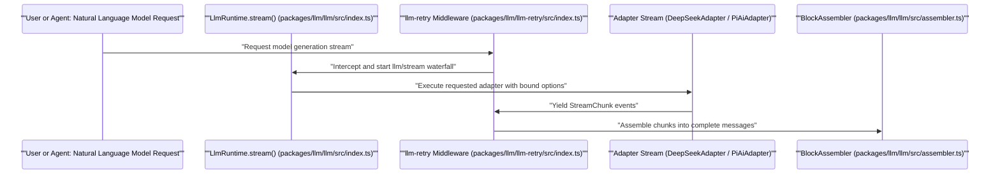

# LLM Adapters & Streaming

<details>
<summary>Relevant source files</summary>

The following files were used as context for generating this wiki page:

- [.agents/notes/implemented/feature/2026-10-22-listed-model-badges.i18n.yaml](.agents/notes/implemented/feature/2026-10-22-listed-model-badges.i18n.yaml)
- [.agents/notes/implemented/feature/2026-10-22-listed-model-badges.md](.agents/notes/implemented/feature/2026-10-22-listed-model-badges.md)
- [.agents/notes/implemented/feature/2026-10-22-listed-model-badges.zh.md](.agents/notes/implemented/feature/2026-10-22-listed-model-badges.zh.md)
- [apps/cli/tests/profiles/acp/tests/stdout.expected.e2e.ts](apps/cli/tests/profiles/acp/tests/stdout.expected.e2e.ts)
- [apps/web/tests/model-badge.e2e.ts](apps/web/tests/model-badge.e2e.ts)
- [docs/subsystems/llm-streaming.i18n.yaml](docs/subsystems/llm-streaming.i18n.yaml)
- [docs/subsystems/llm-streaming.md](docs/subsystems/llm-streaming.md)
- [docs/subsystems/llm-streaming.zh.md](docs/subsystems/llm-streaming.zh.md)
- [docs/upgrade-guide/v0.2.1-rc.4/model-listing-refresh/guide.i18n.yaml](docs/upgrade-guide/v0.2.1-rc.4/model-listing-refresh/guide.i18n.yaml)
- [docs/upgrade-guide/v0.2.1-rc.4/model-listing-refresh/guide.md](docs/upgrade-guide/v0.2.1-rc.4/model-listing-refresh/guide.md)
- [docs/upgrade-guide/v0.2.1-rc.4/model-listing-refresh/guide.zh.md](docs/upgrade-guide/v0.2.1-rc.4/model-listing-refresh/guide.zh.md)
- [packages/llm/llm-deepseek-account/README.i18n.yaml](packages/llm/llm-deepseek-account/README.i18n.yaml)
- [packages/llm/llm-deepseek-account/README.md](packages/llm/llm-deepseek-account/README.md)
- [packages/llm/llm-deepseek-account/README.zh.md](packages/llm/llm-deepseek-account/README.zh.md)
- [packages/llm/llm-deepseek-account/package.json](packages/llm/llm-deepseek-account/package.json)
- [packages/llm/llm-deepseek-account/src/config.ts](packages/llm/llm-deepseek-account/src/config.ts)
- [packages/llm/llm-deepseek-account/src/index.ts](packages/llm/llm-deepseek-account/src/index.ts)
- [packages/llm/llm-deepseek-account/tests/config.spec.ts](packages/llm/llm-deepseek-account/tests/config.spec.ts)
- [packages/llm/llm-deepseek-account/tests/provider.spec.ts](packages/llm/llm-deepseek-account/tests/provider.spec.ts)
- [packages/llm/llm-deepseek-account/tsconfig.json](packages/llm/llm-deepseek-account/tsconfig.json)
- [packages/llm/llm-deepseek-api-key/README.i18n.yaml](packages/llm/llm-deepseek-api-key/README.i18n.yaml)
- [packages/llm/llm-deepseek-api-key/README.md](packages/llm/llm-deepseek-api-key/README.md)
- [packages/llm/llm-deepseek-api-key/README.zh.md](packages/llm/llm-deepseek-api-key/README.zh.md)
- [packages/llm/llm-deepseek-api-key/package.json](packages/llm/llm-deepseek-api-key/package.json)
- [packages/llm/llm-deepseek-api-key/src/index.ts](packages/llm/llm-deepseek-api-key/src/index.ts)
- [packages/llm/llm-deepseek-api-key/tests/listing.spec.ts](packages/llm/llm-deepseek-api-key/tests/listing.spec.ts)
- [packages/llm/llm-deepseek/README.i18n.yaml](packages/llm/llm-deepseek/README.i18n.yaml)
- [packages/llm/llm-deepseek/README.md](packages/llm/llm-deepseek/README.md)
- [packages/llm/llm-deepseek/README.zh.md](packages/llm/llm-deepseek/README.zh.md)
- [packages/llm/llm-deepseek/src/adapter.ts](packages/llm/llm-deepseek/src/adapter.ts)
- [packages/llm/llm-deepseek/src/index.ts](packages/llm/llm-deepseek/src/index.ts)
- [packages/llm/llm-deepseek/src/listed-catalog.ts](packages/llm/llm-deepseek/src/listed-catalog.ts)
- [packages/llm/llm-deepseek/src/listing-cache.ts](packages/llm/llm-deepseek/src/listing-cache.ts)
- [packages/llm/llm-deepseek/src/listing.ts](packages/llm/llm-deepseek/src/listing.ts)
- [packages/llm/llm-deepseek/tests/adapter.spec.ts](packages/llm/llm-deepseek/tests/adapter.spec.ts)
- [packages/llm/llm-deepseek/tests/dynamic-config.spec.ts](packages/llm/llm-deepseek/tests/dynamic-config.spec.ts)
- [packages/llm/llm-deepseek/tests/listed-catalog.spec.ts](packages/llm/llm-deepseek/tests/listed-catalog.spec.ts)
- [packages/llm/llm-deepseek/tests/listing-cache.spec.ts](packages/llm/llm-deepseek/tests/listing-cache.spec.ts)
- [packages/llm/llm-deepseek/tests/listing.spec.ts](packages/llm/llm-deepseek/tests/listing.spec.ts)
- [packages/llm/llm-deepseek/tests/loader-composition.spec.ts](packages/llm/llm-deepseek/tests/loader-composition.spec.ts)
- [packages/llm/llm-deepseek/tests/official-route-turn.spec.ts](packages/llm/llm-deepseek/tests/official-route-turn.spec.ts)
- [packages/llm/llm-pi-ai/README.i18n.yaml](packages/llm/llm-pi-ai/README.i18n.yaml)
- [packages/llm/llm-pi-ai/README.md](packages/llm/llm-pi-ai/README.md)
- [packages/llm/llm-pi-ai/README.zh.md](packages/llm/llm-pi-ai/README.zh.md)
- [packages/llm/llm-pi-ai/src/adapter.ts](packages/llm/llm-pi-ai/src/adapter.ts)
- [packages/llm/llm-pi-ai/src/catalog.ts](packages/llm/llm-pi-ai/src/catalog.ts)
- [packages/llm/llm-pi-ai/src/config.ts](packages/llm/llm-pi-ai/src/config.ts)
- [packages/llm/llm-pi-ai/src/index.ts](packages/llm/llm-pi-ai/src/index.ts)
- [packages/llm/llm-pi-ai/tests/adapter.spec.ts](packages/llm/llm-pi-ai/tests/adapter.spec.ts)
- [packages/llm/llm-pi-ai/tests/catalog.spec.ts](packages/llm/llm-pi-ai/tests/catalog.spec.ts)
- [packages/llm/llm-pi-ai/tests/dynamic-config.spec.ts](packages/llm/llm-pi-ai/tests/dynamic-config.spec.ts)
- [packages/llm/llm/README.i18n.yaml](packages/llm/llm/README.i18n.yaml)
- [packages/llm/llm/README.md](packages/llm/llm/README.md)
- [packages/llm/llm/README.zh.md](packages/llm/llm/README.zh.md)
- [packages/llm/llm/src/index.ts](packages/llm/llm/src/index.ts)
- [packages/llm/llm/src/types.ts](packages/llm/llm/src/types.ts)
- [packages/llm/llm/tests/service.spec.ts](packages/llm/llm/tests/service.spec.ts)

</details>


## Purpose and Scope

This page provides a deep technical overview of the Large Language Model (LLM) subsystem in DeepSeek Harness (DSH). It covers the `LlmRuntime` service seam, adapter registration mechanics, the streaming protocol for model output, retry policies for robust request handling, token metering, and the detailed implementations of the two primary adapter plugins: DeepSeek’s official adapter (`@deepseek-ai/dsh-llm-deepseek`) and the multi-provider Pi.ai adapter (`@deepseek-ai/dsh-llm-pi-ai`).

This is a leaf page with no children, focused on explaining the full data flow, key classes/functions, protocol semantics, and configuration details.

Sources:  
[packages/llm/llm/src/index.ts:1-87](),  
[packages/llm/llm-deepseek/README.md:10-83](),  
[packages/llm/llm-pi-ai/README.md:10-102]()

---

## LlmRuntime & Adapter Registration

The `LlmRuntime` is the core LLM service seam registered into the Cordis plugin framework that acts as the centralized registry for model provider adapters and the orchestrator of LLM calls [packages/llm/llm/src/index.ts:40-100]().

### Key Concepts

- **LlmRuntime Service:**  
  Exposes the main interface for streaming model requests and manages provider adapters. It allows registering adapters to named provider routes, resolving and validating model metadata, executing streams with retry policies, and listing configurable provider routes [packages/llm/llm/src/index.ts:167-178]().

- **Adapter Registration:**  
  Adapters implementing the `LlmAdapter` abstract class are mounted for specific route identifiers (e.g., `deepseek-official`, `pi-ai`), guaranteeing exclusive ownership. Registration captures the provider’s retry policy for the runtime to apply during execution [packages/llm/llm/src/index.ts:167-178]().

- **Prepare Call:**  
  The `prepareCall(config, signal, configure?)` method pre-resolves the exact model info, the retry policy, and the bound adapter stream execution function, forming an immutable executable representation of the request context [packages/llm/llm/src/index.ts:63-64]().

- **Stream:**  
  The main runtime entry point is a streaming invocation returning an asynchronous iterable of `StreamChunk`s representing incremental tokens, reasoning, tool calls, usage, and finish events [packages/llm/llm/src/index.ts:71-78]().

### Diagram: Adapter Registration Flow Between Natural Language and Code Entities

Title: "Adapter Registration Flow"
```mermaid
graph TD
    subgraph "NaturalLanguageSpace"
        Config[""Provider Configuration (YAML / GUI)""]
        AdapterImpl[""LLM Adapter Implementation""]
    end

    subgraph "CodeEntitySpace"
        LRT[""LlmRuntime Service (packages/llm/llm/src/index.ts)""]
        ARH[""AdapterRegistrationHandle""]
        PAA[""PiAiAdapter Class (packages/llm/llm-pi-ai/src/adapter.ts)""]
        DSA[""DeepSeekAdapter Class (packages/llm/llm-deepseek/src/adapter.ts)""]
        ProfileResolver[""resolveProfiles() / resolveAdapterOptions()""]
    end

    Config -->|"Parses & resolves"| ProfileResolver
    ProfileResolver -->|"Instantiates"| PAA
    ProfileResolver -->|"Instantiates"| DSA
    PAA -->|"registerAdapter()"| LRT
    DSA -->|"registerAdapter()"| LRT
    LRT --> ARH
    ARH -.->|"Disposed on fiber exit"| FiberDispose[""Fiber Disposal""]
```

Sources:  
[packages/llm/llm/src/index.ts:167-178](),  
[packages/llm/llm-pi-ai/src/adapter.ts:84-115](),  
[packages/llm/llm-deepseek/src/adapter.ts:20-46]()

---

## Streaming Protocol & Chunk Assembly

Streaming completions from all adapters flow over a common protocol: an async iterable yielding fine-grained, *normalized* `StreamChunk` objects which represent fragments of a message or control signals. This protocol abstracts away provider-specific wire formats.

### StreamChunk Types

- **block-start / block-end:** Mark boundaries of logical content blocks (e.g., text blocks, reasoning steps, tool calls) [packages/llm/llm/src/types.ts:110-120]().
- **text-delta:** Contains incremental text fragment data from the model’s output [packages/llm/llm/src/types.ts:122-126]().
- **reasoning-delta:** Represents incremental internal reasoning text emitted by the model [packages/llm/llm/src/types.ts:128-132]().
- **usage:** Reports token usage metrics including input tokens, output tokens, total tokens [packages/llm/llm/src/types.ts:152-162]().
- **finish:** Denotes stream termination with success (`stop`), length cutoffs (`length`), content filter triggers, or errors (`error`, `aborted`) [packages/llm/llm/src/types.ts:164-184]().

### BlockAssembler

The raw `StreamChunk`s are processed by the `BlockAssembler` class to reconstruct full `Message` objects reflecting complete assistant/user/system turns. It maintains a state machine across chunk iteration and properly sequences block boundaries, handling potentially interleaved block types [packages/llm/llm/src/assembler.ts:49-65]().

### Diagram: Streaming Execution Flow with Retry Integration

Title: "Streaming Execution Flow"


Sources:  
[packages/llm/llm/src/index.ts:71-78](),  
[packages/llm/llm/src/assembler.ts:49-65]()

---

## Implementation: DeepSeek Adapter

The `DeepSeekAdapter` provides direct integration with DeepSeek’s official API route `deepseek-official` [packages/llm/llm-deepseek/src/adapter.ts:20-28](). It is implemented in the package `@deepseek-ai/dsh-llm-deepseek` and typically configured with an API key environment variable.

### Key Features

- Uses **HTTP fetch** calls to the DeepSeek Messages endpoint (`/v1/messages`) and Files API (`/v1/files`) for attachments and uploads [packages/llm/llm-deepseek/README.md:79-83]().
- Implements streaming via Server-Sent Events (SSE) using a custom SSE parser to handle incremental message chunks [packages/llm/llm-deepseek/src/adapter.ts:15-16]().
- Supports rich data types such as text segments, reasoning blocks, tool calls and results, and image inputs via `DeepSeekFileStore` file upload offloading with fallback to inline base64 encoding [packages/llm/llm-deepseek/README.md:92-100]().
- Injects request metadata headers such as `userAgent()`, session identifiers, and timeout watchdogs (`idleWatchdog`) for robustness [packages/llm/llm-deepseek/src/adapter.ts:51-68]().

Sources:  
[packages/llm/llm-deepseek/README.md:12-83](),  
[packages/llm/llm-deepseek/src/adapter.ts:20-75](),  
[packages/llm/llm-deepseek/tests/adapter.spec.ts:66-133]()

---

## Implementation: Pi.ai Adapter

The `PiAiAdapter` integrates multiple LLM providers and OpenAI-compatible gateways under one roof via the `pi-ai` library, enabling routing, catalog merging, and unified streaming [packages/llm/llm-pi-ai/README.md:12-28]().

### Key Features

- Supports multiple provider routes configured dynamically, each with its own endpoint, models, and credentials [packages/llm/llm-pi-ai/README.md:12-102]().
- Resolves provider profiles and credentials on each request, supporting OAuth and interactive key sign-in flows [packages/llm/llm-pi-ai/README.md:90-110]().
- Maps reasoning effort levels (`off`, `low`, `high`, `max`) to provider-specific wire spellings [packages/llm/llm-pi-ai/src/config.ts:38-40]().
- Includes dynamic model catalog discovery and normalization, supporting built-in and hand-declared models together [packages/llm/llm-pi-ai/src/index.ts:70-90]().

### Diagram: Mapping Natural Language Provider Routing to Code Entities

Title: "Pi.ai Provider Routing Flow"
```mermaid
graph TD
    subgraph "NaturalLanguageSpace"
        Config[""Profile Providers Config (YAML/GUI)""]
        CredentialStore[""Credentials (OAuth, API Keys)""]
        ModelRequests[""User / Agent Model Call Requests""]
    end

    subgraph "CodeEntitySpace"
        Resolution[""Profile Resolver (resolveProfiles in src/config.ts)""]
        AuthResolver[""Credential Resolver (resolveApiKey in PiAiAdapter)""]
        PiAiAdpt[""PiAiAdapter Class (packages/llm/llm-pi-ai/src/adapter.ts)""]
        PiAiLibrary[""pi-ai Provider Library""]
        LlmRt[""LlmRuntime (packages/llm/llm/src/index.ts)""]
    end

    Config --> Resolution
    CredentialStore --> AuthResolver
    ModelRequests --> LlmRt
    LlmRt --> PiAiAdpt
    PiAiAdpt --> AuthResolver
    PiAiAdpt --> PiAiLibrary
    PiAiLibrary --> PiAiAdpt
```

Sources:  
[packages/llm/llm-pi-ai/README.md:12-102](),  
[packages/llm/llm-pi-ai/src/adapter.ts:84-145](),  
[packages/llm/llm-pi-ai/tests/adapter.spec.ts:70-130]()

---

## Retry Policies & Error Handling

The LLM subsystem implements robust retry capabilities structured in two layers:

1. **Provider-Level Retry Policy:** Each adapter declares a `RetryPolicy` in its provider info, capturing its own recommended retry modes, delay patterns, and max retries [packages/llm/llm/src/retry-policy.ts:39-55]().
2. **Retry Middleware:** Implemented as a Cordis waterfall extension on the `llm/stream` event, wrapping the `stream` call, intercepting failures, and retrying according to the resolved policy [packages/llm/llm/src/index.ts:62-78]().

### Error Normalization

Adapters normalize HTTP or protocol-specific errors into stable `LlmError` codes [packages/llm/llm/src/index.ts:96-131]():

| Error Code | Meaning | Source |
|---|---|---|
| `INVALID_CREDENTIAL` | Malformed API key or invalid credential format | [packages/llm/llm/src/error.ts:32-40]() |
| `MISSING_CREDENTIAL` | No API key found for the route | [packages/llm/llm/src/index.ts:151-160]() |
| `RATE_LIMIT` | Provider responded HTTP 429 | [packages/llm/llm/src/types.ts:197-200]() |
| `CONTEXT_WINDOW_EXCEEDED` | Request token count exceeds model limit | [packages/llm/llm/src/types.ts:198-202]() |

Sources:  
[packages/llm/llm/src/index.ts:80-131](),  
[packages/llm/llm/src/types.ts:194-205]()

---

## Token Metering and Request Limits

Both adapters enforce configurable caps on output tokens (`maxTokens`), image payload byte sizes and counts, request timeout limits (`streamIdleTimeoutMs`), and file upload expiry & quota cleanup for images uploaded to file endpoints. Usage statistics are tracked in `usage` chunks for accounting and operational telemetry [packages/llm/llm/src/types.ts:152-162]().

Sources:  
[packages/llm/llm/src/types.ts:152-162](),  
[packages/llm/llm-deepseek/README.md:54-74](),  
[packages/llm/llm-pi-ai/README.md:75-90]()

---

# Summary

- `LlmRuntime` is the core seam that registers and dispatches among multiple adapters, offers a unified streaming interface via `StreamChunk`, and enforces retry policies.
- The DeepSeek Adapter provides direct integration with the DeepSeek official API, including rich image input support and a custom SSE streaming protocol.
- The Pi.ai Adapter multiplexes multiple providers under the pi-ai ecosystem, supports dynamic routing and catalogs, and interfaces with OAuth and API key credentials.
- Retry policies are configured on registration and executed via middleware to allow transparent robust recovery.
- The streaming protocol normalizes all output into incremental `StreamChunk` events assembled by `BlockAssembler` into fully typed messages.