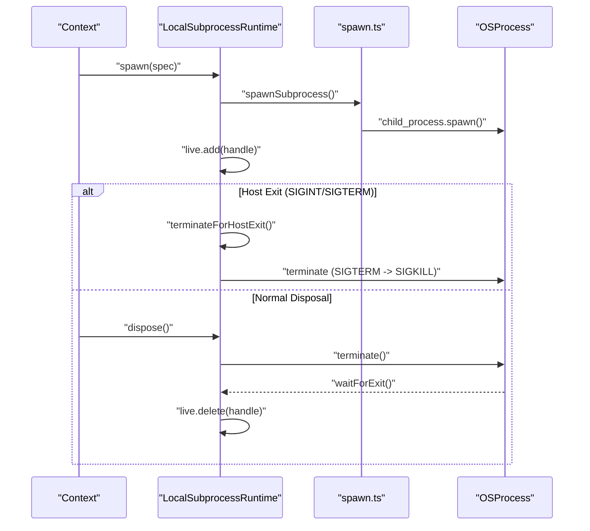
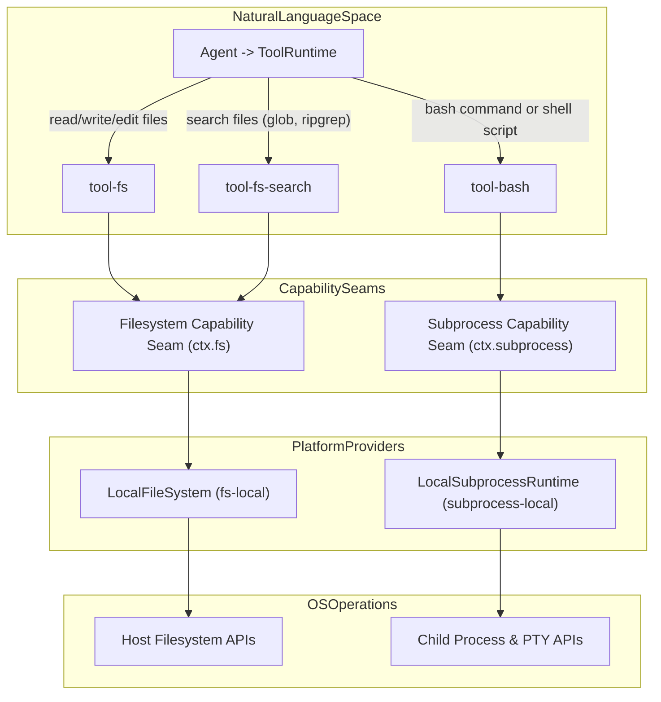
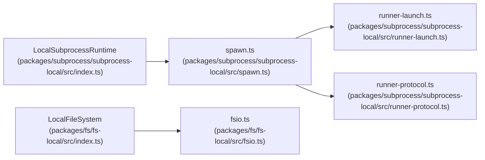

# Execution Environment

Relevant source files

The following files were used as context for generating this wiki page:

- [packages/fs/fs-local/README.i18n.yaml](packages/fs/fs-local/README.i18n.yaml)
- [packages/fs/fs-local/README.md](packages/fs/fs-local/README.md)
- [packages/fs/fs-local/README.zh.md](packages/fs/fs-local/README.zh.md)
- [packages/fs/fs-local/src/fsio.ts](packages/fs/fs-local/src/fsio.ts)
- [packages/fs/fs-local/src/index.ts](packages/fs/fs-local/src/index.ts)
- [packages/fs/fs-local/tests/filesystem.spec.ts](packages/fs/fs-local/tests/filesystem.spec.ts)
- [packages/fs/fs-local/tests/fsio.spec.ts](packages/fs/fs-local/tests/fsio.spec.ts)
- [packages/fs/fs/README.i18n.yaml](packages/fs/fs/README.i18n.yaml)
- [packages/fs/fs/README.md](packages/fs/fs/README.md)
- [packages/fs/fs/README.zh.md](packages/fs/fs/README.zh.md)
- [packages/fs/fs/src/index.ts](packages/fs/fs/src/index.ts)
- [packages/fs/fs/src/types.ts](packages/fs/fs/src/types.ts)
- [packages/fs/fs/tests/service.spec.ts](packages/fs/fs/tests/service.spec.ts)
- [packages/subprocess/subprocess-local/README.i18n.yaml](packages/subprocess/subprocess-local/README.i18n.yaml)
- [packages/subprocess/subprocess-local/README.md](packages/subprocess/subprocess-local/README.md)
- [packages/subprocess/subprocess-local/README.zh.md](packages/subprocess/subprocess-local/README.zh.md)
- [packages/subprocess/subprocess-local/src/index.ts](packages/subprocess/subprocess-local/src/index.ts)
- [packages/subprocess/subprocess-local/src/linux-scope.ts](packages/subprocess/subprocess-local/src/linux-scope.ts)
- [packages/subprocess/subprocess-local/src/managed-owner.ts](packages/subprocess/subprocess-local/src/managed-owner.ts)
- [packages/subprocess/subprocess-local/src/runner-launch.ts](packages/subprocess/subprocess-local/src/runner-launch.ts)
- [packages/subprocess/subprocess-local/src/spawn-runner.ts](packages/subprocess/subprocess-local/src/spawn-runner.ts)
- [packages/subprocess/subprocess-local/src/spawn.ts](packages/subprocess/subprocess-local/src/spawn.ts)
- [packages/subprocess/subprocess-local/src/windows-job.ts](packages/subprocess/subprocess-local/src/windows-job.ts)
- [packages/subprocess/subprocess-local/tests/linux-scope.spec.ts](packages/subprocess/subprocess-local/tests/linux-scope.spec.ts)
- [packages/subprocess/subprocess-local/tests/local.spec.ts](packages/subprocess/subprocess-local/tests/local.spec.ts)
- [packages/subprocess/subprocess-local/tests/native-containment.spec.ts](packages/subprocess/subprocess-local/tests/native-containment.spec.ts)
- [packages/subprocess/subprocess-local/tests/native-windows.spec.ts](packages/subprocess/subprocess-local/tests/native-windows.spec.ts)
- [packages/subprocess/subprocess-local/tests/spawn-runner.spec.ts](packages/subprocess/subprocess-local/tests/spawn-runner.spec.ts)
- [packages/subprocess/subprocess-local/tests/spawn.spec.ts](packages/subprocess/subprocess-local/tests/spawn.spec.ts)
- [packages/subprocess/subprocess-local/tests/windows-job.spec.ts](packages/subprocess/subprocess-local/tests/windows-job.spec.ts)
- [packages/subprocess/win32-process/README.i18n.yaml](packages/subprocess/win32-process/README.i18n.yaml)
- [packages/subprocess/win32-process/README.md](packages/subprocess/win32-process/README.md)
- [packages/subprocess/win32-process/README.zh.md](packages/subprocess/win32-process/README.zh.md)
- [packages/subprocess/win32-process/src/abi.ts](packages/subprocess/win32-process/src/abi.ts)
- [packages/subprocess/win32-process/src/ffi.ts](packages/subprocess/win32-process/src/ffi.ts)
- [packages/subprocess/win32-process/src/index.ts](packages/subprocess/win32-process/src/index.ts)
- [packages/subprocess/win32-process/src/process.ts](packages/subprocess/win32-process/src/process.ts)
- [packages/subprocess/win32-process/tests/ordinary-process.spec.ts](packages/subprocess/win32-process/tests/ordinary-process.spec.ts)
- [packages/subprocess/win32-process/verify/abi-probe.cpp](packages/subprocess/win32-process/verify/abi-probe.cpp)

The **Execution Environment** in `dsh` manages how the system interacts with the host filesystem, spawns native processes, applies security policies, and distributes native platform binaries or remote execution targets. It is built on the **Capability Seam** pattern, where high-level tools and agents interact with abstract interfaces (`ctx.fs`, `ctx.subprocess`, `ctx.sandbox`, `ctx.ssh`) that are fulfilled by specific provider plugins (e.g., `LocalFileSystem`, `LocalSubprocessRuntime`) [packages/fs/fs-local/src/fsio.ts:2-5]().

This is a parent overview page. For granular details on specific sub-topics, see the child pages:
- [Filesystem Tools & Observation](#4.1)
- [Shell, Subprocess & Terminal](#4.2)
- [Sandboxing & Security](#4.3)
- [Native System Packages & Platform Binaries](#4.4)
- [SSH & Remote Execution Backends](#4.5)

---

## 4.1 Filesystem Tools & Observation

The filesystem layer offers a unified interface for file operations focusing on safety, atomicity, and observation tracking. Writes use a "write-then-rename" pattern inside private sibling directories, preventing partial file corruption and ensuring consistency by atomic replacement [packages/fs/fs-local/src/fsio.ts:2-5](). Files are resolved to realpath-based target keys so symlinks share a single backing store state [packages/fs/fs-local/src/fsio.ts:106-111](). 

For granular details on the filesystem capability seam (`ctx.fs`), local provider implementations, file search tools (`tool-fs-search`), observation policies, and the string-replace editor, see the dedicated child page [Filesystem Tools & Observation](#4.1).

Sources: [packages/fs/fs-local/src/fsio.ts:1-152]()

---

## 4.2 Shell, Subprocess & Terminal

The `dsh` subprocess layer manages detached and well-contained OS process trees, ensuring descendant processes do not outlive their parent handles. It relies on POSIX process groups and Windows Job objects (`spawnCurrentTokenJobProcess`) to maintain containment [packages/subprocess/subprocess-local/src/spawn.ts:2-6](), [packages/subprocess/subprocess-local/tests/spawn-runner.spec.ts:97-101](). The local subprocess runtime (`LocalSubprocessRuntime`) supports spawning ordinary child processes with flexible stdio dispositions, bounded output collection via `OutputCollector`, and complex process lifecycle management including signal delivery ordering [packages/subprocess/subprocess-local/src/index.ts:64-100](), [packages/subprocess/subprocess-local/src/spawn.ts:126-143]().

For a deep dive into spawning, job object support, persistent PTY sessions, terminal tool support, and cloud sandbox backends, see [Shell, Subprocess & Terminal](#4.2).

Sources: [packages/subprocess/subprocess-local/src/index.ts:37-156](), [packages/subprocess/subprocess-local/src/spawn.ts:1-160](), [packages/subprocess/subprocess-local/tests/spawn-runner.spec.ts:97-101]()

---

## 4.3 Sandboxing & Security

The execution environment enforces isolation and security boundaries by sandboxing subprocess execution. On Linux, Landlock-based restrictions are implemented via native bindings (`probeLinuxNative`, `launchLinuxScope`) to confine filesystem access and capabilities [packages/subprocess/subprocess-local/src/linux-scope.ts:158-164](). On Windows, sandboxing uses restricted security tokens and DACL modifiers for access control list enforcement. High-risk filesystem mutations and external subprocesses are gated by user approval flows.

For detailed coverage of sandbox policy construction, Landlock rule configuration, Windows ACL handling, and approval seam integration, see [Sandboxing & Security](#4.3).

Sources: [packages/subprocess/subprocess-local/src/linux-scope.ts:158-164](), [packages/subprocess/subprocess-local/src/spawn.ts:43-53]()

---

## 4.4 Native System Packages & Platform Binaries

Native system packages and platform binaries live in the `native/` sub-workspace and include platform-specific launcher executables, native addons like `flock`, and prebuilt packages targeting combinations of `linux` and `darwin` on `x64` and `arm64` architectures. These components enforce CLI contracts and packager scripts to build, release, and publish platform-specific binaries, alongside native-command and directory pickers.

See [Native System Packages & Platform Binaries](#4.4) for full exposition on launcher binaries, prebuild package management, and release automation.

Sources: [packages/subprocess/subprocess-local/README.md:10-57]()

---

## 4.5 SSH & Remote Execution Backends

The `packages/ssh` family provides remote execution capabilities by wiring remote providers into the standard capability seams. It includes the ssh service, helper runtime, `fs-ssh`, `subprocess-ssh`, and `sandbox-ssh` providers that allow `ctx.fs`, `ctx.subprocess`, and `ctx.sandbox` to transparently target a remote host, alongside LSP integration packages.

For details on remote provider setup, tunnel protocols, and cross-host routing, see [SSH & Remote Execution Backends](#4.5).

Sources: [packages/subprocess/subprocess-local/src/index.ts:64-100]()

---

## Execution Lifecycle Overview

The execution environment coordinates subprocess startup, lifecycle, output collection, and teardown through a well-defined multi-stage lifecycle. This process ensures subprocess containment, reliable output retrieval, and proper resource release, especially during host shutdown.

Subprocess Lifecycle & Cleanup

Sources: [packages/subprocess/subprocess-local/src/index.ts:49-105](), [packages/subprocess/subprocess-local/src/spawn.ts:132-157]()

---

## Bridging Natural Language Tools to Code Entities in the Execution Environment

The following diagrams illustrate how `dsh` translates natural language tool requests into concrete code entities responsible for filesystem and subprocess management.

Tool to Execution Flow Mapping

Sources: [packages/subprocess/subprocess-local/src/index.ts:37-156]()

Key Code Entities and Providers

Sources: [packages/subprocess/subprocess-local/src/index.ts:20-47](), [packages/fs/fs-local/src/index.ts:1-20]()