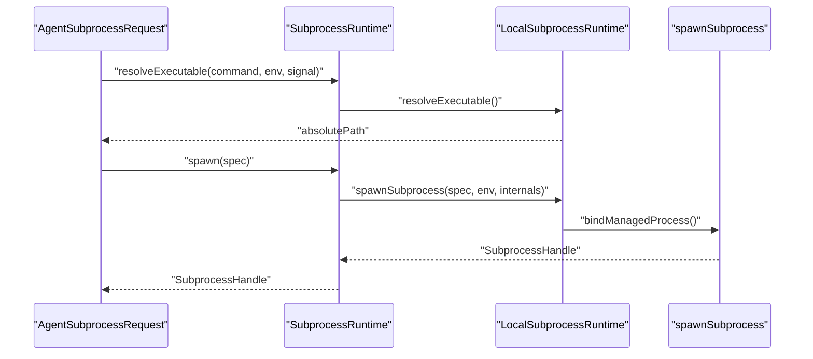
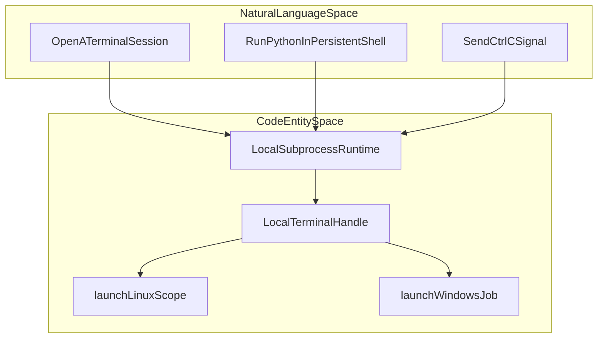

# Shell, Subprocess & Terminal

Relevant source files

The following files were used as context for generating this wiki page:

- [.agents/notes/implemented/feature/2026-07-16-persistent-pty-sessions.i18n.yaml](.agents/notes/implemented/feature/2026-07-16-persistent-pty-sessions.i18n.yaml)
- [.agents/notes/implemented/feature/2026-07-16-persistent-pty-sessions.md](.agents/notes/implemented/feature/2026-07-16-persistent-pty-sessions.md)
- [.agents/notes/implemented/feature/2026-07-16-persistent-pty-sessions.zh.md](.agents/notes/implemented/feature/2026-07-16-persistent-pty-sessions.zh.md)
- [packages/shell/tool-bash-persistent/README.i18n.yaml](packages/shell/tool-bash-persistent/README.i18n.yaml)
- [packages/shell/tool-bash-persistent/README.md](packages/shell/tool-bash-persistent/README.md)
- [packages/shell/tool-bash-persistent/README.zh.md](packages/shell/tool-bash-persistent/README.zh.md)
- [packages/shell/tool-bash-persistent/src/index.ts](packages/shell/tool-bash-persistent/src/index.ts)
- [packages/shell/tool-bash-persistent/tests/loader-composition.spec.ts](packages/shell/tool-bash-persistent/tests/loader-composition.spec.ts)
- [packages/shell/tool-bash-persistent/tests/tools.spec.ts](packages/shell/tool-bash-persistent/tests/tools.spec.ts)
- [packages/shell/tool-pwsh-persistent/README.i18n.yaml](packages/shell/tool-pwsh-persistent/README.i18n.yaml)
- [packages/shell/tool-pwsh-persistent/README.md](packages/shell/tool-pwsh-persistent/README.md)
- [packages/shell/tool-pwsh-persistent/README.zh.md](packages/shell/tool-pwsh-persistent/README.zh.md)
- [packages/shell/tool-pwsh-persistent/package.json](packages/shell/tool-pwsh-persistent/package.json)
- [packages/shell/tool-pwsh-persistent/src/index.ts](packages/shell/tool-pwsh-persistent/src/index.ts)
- [packages/shell/tool-pwsh-persistent/tests/loader-composition.spec.ts](packages/shell/tool-pwsh-persistent/tests/loader-composition.spec.ts)
- [packages/shell/tool-pwsh-persistent/tests/readiness-timeline.spec.ts](packages/shell/tool-pwsh-persistent/tests/readiness-timeline.spec.ts)
- [packages/shell/tool-pwsh-persistent/tests/readiness-timeline.ts](packages/shell/tool-pwsh-persistent/tests/readiness-timeline.ts)
- [packages/shell/tool-pwsh-persistent/tests/tools.spec.ts](packages/shell/tool-pwsh-persistent/tests/tools.spec.ts)
- [packages/shell/tool-pwsh-persistent/tsconfig.json](packages/shell/tool-pwsh-persistent/tsconfig.json)
- [packages/subprocess/subprocess-local/README.i18n.yaml](packages/subprocess/subprocess-local/README.i18n.yaml)
- [packages/subprocess/subprocess-local/README.md](packages/subprocess/subprocess-local/README.md)
- [packages/subprocess/subprocess-local/README.zh.md](packages/subprocess/subprocess-local/README.zh.md)
- [packages/subprocess/subprocess-local/src/index.ts](packages/subprocess/subprocess-local/src/index.ts)
- [packages/subprocess/subprocess-local/src/linux-scope.ts](packages/subprocess/subprocess-local/src/linux-scope.ts)
- [packages/subprocess/subprocess-local/src/managed-owner.ts](packages/subprocess/subprocess-local/src/managed-owner.ts)
- [packages/subprocess/subprocess-local/src/runner-launch.ts](packages/subprocess/subprocess-local/src/runner-launch.ts)
- [packages/subprocess/subprocess-local/src/spawn-runner.ts](packages/subprocess/subprocess-local/src/spawn-runner.ts)
- [packages/subprocess/subprocess-local/src/spawn.ts](packages/subprocess/subprocess-local/src/spawn.ts)
- [packages/subprocess/subprocess-local/src/windows-job.ts](packages/subprocess/subprocess-local/src/windows-job.ts)
- [packages/subprocess/subprocess-local/tests/linux-scope.spec.ts](packages/subprocess/subprocess-local/tests/linux-scope.spec.ts)
- [packages/subprocess/subprocess-local/tests/local.spec.ts](packages/subprocess/subprocess-local/tests/local.spec.ts)
- [packages/subprocess/subprocess-local/tests/native-containment.spec.ts](packages/subprocess/subprocess-local/tests/native-containment.spec.ts)
- [packages/subprocess/subprocess-local/tests/native-windows.spec.ts](packages/subprocess/subprocess-local/tests/native-windows.spec.ts)
- [packages/subprocess/subprocess-local/tests/spawn-runner.spec.ts](packages/subprocess/subprocess-local/tests/spawn-runner.spec.ts)
- [packages/subprocess/subprocess-local/tests/spawn.spec.ts](packages/subprocess/subprocess-local/tests/spawn.spec.ts)
- [packages/subprocess/subprocess-local/tests/windows-job.spec.ts](packages/subprocess/subprocess-local/tests/windows-job.spec.ts)
- [packages/subprocess/win32-process/README.i18n.yaml](packages/subprocess/win32-process/README.i18n.yaml)
- [packages/subprocess/win32-process/README.md](packages/subprocess/win32-process/README.md)
- [packages/subprocess/win32-process/README.zh.md](packages/subprocess/win32-process/README.zh.md)
- [packages/subprocess/win32-process/src/abi.ts](packages/subprocess/win32-process/src/abi.ts)
- [packages/subprocess/win32-process/src/ffi.ts](packages/subprocess/win32-process/src/ffi.ts)
- [packages/subprocess/win32-process/src/index.ts](packages/subprocess/win32-process/src/index.ts)
- [packages/subprocess/win32-process/src/process.ts](packages/subprocess/win32-process/src/process.ts)
- [packages/subprocess/win32-process/tests/ordinary-process.spec.ts](packages/subprocess/win32-process/tests/ordinary-process.spec.ts)
- [packages/subprocess/win32-process/verify/abi-probe.cpp](packages/subprocess/win32-process/verify/abi-probe.cpp)
- [packages/terminal/terminal-bash/tests/local.spec.ts](packages/terminal/terminal-bash/tests/local.spec.ts)
- [packages/test-support/session-snapshot/tests/fixtures/subagent-settlement-barrier.ts](packages/test-support/session-snapshot/tests/fixtures/subagent-settlement-barrier.ts)
- [snapshots/sdk/tool-error-details/notifications.expected.jsonl](snapshots/sdk/tool-error-details/notifications.expected.jsonl)
- [snapshots/sdk/tool-error-details/session.v4.jsonl](snapshots/sdk/tool-error-details/session.v4.jsonl)
- [snapshots/session/advanced-toolchain-runtime/runtime.cordis.yml](snapshots/session/advanced-toolchain-runtime/runtime.cordis.yml)
- [snapshots/session/advanced-toolchain-runtime/session.v4.jsonl](snapshots/session/advanced-toolchain-runtime/session.v4.jsonl)
- [snapshots/session/advanced-toolchain/runtime.cordis.yml](snapshots/session/advanced-toolchain/runtime.cordis.yml)
- [snapshots/session/advanced-toolchain/session.v4.jsonl](snapshots/session/advanced-toolchain/session.v4.jsonl)
- [snapshots/session/persistent-pwsh-tool-turn/session.v2.jsonl](snapshots/session/persistent-pwsh-tool-turn/session.v2.jsonl)
- [snapshots/session/persistent-pwsh-tool-turn/system-prompt.expected.md](snapshots/session/persistent-pwsh-tool-turn/system-prompt.expected.md)
- [snapshots/session/persistent-pwsh-tool-turn/tool-schemas.expected.json](snapshots/session/persistent-pwsh-tool-turn/tool-schemas.expected.json)
- [snapshots/session/pwsh-tool-turn/session.v2.jsonl](snapshots/session/pwsh-tool-turn/session.v2.jsonl)
- [snapshots/session/pwsh-tool-turn/system-prompt.expected.md](snapshots/session/pwsh-tool-turn/system-prompt.expected.md)
- [snapshots/session/pwsh-tool-turn/tool-schemas.expected.json](snapshots/session/pwsh-tool-turn/tool-schemas.expected.json)

The Shell, Subprocess, and Terminal subsystems provide DeepSeek Harness (`dsh`) with the capability to execute code, manage subprocess lifecycles, and maintain interactive terminal sessions. This is achieved via a **Capability Seam** pattern (`SubprocessRuntime`), allowing the system to flexibly run processes either locally (`LocalSubprocessRuntime`) or in cloud sandbox backends while presenting a uniform interface.

This page details the subprocess seam, implementation of local process spawning, Windows job object containment, bash and PowerShell terminal tools (`tool-bash-persistent`, `tool-pwsh-persistent`), persistent PTY sessions, terminal utilities, and cloud sandbox backends.

Sources: [packages/subprocess/subprocess-local/src/index.ts:1-156]()

---

## 1. Overview of the Subprocess Seam & Data Flow

The core abstract service `SubprocessRuntime` defines the interface to spawn one-shot processes or allocate persistent terminal sessions. There are multiple runtime implementations:

- **`LocalSubprocessRuntime`**: Manages native local subprocesses with OS-level controls.
- **Remote / Cloud Backends**: Projects subprocess capabilities onto remote environments.

### Key Entities & Structures

| Entity | Description | Code Reference |
|---|---|---|
| `SubprocessSpawnSpec` | Specifies the command-line, working directory, environment, stdio dispositions (pipe, collect, inherit), and timeouts for subprocess creation. | [packages/subprocess/subprocess-local/src/spawn.ts:17-23]() |
| `SubprocessHandle` | Represents a running process: exposes stdin/write access, stdout/stderr streams, and a `done` Promise signaling exit. | [packages/subprocess/subprocess-local/tests/spawn.spec.ts:15-18]() |
| `SubprocessOutcome` | Final completion result indicating exit code or termination signal. | [packages/subprocess/subprocess-local/src/spawn.ts:19-21]() |
| `SubprocessTerminalHandle` | Represents a persistent PTY terminal session, exposing streams and control APIs for terminal lifecycle and signaling. | [packages/subprocess/subprocess-local/src/terminal.ts:1-60]() |

### Spawn Data Flow Diagram (Natural Language to Code Entity Space)

This sequence illustrates how tooling commands are resolved and executed on the chosen backend, bridging high-level agent requests to concrete code entities like `LocalSubprocessRuntime` and `spawnSubprocess`.

Sources: [packages/subprocess/subprocess-local/src/index.ts:53-155](), [packages/subprocess/subprocess-local/src/spawn.ts:11-35]()

---

## 2. Local Subprocess Spawning & Windows Job Objects

The `LocalSubprocessRuntime` implements subprocess spawning on the host OS, managing process lifetimes within OS-level containment to avoid orphaned subprocesses.

### Process Ownership & Lifetime Management

- **POSIX/Linux/macOS**: Uses either process groups or transient *user-systemd scopes* — systemd-managed cgroups with guaranteed cleanup — to own subprocesses and their descendants. The `launchLinuxScope` and related functions in `packages/subprocess/subprocess-local/src/linux-scope.ts` probe and operate these scopes, launching subprocesses within user-scopes and observing them via `/proc` and systemd interfaces. Signals are sent by group or by direct PID injection, with careful rejection handling for inaccessible process groups. [packages/subprocess/subprocess-local/src/linux-scope.ts:6-180]()

- **Windows**: Uses Windows Job Objects to contain the process tree. Spawning occurs via the `spawnCurrentTokenJobProcess` API from the internal `@deepseek-ai/dsh-win32-process` package, which ensures all processes in the job terminate when the job handle closes. The helper process is spawned with windows hidden (`windowsHide`) to avoid UI disruption. Job termination is performed with `taskkill /PID <pid> /T /F` as a fallback. The spawn runner isolates `fd 0-2`, reserves `fd 3` for internal IPC, and passes stdio carriers on `fd 4-6`, closing extraneous descriptors after launch. [packages/subprocess/subprocess-local/src/spawn-runner.ts:40-213](), [packages/subprocess/subprocess-local/src/spawn.ts:110-138]()

### Output Collection & Spill Files

To handle potentially large outputs without exhausting memory, output collecting follows this scheme:

1. **In-memory tail buffer:** Keeps the most recent `maxBytes` of the output stream for quick access.
2. **Spill files:** Optionally spills the complete output to a per-process private directory under the OS temp directory, with secure permissions (directory `0700`, files `0600`). This prevents symlink attacks and ensures privacy.
3. **Fail-safe spill:** On spill failures (e.g., directory removed, permission errors, full disk, or `EMFILE`), the spill is disabled but the memory tail collection continues, ensuring no exceptions propagate to the host causing process kill. An error is logged through the plugin logger once per failure. The result then shows a truncated tail with no spill path. [packages/subprocess/subprocess-local/src/spawn.ts:15-72](), [packages/subprocess/subprocess-local/tests/spawn-runner.spec.ts:130-170]()

### Host-Exit Cleanup Flow

The `LocalSubprocessRuntime` installs a process `exit` handler with the highest priority (prepended) to synchronously terminate and clean live subprocess handles and terminal sessions on host process exit. This prevents process leakage on abnormal termination. The termination semantics are platform-specific:

- POSIX sends `TERM` signal before escalating to `KILL` if necessary.
- Windows immediately terminates the job and all children with `taskkill`.

The exit finalizer owns no Promises or timers to guarantee synchronous execution. After termination, handles and terminals are cleaned from live sets. This cleanup is invoked both on process exit event and normal disposal of the runtime instance. [packages/subprocess/subprocess-local/src/index.ts:75-105](), [packages/subprocess/subprocess-local/tests/local.spec.ts:120-167]()

Sources:  
- [packages/subprocess/subprocess-local/src/index.ts:59-105]()  
- [packages/subprocess/subprocess-local/src/spawn-runner.ts:40-213]()  
- [packages/subprocess/subprocess-local/src/spawn.ts:110-160]()  
- [packages/subprocess/subprocess-local/src/linux-scope.ts:6-180]()  
- [packages/subprocess/subprocess-local/tests/local.spec.ts:110-167]()  
- [packages/subprocess/subprocess-local/tests/spawn-runner.spec.ts:130-170]()

---

## 3. Persistent PTY Sessions & Terminal Tools

Interactive terminal sessions allow stateful, persistent shells with pseudo-terminal (PTY) allocation and control, backed by packages such as `@deepseek-ai/dsh-tool-bash-persistent` and `@deepseek-ai/dsh-tool-pwsh-persistent`.

### Terminal Session Overview

- Allocated PTYs are handled with the `node-pty` native pseudo-terminal library, lazily required to avoid startup costs on hosts not needing terminals.
- Terminal sessions are represented by `LocalTerminalHandle` which manages lifecycle, UTF-8 bridging, and provides methods for sending signals and termination.
- The service can detect the default terminal shell environment dynamically:
  - On POSIX platforms it reads non-empty `SHELL` environment or falls back to the user login shell via `os.userInfo()`.
  - On Windows, it reads non-empty `ComSpec` environment or falls back silently.
- Terminal readiness involves detecting terminal control sequences and prompt readiness reported by supported shells like bash and zsh.
- On Linux, detailed process inspection via `/proc` extracts information about session foreground processes, their syscall states, and input readiness to drive robust terminal activity detection.
- Windows terminals handle signals like Ctrl-C by sending terminal input events; unsupported signals like SIGHUP and SIGTSTP remain unimplemented. Process table polling confirms shell process termination when PTY exit events are unreliable.

This functionality is centered in `packages/subprocess/subprocess-local/src/terminal.ts` and integrated into the local runtime as persistent terminal handles. [packages/subprocess/subprocess-local/src/index.ts:59-90](), [packages/subprocess/subprocess-local/src/terminal.ts:1-60](), [packages/subprocess/subprocess-local/tests/local.spec.ts:60-110]()

### Terminal Capability Mapping Diagram (Natural Language to Code Entity Space)

This diagram demonstrates the mapping from user-level concepts (open terminal, run shell commands, send signals) to concrete classes (`LocalSubprocessRuntime`, `LocalTerminalHandle`) and OS-containment mechanisms (`launchLinuxScope`, `launchWindowsJob`).

Sources:  
- [packages/subprocess/subprocess-local/src/index.ts:59-90]()  
- [packages/subprocess/subprocess-local/src/terminal.ts:1-60]()  
- [packages/subprocess/subprocess-local/tests/local.spec.ts:60-110]()

---

## 4. Cloud Sandbox Backends & Remote Runtimes

DeepSeek Harness supports sandboxed subprocess execution across remote backends:

- Runs code on cloud-hosted or remote ephemeral sandboxes.
- Enforces environment isolation and serializes the execution environment across the network boundary.
- Pipes outputs through stream encoder/decoder chains to maintain data integrity and encoding.
- Supports persistent PTY sessions allocated remotely but streamed back.
- Remote backends translate local subprocess semantics to remote API calls, providing near-transparent usage to the rest of the agent system.

Though distinct from local subprocess packages, remote and sandbox runtimes integrate via the same `SubprocessRuntime` seam, allowing seamless backend switching without tool-level changes.

Sources:  
- [packages/subprocess/subprocess-local/src/spawn.ts:44-54]()  
- [packages/subprocess/subprocess-local/src/runner-launch.ts:68-86]()

---

## Summary Table: System Components & Responsibilities

| Component | Role | Location | Notes |
|---|---|---|---|
| `SubprocessRuntime` | Abstract subprocess seam | `@deepseek-ai/dsh-subprocess` | Interface to spawn processes or terminals |
| `LocalSubprocessRuntime` | Local OS subprocess management | `packages/subprocess/subprocess-local/src/index.ts` | Handles native execution, containment, lifecycle, terminal sessions |
| `spawnSubprocess` | Platform-aware process spawning | `packages/subprocess/subprocess-local/src/spawn.ts` | Low-level spawning with stdio and spill files |
| `LinuxScopeOwner` | Linux user-systemd scope management | `packages/subprocess/subprocess-local/src/linux-scope.ts` | Creates transient systemd scopes ensuring cleanup |
| `WindowsJobRunner` | Windows Job object helper | `packages/subprocess/subprocess-local/src/windows-job.ts` | Spawns and manages Windows Job for containment |
| `LocalTerminalHandle` | Represents PTY terminal session | `packages/subprocess/subprocess-local/src/terminal.ts` | Manages pty allocation, I/O bridging, lifecycle |
| `OutputCollector` | Stream output buffering & spill | `packages/subprocess/subprocess-local/src/output.ts` | Tail buffer plus spill file management |
| `SpawnRunner` | Windows/Linux subprocess bootstrap helper | `packages/subprocess/subprocess-local/src/spawn-runner.ts` | Handles native exec calls and Windows Job runner IPC |

Sources:  
- [packages/subprocess/subprocess-local/src/index.ts:1-156]()  
- [packages/subprocess/subprocess-local/src/spawn.ts:1-167]()  
- [packages/subprocess/subprocess-local/src/spawn-runner.ts:1-213]()  
- [packages/subprocess/subprocess-local/src/linux-scope.ts:1-180]()  
- [packages/subprocess/subprocess-local/src/terminal.ts:1-60]()  
- [packages/subprocess/subprocess-local/tests/local.spec.ts:1-169]()  
- [packages/subprocess/subprocess-local/tests/spawn-runner.spec.ts:1-182]()