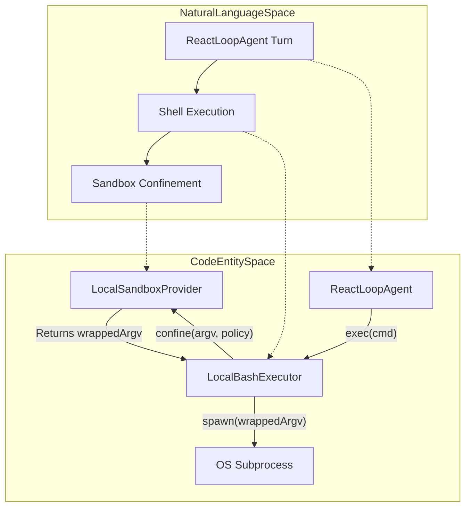
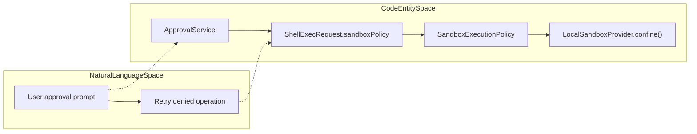

# Sandboxing & Security

<details>
<summary>Relevant source files</summary>

The following files were used as context for generating this wiki page:

- [.agents/notes/implemented/feature/2026-08-08-windows-acl-restricted-token-sandbox.i18n.yaml](.agents/notes/implemented/feature/2026-08-08-windows-acl-restricted-token-sandbox.i18n.yaml)
- [.agents/notes/implemented/feature/2026-08-08-windows-acl-restricted-token-sandbox.md](.agents/notes/implemented/feature/2026-08-08-windows-acl-restricted-token-sandbox.md)
- [.agents/notes/implemented/feature/2026-08-08-windows-acl-restricted-token-sandbox.zh.md](.agents/notes/implemented/feature/2026-08-08-windows-acl-restricted-token-sandbox.zh.md)
- [apps/desktop/tests/acl-skill.built.e2e.ts](apps/desktop/tests/acl-skill.built.e2e.ts)
- [packages/sandbox/sandbox-local/README.i18n.yaml](packages/sandbox/sandbox-local/README.i18n.yaml)
- [packages/sandbox/sandbox-local/README.md](packages/sandbox/sandbox-local/README.md)
- [packages/sandbox/sandbox-local/README.zh.md](packages/sandbox/sandbox-local/README.zh.md)
- [packages/sandbox/sandbox-local/src/index.ts](packages/sandbox/sandbox-local/src/index.ts)
- [packages/sandbox/sandbox-local/src/profiles.ts](packages/sandbox/sandbox-local/src/profiles.ts)
- [packages/sandbox/sandbox-local/tests/bwrap.e2e.ts](packages/sandbox/sandbox-local/tests/bwrap.e2e.ts)
- [packages/sandbox/sandbox-local/tests/local.spec.ts](packages/sandbox/sandbox-local/tests/local.spec.ts)
- [packages/sandbox/sandbox-local/tests/seatbelt.e2e.ts](packages/sandbox/sandbox-local/tests/seatbelt.e2e.ts)
- [packages/sandbox/sandbox-windows-acl/README.i18n.yaml](packages/sandbox/sandbox-windows-acl/README.i18n.yaml)
- [packages/sandbox/sandbox-windows-acl/README.md](packages/sandbox/sandbox-windows-acl/README.md)
- [packages/sandbox/sandbox-windows-acl/README.zh.md](packages/sandbox/sandbox-windows-acl/README.zh.md)
- [packages/sandbox/sandbox-windows-acl/assets/diagnose-windows-sandbox-acl/SKILL.md](packages/sandbox/sandbox-windows-acl/assets/diagnose-windows-sandbox-acl/SKILL.md)
- [packages/sandbox/sandbox-windows-acl/assets/diagnose-windows-sandbox-acl/scripts/diagnose-windows-sandbox-acl.ps1](packages/sandbox/sandbox-windows-acl/assets/diagnose-windows-sandbox-acl/scripts/diagnose-windows-sandbox-acl.ps1)
- [packages/sandbox/sandbox-windows-acl/src/acl.ts](packages/sandbox/sandbox-windows-acl/src/acl.ts)
- [packages/sandbox/sandbox-windows-acl/src/ffi.ts](packages/sandbox/sandbox-windows-acl/src/ffi.ts)
- [packages/sandbox/sandbox-windows-acl/src/grant.ts](packages/sandbox/sandbox-windows-acl/src/grant.ts)
- [packages/sandbox/sandbox-windows-acl/src/index.ts](packages/sandbox/sandbox-windows-acl/src/index.ts)
- [packages/sandbox/sandbox-windows-acl/src/spawn.ts](packages/sandbox/sandbox-windows-acl/src/spawn.ts)
- [packages/sandbox/sandbox-windows-acl/src/token.ts](packages/sandbox/sandbox-windows-acl/src/token.ts)
- [packages/sandbox/sandbox-windows-acl/src/win32-abi.ts](packages/sandbox/sandbox-windows-acl/src/win32-abi.ts)
- [packages/sandbox/sandbox-windows-acl/tests/acl-failure-paths.spec.ts](packages/sandbox/sandbox-windows-acl/tests/acl-failure-paths.spec.ts)
- [packages/sandbox/sandbox-windows-acl/tests/acl-skill.spec.ts](packages/sandbox/sandbox-windows-acl/tests/acl-skill.spec.ts)
- [packages/sandbox/sandbox-windows-acl/tests/acl.spec.ts](packages/sandbox/sandbox-windows-acl/tests/acl.spec.ts)
- [packages/sandbox/sandbox-windows-acl/tests/diagnose-script.spec.ts](packages/sandbox/sandbox-windows-acl/tests/diagnose-script.spec.ts)
- [packages/sandbox/sandbox-windows-acl/tests/grant-failure-paths.spec.ts](packages/sandbox/sandbox-windows-acl/tests/grant-failure-paths.spec.ts)
- [packages/sandbox/sandbox-windows-acl/tests/index-failure-paths.spec.ts](packages/sandbox/sandbox-windows-acl/tests/index-failure-paths.spec.ts)
- [packages/sandbox/sandbox-windows-acl/tests/runner.spec.ts](packages/sandbox/sandbox-windows-acl/tests/runner.spec.ts)
- [packages/sandbox/sandbox-windows-acl/tests/token-failure-paths.spec.ts](packages/sandbox/sandbox-windows-acl/tests/token-failure-paths.spec.ts)
- [packages/sandbox/sandbox/README.md](packages/sandbox/sandbox/README.md)
- [packages/sandbox/sandbox/src/index.ts](packages/sandbox/sandbox/src/index.ts)
- [packages/subprocess/win32-process/tests/process-allocation-failure.spec.ts](packages/subprocess/win32-process/tests/process-allocation-failure.spec.ts)
- [packages/subprocess/win32-process/tests/process-failure-paths.spec.ts](packages/subprocess/win32-process/tests/process-failure-paths.spec.ts)
- [packages/subprocess/win32-process/tests/process.spec.ts](packages/subprocess/win32-process/tests/process.spec.ts)
- [snapshots/session/windows-acl-skill/session.v4.jsonl](snapshots/session/windows-acl-skill/session.v4.jsonl)

</details>


This page covers the execution environment's sandboxing strategy within DeepSeek Harness (`dsh`), detailing the sandbox seam, platform-specific sandbox providers (`@deepseek-ai/dsh-sandbox-local`), the native Linux `landlock-run` binary, the Windows restricted-token ACL backend (`@deepseek-ai/dsh-sandbox-windows-acl`), the approval seam, and sandbox policy configuration.

---

Sandboxing confines subprocesses (mainly `bash` and `pwsh` tools) to strict file system write boundaries aligned with the `dsh` sandbox vocabulary modes: `read-only` and `workspace-write`. It uses platform-specific mechanisms:

- **Linux**: Landlock with fallback to Bubblewrap (`bwrap`).
- **macOS**: Seatbelt profiles via `sandbox-exec`.
- **Windows**: Restricted Tokens with write ACL enforcement (`WRITE_RESTRICTED` + Low integrity).

The system integrates seamlessly with the approval seam and the broader configuration model in the harness monorepo.

Sources:
[packages/sandbox/sandbox-local/src/index.ts:1-22](),
[.agents/notes/implemented/feature/2026-08-08-windows-acl-restricted-token-sandbox.md:1-13]()

---

## Sandbox Seam and `sandbox-local` Provider

The sandboxing foundation is the Cordis plugin package `@deepseek-ai/dsh-sandbox-local`. Its core service is exposed via the `ctx.sandbox` context variable. The `LocalSandboxProvider` class implements the sandbox seam and selects the appropriate platform confinement strategy dynamically at runtime based on the OS environment.

### Key Types & Configuration

- **`Config`**: Plugin configuration, including:
  - `runnerCommand` — path or command to spawn a confined subprocess [packages/sandbox/sandbox-local/src/index.ts:55-55]().
  - `runnerFailureSignatures` — strings to recognize runner failure messages [packages/sandbox/sandbox-local/src/index.ts:63-63]().
  - `probeTimeoutMs` — timeouts for probing sandbox availability [packages/sandbox/sandbox-local/src/index.ts:65-65]().

- **`SandboxMode`** (union type):
  - `read-only`
  - `workspace-write`
  - `danger-full-access` (unconfined)

- **`SandboxEnforcement`**: Capability enforcement completeness [packages/sandbox/sandbox-local/src/index.ts:38-38]().

### Data Flow: Subprocess Confinement

The sandbox seam sits between the shell executor and raw OS process spawning. The agent's turn executes a command via a shell executor, which asks the sandbox provider to confine the subprocess arguments.

Title: "Subprocess Confinement Data Flow"



Sources:
[packages/sandbox/sandbox-local/src/index.ts:1-75]()

---

## Linux Sandboxing: Landlock & Bubblewrap

The `LocalSandboxProvider` prefers to use `bwrap` (Bubblewrap) for sandboxing on Linux if available (`defaultProbeBwrap`), otherwise it falls back to the native `landlock-run` binary.

### `landlock-run` Native Binary

- Implemented in C11, located in the `native/system` workspace.
- Installs Landlock rulesets via syscalls on Linux kernels ≥ 5.13.
- Accepts `--ro <path>` and `--rw <path>` arguments to set read-only or writable paths.
- Features a `--probe` mode (`defaultProbeLandlock`) which returns exit 0 if Landlock kernel support and ruleset creation succeed.
- On launcher failure, outputs a line prefixed with `landlock-run:` and exits with a special code `LAUNCHER_FAILURE_EXIT = 125`, which is recognized separately from child process failures by the runner wrapper.

Sources:
[packages/sandbox/sandbox-local/src/index.ts:28-35](),
[packages/sandbox/sandbox-local/src/index.ts:69-75]()

---

## macOS Sandboxing: Seatbelt

On macOS, `LocalSandboxProvider` uses the system `sandbox-exec` utility with dynamically generated Seatbelt profiles via `seatbeltProfileArgs`.

- The `read-only` profile denies all file system writes except to `/dev/null`.
- The `workspace-write` profile allows recursive write access to the canonical workspace root and the OS temp locations.
- Probing calls `sandbox-exec -p` with a test profile (`defaultProbeSeatbelt`) [packages/sandbox/sandbox-local/src/index.ts:86-92]().
- If `sandbox-exec` is unavailable or if the kernel refuses the profile, it fails closed.

Sources:
[packages/sandbox/sandbox-local/src/index.ts:78-93]()

---

## Windows Sandboxing: Restricted Tokens (`sandbox-windows-acl`)

### Overview & Mechanism

Windows sandboxing uses the `WRITE_RESTRICTED` token capability coupled with ACL (Access Control List) management to restrict subprocess writes and deletions only to authorized directories: the workspace root and a private temporary directory.

The implementation is encapsulated in the `@deepseek-ai/dsh-sandbox-windows-acl` package. It is the default backend selected when mounting `dsh-sandbox-local` on Windows.

1. **Token Duplication**  
   The caller’s token is duplicated into a `WRITE_RESTRICTED` restricted token (`CreateRestrictedToken` with `WRITE_RESTRICTED + DISABLE_MAX_PRIVILEGE`, omitting `LUA_TOKEN`) [.agents/notes/implemented/feature/2026-08-08-windows-acl-restricted-token-sandbox.md:12-13]().
2. **Capability SIDs**  
   - **Workspace Write SID**: Deterministically derived from the canonical workspace path (`workspaceWriteSid`) [packages/sandbox/sandbox-windows-acl/src/index.ts:16-18]().
   - **Temp Write SID**: A random SID specific to the private temp directory, generated per live session (`tempWriteSid`) [packages/sandbox/sandbox-windows-acl/src/index.ts:20-22]().
3. **Integrity Label & Delete Deny**  
   The token is lowered to Low integrity, and every granted directory receives a Low no-write-up label along with a world SID deny for `FILE_DELETE_CHILD` to prevent cross-root or unauthorized deletions [.agents/notes/implemented/feature/2026-08-08-windows-acl-restricted-token-sandbox.md:12-13]().

### The Confinement Runner and Lifecycle

The runner executable uses the `AclSandbox` class [packages/sandbox/sandbox-windows-acl/src/index.ts:63-102]() to initialize grants and spawn the child process under the lowered restricted token, throwing `Win32Error` on any API failure to prevent unsafe execution [packages/sandbox/sandbox-windows-acl/src/index.ts:23-24]().

### Example Usage

```ts
import { mkdtempSync, rmSync } from 'node:fs'
import { tmpdir } from 'node:os'
import { join } from 'node:path'
import { AclSandbox, tempWriteSid, workspaceWriteSid } from '@deepseek-ai/dsh-sandbox-windows-acl'

const workspaceRoot = process.cwd()
const tempDir = mkdtempSync(join(tmpdir(), 'dsh-'))

const sandbox = new AclSandbox({
  writableDirs: [workspaceRoot],
  tempDir,
  writeSid: workspaceWriteSid(workspaceRoot),
  tempWriteSid: tempWriteSid(tempDir),
  mode: 'workspace-write',
})

await sandbox.init() // throws on any failure

const child = sandbox.spawn({
  command: 'pwsh',
  args: ['-NoProfile', '-Command', 'your commands here'],
  cwd: workspaceRoot,
})

const { stdout, stderr, exitCode } = await child.wait()

sandbox.dispose() // removes revocable grants and cleans up
rmSync(tempDir, { recursive: true, force: true })
```

### ACL Diagnosis and Recovery Skill

When unexpected permission denials occur on Windows, the bundled skill `diagnose-windows-sandbox-acl` (`packages/sandbox/sandbox-windows-acl/assets/diagnose-windows-sandbox-acl/SKILL.md:1-10`) inspects ancestor chains, repairs missing `WRITE_DAC` or `WRITE_OWNER` permissions, removes conflicting AppContainer package allow ACEs, and backs up changes with automated rollbacks.

Sources:
[packages/sandbox/sandbox-windows-acl/src/index.ts:1-134](),
[.agents/notes/implemented/feature/2026-08-08-windows-acl-restricted-token-sandbox.md:1-20](),
[packages/sandbox/sandbox-windows-acl/assets/diagnose-windows-sandbox-acl/SKILL.md:1-30]()

---

## Approval Seam and Escalation

The deep layering of sandbox confinement supports an **approval seam** for user-mediated security escalation:

- When a sandbox denies a requested operation, the approval seam may prompt the user for consent to widen access or relax the sandbox policy.
- After user approval, the agent can retry the operation under a more permissive policy.
- This is integrated via `ctx.approval` (`ApprovalService`) and `ShellExecRequest.sandboxPolicy` tracking.

Title: "Approval Seam and Policy Execution"



Sources:
[packages/sandbox/sandbox-local/src/index.ts:35-43]()

---

## Sandbox Policy Configuration

Sandbox policies and modes are configured declaratively in the monorepo's Cordis plugin manifests (`cordis.yml`):

```yaml
- id: sandbox
  name: '@deepseek-ai/dsh-sandbox-local'

- id: bash
  name: '@deepseek-ai/dsh-bash-sandbox'
  config:
    mode: workspace-write
    workspaceRoot: !!js process.cwd()

- id: approval
  name: '@deepseek-ai/dsh-user-approval'
  config:
    policy: ask
```

This configuration ensures consistent policy control and sandbox backend selection, integrated with the approval seam for dynamic escalation.

Sources:
[packages/sandbox/sandbox-local/src/index.ts:35-66]()

---

## Security Boundaries and Limitations

| Feature               | Linux (Landlock/Bubblewrap)                                   | Windows (`sandbox-windows-acl`)                          |
|-----------------------|---------------------------------------------------------------|----------------------------------------------------------|
| **Write Restriction**  | Full (or partial fallback on older kernels)                   | Partial:<br>- Write allowed only in workspace & temp grants<br>- Hard links aliasing can bypass | 
| **Read Restriction**   | Supported (via Landlock rulesets)                             | Not enforced (ambient SIDs allow reads)                   |
| **Network Restriction**| Not enforced                                                  | Not enforced                                             |
| **Process Visibility** | Not enforced                                                  | Not enforced                                             |
| **Console Isolation**  | Supported (isolated consoles)                                 | Unavailable:<br>- Children share host console<br>- `CREATE_NO_WINDOW` children fail | 

The Windows sandbox implementation carefully limits writes and deletes but cannot fully prohibit aliasing via NTFS hard links. Both platforms fail closed on API call errors.

Sources:
[packages/sandbox/sandbox-windows-acl/README.md:70-76](),
[.agents/notes/implemented/feature/2026-08-08-windows-acl-restricted-token-sandbox.md:33-36]()