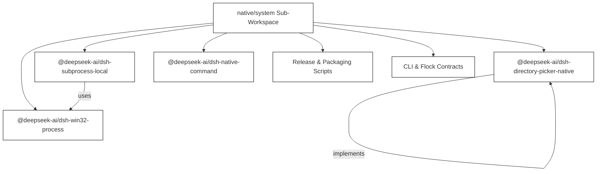
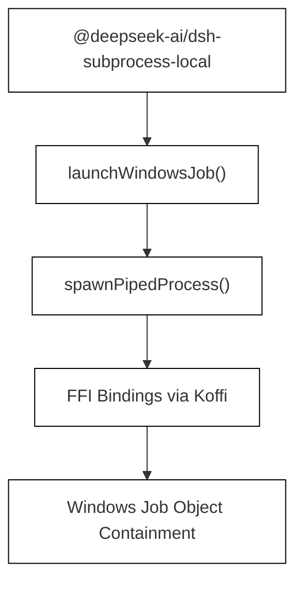
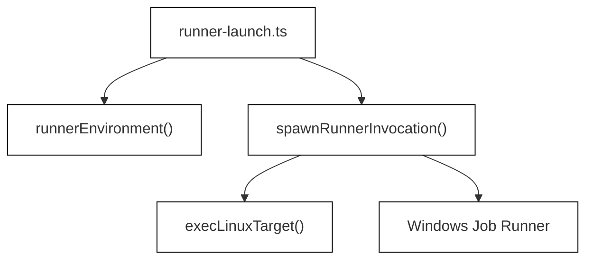
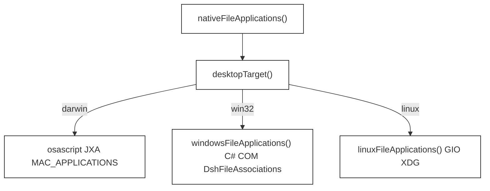
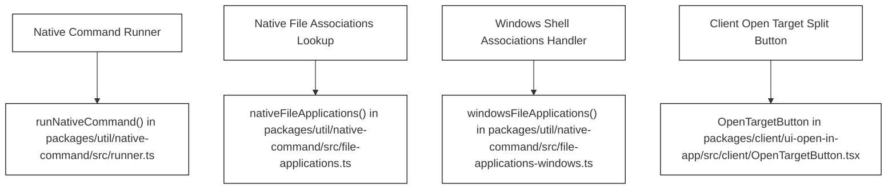
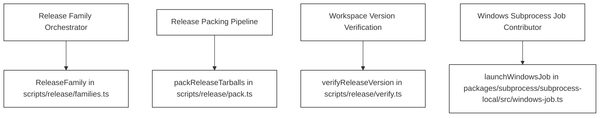

# Native System Packages & Platform Binaries

Relevant source files

The following files were used as context for generating this wiki page:

- [apps/web/tests/shortcuts-workspace.e2e.ts](apps/web/tests/shortcuts-workspace.e2e.ts)
- [packages/api/workspace-controller/src/default-directory.ts](packages/api/workspace-controller/src/default-directory.ts)
- [packages/api/workspace-controller/tests/default-directory.host.spec.ts](packages/api/workspace-controller/tests/default-directory.host.spec.ts)
- [packages/client/ui-open-in-app/README.i18n.yaml](packages/client/ui-open-in-app/README.i18n.yaml)
- [packages/client/ui-open-in-app/README.md](packages/client/ui-open-in-app/README.md)
- [packages/client/ui-open-in-app/README.zh.md](packages/client/ui-open-in-app/README.zh.md)
- [packages/client/ui-open-in-app/src/client/OpenInAppAction.tsx](packages/client/ui-open-in-app/src/client/OpenInAppAction.tsx)
- [packages/client/ui-open-in-app/src/client/OpenPathAction.tsx](packages/client/ui-open-in-app/src/client/OpenPathAction.tsx)
- [packages/client/ui-open-in-app/src/client/OpenPathEmptyAction.tsx](packages/client/ui-open-in-app/src/client/OpenPathEmptyAction.tsx)
- [packages/client/ui-open-in-app/src/client/OpenTargetButton.module.css](packages/client/ui-open-in-app/src/client/OpenTargetButton.module.css)
- [packages/client/ui-open-in-app/src/client/OpenTargetButton.tsx](packages/client/ui-open-in-app/src/client/OpenTargetButton.tsx)
- [packages/client/ui-open-in-app/src/client/index.ts](packages/client/ui-open-in-app/src/client/index.ts)
- [packages/client/ui-open-in-app/src/client/locales.ts](packages/client/ui-open-in-app/src/client/locales.ts)
- [packages/client/ui-open-in-app/src/client/open-path.ts](packages/client/ui-open-in-app/src/client/open-path.ts)
- [packages/client/ui-open-in-app/tests/browser-plugin.client.spec.ts](packages/client/ui-open-in-app/tests/browser-plugin.client.spec.ts)
- [packages/client/ui-open-in-app/tests/open-in-app-action.client.spec.tsx](packages/client/ui-open-in-app/tests/open-in-app-action.client.spec.tsx)
- [packages/client/ui-open-in-app/tests/open-path-action.client.spec.tsx](packages/client/ui-open-in-app/tests/open-path-action.client.spec.tsx)
- [packages/client/ui-open-in-app/tests/open-path.client.spec.ts](packages/client/ui-open-in-app/tests/open-path.client.spec.ts)
- [packages/client/ui-sidebar-files/src/client/index.ts](packages/client/ui-sidebar-files/src/client/index.ts)
- [packages/host/open-in-app/README.i18n.yaml](packages/host/open-in-app/README.i18n.yaml)
- [packages/host/open-in-app/README.md](packages/host/open-in-app/README.md)
- [packages/host/open-in-app/README.zh.md](packages/host/open-in-app/README.zh.md)
- [packages/host/open-in-app/src/icons.ts](packages/host/open-in-app/src/icons.ts)
- [packages/host/open-in-app/src/resolver.ts](packages/host/open-in-app/src/resolver.ts)
- [packages/host/open-in-app/tests/host-routes.spec.ts](packages/host/open-in-app/tests/host-routes.spec.ts)
- [packages/host/open-in-app/tests/resolver.spec.ts](packages/host/open-in-app/tests/resolver.spec.ts)
- [packages/util/native-command/README.i18n.yaml](packages/util/native-command/README.i18n.yaml)
- [packages/util/native-command/README.md](packages/util/native-command/README.md)
- [packages/util/native-command/README.zh.md](packages/util/native-command/README.zh.md)
- [packages/util/native-command/src/desktop-entry.ts](packages/util/native-command/src/desktop-entry.ts)
- [packages/util/native-command/src/file-applications-linux.ts](packages/util/native-command/src/file-applications-linux.ts)
- [packages/util/native-command/src/file-applications-windows.ts](packages/util/native-command/src/file-applications-windows.ts)
- [packages/util/native-command/src/file-applications.ts](packages/util/native-command/src/file-applications.ts)
- [packages/util/native-command/src/index.ts](packages/util/native-command/src/index.ts)
- [packages/util/native-command/src/path-opener.ts](packages/util/native-command/src/path-opener.ts)
- [packages/util/native-command/src/runner.ts](packages/util/native-command/src/runner.ts)
- [packages/util/native-command/src/types.ts](packages/util/native-command/src/types.ts)
- [packages/util/native-command/tests/file-applications-linux-native.spec.ts](packages/util/native-command/tests/file-applications-linux-native.spec.ts)
- [packages/util/native-command/tests/file-applications-linux.spec.ts](packages/util/native-command/tests/file-applications-linux.spec.ts)
- [packages/util/native-command/tests/file-applications-windows.spec.ts](packages/util/native-command/tests/file-applications-windows.spec.ts)
- [packages/util/native-command/tests/file-applications.spec.ts](packages/util/native-command/tests/file-applications.spec.ts)
- [packages/util/native-command/tests/path-opener.spec.ts](packages/util/native-command/tests/path-opener.spec.ts)

The native/system sub-workspace delivers a set of foundational, platform-specific packages and binaries essential for DeepSeek Harness's low-level OS integrations. It includes the native launcher process, the flock native addon, prebuilt platform binaries, command-line interface (CLI) contracts, platform directory pickers, and the release orchestration scripts. These components bridge Node.js and the host OS, manage subprocess lifecycles, provide native UI and desktop integrations, and coordinate application handlers.

---

## 1. Sub-Workspace Overview & Architectural Scope

The `native/system` workspace is structured around platform abstraction, subprocess spawning, native OS UI dialogs, and release workflows:

- **Launcher Binary & Native Addons**: The launcher binary manages process bootstrap, and the flock native addon provides native OS-level capability extensions.
- **Per-Platform Prebuild Packages**: Binary packages are prebuilt per target platform (Windows, Linux, macOS, ARM/x64 flavors) and independently released.
- **CLI & Flock Contracts**: Defines platform commands and interop contracts for consistent invocation and capabilities.
- **Build/Pack/Publish Scripts**: Independent release families `dsh`, `vendor`, and `native/system/packages/*` maintain strict publish sequence control and package integrity.
- **Native Command Utilities & Directory Pickers**: Provide shell-free native command execution, desktop path opening, file application association queries, and native directory selection dialogs for Windows and other OSes.

Sources: `scripts/release/families.ts:100-164`, `packages/util/native-command/README.md:1-80`, `packages/host/directory-picker-native/tests/win32-dialog.spec.ts:67-159`

---

## 2. Platform-Specific Native Launchers and Addons

### 2.1. Subprocess Launching and Windows Job Objects

The package `@deepseek-ai/dsh-subprocess-local` manages local subprocess spawning with detailed platform abstraction.

- Supports Linux `execve`-style one-shot launching and Windows Job Object-based containment to reliably manage subprocess lifecycle.
- The Windows Job Object containment ensures that all subprocess trees are cleaned up properly on connection termination or process exit.
- The core function `launchWindowsJob()` orchestrates the setup of IPC pipes and invokes the runner with the necessary rights and stdio redirections [packages/subprocess/subprocess-local/src/windows-job.ts:124-188]().

The `@deepseek-ai/dsh-win32-process` package exposes native Windows API bindings through Koffi FFI:

- Offers APIs such as `CreateProcessW`, token and security descriptor management, anonymous pipe creation, and Job Object control.
- Implements `spawnPipedProcess()` which spawns processes in a detached or contained manner, integrating with Windows Job objects [packages/subprocess/win32-process/src/process.ts:1-208]().

Sources: `packages/subprocess/subprocess-local/src/windows-job.ts:124-188`, `packages/subprocess/win32-process/src/process.ts:1-208`

### 2.2. Runner Bootstrap and Environment Setup

The bootstrap process differs per platform:

- On Linux, a direct `execve` one-shot spawn is used for lightweight process launch.
- On Windows, the runner process owns the Job Object lifecycle and manages subprocess containment reliably.

The module `runner-launch.ts` prepares the runner invocation environment by stripping environment variables associated with Node.js and TSX influences and sets the `DSH_SUBPROCESS_RUNNER` environment variable for lifecycle management hooks [packages/subprocess/subprocess-local/src/runner-launch.ts:27-84](). The prepared invocation ensures subprocesses run in an isolated and clean environment without unexpected inherited state.

Sources: `packages/subprocess/subprocess-local/src/runner-launch.ts:27-84`

---

## 3. Native Command Execution & Path Opening Utilities

The `@deepseek-ai/dsh-native-command` package provides stateless utilities for shell-free native command execution and desktop path opening, critical for reliable OS integration [packages/util/native-command/README.md:10-13]().

### 3.1 Core Features

- **Shell-Free Execution:** The main function `runNativeCommand()` is a thin wrapper over Node.js's `execFile`, spawning native executables directly with argument arrays, never using a shell [packages/util/native-command/README.md:12-40]().
- **Cancellation Support:** Supports `AbortSignal` for cancellation propagation to subprocesses [packages/util/native-command/README.md:40-75]().
- **Windows Window Visibility:** Explicit control over window visibility during process startup (`hidden` or `visible`) [packages/util/native-command/README.md:40-41]().
- **Path Opening with Intent:** Functions such as `openNativePath()`, `openNativeAssociatedPath()`, and `openNativeTextFile()` open file paths using OS-specific intents [packages/util/native-command/README.md:46-51]().
- **Querying Native File Associations:** Functions like `nativeFileApplications()` retrieve registered handlers via macOS LaunchServices/JXA, Windows Shell associations, and Linux GIO [packages/util/native-command/README.md:52-53]().

Sources: `packages/util/native-command/README.md:10-53`, `packages/util/native-command/src/runner.ts:1-50`

### 3.2 Internal Architecture & File Association Queries

Platform-specific query logic handles native registration lookup and handler deduplication:
- On macOS, `MAC_APPLICATIONS` uses AppKit via JXA to query `NSWorkspace` for registered application URLs and extract icons, while `dedupeMacApplications()` collapses self-updating staged copies and per-version installs [packages/util/native-command/src/file-applications.ts:10-46](), [packages/util/native-command/src/file-applications.ts:127-141]().
- On Windows, `WINDOWS_ASSOCIATIONS` uses C# COM interop (`SHAssocEnumHandlers`, `IShellItem`, `WithShellLifetime`) to extract application names, icons, and recommended flags [packages/util/native-command/src/file-applications-windows.ts:8-111]().

Sources: `packages/util/native-command/src/file-applications.ts:56-81`, `packages/util/native-command/src/file-applications-windows.ts:8-139`

---

## 4. Native Directory Pickers & UI Integration

### 4.1 Native Directory Picker for Windows

The `@deepseek-ai/dsh-directory-picker-native` package provides native folder selection dialogs integrated with Windows Shell APIs.

- Uses a dedicated worker thread to display the folder picker dialog without blocking the main host process UI thread.
- Listens for abort signals; upon cancellation, sends a `WM_CLOSE` message to gracefully close the dialog.

Sources: `packages/host/directory-picker-native/tests/win32-dialog.spec.ts:67-159`

### 4.2 Alternative Directory Picker Backend: Browse Directory Picker

For environments that cannot use OS-native dialogs (remote browser clients, SSH sessions, or unattended hosts), the package `@deepseek-ai/dsh-host-directory-picker-browse` provides an in-app directory picker backend [packages/host/directory-picker-browse/README.md:10-13]().

- Lists one directory level of subdirectories, sorted by name, including hidden status [packages/host/directory-picker-browse/README.md:12-32]().
- Supports creation of a single child directory under an existing path with segment validation [packages/host/directory-picker-browse/README.md:34-37]().
- Enforces fully qualified absolute paths and handles `AbortSignal` for cancellation [packages/host/directory-picker-browse/README.md:38-41]().

Sources: `packages/host/directory-picker-browse/README.md:10-54`

### 4.3 Client UI Integration (`ui-open-in-app`)

The client package `@deepseek-ai/dsh-client-ui-open-in-app` renders split buttons and dropdown menus that interface with the host's native application and directory opening routes:
- `OpenTargetButton` provides a unified split button for files and directories, managing default selections, application icons via `ApplicationIcon`, and menu visibility [packages/client/ui-open-in-app/src/client/OpenTargetButton.tsx:72-137]().
- `useOpenTargetGesture` serializes user gestures, guards against concurrent in-flight requests, and dispatches outcomes to the app-wide announcement seat [packages/client/ui-open-in-app/src/client/OpenTargetButton.tsx:52-69]().

Sources: `packages/client/ui-open-in-app/src/client/OpenTargetButton.tsx:1-162`, `packages/client/ui-open-in-app/README.md:10-40`

---

## 5. Release & Packaging Pipelines for Native System Packages

### 5.1 Release Families and Independent Sequences

The release orchestration in `scripts/release/families.ts` organizes three independent publish sequences (`packages/` + `apps/`, `vendor/`, and `native/system/packages/*`) [scripts/release/families.ts:1-164](). Each family carries its own version baseline, tag naming convention, and publish set so releasing one never forces republishing another [.agents/notes/implemented/process/2026-08-10-npm-release-sequences.md:19-28]().

- **dsh family:** Main runtime surface of `@deepseek-ai/dsh`, public members of `packages/*/*` + `apps/*` (excluding private exceptions), tagged with `dsh-v<version>` [.agents/notes/implemented/process/2026-08-10-npm-release-sequences.md:25]().
- **vendor family:** Nine rescoped Cordis framework packages in `vendor/*`, tagged per-package with `vendor-<package>-v<version>` [.agents/notes/implemented/process/2026-08-10-npm-release-sequences.md:26]().
- **native family:** Platform binary and addon packages under `native/system/packages/*`, tagged with `node-addon-system-v<version>` [.agents/notes/implemented/process/2026-08-10-npm-release-sequences.md:27]().

The `ReleaseFamily` base class discovers workspace members, validates their `package.json` manifests, and computes publish order and dependency constraints [scripts/release/families.ts:100-164]().

Sources: `scripts/release/families.ts:1-164`, `.agents/notes/implemented/process/2026-08-10-npm-release-sequences.md:19-75`

---

## Summary Diagrams: Mapping Natural Language Spaces to Code Entity Space

### Diagram A: Native Command Execution & Association Code Mappings

Sources: `packages/util/native-command/src/runner.ts:1-80`, `packages/util/native-command/src/file-applications.ts:56-81`, `packages/util/native-command/src/file-applications-windows.ts:8-139`, `packages/client/ui-open-in-app/src/client/OpenTargetButton.tsx:85-137`

### Diagram B: Release Orchestration Code Mappings

Sources: `scripts/release/families.ts:100-164`, `scripts/release/pack.ts:1-50`, `scripts/release/verify.ts:1-50`, `packages/subprocess/subprocess-local/src/windows-job.ts:124-188`

---

# References & Sources

- `scripts/release/families.ts:1-164`
- `scripts/release/families.spec.ts:46-100`
- `packages/util/native-command/README.md:1-80`
- `packages/util/native-command/src/runner.ts:1-80`
- `packages/util/native-command/src/file-applications.ts:10-81`
- `packages/util/native-command/src/file-applications-windows.ts:8-139`
- `packages/host/directory-picker-native/tests/win32-dialog.spec.ts:67-159`
- `packages/host/directory-picker-browse/README.md:10-54`
- `packages/subprocess/subprocess-local/src/windows-job.ts:124-188`
- `packages/subprocess/win32-process/src/process.ts:1-208`
- `packages/subprocess/subprocess-local/src/runner-launch.ts:27-84`
- `packages/client/ui-open-in-app/src/client/OpenTargetButton.tsx:52-137`
- `.agents/notes/implemented/process/2026-08-10-npm-release-sequences.md:19-75`