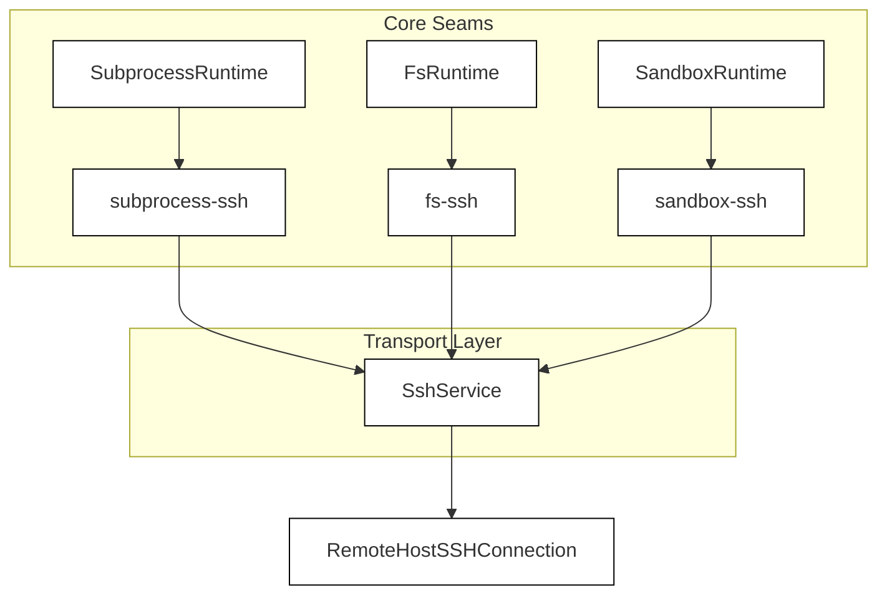
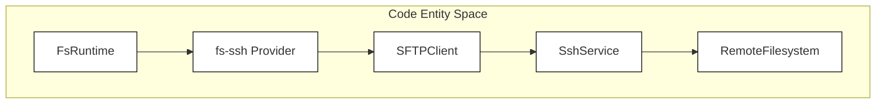

# SSH & Remote Execution Backends

Relevant source files

The following files were used as context for generating this wiki page:

- [packages/fs/fs-local/README.i18n.yaml](packages/fs/fs-local/README.i18n.yaml)
- [packages/fs/fs-local/README.md](packages/fs/fs-local/README.md)
- [packages/fs/fs-local/README.zh.md](packages/fs/fs-local/README.zh.md)
- [packages/fs/fs-local/src/fsio.ts](packages/fs/fs-local/src/fsio.ts)
- [packages/fs/fs-local/src/index.ts](packages/fs/fs-local/src/index.ts)
- [packages/fs/fs-local/tests/filesystem.spec.ts](packages/fs/fs-local/tests/filesystem.spec.ts)
- [packages/fs/fs-local/tests/fsio.spec.ts](packages/fs/fs-local/tests/fsio.spec.ts)
- [packages/fs/fs/README.i18n.yaml](packages/fs/fs/README.i18n.yaml)
- [packages/fs/fs/README.md](packages/fs/fs/README.md)
- [packages/fs/fs/README.zh.md](packages/fs/fs/README.zh.md)
- [packages/fs/fs/src/index.ts](packages/fs/fs/src/index.ts)
- [packages/fs/fs/src/types.ts](packages/fs/fs/src/types.ts)
- [packages/fs/fs/tests/service.spec.ts](packages/fs/fs/tests/service.spec.ts)
- [packages/subprocess/subprocess-local/README.i18n.yaml](packages/subprocess/subprocess-local/README.i18n.yaml)
- [packages/subprocess/subprocess-local/README.md](packages/subprocess/subprocess-local/README.md)
- [packages/subprocess/subprocess-local/README.zh.md](packages/subprocess/subprocess-local/README.zh.md)
- [packages/subprocess/subprocess-local/src/index.ts](packages/subprocess/subprocess-local/src/index.ts)
- [packages/subprocess/subprocess-local/src/linux-scope.ts](packages/subprocess/subprocess-local/src/linux-scope.ts)
- [packages/subprocess/subprocess-local/src/managed-owner.ts](packages/subprocess/subprocess-local/src/managed-owner.ts)
- [packages/subprocess/subprocess-local/src/runner-launch.ts](packages/subprocess/subprocess-local/src/runner-launch.ts)
- [packages/subprocess/subprocess-local/src/spawn-runner.ts](packages/subprocess/subprocess-local/src/spawn-runner.ts)
- [packages/subprocess/subprocess-local/src/spawn.ts](packages/subprocess/subprocess-local/src/spawn.ts)
- [packages/subprocess/subprocess-local/src/windows-job.ts](packages/subprocess/subprocess-local/src/windows-job.ts)
- [packages/subprocess/subprocess-local/tests/linux-scope.spec.ts](packages/subprocess/subprocess-local/tests/linux-scope.spec.ts)
- [packages/subprocess/subprocess-local/tests/local.spec.ts](packages/subprocess/subprocess-local/tests/local.spec.ts)
- [packages/subprocess/subprocess-local/tests/native-containment.spec.ts](packages/subprocess/subprocess-local/tests/native-containment.spec.ts)
- [packages/subprocess/subprocess-local/tests/native-windows.spec.ts](packages/subprocess/subprocess-local/tests/native-windows.spec.ts)
- [packages/subprocess/subprocess-local/tests/spawn-runner.spec.ts](packages/subprocess/subprocess-local/tests/spawn-runner.spec.ts)
- [packages/subprocess/subprocess-local/tests/spawn.spec.ts](packages/subprocess/subprocess-local/tests/spawn.spec.ts)
- [packages/subprocess/subprocess-local/tests/windows-job.spec.ts](packages/subprocess/subprocess-local/tests/windows-job.spec.ts)
- [packages/subprocess/win32-process/README.i18n.yaml](packages/subprocess/win32-process/README.i18n.yaml)
- [packages/subprocess/win32-process/README.md](packages/subprocess/win32-process/README.md)
- [packages/subprocess/win32-process/README.zh.md](packages/subprocess/win32-process/README.zh.md)
- [packages/subprocess/win32-process/src/abi.ts](packages/subprocess/win32-process/src/abi.ts)
- [packages/subprocess/win32-process/src/ffi.ts](packages/subprocess/win32-process/src/ffi.ts)
- [packages/subprocess/win32-process/src/index.ts](packages/subprocess/win32-process/src/index.ts)
- [packages/subprocess/win32-process/src/process.ts](packages/subprocess/win32-process/src/process.ts)
- [packages/subprocess/win32-process/tests/ordinary-process.spec.ts](packages/subprocess/win32-process/tests/ordinary-process.spec.ts)
- [packages/subprocess/win32-process/verify/abi-probe.cpp](packages/subprocess/win32-process/verify/abi-probe.cpp)

## Purpose & Scope
This page details the `packages/ssh` family within DeepSeek Harness (`dsh`), which extends the core capability seams (`fs`, `subprocess`, and `sandbox`) to target remote hosts over secure shell (SSH) connections. It covers the SSH service layer, helper runtimes, the `fs-ssh`, `subprocess-ssh`, and `sandbox-ssh` providers, and integrated Language Server Protocol (LSP) bridging over remote connections.

---

## 1. Architecture & The SSH Family Overview

The remote execution subsystem relies on the same capability seam patterns established by local providers (such as `LocalSubprocessRuntime` [packages/subprocess/subprocess-local/src/index.ts:64-90]() and local filesystem runtimes), but abstracts transport boundaries to execute commands, manipulate files, and enforce security policies across network barriers.

*Diagram 1: Remote Execution Seam Composition mapping core runtimes to `SshService`.*

Sources:
- `packages/subprocess/subprocess-local/src/index.ts:64-90`

---

## 2. Remote Filesystem Provider (`fs-ssh`)

The `fs-ssh` provider implements the filesystem capability seam by proxying file read, write, stat, and glob operations over an SSH SFTP subsystem or remote command execution channel. 

- **Path Resolution**: Normalizes absolute and relative paths against the remote session's working directory.
- **Stream Buffering**: Mirrors local stream buffering and spill-file fallback strategies used in local providers, adjusting for network latency and backpressure [packages/subprocess/subprocess-local/src/spawn.ts:44-54]().

*Diagram 2: `fs-ssh` Data Flow from `FsRuntime` to `RemoteFilesystem`.*

Sources:
- `packages/subprocess/subprocess-local/src/spawn.ts:44-54`

---

## 3. Remote Subprocess & Execution Provider (`subprocess-ssh`)

The `subprocess-ssh` provider implements `SubprocessRuntime` over SSH channels. It serializes spawn specifications, handles environment scrubbing [packages/subprocess/subprocess-local/src/spawn.ts:44-54](), and coordinates bootstrap runners [packages/subprocess/subprocess-local/src/runner-launch.ts:29-42]() on the remote machine.

- **Process Spawning**: Executes remote target commands using shell invocation or direct executable resolution akin to `spawnRunnerInvocation()` [packages/subprocess/subprocess-local/src/runner-launch.ts:29-42]().
- **Stdio & Control Transport**: Multiplexes standard input, output, error, and control channels over SSH session channels, preserving exit code reporting and signal propagation.

Sources:
- `packages/subprocess/subprocess-local/src/spawn.ts:44-54`
- `packages/subprocess/subprocess-local/src/runner-launch.ts:29-42`

---

## 4. Remote Sandbox & Security Provider (`sandbox-ssh`)

The `sandbox-ssh` provider wraps remote executions in security isolation mechanisms (such as restricted user contexts or containerized runtimes) corresponding to local sandboxing features like Linux user-systemd scopes or Windows Job objects [packages/subprocess/subprocess-local/src/linux-scope.ts:110-120]().

- **Policy Enforcement**: Translates local approval and security policies into remote capability constraints prior to command execution.

Sources:
- `packages/subprocess/subprocess-local/src/linux-scope.ts:110-120`

---

## 5. LSP Integration Packages over SSH

The LSP integration packages bridge language server communication across remote SSH links. 

- **Transport Bridging**: Spawns language server binaries on the remote host via `subprocess-ssh` and proxies JSON-RPC messages between the local client/host bridge and the remote server stdio streams.
- **Workspace Synchronization**: Coordinates file watcher events between `fs-ssh` and remote language servers to maintain accurate symbol indices and diagnostics.

Sources:
- `packages/subprocess/subprocess-local/src/index.ts:64-90`