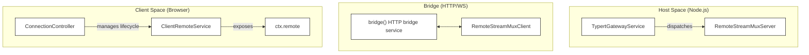
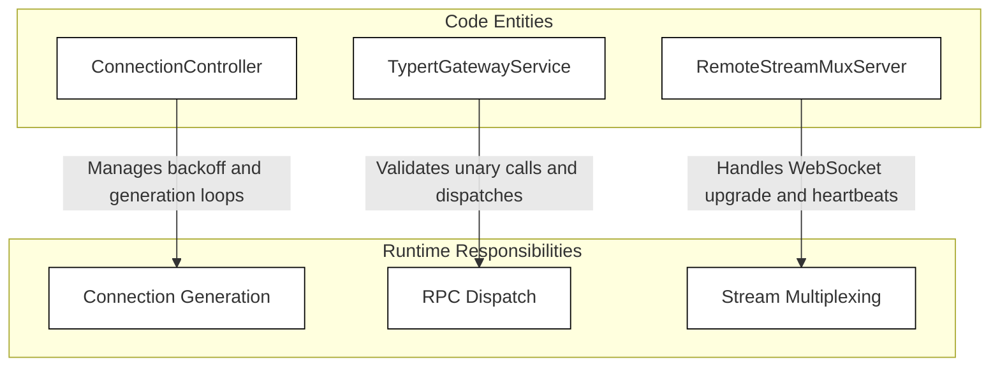
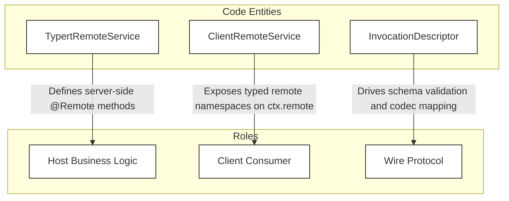
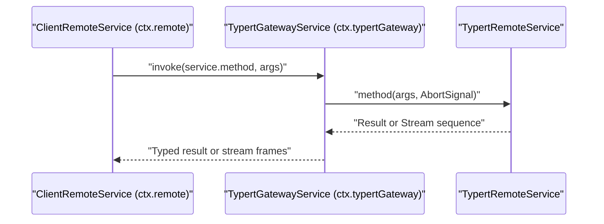

# API Layer & Host-Client Bridge

Relevant source files

The following files were used as context for generating this wiki page:

- [packages/api/gateway/README.i18n.yaml](packages/api/gateway/README.i18n.yaml)
- [packages/api/gateway/README.md](packages/api/gateway/README.md)
- [packages/api/gateway/README.zh.md](packages/api/gateway/README.zh.md)
- [packages/api/gateway/src/client/index.ts](packages/api/gateway/src/client/index.ts)
- [packages/api/gateway/src/client/stream-client.ts](packages/api/gateway/src/client/stream-client.ts)
- [packages/api/gateway/src/index.ts](packages/api/gateway/src/index.ts)
- [packages/api/gateway/src/stream-server.ts](packages/api/gateway/src/stream-server.ts)
- [packages/api/gateway/src/types.ts](packages/api/gateway/src/types.ts)
- [packages/api/gateway/tests/gateway-stream.host.spec.ts](packages/api/gateway/tests/gateway-stream.host.spec.ts)
- [packages/api/gateway/tests/gateway.client.spec.ts](packages/api/gateway/tests/gateway.client.spec.ts)
- [packages/api/gateway/tests/gateway.host.spec.ts](packages/api/gateway/tests/gateway.host.spec.ts)
- [packages/api/gateway/tests/stream-server.host.spec.ts](packages/api/gateway/tests/stream-server.host.spec.ts)
- [packages/client/connection/src/client/connection.ts](packages/client/connection/src/client/connection.ts)
- [packages/client/connection/tests/connection.client.spec.ts](packages/client/connection/tests/connection.client.spec.ts)

The **API Layer & Host-Client Bridge** constitutes the central infrastructure enabling communication between the Node.js Host environment and the browser Client UI in DeepSeek Harness (`dsh`). It exposes services on the Host as secure, typed remote procedure calls (RPCs) and multiplexed streaming endpoints consumable by the browser client through HTTP and WebSocket protocols.

This layer abstracts:
- Carrier-neutral RPC transport.
- Authentication and trust enforcement using signed browser cookies and strict Host/Origin validation [packages/api/gateway/README.md:31-33]().
- Multiplexed logical streams over WebSockets with reconnect and backoff managed by `ConnectionController` [packages/client/connection/src/client/connection.ts:77-111]().
- Type-safe remote invocation built on the Typert system with generated contracts [packages/api/gateway/src/client/index.ts:103-132]().

This page provides a high-level overview of the main components and their integration. Detailed technical documentation is available in dedicated child pages for each major subsystem:
- [API Proxy & RPC Protocol](#5.1)
- [Typert: Type-Safe RPC Generation](#5.2)
- [Client Runtime & Session Management](#5.3)

---

## System Entity Map: Host to Client

The following diagram maps core system entities by their code identities and shows their connections across the bridge layer, illustrating host services, transport carriers, and client runtime components.

### Diagram: Host-Client Bridge Entity Topology

Sources:  
- [packages/client/connection/src/client/connection.ts:77-111]()  
- [packages/api/gateway/src/index.ts:1-70]()  
- [packages/api/gateway/src/client/index.ts:145-194]()  

---

## 5.1 API Proxy & RPC Protocol

The **API Proxy & RPC Protocol** forms the transport and gateway abstraction exposed to browser clients. This subsystem manages connection generations, request authentication, and HTTP/WebSocket bridging between the browser and Node.js Host.

The `ConnectionController` orchestrates connection generations, state transitions, and exponential backoff recovery [packages/client/connection/src/client/connection.ts:77-111](). On the Host side, `TypertGatewayService` and `RemoteStreamMuxServer` handle incoming RPC requests, schema validation, and multiplexed streaming over WebSockets [packages/api/gateway/src/index.ts:1-70](), [packages/api/gateway/src/stream-server.ts:55-114]().

For in-depth protocol details including SSE streaming, request trust validation, retry policy, and fetch handler internals, see [API Proxy & RPC Protocol](#5.1).

### Diagram: API Proxy Code Entity Mapping

Sources:  
- [packages/client/connection/src/client/connection.ts:77-111]()  
- [packages/api/gateway/src/index.ts:1-70]()  
- [packages/api/gateway/src/stream-server.ts:55-114]()  

---

## 5.2 Typert: Type-Safe RPC Generation

The **Typert** subsystem enables end-to-end type safety for remote procedure calls between Host and Client using generated code declarations. Host services extend `TypertRemoteService` and annotate methods with `@Remote` or `@RemoteScope` decorators [packages/api/gateway/README.md:27-29]().

Invocation descriptors generated during the build pipeline provide strict runtime validation on the Host and expose type-safe contracts on the Client via `ClientRemote` [packages/api/gateway/src/client/index.ts:103-132](). Unary results and streams are validated through codecs before crossing the transport boundary.

For full technical details on decorators, type analysis, build pipeline, and generated contracts, see [Typert: Type-Safe RPC Generation](#5.2).

### Diagram: Typert RPC Code Entity Mapping

Sources:  
- [packages/api/gateway/README.md:27-29]()  
- [packages/api/gateway/src/client/index.ts:103-143]()  

---

## 5.3 Client Runtime & Session Management

On the browser side, the **Client Runtime** provides the `ClientRemoteService` registered as `ctx.remote` in the Cordis dependency injection container [packages/api/gateway/src/client/index.ts:127-143](). It unifies multiplexed stream handling via `RemoteStreamMuxClient` and manages physical transport recovery with `ConnectionController`.

The client runtime mediates session lifecycles, conversation node assembly, workspace routing, and stream dispatch while supporting cooperative cancellation through `AbortSignal` parameters [packages/api/gateway/src/client/index.ts:145-201]().

For thorough coverage of session management, multiplexed dispatch, history paging, and runtime extensibility, see [Client Runtime & Session Management](#5.3).

Sources:  
- [packages/api/gateway/src/client/index.ts:127-201]()  

---

## Communication Flow Diagram

The following sequence demonstrates the life cycle of a typical typed API call from browser to Host and back, mapping runtime calls directly to code methods and services.

### Diagram: RPC Invocation and Stream Dispatch Sequence

Sources:  
- [packages/api/gateway/src/index.ts:1-70]()  
- [packages/api/gateway/src/client/index.ts:145-201]()  

---

# Summary

The **API Layer & Host-Client Bridge** orchestrates the exposure of Node.js Host services as type-safe, authenticated RPC endpoints for consumption by the browser client.

Key constituents are:
- **Connection Management**: Carrier-neutral HTTP and WebSocket bridge equipped with browser authentication and retry-aware connection generation [packages/client/connection/src/client/connection.ts:77-111]().
- **Typert Gateway Service**: Hosts typed invocation dispatch and Remote streaming protocol atop the connection layer [packages/api/gateway/src/index.ts:1-70]().
- **Client Runtime**: Implements browser client proxies for typed Remote method calls and multiplexed streams integrated into Cordis service contexts [packages/api/gateway/src/client/index.ts:127-143]().

For detailed technical working within each subsystem, please proceed to the following child pages:
- [API Proxy & RPC Protocol](#5.1)  
- [Typert: Type-Safe RPC Generation](#5.2)  
- [Client Runtime & Session Management](#5.3)