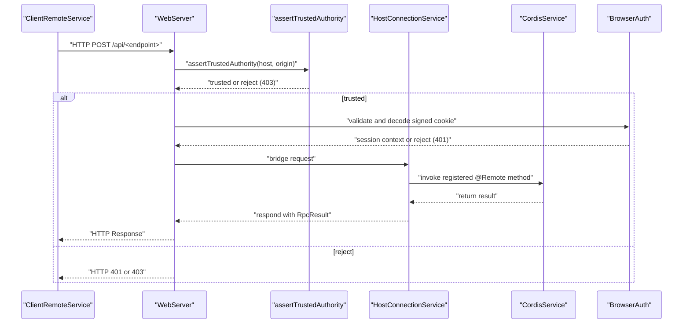
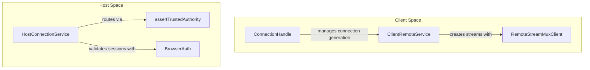
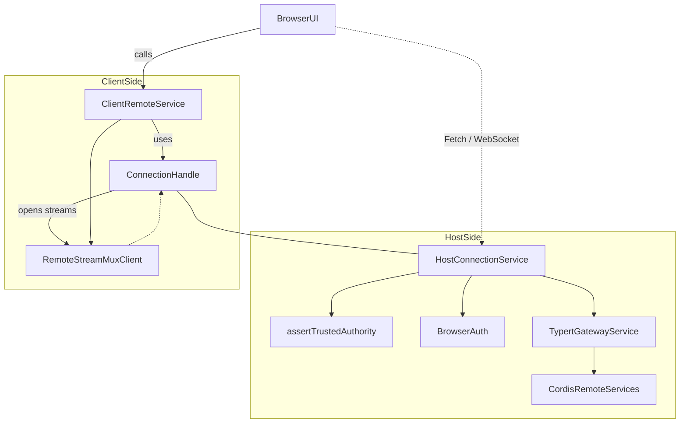
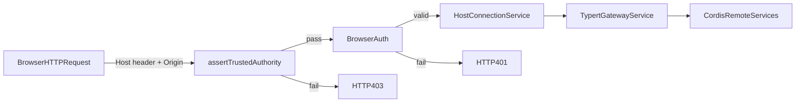

# API Proxy & RPC Protocol

Relevant source files

The following files were used as context for generating this wiki page:

- [.agents/notes/implemented/architecture/2026-07-28-api-browser-trust-boundary.i18n.yaml](.agents/notes/implemented/architecture/2026-07-28-api-browser-trust-boundary.i18n.yaml)
- [.agents/notes/implemented/architecture/2026-07-28-api-browser-trust-boundary.md](.agents/notes/implemented/architecture/2026-07-28-api-browser-trust-boundary.md)
- [.agents/notes/implemented/architecture/2026-07-28-api-browser-trust-boundary.zh.md](.agents/notes/implemented/architecture/2026-07-28-api-browser-trust-boundary.zh.md)
- [.agents/notes/implemented/architecture/2026-08-24-browser-token-authentication.i18n.yaml](.agents/notes/implemented/architecture/2026-08-24-browser-token-authentication.i18n.yaml)
- [.agents/notes/implemented/architecture/2026-08-24-browser-token-authentication.md](.agents/notes/implemented/architecture/2026-08-24-browser-token-authentication.md)
- [.agents/notes/implemented/architecture/2026-08-24-browser-token-authentication.zh.md](.agents/notes/implemented/architecture/2026-08-24-browser-token-authentication.zh.md)
- [packages/api/gateway/README.i18n.yaml](packages/api/gateway/README.i18n.yaml)
- [packages/api/gateway/README.md](packages/api/gateway/README.md)
- [packages/api/gateway/README.zh.md](packages/api/gateway/README.zh.md)
- [packages/api/gateway/src/client/index.ts](packages/api/gateway/src/client/index.ts)
- [packages/api/gateway/src/client/stream-client.ts](packages/api/gateway/src/client/stream-client.ts)
- [packages/api/gateway/src/index.ts](packages/api/gateway/src/index.ts)
- [packages/api/gateway/src/stream-server.ts](packages/api/gateway/src/stream-server.ts)
- [packages/api/gateway/src/types.ts](packages/api/gateway/src/types.ts)
- [packages/api/gateway/tests/gateway-stream.host.spec.ts](packages/api/gateway/tests/gateway-stream.host.spec.ts)
- [packages/api/gateway/tests/gateway.client.spec.ts](packages/api/gateway/tests/gateway.client.spec.ts)
- [packages/api/gateway/tests/gateway.host.spec.ts](packages/api/gateway/tests/gateway.host.spec.ts)
- [packages/api/gateway/tests/stream-server.host.spec.ts](packages/api/gateway/tests/stream-server.host.spec.ts)
- [packages/api/remotes/tests/built-lib.e2e.ts](packages/api/remotes/tests/built-lib.e2e.ts)
- [packages/client/connection/README.i18n.yaml](packages/client/connection/README.i18n.yaml)
- [packages/client/connection/README.md](packages/client/connection/README.md)
- [packages/client/connection/README.zh.md](packages/client/connection/README.zh.md)
- [packages/client/connection/src/api-request-trust.ts](packages/client/connection/src/api-request-trust.ts)
- [packages/client/connection/src/browser-auth.ts](packages/client/connection/src/browser-auth.ts)
- [packages/client/connection/src/client/api.ts](packages/client/connection/src/client/api.ts)
- [packages/client/connection/src/client/connection.ts](packages/client/connection/src/client/connection.ts)
- [packages/client/connection/src/client/index.ts](packages/client/connection/src/client/index.ts)
- [packages/client/connection/src/client/random-uuid.ts](packages/client/connection/src/client/random-uuid.ts)
- [packages/client/connection/src/client/rpc.ts](packages/client/connection/src/client/rpc.ts)
- [packages/client/connection/src/http-bridge.ts](packages/client/connection/src/http-bridge.ts)
- [packages/client/connection/src/index.ts](packages/client/connection/src/index.ts)
- [packages/client/connection/src/rpc-host.ts](packages/client/connection/src/rpc-host.ts)
- [packages/client/connection/src/rpc.ts](packages/client/connection/src/rpc.ts)
- [packages/client/connection/tests/browser-auth.host.spec.ts](packages/client/connection/tests/browser-auth.host.spec.ts)
- [packages/client/connection/tests/client-apply.client.spec.ts](packages/client/connection/tests/client-apply.client.spec.ts)
- [packages/client/connection/tests/connection.client.spec.ts](packages/client/connection/tests/connection.client.spec.ts)
- [packages/client/connection/tests/fetch-routes.host.spec.ts](packages/client/connection/tests/fetch-routes.host.spec.ts)
- [packages/client/connection/tests/http-bridge.host.spec.ts](packages/client/connection/tests/http-bridge.host.spec.ts)
- [packages/client/connection/tests/node-half.host.spec.ts](packages/client/connection/tests/node-half.host.spec.ts)
- [packages/client/hmr/tests/events.client.spec.ts](packages/client/hmr/tests/events.client.spec.ts)
- [packages/client/ui-workspace/src/client/shortcuts.ts](packages/client/ui-workspace/src/client/shortcuts.ts)
- [packages/client/ui-workspace/tests/shortcuts.client.spec.ts](packages/client/ui-workspace/tests/shortcuts.client.spec.ts)

The API Proxy module orchestrates communication between the DeepSeek Harness (dsh) Host environment (Node.js) and the Client (Browser UI or in-process) through a carefully designed type-safe Remote Procedure Call (RPC) protocol. It serves as a gateway combining:

- Unary RPC over HTTP POST with multiplexed streaming (using SSE or WebSocket mux).
- Structured payload envelope validation and encoding, including multipart byte attachments.
- A strict trust boundary enforcing browser request authentication and host-origin checks.
- Session export endpoints and exact HTTP fetch routing.
- Integration of a typed RPC method map powered by Typert-generated descriptors.

This page provides an in-depth technical overview, describing core service implementations, data flow, key classes and interfaces, and relations bridging natural language UI concepts to actual code entities. Mermaid diagrams illustrate protocol components and trust boundaries.

Sources: [packages/client/connection/README.md:1-35](), [packages/client/connection/src/index.ts:1-161](), [packages/api/gateway/src/client/index.ts:1-203](), [packages/api/gateway/src/index.ts:1-199]()

---

## System Architecture & Trust Boundary

The API Proxy architecture separates concerns between:

- **Carrier-neutral RPC and fetch registries** hosted by the `HostConnectionService` in the `client-connection` package (`[packages/client/connection/src/rpc-host.ts]()`).
- **Typed RPC client facades and stream muxers** residing in the `api-gateway` client service (`[packages/api/gateway/src/client/index.ts]()`).
- **Browser-trust-enforcing HTTP routes** guarded by origin and authority validation (`[packages/client/connection/src/api-request-trust.ts]()`).
- **Authentication layers** issuing signed, authority-bound cookies (`[packages/client/connection/src/browser-auth.ts]()`).

### Key Components

| Component                  | Code Entity                          | Location                                    | Role                                                                                      |
|---------------------------|------------------------------------|-------------|-------------------------------------------------------------------------------------------|
| HostConnectionService      | `HostConnectionService`             | `[packages/client/connection/src/rpc-host.ts]()` | Manages HTTP fetch routing, RPC endpoint dispatch, and trust boundary enforcement on host.|
| API `/api` HTTP bridge     | `bridge()`                         | `[packages/client/connection/src/index.ts:10]()` | Bridges requests to RPC handlers with exact route matching and request body modes.       |
| Trust verification         | `assertTrustedAuthority()`         | `[packages/client/connection/src/api-request-trust.ts]()` | Enforces strict checks on Host headers and Origins to prevent DNS rebinding and CSRF.     |
| Browser authentication     | `BrowserAuth`                      | `[packages/client/connection/src/browser-auth.ts]()` | Manages cryptographic signed cookies for browser session authentication.                   |
| Typed RPC client facade    | `ClientRemoteService`               | `[packages/api/gateway/src/client/index.ts:144]()` | Client-side typed proxy exposing generated `@Remote` namespaces, multiplexed streams.     |
| Gateway RPC dispatch       | `TypertGatewayService`              | `[packages/api/gateway/src/index.ts:199]()` | Host-side typed RPC dispatcher invoking Cordis services using generated method maps.       |
| RPC envelope and schema    | Types and schema sets               | `[packages/client/connection/src/rpc-schema.ts]()` & `[packages/client/connection/src/rpc.ts]()` | Define the standardized message envelope for RPC requests and responses with validation.  |

Sources: [packages/client/connection/src/rpc-host.ts](), [packages/client/connection/src/index.ts:10](), [packages/client/connection/src/api-request-trust.ts](), [packages/client/connection/src/browser-auth.ts](), [packages/api/gateway/src/client/index.ts:144](), [packages/api/gateway/src/index.ts:199]()

### Browser Request Trust & Authentication Flow

Every host-side RPC method and WebSocket stream requires an authenticated browser session. This is established using a signed cookie whose secret key is provisioned by `BrowserAuth`:

- Incoming requests first pass through `assertTrustedAuthority` which verifies:
  - The `Host` is either a recognized loopback address or matches an explicit trusted entry (`[packages/client/connection/README.md:41-47]()`).
  - The `Origin` header matches the `Host` exactly when present (`[packages/client/connection/README.md:41-47]()`).
  - Requests with cross-site `sec-fetch-site` headers are refused (`[packages/client/connection/README.md:41-47]()`).
- Requests without a valid signed cookie return HTTP `401 Unauthorized` (`[packages/client/connection/README.md:41-47]()`).
- Requests failing trust checks return HTTP `403 Forbidden` (`[packages/client/connection/README.md:41-47]()`).

This trust boundary protects the API gateway against DNS rebinding and cross-site request forgery attacks.

#### Diagram: RPC Request & Trust Verification Flow

Sources: [packages/client/connection/src/api-request-trust.ts](), [packages/client/connection/src/browser-auth.ts](), [packages/client/connection/src/index.ts:139-156](), [packages/client/connection/README.md:41-47]()

---

## RPC Protocol Definition & Typert Gateway

The system uses Typert-generated invocation descriptors combined with Cordis services to implement typed RPC on both Host and Client sides.

- The **API Gateway Host service** (`TypertGatewayService`, `[packages/api/gateway/src/index.ts:199]()`) manages invocation dispatch:
  - Validates payloads against generated codecs and parameter lookup contexts (`[packages/api/gateway/README.md:27-30]()`).
  - Supports cancellation-aware methods with `AbortSignal` (`[packages/api/gateway/README.md:37]()`).
  - Implements unary calls and stream invocations over the WebSocket mux (`[packages/api/gateway/README.md:39-43]()`).
- The **Client Remote facade** (`ClientRemoteService`, `[packages/api/gateway/src/client/index.ts:144]()`) exposes typed namespaces accessible via generated proxies:
  - Manages multiplexed logical streams over WebSocket `/api/remote.mux` (`[packages/api/gateway/README.md:39-43]()`).
  - Provides `$stream()` for creating reconnecting typed streams (`[packages/api/gateway/src/client/index.ts:196-201]()`).
  - Offers a `$host` read-only object exposing static Host facts (`[packages/api/gateway/src/client/index.ts:116-125]()`).

The RPC envelope includes:

- A unique RPC ID (`rpcId`) for correlation.
- Typed result or error payloads.
- Support for multipart MIME encoding with binary attachments encoded separately (`[packages/client/connection/README.md:32]()`).
- Strict client- and server-side validation via `@deepseek-ai/schemastery` schemas (`[packages/client/connection/src/index.ts:4]()`).

Sources: [packages/api/gateway/src/index.ts:199](), [packages/api/gateway/src/client/index.ts:116-201](), [packages/client/connection/README.md:32](), [packages/client/connection/src/index.ts:4]()

### RPC Transport Model

| Transport Mode         | Protocol     | Location                              | Description                                                        |
|-----------------------|--------------|-------------------------------------|--------------------------------------------------------------------|
| Unary JSON calls       | HTTP POST    | `/api/<endpoint>` routes             | JSON request/response with typed envelopes and binary attachments (`[packages/client/connection/README.md:32]`).|
| Streaming RPC          | WebSocket    | `/api/remote.mux` multiplexed stream | Logical streams multiplexed over a single WebSocket connection (`[packages/api/gateway/README.md:39]`). |
| In-process Carrier     | Direct call  | Within Node.js via `connection.rpc.open` | Bypasses WebSocket, uses direct iterable streams for flow control (`[packages/client/connection/README.md:34]`). |

Sources: [packages/client/connection/README.md:32-34](), [packages/api/gateway/README.md:39]()

#### Diagram: Client to Host RPC Bridges & Components

Sources: [packages/api/gateway/src/index.ts:1-199](), [packages/api/gateway/src/client/index.ts:142-183]()

---

## Session Export Endpoint & Exact Fetch Routes

The proxy exposes exact Fetch routes for session export and other file-related REST endpoints besides the main RPC `/api` path (`[packages/client/connection/README.md:34]()`).

- The `HostConnectionService` registers exact HTTP verbs and paths with the Host web server (`[packages/client/connection/README.md:34]()`).
- Request bodies are either fully buffered or streamed, depending on route definitions (`[packages/client/connection/README.md:34]()`).
- Non-JSON payloads like multipart session logs or file uploads are handled in specialized endpoints (`[packages/client/connection/README.md:34]()`).
- Request size limits ensure in-memory buffering is safe, with a default maximum request size of 300 MiB (configurable via `maxRequestBodyBytes`, `[packages/client/connection/README.md:80-81]()`).

Sources: [packages/client/connection/README.md:34](), [packages/client/connection/README.md:80-81]()

---

## Streaming & Event Multiplexing

Beyond unary RPC, real-time synchronization and eventing leverage streaming:

- The client opens a shared WebSocket `/api/remote.mux` owned by the API Gateway (`[packages/api/gateway/README.md:39-43]()`).
- Logical streams multiplex over this socket, identified by stream IDs.
- The Gateway hosts event streams (`$events`) that continuously publish Host-side Cordis events (`[packages/api/gateway/README.md:47-50]()`).
- The `RemoteStreamMuxClient` on Client side manages stream lifecycle, delivery, backpressure, and retries.
- Stream uplinks carry client-to-host "input" events; downlinks carry server responses or events (`[packages/api/gateway/README.md:43-46]()`).

### Connection Generations & Recovery

The Client-Connection controller tracks connection generations for resilience (`[packages/client/connection/README.md:56-65]()`):

- Registered generation sources report readiness with an initial `{ type: 'ready', clientId, host }` event (`[packages/client/connection/README.md:56-65]()`).
- Upon readiness, a new generation is published making that connection available (`[packages/client/connection/README.md:56-65]()`).
- In case of network failure or server disconnect, exponential backoff with jitter governs automatic reconnect retries (`[packages/client/connection/README.md:56-65]()`).
- A manual `ctx.connection.reconnect()` triggers restart and state reset (`[packages/client/connection/README.md:56-65]()`).
- Browser offline/online events toggle auto reconnect strategies (`[packages/client/connection/README.md:56-65]()`).

Sources: [packages/api/gateway/README.md:39-50](), [packages/client/connection/README.md:56-65]()

---

# Summary Table of Key Classes and Interfaces

| Name                    | Description                                                                                          | Location                                              |
|-------------------------|--------------------------------------------------------------------------------------------------|-------------------------------------------------------|
| `HostConnectionService` | Core host-side service managing HTTP API routing, RPC endpoints, and authentication enforcement. | `[packages/client/connection/src/rpc-host.ts]()`            |
| `ClientRemoteService`   | Client-side implementation exposing typed RPC facade and managing multiplexed streams.            | `[packages/api/gateway/src/client/index.ts]()`               |
| `TypertGatewayService`  | Host-side supervisor resolving descriptors, dispatching @Remote methods, validating calls.        | `[packages/api/gateway/src/index.ts]()`                      |
| `assertTrustedAuthority`| Function enforcing network-level browser request trust boundaries.                               | `[packages/client/connection/src/api-request-trust.ts]()`    |
| `BrowserAuth`           | Utility class for managing signed browser session cookies and cryptographic keys.                 | `[packages/client/connection/src/browser-auth.ts]()`         |
| `bridge`                | HTTP bridge function routing `/api` requests to RPC handlers with exact Fetch routing logic.     | `[packages/client/connection/src/http-bridge.ts]()`          |
| `RpcId`                 | Type branding RPC request identifiers for correlation tracking.                                  | `[packages/client/connection/src/rpc.ts]()`                   |

Sources: [packages/client/connection/src/rpc-host.ts](), [packages/api/gateway/src/client/index.ts](), [packages/api/gateway/src/index.ts](), [packages/client/connection/src/api-request-trust.ts](), [packages/client/connection/src/browser-auth.ts](), [packages/client/connection/src/http-bridge.ts](), [packages/client/connection/src/rpc.ts]()

---

# Natural Language to Code Entity Space Diagrams

### Diagram 1: API Proxy Core Components and Relations

Sources: [packages/client/connection/src/index.ts](), [packages/client/connection/README.md](), [packages/api/gateway/src/index.ts](), [packages/api/gateway/src/client/index.ts]()

### Diagram 2: Browser Request Trust and Authentication Layers

Sources: [packages/client/connection/src/api-request-trust.ts](), [packages/client/connection/src/browser-auth.ts](), [packages/client/connection/src/rpc-host.ts]()