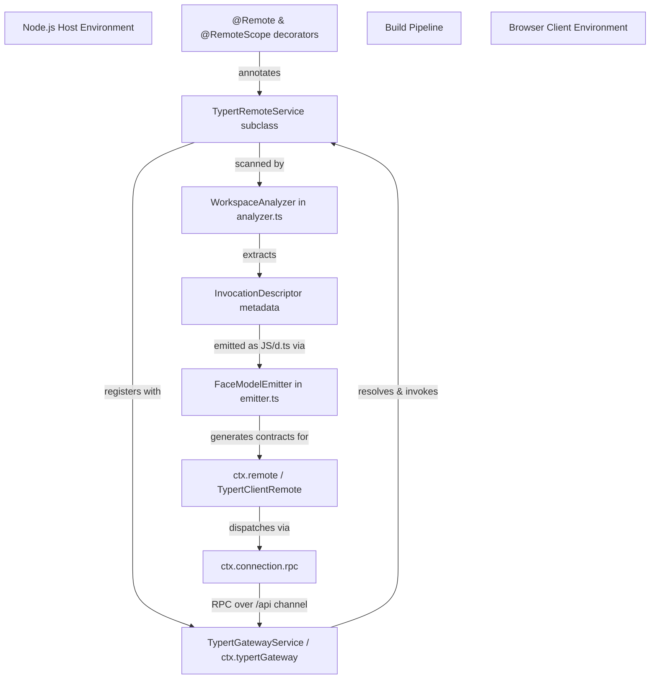
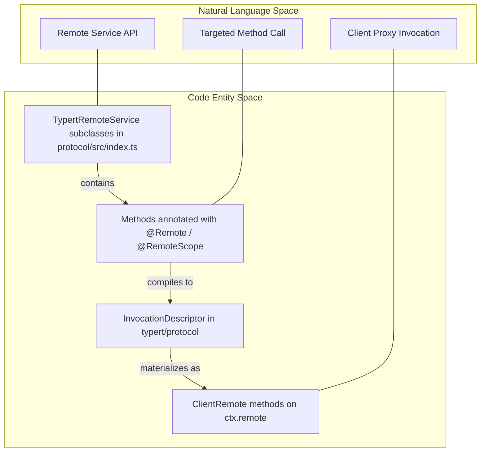
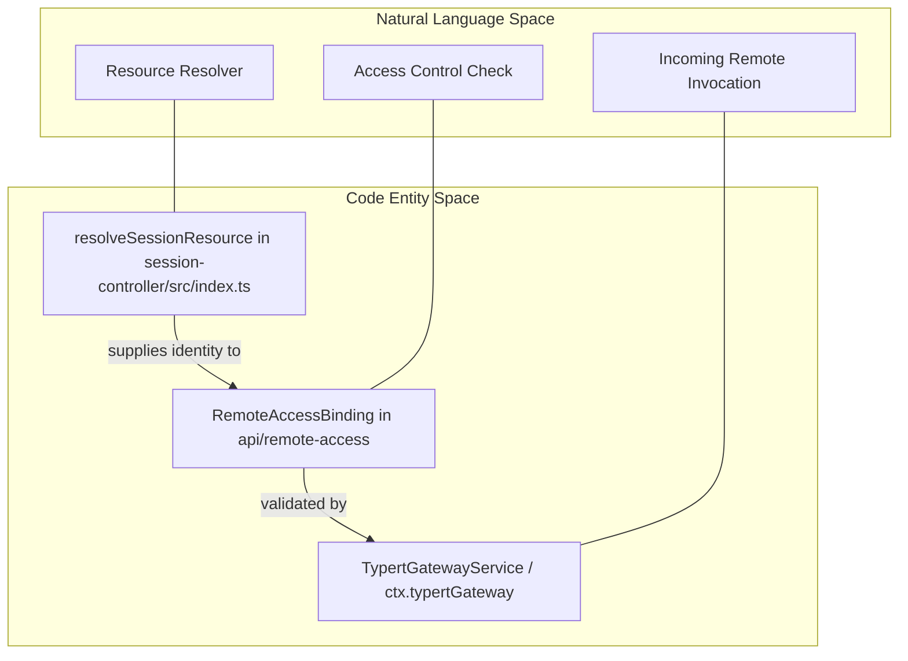

# Typert: Type-Safe RPC Generation

<details>
<summary>Relevant source files</summary>

The following files were used as context for generating this wiki page:

- [.agents/notes/implemented/architecture/2026-10-12-peer-principal-and-remote-access.i18n.yaml](.agents/notes/implemented/architecture/2026-10-12-peer-principal-and-remote-access.i18n.yaml)
- [.agents/notes/implemented/architecture/2026-10-12-peer-principal-and-remote-access.md](.agents/notes/implemented/architecture/2026-10-12-peer-principal-and-remote-access.md)
- [.agents/notes/implemented/architecture/2026-10-12-peer-principal-and-remote-access.zh.md](.agents/notes/implemented/architecture/2026-10-12-peer-principal-and-remote-access.zh.md)
- [docs/subsystems/typert.i18n.yaml](docs/subsystems/typert.i18n.yaml)
- [docs/subsystems/typert.md](docs/subsystems/typert.md)
- [docs/subsystems/typert.zh.md](docs/subsystems/typert.zh.md)
- [packages/api/gateway/src/access.ts](packages/api/gateway/src/access.ts)
- [packages/api/gateway/tests/gateway-access.host.spec.ts](packages/api/gateway/tests/gateway-access.host.spec.ts)
- [packages/api/remote-access/README.i18n.yaml](packages/api/remote-access/README.i18n.yaml)
- [packages/api/remote-access/README.md](packages/api/remote-access/README.md)
- [packages/api/remote-access/README.zh.md](packages/api/remote-access/README.zh.md)
- [packages/api/session-controller/package.json](packages/api/session-controller/package.json)
- [packages/api/session-controller/src/client/contract/events.ts](packages/api/session-controller/src/client/contract/events.ts)
- [packages/api/session-controller/src/index.ts](packages/api/session-controller/src/index.ts)
- [packages/api/session-controller/src/types.ts](packages/api/session-controller/src/types.ts)
- [packages/api/session-controller/tests/client-contract.client.spec.ts](packages/api/session-controller/tests/client-contract.client.spec.ts)
- [packages/api/session-controller/tests/commands-create-fork.host.spec.ts](packages/api/session-controller/tests/commands-create-fork.host.spec.ts)
- [packages/api/session-controller/tests/remote-access.host.spec.ts](packages/api/session-controller/tests/remote-access.host.spec.ts)
- [packages/api/session-controller/tests/session-presets.host.spec.ts](packages/api/session-controller/tests/session-presets.host.spec.ts)
- [packages/api/session-controller/tsconfig.host.json](packages/api/session-controller/tsconfig.host.json)
- [packages/typert/generator/README.i18n.yaml](packages/typert/generator/README.i18n.yaml)
- [packages/typert/generator/README.md](packages/typert/generator/README.md)
- [packages/typert/generator/README.zh.md](packages/typert/generator/README.zh.md)
- [packages/typert/generator/src/analyzer.ts](packages/typert/generator/src/analyzer.ts)
- [packages/typert/generator/src/emitter.ts](packages/typert/generator/src/emitter.ts)
- [packages/typert/generator/src/tsdown-plugin.ts](packages/typert/generator/src/tsdown-plugin.ts)
- [packages/typert/generator/src/workspace.ts](packages/typert/generator/src/workspace.ts)
- [packages/typert/generator/tests/__snapshots__/type-model.spec.ts.snap](packages/typert/generator/tests/__snapshots__/type-model.spec.ts.snap)
- [packages/typert/generator/tests/fixtures/type-model/packages/host/src/index.ts](packages/typert/generator/tests/fixtures/type-model/packages/host/src/index.ts)
- [packages/typert/generator/tests/fixtures/type-model/tsconfig.base.json](packages/typert/generator/tests/fixtures/type-model/tsconfig.base.json)
- [packages/typert/generator/tests/remote-metadata.spec.ts](packages/typert/generator/tests/remote-metadata.spec.ts)
- [packages/typert/generator/tests/remote-model.spec.ts](packages/typert/generator/tests/remote-model.spec.ts)
- [packages/typert/generator/tests/schema-emitter.spec.ts](packages/typert/generator/tests/schema-emitter.spec.ts)
- [packages/typert/generator/tests/tsdown-plugin.spec.ts](packages/typert/generator/tests/tsdown-plugin.spec.ts)
- [packages/typert/generator/tests/type-model-workspace.ts](packages/typert/generator/tests/type-model-workspace.ts)
- [packages/typert/generator/tests/type-model.spec.ts](packages/typert/generator/tests/type-model.spec.ts)
- [packages/typert/loader/tests/lazy-info.spec.ts](packages/typert/loader/tests/lazy-info.spec.ts)
- [packages/typert/protocol/README.i18n.yaml](packages/typert/protocol/README.i18n.yaml)
- [packages/typert/protocol/README.md](packages/typert/protocol/README.md)
- [packages/typert/protocol/README.zh.md](packages/typert/protocol/README.zh.md)
- [packages/typert/protocol/src/index.ts](packages/typert/protocol/src/index.ts)
- [packages/typert/protocol/src/remote-info.ts](packages/typert/protocol/src/remote-info.ts)
- [packages/typert/protocol/src/types.ts](packages/typert/protocol/src/types.ts)
- [packages/typert/protocol/tests/built-runtime.e2e.ts](packages/typert/protocol/tests/built-runtime.e2e.ts)
- [packages/typert/protocol/tests/protocol.spec.ts](packages/typert/protocol/tests/protocol.spec.ts)
- [packages/typert/registry/README.i18n.yaml](packages/typert/registry/README.i18n.yaml)
- [packages/typert/registry/README.md](packages/typert/registry/README.md)
- [packages/typert/registry/README.zh.md](packages/typert/registry/README.zh.md)
- [packages/typert/registry/package.json](packages/typert/registry/package.json)
- [packages/typert/registry/src/service.ts](packages/typert/registry/src/service.ts)
- [packages/typert/registry/src/types.ts](packages/typert/registry/src/types.ts)
- [packages/typert/registry/tests/typert.spec.ts](packages/typert/registry/tests/typert.spec.ts)
- [packages/typert/registry/tsdown.config.ts](packages/typert/registry/tsdown.config.ts)

</details>


Typert is the type-safe Remote Procedure Call (RPC) generation system within DeepSeek Harness (`dsh`) that enables seamless, type-safe interaction between the Node.js Host environment and the browser Client runtime. It automates the transformation of decorated Host service classes into remote callable contracts and client proxies, ensuring compile-time type safety without manual proxy boilerplate.

Sources: `[packages/typert/generator/src/analyzer.ts:1-82](), [packages/typert/protocol/src/index.ts:1-35]()`

---

## 5.2.1 Purpose and Scope

Typert bridges the API surface of Host Cordis services to the browser Client transparently and type-safely. Instead of importing Host code directly into the Client, Typert generates a set of platform-neutral contracts describing remote callable APIs with analyzed argument and return types.

This architectural separation guarantees:
- **Strong type safety** bridging Host implementations and Client usage.
- **Simplified client code** with zero runtime dependency on upstream Host source files.
- **Automatic synchronization** of service API surfaces and underlying transport contracts.

Sources: `[packages/typert/generator/src/analyzer.ts:1-44](), [packages/typert/protocol/src/index.ts:1-25]()`

---

## 5.2.2 Decorators for Host Service Annotation: `@Remote` and `@RemoteScope`

Typert leverages the Cordis plugin system and TypeScript decorators to mark Host-side service classes and methods as remotely accessible.

### `@Remote`

- Applied at the **method** level of a service class.
- Marks that the Host method is accessible over the RPC gateway.
- Supports unary and streaming RPC calls (using `Iterable`, `AsyncIterable`, or `RemoteStream<Out, In>` return types via `RemoteMethodOptions`).
- Attaches metadata including unique method identifiers, parameter types, codec validation schemas, and optional resource readers.

### `@RemoteScope`

- Applied at the **class** or **method** level.
- Specifies a named contextual resolution scope for the receiver service.
- Used to resolve execution identities via context adapters before accessing the service instance and invoking the targeted method.

These decorators provide the static metadata that `WorkspaceAnalyzer` (`[packages/typert/generator/src/analyzer.ts:67-93]()`) discovers for RPC contract generation.

Sources: `[packages/typert/generator/src/analyzer.ts:67-93](), [packages/typert/protocol/src/index.ts:110-178]()`

---

## 5.2.3 `TypertRemoteService`: The Runtime Remote Service Host Facade

`TypertRemoteService` is a base class specialized for remote services in Typert. It standardizes the binding of service implementations, offering:

- Registration keys to identify implementations in Cordis contexts.
- Default namespaces for Remote method resolution.
- Support for alternative inheritance hierarchies via helper registrations (`bindTypertRemote`).
- Tight integration with gateway services to manage:
  - Parameter decoding (`method.input(options)` supporting normal and strict parsing).
  - Scoped container resolution.
  - Execution lifecycle and `AbortSignal` cancellation management.

This base class encapsulates conventions and runtime helpers to expose Cordis services as remotely callable endpoints.

Sources: `[packages/api/session-controller/src/index.ts:135-150](), [packages/typert/protocol/src/index.ts:109-142]()`

---

## 5.2.4 Build Pipeline: Analysis and Emission of RPC Contracts

### Analyzer (`WorkspaceAnalyzer`)

`WorkspaceAnalyzer` (`[packages/typert/generator/src/analyzer.ts:67-93]()`) scans the Host TypeScript program (`ts.Program`) for classes and methods decorated with `@Remote` and `@RemoteScope`. It constructs an in-memory graph of metadata objects that describe every remote callable method, including:

- Method identifiers and dispatch patterns.
- Parameter schemas, names, and mapping sources (normal vs. strict Zod codecs via `createTypertRemoteInfo` `[packages/typert/protocol/src/index.ts:20-20]()`).
- Return types and streaming classifications (`mode: 'stream'`).
- Cancellation support modeling (`AbortSignal`).

### Emitter (`FaceModelEmitter` & `WorkspaceTypertGenerator`)

Using information from the analyzer, `FaceModelEmitter` (`[packages/typert/generator/src/emitter.ts:90-128]`) generates:

- Static TypeScript declaration files (`.d.ts`), describing the remote API contracts.
- Source maps (`.d.ts.map`) for debugging `[packages/typert/generator/src/emitter.ts:43-48]()`.
- Runtime JavaScript files (`.js`) for client proxies and server dispatch registration.

Additionally, build tools integrate this process to automatically emit artifacts at package roots (`lib/typert.host.js`, `lib/typert.host.d.ts`, and `lib/typert.remote-client.js`).

Sources: `[packages/typert/generator/src/analyzer.ts:67-93](), [packages/typert/generator/src/emitter.ts:33-48]()`

---

## 5.2.5 `api/remotes`: Generated Contracts and Runtime Metadata

The registry service (`TypertRegistry`) aggregates selected Host business packages that employ Typert and manages runtime contributions.

### Key RPC Descriptor Fields (`InvocationDescriptor`)

| Field        | Description                                                                                   |
|--------------|-----------------------------------------------------------------------------------------------|
| `id`         | Unique remote method identifier (`<package>#<namespace>/<method>`)                            |
| `service`    | Underlying Cordis service key or explicit namespace string                                    |
| `namespace`  | Logical grouping namespace for client dispatch routing                                       |
| `method`     | Remote method name on the target service                                                     |
| `invocation` | Invocation pattern indicating direct call or scoped context resolution                        |
| `parameters` | Array of parameter descriptors with names, wire keys, sources, and codec validation schemas |
| `cancellation` | Optional configuration for supporting `AbortSignal` propagation                            |
| `result`     | Result codec descriptor, including streaming flags and optional byte serialization            |

Sources: `[packages/typert/protocol/src/index.ts:36-51](), [docs/subsystems/typert.md:39-117]()`

---

## Typert Architecture and Data Flow



Figure 1: High-level Typert build and runtime execution pipeline.
Sources: `[packages/typert/generator/src/analyzer.ts:67-93](), [packages/typert/generator/src/emitter.ts:33-48]()`

---

## Natural Language Space to Code Entity Space Bridges

### Bridge 1: API Surface to Metadata Contracts



Figure 2: Mapping between conceptual remote API entities and concrete classes/functions in the codebase.
Sources: `[packages/typert/generator/src/analyzer.ts:67-93](), [packages/typert/protocol/src/index.ts:36-142]()`

### Bridge 2: Session Identity & Access Policy Resolution



Figure 3: Mapping between conceptual session security/identity resolution and concrete runtime functions.
Sources: `[packages/api/session-controller/src/index.ts:92-107](), [packages/api/gateway/tests/gateway-access.host.spec.ts:1-35]()`

---

## 5.2.6 End-to-End RPC Usage Example

### Host-Side Service Definition

```ts
class FixtureProbeService extends TypertRemoteService {
  constructor(ctx: Context) {
    super(ctx, 'fixtures')
  }

  @Remote('create')
  async create(agentId: string): Promise<string> {
    return 'probe-created'
  }
}
```

Here, `FixtureProbeService` extends `TypertRemoteService` with the service key `'fixtures'`. The `create` method is decorated with `@Remote`, exposing it as a callable remote method.

Sources: `[packages/typert/protocol/src/index.ts:109-142]()`

### Client-Side Invocation

```ts
const result = await ctx.remote['fixtures'].create('agent-123')
```

On the browser Client, the generated contract exposes the remote service on `ctx.remote['fixtures']`. Invoking `create` acts as a native asynchronous function call, carrying fully typed parameters and return values with transparent RPC communication to the Host gateway.

Sources: `[packages/typert/protocol/src/index.ts:36-57]()`

---

# Summary

Typert provides a robust architecture for generating type-safe, platform-neutral, and strongly typed RPC contracts that expose Host Cordis services to the browser Client without direct dependency. Its decorator-driven Host annotations, combined with `WorkspaceAnalyzer` (`[packages/typert/generator/src/analyzer.ts:67-93]()`) and `FaceModelEmitter` (`[packages/typert/generator/src/emitter.ts:90-128]()`), produce precise invocation metadata and client proxies. This system enhances developer experience by eliminating boilerplate and runtime errors, maintaining full type safety across the Host-Client boundary.

Sources: `[packages/typert/generator/src/analyzer.ts:67-93](), [packages/typert/generator/src/emitter.ts:90-128](), [packages/typert/protocol/src/index.ts:1-185]()`