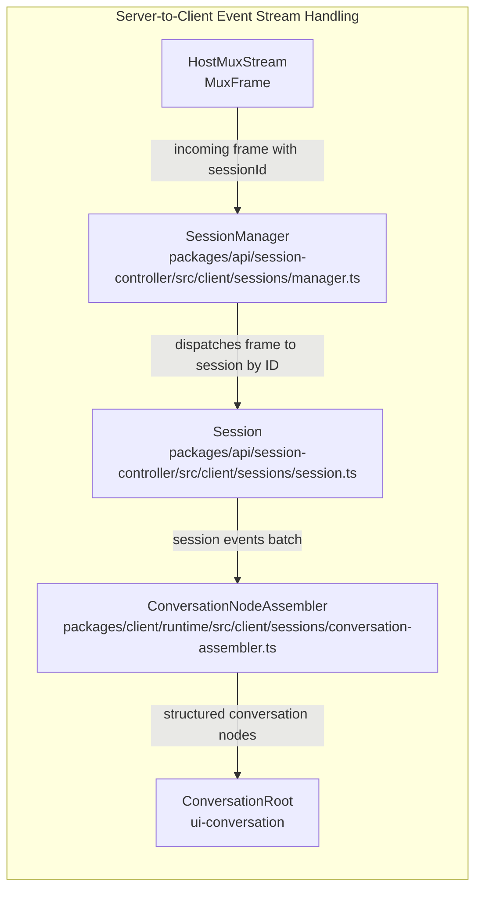
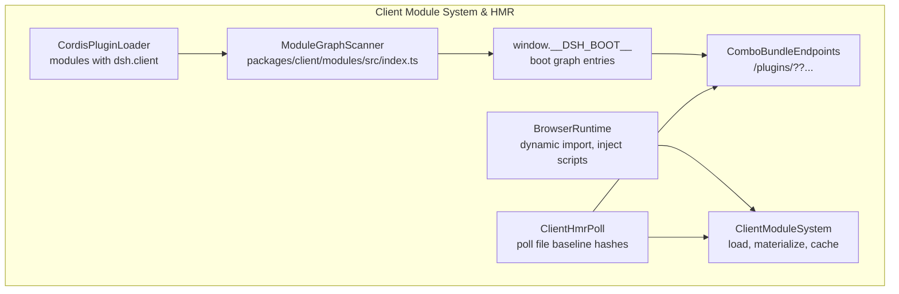

# Client Runtime & Session Management

Relevant source files

The following files were used as context for generating this wiki page:

- [.agents/notes/implemented/architecture/2026-07-23-client-plugin-loading-model.i18n.yaml](.agents/notes/implemented/architecture/2026-07-23-client-plugin-loading-model.i18n.yaml)
- [.agents/notes/implemented/architecture/2026-07-23-client-plugin-loading-model.md](.agents/notes/implemented/architecture/2026-07-23-client-plugin-loading-model.md)
- [.agents/notes/implemented/architecture/2026-07-23-client-plugin-loading-model.zh.md](.agents/notes/implemented/architecture/2026-07-23-client-plugin-loading-model.zh.md)
- [.agents/notes/implemented/architecture/2026-08-25-session-observations-and-projection-owned-client-state.i18n.yaml](.agents/notes/implemented/architecture/2026-08-25-session-observations-and-projection-owned-client-state.i18n.yaml)
- [.agents/notes/implemented/architecture/2026-08-25-session-observations-and-projection-owned-client-state.md](.agents/notes/implemented/architecture/2026-08-25-session-observations-and-projection-owned-client-state.md)
- [.agents/notes/implemented/architecture/2026-08-25-session-observations-and-projection-owned-client-state.zh.md](.agents/notes/implemented/architecture/2026-08-25-session-observations-and-projection-owned-client-state.zh.md)
- [apps/web/tests/chat-fold-opened-group.e2e.ts](apps/web/tests/chat-fold-opened-group.e2e.ts)
- [apps/web/tests/smoke-real.e2e.ts](apps/web/tests/smoke-real.e2e.ts)
- [docs/subsystems/client-modules.i18n.yaml](docs/subsystems/client-modules.i18n.yaml)
- [docs/subsystems/client-modules.md](docs/subsystems/client-modules.md)
- [docs/subsystems/client-modules.zh.md](docs/subsystems/client-modules.zh.md)
- [packages/api/session-controller/README.i18n.yaml](packages/api/session-controller/README.i18n.yaml)
- [packages/api/session-controller/README.md](packages/api/session-controller/README.md)
- [packages/api/session-controller/README.zh.md](packages/api/session-controller/README.zh.md)
- [packages/api/session-controller/src/client/contract/session.ts](packages/api/session-controller/src/client/contract/session.ts)
- [packages/api/session-controller/src/client/contract/sessions.ts](packages/api/session-controller/src/client/contract/sessions.ts)
- [packages/api/session-controller/src/client/contract/snapshot.ts](packages/api/session-controller/src/client/contract/snapshot.ts)
- [packages/api/session-controller/src/client/index.ts](packages/api/session-controller/src/client/index.ts)
- [packages/api/session-controller/src/client/sessions/lineage.ts](packages/api/session-controller/src/client/sessions/lineage.ts)
- [packages/api/session-controller/src/client/sessions/manager.ts](packages/api/session-controller/src/client/sessions/manager.ts)
- [packages/api/session-controller/src/client/sessions/projection-store.ts](packages/api/session-controller/src/client/sessions/projection-store.ts)
- [packages/api/session-controller/src/client/sessions/service.ts](packages/api/session-controller/src/client/sessions/service.ts)
- [packages/api/session-controller/src/client/sessions/session.ts](packages/api/session-controller/src/client/sessions/session.ts)
- [packages/api/session-controller/src/commands.ts](packages/api/session-controller/src/commands.ts)
- [packages/api/session-controller/tests/client-apply.client.spec.ts](packages/api/session-controller/tests/client-apply.client.spec.ts)
- [packages/api/session-controller/tests/inbox-projection.client.spec.ts](packages/api/session-controller/tests/inbox-projection.client.spec.ts)
- [packages/api/session-controller/tests/manager.client.spec.ts](packages/api/session-controller/tests/manager.client.spec.ts)
- [packages/api/session-controller/tests/projection-store.client.spec.ts](packages/api/session-controller/tests/projection-store.client.spec.ts)
- [packages/api/session-controller/tests/session-models.host.spec.ts](packages/api/session-controller/tests/session-models.host.spec.ts)
- [packages/api/session-controller/tests/session-pending-submissions.client.spec.ts](packages/api/session-controller/tests/session-pending-submissions.client.spec.ts)
- [packages/api/session-controller/tests/session.client.spec.ts](packages/api/session-controller/tests/session.client.spec.ts)
- [packages/api/session-controller/tests/sessions-service.client.spec.ts](packages/api/session-controller/tests/sessions-service.client.spec.ts)
- [packages/client/AGENTS.md](packages/client/AGENTS.md)
- [packages/client/modules/README.i18n.yaml](packages/client/modules/README.i18n.yaml)
- [packages/client/modules/README.md](packages/client/modules/README.md)
- [packages/client/modules/README.zh.md](packages/client/modules/README.zh.md)
- [packages/client/modules/src/index.ts](packages/client/modules/src/index.ts)
- [packages/client/modules/tests/node-half.client.spec.ts](packages/client/modules/tests/node-half.client.spec.ts)
- [packages/client/tsdown.client.ts](packages/client/tsdown.client.ts)
- [packages/client/ui-sidebar-documentpreview/tests/document-preview-license-bundle.client.spec.ts](packages/client/ui-sidebar-documentpreview/tests/document-preview-license-bundle.client.spec.ts)
- [packages/client/ui-sidebar-terminal/tests/bundle-split.client.spec.ts](packages/client/ui-sidebar-terminal/tests/bundle-split.client.spec.ts)
- [packages/experimental/webworker-packer/README.i18n.yaml](packages/experimental/webworker-packer/README.i18n.yaml)
- [packages/experimental/webworker-packer/README.md](packages/experimental/webworker-packer/README.md)
- [packages/experimental/webworker-packer/README.zh.md](packages/experimental/webworker-packer/README.zh.md)
- [packages/experimental/webworker-packer/src/pack.ts](packages/experimental/webworker-packer/src/pack.ts)
- [packages/experimental/webworker-packer/tests/lazy-chunks.spec.ts](packages/experimental/webworker-packer/tests/lazy-chunks.spec.ts)
- [packages/experimental/webworker-runtime/src/image-manifest.ts](packages/experimental/webworker-runtime/src/image-manifest.ts)
- [packages/test-support/client-runtime/src/sessions.ts](packages/test-support/client-runtime/src/sessions.ts)
- [scripts/client-bundle-css.spec.ts](scripts/client-bundle-css.spec.ts)
- [scripts/client-bundle-purity.spec.ts](scripts/client-bundle-purity.spec.ts)

The purpose of this page is to detail the browser-side client runtime of DeepSeek Harness (`dsh`), covering conversation session orchestration (`SessionRuntime`, `SessionManager`, `Session`), workspace integration (`WorkspaceRuntime`), multiplexed event stream dispatch, history paging, gap repair, and client-side dynamic module loading with Hot Module Replacement (HMR). Leveraging the Cordis dependency injection framework, it exposes services that isolate session data flow from UI composition, ensuring the React layer operates on consistent snapshot projections.

Sources: `packages/client/runtime/src/client/index.ts:1-13()`, `packages/api/session-controller/README.md:1-64()`, `packages/api/session-controller/src/client/sessions/manager.ts:84-140()`, `packages/api/session-controller/src/client/sessions/session.ts:96-150()`, `packages/client/modules/src/index.ts:1-59()`

---

## Overview & Service Architecture

The client runtime declares core services into the browser context using Cordis’s `Context`, notably the `sessions` and `workspaces` namespaces. This architecture abstracts raw event streams and projections from UI, providing reactive, consistent snapshots for consumption.

### Primary Runtime Services

| Service/Component           | Role/Responsibility                                                                                          | File & Lines                                              |
|----------------------------|-------------------------------------------------------------------------------------------------------------|-----------------------------------------------------------|
| **SessionRuntime**          | Root service that owns the session list mirror (`SessionManager`) and maintains the agent scope tree mirror | `packages/client/runtime/src/client/sessions/service.ts:1-40()`     |
| **SessionManager**          | Routes incoming host multiplexed frames to sessions, manages session instances and projections              | `packages/api/session-controller/src/client/sessions/manager.ts:84-140()` |
| **Session**                 | Represents one conversation session; manages in-memory event windows, history paging, and projection states| `packages/api/session-controller/src/client/sessions/session.ts:96-150()` |
| **ConversationNodeAssembler** | Folds raw `SessionEvent` streams into conversation nodes usable by the chat UI                               | `packages/client/runtime/src/client/sessions/conversation-assembler.ts:1-50()` |
| **WorkspaceRuntime**        | Tracks workspace file system contexts and maps sessions to workspace paths                                   | `packages/client/runtime/src/client/workspaces/service.ts:50-116()`      |
| **ClientModuleRegistry**    | Browser-side loader scanning host declarations for client module plugins and building the boot graph         | `packages/client/modules/src/index.ts:1-59()`                       |

These services compose a layered runtime separating concerns of session state, persistence projections, event folding, workspace filesystems, and dynamic client module loading.

Sources: `packages/client/runtime/src/client/index.ts:1-13()`, `packages/client/runtime/src/client/sessions/service.ts:1-40()`, `packages/api/session-controller/src/client/sessions/manager.ts:84-140()`, `packages/api/session-controller/src/client/sessions/session.ts:96-150()`, `packages/client/modules/src/index.ts:1-59()`

---

## Session Management, History Paging & Gap Repair

### Session Model

A `Session` models a conversation thread as an append-only event log. It maintains an in-memory sliding window of events streamed from Host, including history pagination state, pending submissions, and projection caches. The session enables reactive views via snapshot generation (`packages/api/session-controller/src/client/sessions/session.ts:96-150()`).

**Key Fields & Concepts (in `Session` class):**

- `baseSeq`: Lowest sequence offset for loaded events (`packages/api/session-controller/src/client/sessions/session.ts:98-98()`)
- `hasMore`: Indicator if backward paging is still possible (`packages/api/session-controller/src/client/sessions/session.ts:99-99()`)
- `openState`: Session open lifecycle state (`cold`, `loading`, `ready`, or `error`) (`packages/api/session-controller/src/client/sessions/session.ts:100-100()`)
- `pendingHistory`: Batched older pages awaiting incorporation (`packages/api/session-controller/src/client/sessions/session.ts:64-68()`)
- `assistantStream`: `ClientAssistantStream` handles incremental assistant message streaming (`packages/api/session-controller/src/client/sessions/session.ts:113-113()`)
- `pendingSubmissions`: Local synchronous echoes of user input prior to host confirmation (`packages/api/session-controller/src/client/sessions/session.ts:131-131()`)
- `events`: The `SessionEventStream` handling paging and realtime updates (`packages/api/session-controller/src/client/sessions/session.ts:149-149()`)

These are modulated by paging options such as `PAGE_MESSAGES = 50` for normal pages and larger page sizes for jump paging (`JUMP_PAGE_MESSAGES = 200`) (`packages/api/session-controller/src/client/sessions/session.ts:51-62()`).

Sources: `packages/api/session-controller/src/client/sessions/session.ts:51-150()`

### Opening & Validation

Sessions open by either creating a new session or resuming an existing one through the `session.create` or `session.resume` commands. Before emitting updates from history pages or live event streams, the client journal applies precise envelope validation using browser-safe validators to ensure event integrity and consistency, based on Surface projection semantics (`packages/api/session-controller/README.md:27-33()`).

Sources: `packages/api/session-controller/README.md:27-33()`

### History Paging

Two paging verbs support backward navigation:

- `loadOlder()`: Fetches a fixed-size older page of events aligned to turn boundaries (`packages/api/session-controller/src/client/sessions/session.ts:106-106()`).
- `loadThrough(seq)`: Iteratively fetches history pages until a target sequence number (cursor) is covered, supporting turn jump scrolling (`packages/api/session-controller/src/client/sessions/session.ts:108-111()`).

Paging maintains partial pages to splice live frames into consistent views and supports mid-history reconnection gap repair (`packages/api/session-controller/README.md:48-61()`).

Sources: `packages/api/session-controller/src/client/sessions/session.ts:106-111()`, `packages/api/session-controller/README.md:48-61()`

### Submission Echoes & Retirements

`session.beginSubmission` allows synchronous publishing of a local echo for user input before asynchronous serialization and dispatch, improving UI responsiveness. Echoes keep insertion order and map to eventual durable event settlements. Failed or abandoned submissions are promptly retired locally (`packages/api/session-controller/src/client/sessions/session.ts:54-55()`).

Sources: `packages/api/session-controller/src/client/sessions/session.ts:54-55()`

### Gap Repair & Stream Reconnection

The client runtime manages SSE disconnections with automated tail-page repair protocols and sequence gap detection. Missing sequences in event streams prompt selective replaying of pages to close gaps without resetting the client state or losing pending user inputs (`packages/api/session-controller/README.md:52-52()`).

Sources: `packages/api/session-controller/README.md:52-52()`

---

## Conversation Node Assembly

The `ConversationNodeAssembler` translates flat chronological event sequences (`SessionEvent`) into hierarchical conversation nodes with semantic grouping, enabling performant rendering in chat UI.

- Transforms events such as `user/message`, `assistant/attempt`, `tool/call`, and turn markers into typed node data structures (`packages/client/runtime/src/client/sessions/conversation-assembler.ts:1-30()`).
- Ensures stable node identity across history paging and new event appends (`packages/client/runtime/src/client/sessions/conversation-assembler.ts:31-45()`).
- Maintains turn and step indexes for viewport navigation, steering, and scroll location hints (`packages/client/runtime/src/client/sessions/conversation-assembler.ts:46-50()`).

This abstraction decouples raw event transport logic from UI rendering details, yielding a coherent conversation model for components (`packages/client/runtime/src/client/sessions/conversation-assembler.ts:1-50()`, `packages/client/ui-conversation/src/client/conversation/assembler.ts:1-200()`).

Sources: `packages/client/runtime/src/client/sessions/conversation-assembler.ts:1-50()`, `packages/client/ui-conversation/src/client/conversation/assembler.ts:1-200()`

---

## Host Stream Dispatch & Multiplexing

Sessions receive multiplexed event streams (`MuxFrame`) from the Host API gateway. The `SessionManager` is the core dispatcher (`packages/api/session-controller/src/client/sessions/manager.ts:84-140()`):

- Inspects incoming multiplexed frames, identifies the `sessionId` from headers (`packages/api/session-controller/src/client/sessions/manager.ts:84-105()`).
- Routes the payload and event data to the corresponding `Session` instance or retains in cache if not active (`packages/api/session-controller/src/client/sessions/manager.ts:86-102()`).
- Manages SSE connection lifecycle with automatic retries, cancellation support, and event listener cleanup (`packages/api/session-controller/src/client/sessions/manager.ts:103-140()`).

This ensures that each client session maintains an up-to-date event window despite network or server disruptions (`packages/api/session-controller/src/client/sessions/manager.ts:84-140()`, `packages/api/session-controller/README.md:44-49()`).

Sources: `packages/api/session-controller/src/client/sessions/manager.ts:84-140()`, `packages/api/session-controller/README.md:44-49()`

---

## Client Module Loading & Hot Module Replacement (HMR)

The client module system (`@deepseek-ai/dsh-client-modules`) takes host-side Cordis plugin loader declarations with attribute `dsh.client` and produces a browser-side boot graph (`packages/client/modules/src/index.ts:1-59()`):

- Scans the host module loader entries for all client-enabled plugins (`packages/client/modules/src/index.ts:1-25()`).
- Constructs `window.__DSH_BOOT__` as a dependency-ordered graph of plugin chunks (single or combo bundles) (`packages/client/modules/src/index.ts:26-40()`).
- Provides endpoints under `/plugins/??` that serve revisioned single/multi-plugin JavaScript bundles with source maps (`packages/client/modules/src/index.ts:41-50()`).
- Integrates incremental HMR by polling filesystem baseline manifests (`ClientArtifactBaseline`) for bundle hash changes (`packages/client/modules/src/index.ts:51-59()`).
- Fires `rebuilt(id)` invocations on detected edits to update the revision references and broadcast reloads via SSE without full reloads (`packages/client/modules/src/index.ts:51-59()`).
- Maintains lifecycle hooks for style tag claiming, script injection, and rev replacement (`packages/client/modules/src/index.ts:1-59()`).

This fine-grained module loading system supports client-side extensibility and live update of UI and runtime code (`packages/client/modules/src/index.ts:1-59()`, `docs/subsystems/client-modules.zh.md:11-104()`).

Sources: `packages/client/modules/src/index.ts:1-59()`, `docs/subsystems/client-modules.zh.md:11-104()`

---

## Architecture & Code Entity Diagrams

### Diagram 1: Client Runtime Service Architecture

```mermaid
graph TD
    subgraph ClientRuntimeCodeSpace ["Client Runtime Code Entities"]
        SessionRuntime["SessionRuntime\npackages/client/runtime/src/client/sessions/service.ts"]
        SessionManager["SessionManager\npackages/api/session-controller/src/client/sessions/manager.ts"]
        Session["Session\npackages/api/session-controller/src/client/sessions/session.ts"]
        ConversationNodeAssembler["ConversationNodeAssembler\npackages/client/runtime/src/client/sessions/conversation-assembler.ts"]
        ClientModuleRegistry["ClientModuleRegistry\npackages/client/modules/src/index.ts"]
        WorkspaceRuntime["WorkspaceRuntime\npackages/client/runtime/src/client/workspaces/service.ts"]
    end

    SessionRuntime -->|"owns / coordinates"| SessionManager
    SessionManager -->|"dispatches Events to"| Session
    Session -->|"uses conversation folding"| ConversationNodeAssembler
    ClientModuleRegistry -->|"provides boot graph to"| SessionRuntime
    SessionRuntime -->|"coordinates workspace file context"| WorkspaceRuntime
```

Sources: `packages/client/runtime/src/client/sessions/service.ts:1-40()`, `packages/api/session-controller/src/client/sessions/manager.ts:84-140()`, `packages/api/session-controller/src/client/sessions/session.ts:96-150()`, `packages/client/modules/src/index.ts:1-59()`, `packages/client/runtime/src/client/workspaces/service.ts:50-116()`

---

### Diagram 2: Stream Dispatch & Event Processing Pipeline

Sources: `packages/api/session-controller/src/client/sessions/manager.ts:84-140()`, `packages/client/runtime/src/client/sessions/conversation-assembler.ts:1-50()`, `packages/api/session-controller/src/client/sessions/session.ts:96-150()`

---

### Diagram 3: Client Module Loader & HMR Workflow

Sources: `packages/client/modules/src/index.ts:1-59()`, `docs/subsystems/client-modules.zh.md:11-104()`

---

# Summary

The DeepSeek Harness client runtime composes a robust and modular system that:

- Manages session lifecycle as append-only, event-sourced logs with paging and gap repair (`packages/api/session-controller/src/client/sessions/session.ts:96-150()`).
- Routes multiplexed frames from the host to session instances efficiently (`packages/api/session-controller/src/client/sessions/manager.ts:84-140()`).
- Assembles conversation nodes from raw events for consistent UI rendering (`packages/client/runtime/src/client/sessions/conversation-assembler.ts:1-50()`).
- Integrates workspace filesystem context and workspace/session bindings (`packages/client/runtime/src/client/workspaces/service.ts:50-116()`).
- Provides incremental client module loading with complex combo bundles and HMR (`packages/client/modules/src/index.ts:1-59()`).

Together, these aspects enable a scalable, resilient, and dynamically extensible client experience over DeepSeek’s distributed agent model.

Sources: `packages/api/session-controller/src/client/sessions/session.ts:96-150()`, `packages/api/session-controller/src/client/sessions/manager.ts:84-140()`, `packages/client/runtime/src/client/sessions/conversation-assembler.ts:1-50()`, `packages/client/runtime/src/client/workspaces/service.ts:50-116()`, `packages/client/modules/src/index.ts:1-59()`

---

**End of Section 5.3: Client Runtime & Session Management**